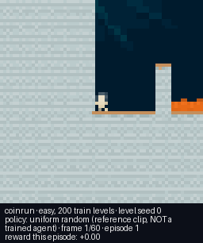
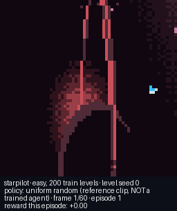
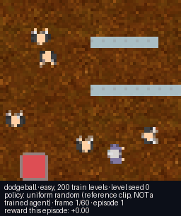
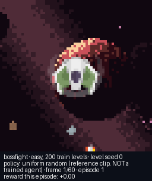
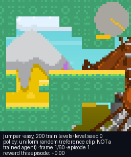
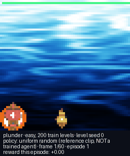
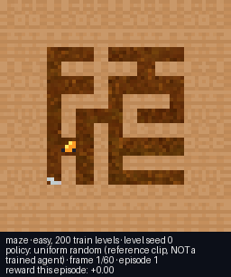
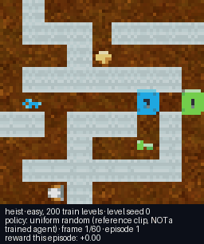
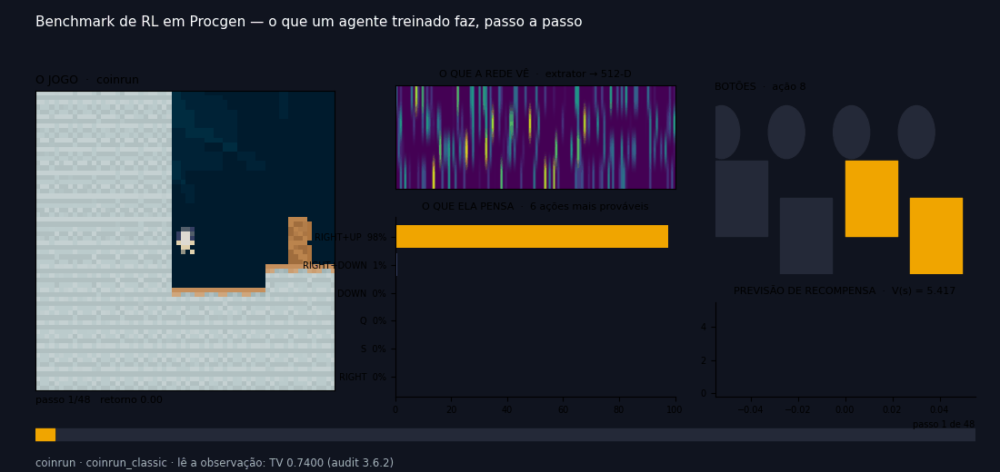

# Systematic Benchmark of Visual Architectures, World Models, and Exploration in Procgen — A Study with 5 Seeds, 5 Games, and 100k Steps

**Python 3.10.11 + Procgen 0.10.7 + Stable-Baselines3 2.9.0 + PyTorch 2.5.1+cu121 (RTX 4070) — `py -3.10` (Python 3.10.11)**

> **Abstract.** Systematic evaluation of **16 architectures** across **6 families** (`CNN` vs `Attention` vs `World Models` vs `Augment` vs `New Archs` vs `Exploration`) with **5 seeds** (`42-46`), **5 games** (`bossfight`, `starpilot`, `dodgeball`, `maze`, `heist` + `coinrun` control), and **two difficulty settings** (`easy 200` / `hard 200` / `eval 0`) in `Procgen` (`~300 FPS` on `cuda`, `50k` in `~3 min`). All experiments use `frame_stack=1` (`3×64×64` `CHW` `uint8`), `PPO` (`lr 3e-4`, `n_steps 256`, `batch 64`, `n_epochs 3`, `γ 0.99`, `λ 0.95`, `clip 0.2`), and `tensorboard` for training monitoring. Evaluation initially used `10 episodes` and was systematically hardened throughout the study up to the definitive protocol: **`100 eps` stochastic + deterministic on unseen levels (`seed+1000`)** — sections 3.10→3.12.

### The games this study runs on

Eight Procgen games appear anywhere in this document. Each clip below is **60 frames of a uniform
random policy** on the same `easy` / 200-training-level distribution the benchmark trains on, and
the label is burned into every frame — a clip that only names its game in the filename is a claim
nobody can check by watching it. They are here to show what the agent is looking at, not how well
it plays: for `maze`/`heist` a trained-agent clip would be misleading, since §3.6.2 measures those
policies as emitting the same action across five different games — which is why the dashboard
below is deliberately the one arm the audit shows reading its screen. Regenerate with
`py -3.10 record_game_clips.py` (provenance: `results/games/clips_provenance.json`).

| `coinrun` | `starpilot` | `dodgeball` | `bossfight` |
|---|---|---|---|
|  |  |  |  |
| `jumper` | `plunder` | `maze` | `heist` |
|---|---|---|---|
|  |  |  |  |

> The first four are the games of the main 16-architecture comparison; `jumper`/`plunder` carry the
> hierarchical study (§15), `maze`/`heist` the exploration study (§3.6). `caveflyer` appears in the
> temporal/POMDP benchmarks and is not clipped here.

**And one agent, thought by thought.** The clip below is the same game (`coinrun`) with a trained
policy, panel by panel: what it sees (the extractor's 512-D output), what it thinks (its six most
likely actions, with the button combination it actually presses), what it expects to earn (`V(s)`), and the step counter. It is deliberately the **one** arm of this study that §3.6.2 measures as reading its observation (cross-game TV `0.739958`, carried on the clip's own caption
line) — the other arms would render the same clip with a frozen "what it thinks" panel, which is
how the defect was found. `48` steps, return `10.00` (level completed), `V(s)` rising to `9.66`.



> Reproduce: `py -3.10 diagnose_policy_saturation.py --game coinrun --timesteps 100000 --save-model logs_audit/models/coinrun_classic.zip`, then `py -3.10 record_dashboard_video.py --checkpoint logs_audit/models/coinrun_classic.zip --game coinrun --episodes 3 --max-steps 400 --stride 2`.

## 0. The 5 Main Conclusions of the Study

1. **The evaluation protocol dictates conclusions — and `10` episodes are insufficient.** Each protocol upgrade (`10→30→100 eps`, unseen levels with `seed+1000`, dual stochastic+deterministic evaluation) reshuffled rankings: the global leader dropped (`spatial 1.54 → 1.35`), `ICM` lost its lead in `maze`/`heist` observed at `30 eps` (spurious variance), and `vit` collapsed in `dodgeball`. An enduring lesson: in `Procgen`, rankings evaluated with `<100` episodes are unreliable (sections 3.10–3.12).
2. **There is no return winner — the architecture result is the response scorecard (§0.1).** The study's original answer was a return ranking (§3.7/§3.12: `mlp_vector 1.43` ≈ `resnet18 1.34` ≈ `spatial 1.28` ≈ `lstm_attention 1.26` ≈ `aug_crop 1.25`, statistically indistinguishable, with `mlp_vector` the one arm at the top across every evaluation protocol); the evidence that follows retires it. **Validity (11/10/2026):** the comparison was re-run arm by arm on each of its three games with the response measure attached (`48` cells: `16` arms `×` `bossfight`/`starpilot`/`dodgeball`), and **every one of the `47` that finished emits one argmax for five different games** (§3.6.2) — so this ranking is **unverified as an architecture result**: a policy that does not read the observation cannot score differently from another one because of its visual front end. The audit carries its own positive control (`classic` on `coinrun`, cross-game TV `0.740`), and that control produced the study's starkest single number: `vit` on `coinrun` scores `6.00` with TV $3\times10^{-6}$, so a high return is not evidence of a visual policy. §3.6.7 closes the question: the grid re-run under the recipe that keeps policies responsive **reshuffles the table** — the archived top-3 falls to 12th–14th — **and still ranks the non-reading arms at the top**: `vit` `1.907` and `impoola` `1.707` respond on only `1/15` and `3/15` cells, while `mlp_vector`, the named consistent leader, falls to 7th and third-least responsive. At this budget, return is not a measure of the visual front end under either recipe; the response measure is — and by it the front ends do differ, verifiably (`cbam`/`classic`/`spatial`/`c_aug_color` read on 15/15 cells; `vit`/`impoola`/`mlp_vector` on 1–3; the full scorecard is §0.1). §3.6.3 puts the failure on a timeline and narrows what it can be: `LayerNorm` collapses 74k steps before it ever saturates, giving the policy three frames of motion multiplies its response up to $15\times$ and still conditions on nothing, and the blind `maze` policy loses to uniform random (44% of levels completed by random, ~26% by the arms) — so it is neither the extractor's scale nor an uninformative input nor an optimum the policy settled into. §3.6.4 names it: **the single-stream rollout**. The same `maze` recipe re-trained with `n_envs=16` — per-update batch held at the published `256`, same seed, extractor, budget and probe set — never loses the response (**101/101** dense probes alive, against **21/101** for the published single-stream arm, which dies at step 9500), and the `16×256` variant ends as the first `maze` policy in the study to answer two different games with two different actions. §3.6.5 replicates this across five seeds (`0/5` vs `5/5` ending responsive) and pulls the remaining mechanisms as levers: repeating frames 4× leaves the policy blind on four of five seeds and pressing the entropy bonus on all five (the marginal held entropic throughout), while quadrupling the stream length at one env keeps all five responsive — the operative quantity is what one *update* sees, not what one step sees. That quantity has a **cliff**: one to three distinct levels per update save nothing (`0/15` seeds), the cliff sits between three and four, and four times the transitions substitute at one stream (`5/5`). §3.6.6's pilot — the 16 architectures on `starpilot` under `16×256` — confirms the rescue generalizes across front ends: 13/16 respond, returns spread `1.00–6.40`, and the published ordering **inverts** (the old bottom four average `4.58` responsive against the old top four's `1.70`; `classic` `0.50 → 5.20`), with two warnings the pilot adds: `mlp_vector`, the ranking's named leader, is the one arm the fix does not rescue, and `vit` posts the top return while barely reading the screen — a high return is still not evidence of a visual policy. Of the blindnesses behind the non-readers, `mlp_vector`'s was a preprocessing bug (raw `uint8` input; `obs/255` rescues it on every seed, §3.6.12) while `vit`'s is an architecture-level property at this budget (§3.6.10–§3.6.11). The ten-minute narrative is [REPORT.md](REPORT.md).
3. **World Models and exploration: contextual conclusions, not universal — and curiosity does not survive the recipe fix.** Under the published recipe WMs underperform only in `bossfight` (`<0.5`) and match standard CNNs in `starpilot`/`dodgeball`; on the response scorecard they sit mid-table (`ae` `13/15`, `vae` `9/14`), with `vae` carrying an unresolved defect (`NaN` mid-training on `bossfight`/seed `42` under both recipes, a `7.2e13` latent on `dodgeball`). The exploration arms were null by scale (the unnormalized bonus injects ~`1e-7` per step, §3.6), and the scaled bonus's apparent win sat on blind policies (§3.6.1–§3.6.2). Re-run at the responsive recipe (`40` cells, §3.6.1 follow-up), the coverage lift alone (`maze +1.62`, `heist +1.34`) exceeds every bonus effect, no comparison survives Bonferroni, and on `heist` the control is the arm that reads most (`4/5` responsive against `0–2/5` for the bonus arms): what remains is a directional reward-shaping effect, not visual curiosity.
4. **More budget does not make return an architecture measure — it deepens the response instead.** Under the published recipe, budget scaling (`100k→250k→500k`, §3.13) left the top configurations' curves flat with a generalization gap `≈0`. Under the responsive recipe (§3.6.8, §3.6.13) the return ranking stays seed noise at every budget — the `100k` champion `vit` was one seed (its `6.4` cell lands at `2.2` at `250k`), and at `500k` on `bossfight` `classic` reads as deeply as `cbam` (TV `0.441471` against `0.439787`) yet scores `0.02` against `1.14`, while `vit` reads nothing and scores `0.64` — whereas the response measure deepens monotonically for every reader (`30/30` cells at `500k`; `cbam` starpilot `0.254 → 0.538 → 0.682`). With `5 seeds`, return differences are on the order of noise: the study reports trends with confidence intervals, not champions (§3.8). Section 21 quantifies the same two facts from the opposite direction: symbolic regression recovers a within-game slope of only $+0.08$ to $+0.12$ return per decade of budget in `bossfight`/`dodgeball`, and the measured return identifies the generating architecture family at 0.133 accuracy against a chance level of 0.111–0.167.
5. **In HRL, the primary driver is temporal abstraction — and learned skills only win when timing matters.** In `jumper`, action-repeat (`skip4`) yields `4×` the return of flat RL, and hierarchy with fixed skills adds nothing further; in `plunder`, only hierarchy with **learned skills** wins (`4.16` vs `3.53`, `+18%`) and yields a deterministically exploitable policy (`det 2.70` vs `≤1.32`). Whether "hierarchy helps" is strictly game-dependent (section 11.1).

### 0.1. The Response Scorecard — the study's architecture result

The tables above rank by *return*; §3.6 established that at this budget return does not measure the visual front end. This is the table that does — every cell a full `16×256` training at the responsive recipe, the score the fraction of its `15` (game × seed) audit cells whose cross-game TV clears `0.1` (data: `results/suite_validity_nenv16_grid.json`, §3.6.7):

| architecture | responsive cells | cross-game TV mean |
|---|---:|---:|
| `cbam` | **15/15** | 0.213354 |
| `classic` | **15/15** | 0.226796 |
| `spatial` | **15/15** | 0.261556 |
| `c_aug_color` | **15/15** | 0.260682 |
| `ae` ≡ `recon` | 13/15 | 0.257341 |
| `contrastive` ≡ `c_aug_noise` | 13/15 | 0.216797 |
| `lstm_attention` | 12/15 | 0.245429 |
| `resnet18` | 11/15 | 0.189925 |
| `c_aug_crop` | 10/15 | 0.128228 |
| `vae` | 9/14 | 0.136637 |
| `impala` | 9/15 | 0.157166 |
| `mlp_vector` | 3/15 | 0.072704 |
| `impoola` | 3/15 | 0.088043 |
| `vit` | 1/15 | 0.024790 |
| `mlp_scaled` † | 7/15 | 0.135081 |

`vae` has 14, not 15 cells: its `bossfight`/seed-42 training diverged to `NaN` (§3.6.7). The cliff between 13/15 and 3/15 is the architecture result this study set out to produce and only obtained once the response measure existed; what the cells' *returns* did under the same recipe is in §3.6.7 — they did not track this table. **The ten-minute narrative of the whole diagnostic arc (§3.6.2–§3.6.12) is [REPORT.md](REPORT.md)** — every number in it gated on the same artifacts as this document.

`mlp_scaled` († added 24/10/2026) is not one of the published sixteen: it is the §3.6.12 input-scale rescue run as a full audit arm — the same `256-D` vector observation as `mlp_vector`, divided by `255` in the wrapper (`procgen_wrapper.ProcgenVectorWrapper(scale=True)`; the raw path stays the factory default so every published cell remains reproducible). At the audit's own protocol it more than doubles the arm's responsive cells (`7/15` against the raw arm's `3/15`, TV mean `0.135081` against `0.072704`) with the birth saturation gone (first `Tanh` `2–28%` on every cell, against `91–98%` at birth for the raw arm) — and it carries the arc's one caveat: on `dodgeball` it reads *within* the game but stays below the cross-game threshold on all five seeds (`0/5`), the §3.6.10 within-game-reader pattern. Data: `results/suite_validity_nenv16_mlp_scaled.json` (`summarize_mlpscaled_grid.py --check` gated; §3.6.12).

---

## Documentation Map

The study is long; this page carries its conclusions, scorecard, methodology and reproduction steps. Everything else lives in [`docs/`](docs/), one page per arc. Section numbers are unchanged, so a `§x.y` reference anywhere (code comments, tests, [REPORT.md](REPORT.md)) names the same section it always did.

| Page | Sections | What it holds |
|---|---|---|
| [REPORT.md](REPORT.md) | — | The ten-minute narrative of the diagnostic arc |
| [docs/diagnostic-arc.md](docs/diagnostic-arc.md) | §3.6–§3.6.13 | Exploration arms, the blindness of the trained policies, its cause, the grid re-run, the anatomy, the budget tests |
| [docs/results-archive.md](docs/results-archive.md) | §2, §3.1–§3.5, §3.7–§3.14, §7 | The executed benchmarks and their return tables (published recipe — provenance, not architecture results) |
| [docs/figures.md](docs/figures.md) | §4, §8 | Figures and videos |
| [docs/offline-rl-and-roadmap.md](docs/offline-rl-and-roadmap.md) | §6 | Offline RL benchmark and the twelve-item instrumentation roadmap |
| [docs/independent-benchmarks.md](docs/independent-benchmarks.md) | §11–§12 | HRL vs flat RL; value-based vs policy-based |
| [docs/jax-port.md](docs/jax-port.md) | §13–§16 | The JAX port: scope, trajectory, parity, full grid, MARL and temporal results |
| [docs/marl-and-rliable.md](docs/marl-and-rliable.md) | §17–§18 | MARL buffer alignment; RLiable protocol and normalization |
| [docs/verification.md](docs/verification.md) | §19–§20 | Test suites; legacy continuous-control prototypes |
| [docs/symbolic-regression.md](docs/symbolic-regression.md) | §21 | Symbolic regression as system identification |

## 1. Methodology

### 1.1. Environments
- **Wrapper** `procgen_wrapper.py:6` `ProcgenGymWrapper(gymn.Env)` — converts `gym 0.26.2` legacy API (`obs, done`) → `gymnasium 1.3.0` (`obs, terminated, truncated`), `HWC 64×64×3 → CHW 3×64×64` (`np.transpose`), `Discrete(15)` (`bossfight`, `starpilot`, `dodgeball`, `coinrun`). Vision-free variant `procgen_wrapper.py:55` `ProcgenVectorWrapper` (`16×16` `grayscale` → `256D` `MLP`) for control comparison: `same game with/without computer vision`.
- **Factory** `procgen_wrapper.py:85` `make_procgen_env(game, num_levels, distribution_mode, rand_seed, frame_stack, vector)` — `gym.make(f'procgen:procgen-{game}-v0', num_levels, distribution_mode, rand_seed)`.
- **Training:** `num_levels=200`, `distribution_mode='easy'` (`Procgen` standard); **Eval:** `num_levels=0` (`unlimited`, never-before-seen levels) with `seed+1000` — measures generalization.
- **No Frame Stacking:** `frame_stack=1`, `Box(3,64,64)` `uint8` across all benchmarks (`procgen_wrapper.py:21`). `frame_stack=4` (`12×64×64`) is supported (`procgen_wrapper.py:19`) but unused; `Imitation-player` uses `128×128×4`.

### 1.2. Architectures
- **Classic CNN** `models/sb3_extractors.py:8` `ClassicCNNExtractor` — `Conv 32 8×8 s4 → 64 4×4 s2 → 64 3×3 s1 → Flatten → FC 512` (`600k` params), auto-detects `HWC/CHW` (`is_hwc`).
- **Attention CNN** `models/sb3_extractors.py:63` `AttentionCNNExtractor(use_cbam)` — `CBAM` (`ChannelAttention` `reduction 16` + `SpatialAttention` `kernel 7`) `models/cnn_attention.py:82` or purely `SpatialAttentionModule` `models/cnn_attention.py:6` (`x * attention_map + x` with **residual** connection `models/cnn_attention.py:37` to stabilize pure `spatial` attention, which collapsed to `0.00` deterministically). `FC 512`.
- **World Models & Auxiliary Visual Representations** `models/world_model_extractors.py:6` — `VAEExtractor(latent 128, KL)` + `dream()` `deconv`, deterministic `AEExtractor` + `dream()`, `ReconExtractor` (`L2` `dec 3×64×64`) + `dream()`, `ContrastiveExtractor` (`InfoNCE` `noise 0.01` + `proj 64`). *Theoretical Note:* In the root SB3 study, these extractors function as **Self-Supervised Auxiliary Visual Representation Learning** heads co-optimized with PPO policy gradients over real environment trajectories. Full **Model-Based Imagination RL** (latent RSSM transition dynamics, latent imagination rollouts, and actor-critic learning inside imagined dynamics) is implemented and benchmarked in `jax_port/dreamer.py` and `jax_port/train_dreamer.py`.
- **Contrastive Augmentations** `compare_augment_contrastive.py:14` `ContrastiveCrop` (`pad 4 + random 64`), `ContrastiveColor` (`brightness 0.8-1.2`), `ContrastiveNoise` (`noise 0.01`).
- **New Architectures** `models/combined_extractors.py` — `ImpalaCNNExtractor` (stack of convolutional `ImpalaBlock` modules), `ImpoolaCNNExtractor` (`GAP 64D`), `LSTMAttentionExtractor` (`CNN + LSTM 256 + attention`), `ViTExtractor` (`64 patches 16×16 + 4-layer Transformer`), `ResNet18Extractor` — all with `FC 512` (`benchmark #6`).
- **Exploration (ICM/RND/NGU)** `compare_maze_heist.py:16` — `ICMWrapper` (intrinsic bonus via forward dynamics prediction error), `RNDWrapper` (random network distillation), `NGUWrapper` (extends `RNDWrapper` with episodic novelty memory, `reward += beta * bonus * episodic`) — evaluated on `maze`/`heist` (`benchmark #7`).

### 1.3. Seeds and Evaluation
- **Training:** `5 seeds` (`42,43,44,45,46`) with fixed `PPO` `seed` + `procgen rand_seed` — `mean±std` across seeds recorded in `statistics.json`.
- **Evaluation:** `10 episodes` `deterministic=False` (stochastic, correcting `spatial` which gave `0.00` deterministic vs `4.00` stochastic in `8k` tests) on `eval 0`.
- **Monitoring:** `tensorboard --logdir logs_*` (`events.out.tfevents.*`).

### 1.4. Why `100k` Steps? Scope of the Low-Data Regime

Standard `Procgen` literature (original paper, `IDAAC`/`PPG`) reports `5M–25M` steps for near-human performance — and data from this study corroborates this: at `100k`, absolute scores remain low (`starpilot ~2.6`, `bossfight ~0.4`, `heist ~0.7`; only `coinrun` saturates early, reaching `8.0` at `50k`). **These two statements do not conflict — they address distinct questions:**

| Regime | Research Question | Typical Budget |
|---|---|---:|
| **Solving** the game | "Can high absolute asymptotic performance be attained?" | `5M–25M` |
| **Comparing inductive biases** (this study) | "Which architecture extracts the most learning per step under a constrained budget?" | `100k` |

`100k` is not a defect — it is the *formal definition of the experimental regime* (low-data regime, as in sample-efficiency and data-augmentation literature): architectural inductive biases manifest early (see the ⚡ `AUC` axis in section 3.9 and the `ICM` trajectory in section 3.10), while computational cost remains tractable (`~10 min/model` on an `RTX 4070 Laptop`; a grid of `115+` models would be prohibitive across millions of steps).

**Honest limitation:** ranking order at `100k` may not persist under larger budgets (a slower architecture with a higher asymptotic ceiling loses here but might win at `25M`). Therefore, conclusions strictly hold for *this* budget, and roadmap item #6 in section 6.1 (scaling `100k→250k→500k` on winners) was designed specifically to test advantage persistence.

---

## 5. How to Reproduce

**Training recipe (since 30/10/2026).** Every Procgen producer (`compare_*.py`) now trains on the responsive recipe by default — `16` parallel envs × `256` steps per update, each env on its own level stream (`seed + rank`), §3.6.7 — and runs the cross-game response guard (`response_guard.py`) after every cell. `--published-recipe` restores the archived `1 × 256` single-stream recipe that produced the tables in [docs/results-archive.md](docs/results-archive.md) (and that §3.6.2 showed trains blind policies); `--n-envs`/`--n-steps` set any other recipe, and `--no-response-guard` skips the guard. A non-published recipe never writes into a published artifact: results files and run directories get a `_nenv16`-style suffix. The commands below reproduce the archived runs, so add `--published-recipe` to match their numbers.

```powershell
# Environment setup (Python 3.10 mandatory for Procgen wheels) — exact pinned versions in requirements.txt
pip install -r requirements.txt

# Or install manually with verified release pins:
py -3.10 -m pip install procgen==0.10.7 stable-baselines3==2.9.0 gymnasium==1.3.0 gym==0.26.2 torch==2.5.1+cu121 opencv-python==4.8.0.74 --extra-index-url https://download.pytorch.org/whl/cu121

# Execute 5-seed benchmarks
py -3.10 -u compare_world_models.py --timesteps 100000 --seeds 42 43 44 45 46 --num_levels 200 --log_dir ./logs_world_models --device cuda
py -3.10 -u compare_procgen.py --game coinrun --timesteps 50000 --seeds 42 43 44 45 46 --num_levels 200 --log_dir ./logs_procgen --device cuda
py -3.10 -u compare_suite.py --games bossfight starpilot dodgeball --timesteps 100000 --seeds 42 43 44 45 46 --log_dir ./logs_suite --device cuda
py -3.10 -u compare_bossfight_hard.py --timesteps 100000 --seeds 42 43 44 45 46 --log_dir ./logs_bossfight_hard --device cuda
py -3.10 -u compare_new_archs.py --timesteps 100000 --seeds 42 43 44 45 46 --games bossfight starpilot dodgeball --log_dir ./logs_new_archs --device cuda
py -3.10 -u compare_maze_heist.py --timesteps 100000 --seeds 42 43 44 45 46 --games maze heist --log_dir ./logs_maze_heist --device cuda
py -3.10 -u compare_combined.py  # Aggregates logs_suite + logs_new_archs into global ranking
py -3.10 -u re_eval_scorecard.py --device cuda  # Re-evaluates 30 eps stoch+det on 115 zips (no retraining)
py -3.10 -u compare_suite_retrain.py --device cuda  # Retrains suite under new protocol (resume-safe)
py -3.10 scorecard_analysis.py  # 95% CI + Cohen's d + AUC -> results/scorecard.json. Requires the logs_new_archs/ and logs_maze_heist/ run directories; without them it exits with an error rather than overwriting the published table with a reduced one (--logs_root / --force to override)
py -3.10 retrain_analysis.py  # Retraining analysis + updated global ranking -> results/retrain_analysis.json
py -3.10 -u re_eval_100.py --device cuda  # Definitive protocol: 100 eps across all 275 zips
py -3.10 eval100_analysis.py  # Comparative analysis 30 vs 100 -> results/eval100_analysis.json
py -3.10 random_baselines.py --episodes 50  # Empirical random anchors on unseen levels -> results/random_baselines.json (section 18.1)
py -3.10 run_rliable_eval.py  # IQM / trimmed mean / stratified bootstrap CIs / profiles -> results/rliable_scorecard.json + rliable_profile.png (section 3.14)
py -3.10 symbolic_regression.py  # system identification over the 825 committed port cells -> results/symbolic_regression.json + 3 figures (section 21)
py -3.10 report_figures.py  # Rebuilds figures 4.1/4.2 from results/legacy_records.json; prints which of the other 11 need a re-run
py -3.10 -m pytest tests -q  # 352 tests: extractors, SB3 integration, bonuses, world models, aggregation, provenance, published-number gates, the response/occlusion/mlp_scaled/exploration artifacts
py -3.10 probe_actions.py  # Action space probing (basis for HRL skills)
py -3.10 audit_suite_validity.py --game starpilot  # All 16 published arms x the cross-game response (section 3.6.2): 1.6M steps, ~2.9 h, ~10 min/arm; resume-safe, writes results/suite_validity_starpilot.json one arm at a time
bash run_suite_validity.sh starpilot bossfight dodgeball  # The same audit over several games: one process per arm (the cffi deadlock note below), 3 workers, then fuses results/suite_validity_<game>.json -- the 48 cells of section 3.6.2 took 8.08 h
py -3.10 -u diagnose_policy_saturation.py --game maze --timesteps 100000 --probe-every 2000 --cross-game --out results/policy_saturation_perlayer_repo.json  # Section 3.6.3 timeline; add --extractor layernorm for the counterfactual, --frame-stack 3 for the input-variance intervention, --save-model <zip> to keep the policy for the dashboard
py -3.10 -u diagnose_policy_saturation.py --game maze --timesteps 50000 --probe-every 500 --n-envs 16 --n-steps 16 --cross-game --out results/policy_saturation_dense_nenv16_nsteps16.json  # Section 3.6.4 dense rollout probe; the other arms are --n-envs 1 --n-steps 256 / --n-envs 4 --n-steps 64 / --n-envs 16 --n-steps 256, and --game coinrun gives the surviving-arm reference (each ~1-2 GPU-minutes)
py -3.10 -u diagnose_policy_saturation.py --game maze --timesteps 50000 --probe-every 500 --n-envs 16 --n-steps 256 --seed 43 --cross-game --out results/policy_saturation_dense_nenv16_nsteps256_seed43.json  # one cell of the 3.6.5 replication (5 arms x seeds 43-46); the mechanism levers are --action-repeat 4 / --n-steps 1024 / --ent-coef 0.01, each at --n-envs 1, seeds 42+43
py -3.10 -u diagnose_policy_saturation.py --game maze --timesteps 50000 --probe-every 500 --n-envs 2 --n-steps 128 --seed 42 --cross-game --out results/policy_saturation_dense_nenv2_nsteps128_seed42.json  # one cell of the (iv) dose (section 3.6.5, seeds 42-46); the other arm is --n-envs 8 --n-steps 32 --out results/policy_saturation_dense_nenv8_nsteps32_seed42.json
py -3.10 summarize_dense_multiseed.py  # folds the dense-probe runs (7 arms x 5 seeds + 3 levers x 2) into results/policy_saturation_dense_multiseed.json (sections 3.6.5); --check re-verifies the fold against the per-run files
py -3.10 -u audit_suite_validity.py --game starpilot --n-envs 16 --n-steps 256 --configs classic --out logs_audit/shards_nenv16/sh-classic.json  # one cell of the 3.6.6 pilot (one arm per process -- the cffi deadlock note); the 16 shards are fused by --merge "logs_audit/shards_nenv16/sh-*.json" --out results/suite_validity_starpilot_nenv16.json, and the producers' train_one gained n_envs/n_steps (defaults were the published 1x256 until 30/10/2026; since then 16x256 -- this audit passes its recipe explicitly)
py -3.10 run_grid_nenv16.py --workers 6  # the full 240-cell re-run of section 3.6.7 (16 arms x 3 games x seeds 42-46 at 16x256): resume-safe, one process per cell (concurrent processes must not share a JSON -- a violation cost two rows once), holds keep-awake, --status shows progress
py -3.10 run_grid_nenv16.py --workers 4 --arms mlp_scaled --shards logs_audit/shards_mlpscaled  # the 3.6.12 input-scale rescue as a full audit arm (15 cells, ~24 min); merge each game's shards with audit_suite_validity.py --merge ... --key-by-seed, then:
py -3.10 summarize_mlpscaled_grid.py  # folds the three fusions into results/suite_validity_nenv16_mlp_scaled.json (3.6.12 follow-up, section 0.1 row); --check re-verifies
py -3.10 -u compare_maze_heist.py --normalize --n-envs 16 --eval_eps 100 --log_dir logs_maze_heist_norm16  # the 3.6.1 follow-up: the scaled-bonus arms AND a fresh ppo control at the responsive recipe (40 cells, ~40 GPU-h summed; split across processes with --arms/--seeds)
py -3.10 summarize_exploration_nenv16.py  # folds the nenv16 run dirs into results/exploration_nenv16.json (3.6.1 follow-up, roadmap item 8)
py -3.10 audit_suite_validity.py --merge "logs_audit/shards_nenv16_grid/sh-starpilot-s*-*.json" --key-by-seed --out results/suite_validity_nenv16_starpilot.json  # one of the three per-game fusions (bossfight/dodgeball identical), then:
py -3.10 summarize_grid_nenv16.py  # folds the three fusions into results/suite_validity_nenv16_grid.json (section 3.6.7); --check re-verifies the fold against them
py -3.10 run_grid_nenv16.py --workers 4 --timesteps 250000 --games starpilot dodgeball --arms classic cbam vit mlp_vector --shards logs_audit/shards_nenv16_250k  # the 3.6.8 budget sweep: 40 cells paired with the 100k grid; merge each game's shards with --key-by-seed, then:
py -3.10 summarize_budget_nenv16.py  # folds the 250k sweep against the 100k grid into results/suite_validity_nenv16_budget250k.json (section 3.6.8); --check re-verifies
py -3.10 run_grid_nenv16.py --workers 6 --timesteps 500000 --games starpilot dodgeball bossfight --arms classic cbam vit mlp_vector --shards logs_audit/shards_nenv16_500k  # the 3.6.13 sweep (60 cells, ~23 GPU-hours summed); merge each game's shards with --key-by-seed, then:
py -3.10 summarize_budget500k.py  # folds the 500k sweep against the 100k grid and the 250k artifact into results/suite_validity_nenv16_budget500k.json (section 3.6.13); --check re-verifies
py -3.10 -u diagnose_policy_saturation.py --game bossfight --timesteps 100000 --probe-every 500 --n-envs 16 --n-steps 256 --arch vit --cross-game --out results/probe_nonreaders_vit_bossfight.json  # one curve of section 3.6.9; the other probes are --arch {classic,mlp,impoola} x {bossfight,dodgeball,starpilot}, ~1.5 GPU-minutes each
py -3.10 diagnose_feature_vs_actor.py --game bossfight --arch vit  # one cell of section 3.6.10 (feature response vs action response on the same held-out frames); the other six cells are --arch {classic,mlp,impoola} x the named games, ~1-4 GPU-minutes each
py -3.10 -u diagnose_policy_saturation.py --game bossfight --timesteps 100000 --probe-every 500 --n-envs 16 --n-steps 256 --arch vit_ln --cross-game --out results/probe_vitlayernorm_bossfight.json  # the 3.6.11 counterfactual (ViT + LayerNorm at its output); the head levers are the same command with --arch mlp --ent-coef 0.01 / --n-steps 64 on dodgeball
py -3.10 -u diagnose_policy_saturation.py --game bossfight --timesteps 100000 --probe-every 500 --n-envs 16 --n-steps 256 --arch vit --seed 42 --cross-game --save-model results/models/vit_bossfight.zip --out results/models/vit_bossfight_repro.json  # one key-cell checkpoint (the 8 of section 4's provenance table are the same command per cell; each repro.json reproduces the committed probe artifact's final row bitwise, so the zip is the model behind the published number)
py -3.10 report_diagnostics_figures.py  # the five figures of the dense-probe arc (sections 3.6.4-3.6.10), drawn from committed artifacts -- no training, byte-comparable rebuilds
py -3.10 -u diagnose_policy_saturation.py --game dodgeball --timesteps 100000 --probe-every 500 --n-envs 16 --n-steps 256 --arch mlp_scaled --cross-game --out results/probe_mlpscaled_dodgeball.json  # the 3.6.12 input-scale lever (obs/255 on the vector arm); the pooling lever is --arch vit_maxpool on bossfight, and diagnose_feature_vs_actor.py takes the same --arch registry for the anatomy numbers
py -3.10 record_dashboard_video.py --checkpoint logs_audit/models/coinrun_classic.zip --game coinrun --episodes 3 --max-steps 400 --stride 2  # The panel-by-panel clip at the top; refuses an arm with no audit row unless --allow-unaudited is passed
py -3.10 -u compare_hrl.py --device cuda  # Independent benchmark: HRL vs Flat RL (jumper/plunder)
py -3.10 -u compare_hrl_learned.py --device cuda  # hrl_learned arm (RUN AFTER compare_hrl.py: both write to results/hrl_results.json)
py -3.10 hrl_analysis.py  # Analysis of 4 HRL arms -> results/hrl_analysis.json
py -3.10 -u compare_budget_scaling.py --device cuda  # Budget scaling 250k/500k (resume-safe)
py -3.10 budget_analysis.py  # Curves 100k->250k->500k -> results/budget_analysis.json
py -3.10 -u compare_algo_families.py --device cuda  # Value vs policy-based (section 12; requires sb3-contrib)
py -3.10 algo_analysis.py  # Analysis per family/algorithm -> results/algo_families_analysis.json
py -3.10 -u lr_sensitivity.py --device cuda  # Learning rate sensitivity test for value-based algorithms (section 12.2)
```

**`cuda` Runtime Estimates:** `coinrun 50k` `5×50k` `~35 min`; `bossfight 100k` `5×100k` `~67 min`; `suite 100k` `3 games × 11 × 5 × 100k` `16.5M steps` `~15h` (`20:41→04:47`); `bossfight hard` `~2.5h`; `new archs 100k` `3 games × 5 × 5 × 100k` `7.5M steps` `~12h` (`13:45→01:39`); `maze+heist 100k` `2 games × 4 × 5 × 100k` `4M steps` `~6.5h` (`01:48→08:23`); `combined` immediate; `re-eval 115 zips` `~70 min`; `suite retrain 165 models` `~28h` (`bossfight ~10 min/model`, `dodgeball ~3 min/model`); `re-eval 100 eps 275 zips` `~5h`.

**Long-lived grid processes can deadlock in `cffi`.** Measured on this audit's first full run (11/10/2026): two of three shards stopped making progress mid-grid at 0% CPU, `py-spy dump` showing `gym3\libenv.py::__del__ → close → cffi api.make_accessor` — a `Libenv` finalizer firing while the main thread already holds cffi's accessor-construction lock. Each `train_one` builds ~7 Procgen envs (`1` train + `1` eval + `5` cross-game probes), so a `165`-cell grid in one process is `~1200` env creations and `~20` per shard arm. `audit_suite_validity.run_arm` now forces a `gc.collect()` at every arm boundary, and shards of one arm are the safe shape; nothing was lost beyond the two in-flight cells, because the audit writes each finished cell before starting the next.

**Continuous integration:** `.github/workflows/tests.yml` runs on every push to `main` and on pull requests — one job installs the CPU build of the study stack and runs, in order, a `compileall` syntax gate over every module in the repository, `python report_figures.py --check` (every figure this README embeds must exist and must have a producer recorded in the section 4 table), and `python -m pytest tests -q`; a second job installs JAX/Flax/Optax on CPU and runs `python -m jax_port.tests.run_tests`, whose cases report SKIP when an environment-only dependency (procgen, jaxmarl) is absent but fail the build on any assertion error. Neither job retrains anything: they protect the analysis, extractor and documentation-integrity code, not the benchmark numbers.

---

## 9. Hardware and Limitations

- **Hardware:** `NVIDIA GeForce RTX 4070 Laptop`, driver `556.29`, `CUDA 12.5`, `WDDM`, `8 GB VRAM`, `58°C`, `~30%` `GPU-Util` during `PPO` execution on `cuda` (`nvidia-smi` sampled at `20:41`), `Python 3.10.11`, `torch 2.5.1+cu121`, `gym 0.26.2`, `gymnasium 1.3.0`, `stable-baselines3 2.9.0`.
- **Limitations (revised 30/10/2026):**
  - **The archived return tables are not architecture results.** Every table produced by the published single-stream recipe (§3.3–§3.13, §7) comes from policies that do not condition on the observation (§3.6.2). They are kept for provenance; the architecture result is the response scorecard (§0.1), and return does not track the front end under the responsive recipe either (§3.6.7).
  - **Budget.** At most `500k` steps, and the widest within-game span is under one decade (§21.7). The response conclusion holds at `100k`, `250k` and `500k` (§3.6.13); nothing here speaks to `25M`-step asymptotes.
  - **Seeds.** `5` seeds per cell: return differences between configurations are on the order of noise (§3.8).
  - **Distinct front ends.** `ae` ≡ `recon` and `contrastive` ≡ `c_aug_noise` are the same networks, so the "16 architectures" are `14` distinct front ends (§3.6.7).
  - **Open defects.** `vae` diverges to `NaN` on `bossfight`/seed `42` under both recipes and reaches a `7.2e13` latent on `dodgeball` (§3.6.2); `vit`'s frontal collapse resists every single-stage fix tried (§3.6.11).
  - **Runtime.** `ViT` is `~4×` slower than standard CNNs (`~4.6 min/run` in `bossfight`, `16-25 min/run` in `starpilot`); earlier estimates of `~15×` (`Imitation-player:171`) stemmed from imitation-learning loss computation rather than `PPO` rollouts.

## 10. References

- `Procgen` (`Cobbe et al.`), `DreamerV3` (`Hafner et al.`, `SheepRL`), `CURL`/`SPR` (`mario-ds:121`), `CBAM` (`Woo et al.`), `PPO` (`Schulman et al.`), `Stable-Baselines3`, `Imitation-player` `compare_models.py` `Nature 3.48` vs `ResNet 2.90`.

---
