# Systematic Benchmark of Visual Architectures, World Models, and Exploration in Procgen — A Study with 5 Seeds, 5 Games, and 100k Steps

**Python 3.10.11 + Procgen 0.10.7 + Stable-Baselines3 2.9.0 + PyTorch 2.5.1+cu121 (RTX 4070) — `py -3.10` (Python 3.10.11)**

> **Abstract.** Systematic evaluation of **16 architectures** across **6 families** (`CNN` vs `Attention` vs `World Models` vs `Augment` vs `New Archs` vs `Exploration`) with **5 seeds** (`42-46`), **5 games** (`bossfight`, `starpilot`, `dodgeball`, `maze`, `heist` + `coinrun` control), and **two difficulty settings** (`easy 200` / `hard 200` / `eval 0`) in `Procgen` (`~300 FPS` on `cuda`, `50k` in `~3 min`). All experiments use `frame_stack=1` (`3×64×64` `CHW` `uint8`), `PPO` (`lr 3e-4`, `n_steps 256`, `batch 64`, `n_epochs 3`, `γ 0.99`, `λ 0.95`, `clip 0.2`), and `tensorboard` for training monitoring. Evaluation initially used `10 episodes` and was systematically hardened throughout the study up to the definitive protocol: **`100 eps` stochastic + deterministic on unseen levels (`seed+1000`)** — sections 3.10→3.12.

### The games this study runs on

Eight Procgen games appear anywhere in this document. Each clip below is **60 frames of a uniform
random policy** on the same `easy` / 200-training-level distribution the benchmark trains on, and
the label is burned into every frame — a clip that only names its game in the filename is a claim
nobody can check by watching it. They are here to show what the agent is looking at, not how well
it plays: for `maze`/`heist` a trained-agent clip would be misleading, since §3.6.2 measures those
policies as emitting the same action across five different games — which is why the dashboard
below is deliberately the one arm the audit shows reading its screen. Regenerate with
`py -3.10 record_game_clips.py` (provenance: `results/games/clips_provenance.json`).

| `coinrun` | `starpilot` | `dodgeball` | `bossfight` |
|---|---|---|---|
| 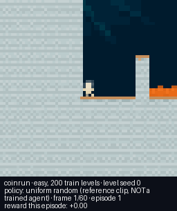 | 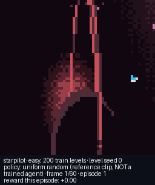 | 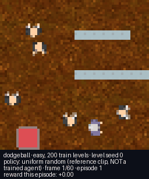 | 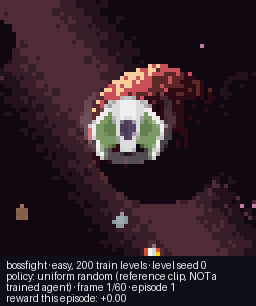 |
| `jumper` | `plunder` | `maze` | `heist` |
|---|---|---|---|
| 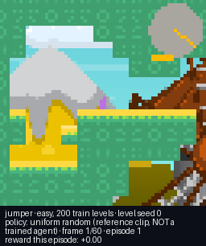 | 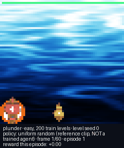 | 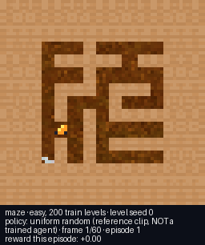 | 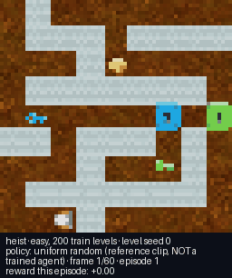 |

> The first four are the games of the main 16-architecture comparison; `jumper`/`plunder` carry the
> hierarchical study (§15), `maze`/`heist` the exploration study (§3.6). `caveflyer` appears in the
> temporal/POMDP benchmarks and is not clipped here.

**And one agent, thought by thought.** The clip below is the same game (`coinrun`) with a trained
policy, panel by panel: what it sees (the extractor's 512-D output), what it thinks (its six most
likely actions, with the button combination it actually presses), what it expects to earn (`V(s)`), and the step counter. It is deliberately the **one** arm of this study that §3.6.2 measures as reading its observation (cross-game TV `0.739958`, carried on the clip's own caption
line) — the other arms would render the same clip with a frozen "what it thinks" panel, which is
how the defect was found. `48` steps, return `10.00` (level completed), `V(s)` rising to `9.66`.

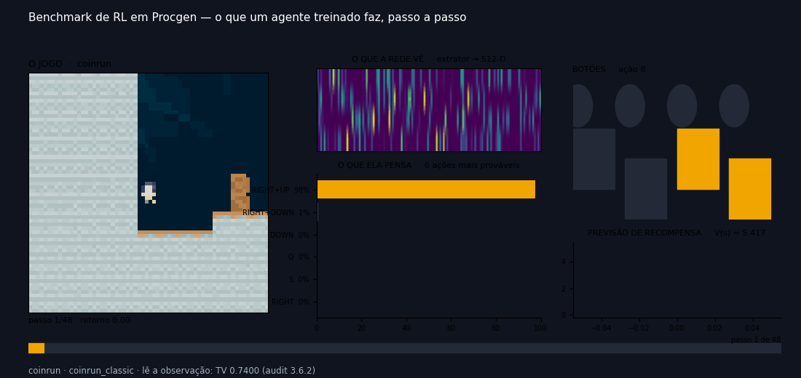

> Reproduce: `py -3.10 diagnose_policy_saturation.py --game coinrun --timesteps 100000 --save-model logs_audit/models/coinrun_classic.zip`, then `py -3.10 record_dashboard_video.py --checkpoint logs_audit/models/coinrun_classic.zip --game coinrun --episodes 3 --max-steps 400 --stride 2`.

## 0. The 5 Main Conclusions of the Study

1. **The evaluation protocol dictates conclusions — and `10` episodes are insufficient.** Each protocol upgrade (`10→30→100 eps`, unseen levels with `seed+1000`, dual stochastic+deterministic evaluation) reshuffled rankings: the global leader dropped (`spatial 1.54 → 1.35`), `ICM` lost its lead in `maze`/`heist` observed at `30 eps` (spurious variance), and `vit` collapsed in `dodgeball`. An enduring lesson: in `Procgen`, rankings evaluated with `<100` episodes are unreliable (sections 3.10–3.12).
2. **There is no absolute winner — there is a consistent leader: `mlp_vector`.** Under the definitive protocol, the global top-5 is statistically indistinguishable (`mlp_vector 1.43` ≈ `resnet18 1.34` ≈ `spatial 1.28` ≈ `lstm_attention 1.26` ≈ `aug_crop 1.25`), but only `mlp_vector` (MLP over `16×16` grayscale, `256D`) remained at the top across **all** protocols (`1.25@10 → 1.36@30 → 1.43@100`) and wins in `starpilot`. Per-game winners: `aug_crop` (`bossfight`), `mlp_vector` (`starpilot`), `resnet18` (`dodgeball`) (section 3.12). **Validity (11/10/2026):** the comparison was re-run arm by arm on each of its three games with the response measure attached (`48` cells: `16` arms `×` `bossfight`/`starpilot`/`dodgeball`), and **every one of the `47` that finished emits one argmax for five different games** (§3.6.2) — so this ranking is **unverified as an architecture result**: a policy that does not read the observation cannot score differently from another one because of its visual front end. The audit carries its own positive control (`classic` on `coinrun`, cross-game TV `0.740`), and that control produced the study's starkest single number: `vit` on `coinrun` scores `6.00` with TV $3\times10^{-6}$, so a high return is not evidence of a visual policy. §3.6.7 closes the question: the grid re-run under the recipe that keeps policies responsive **reshuffles the table** — the archived top-3 falls to 12th–14th — **and still ranks the non-reading arms at the top**: `vit` `1.907` and `impoola` `1.707` respond on only `1/15` and `3/15` cells, while `mlp_vector`, the named consistent leader, falls to 7th and third-least responsive. At this budget, return is not a measure of the visual front end under either recipe; the response measure is — and by it the front ends do differ, verifiably (`cbam`/`classic`/`spatial`/`c_aug_color` read on 15/15 cells; `vit`/`impoola`/`mlp_vector` on 1–3; the full scorecard is §0.1). §3.6.3 puts the failure on a timeline and narrows what it can be: `LayerNorm` collapses 74k steps before it ever saturates, giving the policy three frames of motion multiplies its response up to $15\times$ and still conditions on nothing, and the blind `maze` policy loses to uniform random (44% of levels completed by random, ~26% by the arms) — so it is neither the extractor's scale nor an uninformative input nor an optimum the policy settled into. §3.6.4 names it: **the single-stream rollout**. The same `maze` recipe re-trained with `n_envs=16` — per-update batch held at the published `256`, same seed, extractor, budget and probe set — never loses the response (**101/101** dense probes alive, against **21/101** for the published single-stream arm, which dies at step 9500), and the `16×256` variant ends as the first `maze` policy in the study to answer two different games with two different actions. §3.6.5 replicates this across five seeds (`0/5` vs `5/5` ending responsive) and pulls the remaining mechanisms as levers: repeating frames 4× leaves the policy blind on four of five seeds and pressing the entropy bonus on all five (the marginal held entropic throughout), while quadrupling the stream length at one env keeps all five responsive — the operative quantity is what one *update* sees, not what one step sees. That quantity has a **cliff**: one to three distinct levels per update save nothing (`0/15` seeds), the cliff sits between three and four, and four times the transitions substitute at one stream (`5/5`). §3.6.6's pilot — the 16 architectures on `starpilot` under `16×256` — confirms the rescue generalizes across front ends: 13/16 respond, returns spread `1.00–6.40`, and the published ordering **inverts** (the old bottom four average `4.58` responsive against the old top four's `1.70`; `classic` `0.50 → 5.20`), with two warnings the pilot adds: `mlp_vector`, the ranking's named leader, is the one arm the fix does not rescue, and `vit` posts the top return while barely reading the screen — a high return is still not evidence of a visual policy.
3. **World Models and exploration: contextual conclusions, not universal.** WMs underperform only in `bossfight` (`<0.5`); in `starpilot`/`dodgeball` they match standard CNNs — the initial "WM is weak" claim was an artifact dominated by a single environment. The `maze`/`heist` exploration arms are not usable as an exploration result at all: the unnormalized bonus injects $\sim 10^{-7}$ per step (§3.6), and rescaling it to $O(eta)$ moves every arm off the control (§3.6.1) — but the policies behind both grids **do not condition on the observation** (69/70 checkpoints take the same action across five different Procgen games, §3.6.2), so what the bonus changes is a near-constant action marginal, not curiosity. The mechanism of that collapse is unresolved; the `Tanh`-saturation story was tested and refuted by a LayerNorm counterfactual that collapses the same way (sections 3.6, 3.6.1, 3.6.2, 3.12).
4. **At this budget, architecture matters less than rigorous evaluation — and more budget does not resolve differences.** Budget scaling (`100k→250k→500k`) reveals **stagnant** learning curves for the top two configurations in their respective games: a `5×` budget neither created nor eliminated an advantage, and the generalization gap remained `≈0` (no memorization up to `500k`). With `5 seeds`, differences across configurations are on the order of noise: the study reports **trends with confidence intervals**, not definitive champions (sections 3.8, 3.13). Section 21 quantifies the same two facts from the opposite direction: symbolic regression recovers a within-game slope of only $+0.08$ to $+0.12$ return per decade of budget in `bossfight`/`dodgeball`, and the measured return identifies the generating architecture family at 0.133 accuracy against a chance level of 0.111–0.167.
5. **In HRL, the primary driver is temporal abstraction — and learned skills only win when timing matters.** In `jumper`, action-repeat (`skip4`) yields `4×` the return of flat RL, and hierarchy with fixed skills adds nothing further; in `plunder`, only hierarchy with **learned skills** wins (`4.16` vs `3.53`, `+18%`) and yields a deterministically exploitable policy (`det 2.70` vs `≤1.32`). Whether "hierarchy helps" is strictly game-dependent (section 11.1).

### 0.1. The Response Scorecard — the study's architecture result

The tables above rank by *return*; §3.6 established that at this budget return does not measure the visual front end. This is the table that does — every cell a full `16×256` training at the responsive recipe, the score the fraction of its `15` (game × seed) audit cells whose cross-game TV clears `0.1` (data: `results/suite_validity_nenv16_grid.json`, §3.6.7):

| architecture | responsive cells | cross-game TV mean |
|---|---:|---:|
| `cbam` | **15/15** | 0.213354 |
| `classic` | **15/15** | 0.226796 |
| `spatial` | **15/15** | 0.261556 |
| `c_aug_color` | **15/15** | 0.260682 |
| `ae` ≡ `recon` | 13/15 | 0.257341 |
| `contrastive` ≡ `c_aug_noise` | 13/15 | 0.216797 |
| `lstm_attention` | 12/15 | 0.245429 |
| `resnet18` | 11/15 | 0.189925 |
| `c_aug_crop` | 10/15 | 0.128228 |
| `vae` | 9/14 | 0.136637 |
| `impala` | 9/15 | 0.157166 |
| `mlp_vector` | 3/15 | 0.072704 |
| `impoola` | 3/15 | 0.088043 |
| `vit` | 1/15 | 0.024790 |

`vae` has 14, not 15 cells: its `bossfight`/seed-42 training diverged to `NaN` (§3.6.7). The cliff between 13/15 and 3/15 is the architecture result this study set out to produce and only obtained once the response measure existed; what the cells' *returns* did under the same recipe is in §3.6.7 — they did not track this table. **The ten-minute narrative of the whole diagnostic arc (§3.6.2–§3.6.12) is [REPORT.md](REPORT.md)** — every number in it gated on the same artifacts as this document.

---

## 1. Methodology

### 1.1. Environments
- **Wrapper** `procgen_wrapper.py:6` `ProcgenGymWrapper(gymn.Env)` — converts `gym 0.26.2` legacy API (`obs, done`) → `gymnasium 1.3.0` (`obs, terminated, truncated`), `HWC 64×64×3 → CHW 3×64×64` (`np.transpose`), `Discrete(15)` (`bossfight`, `starpilot`, `dodgeball`, `coinrun`). Vision-free variant `procgen_wrapper.py:55` `ProcgenVectorWrapper` (`16×16` `grayscale` → `256D` `MLP`) for control comparison: `same game with/without computer vision`.
- **Factory** `procgen_wrapper.py:85` `make_procgen_env(game, num_levels, distribution_mode, rand_seed, frame_stack, vector)` — `gym.make(f'procgen:procgen-{game}-v0', num_levels, distribution_mode, rand_seed)`.
- **Training:** `num_levels=200`, `distribution_mode='easy'` (`Procgen` standard); **Eval:** `num_levels=0` (`unlimited`, never-before-seen levels) with `seed+1000` — measures generalization.
- **No Frame Stacking:** `frame_stack=1`, `Box(3,64,64)` `uint8` across all benchmarks (`procgen_wrapper.py:21`). `frame_stack=4` (`12×64×64`) is supported (`procgen_wrapper.py:19`) but unused; `Imitation-player` uses `128×128×4`.

### 1.2. Architectures
- **Classic CNN** `models/sb3_extractors.py:8` `ClassicCNNExtractor` — `Conv 32 8×8 s4 → 64 4×4 s2 → 64 3×3 s1 → Flatten → FC 512` (`600k` params), auto-detects `HWC/CHW` (`is_hwc`).
- **Attention CNN** `models/sb3_extractors.py:63` `AttentionCNNExtractor(use_cbam)` — `CBAM` (`ChannelAttention` `reduction 16` + `SpatialAttention` `kernel 7`) `models/cnn_attention.py:82` or purely `SpatialAttentionModule` `models/cnn_attention.py:6` (`x * attention_map + x` with **residual** connection `models/cnn_attention.py:37` to stabilize pure `spatial` attention, which collapsed to `0.00` deterministically). `FC 512`.
- **World Models & Auxiliary Visual Representations** `models/world_model_extractors.py:6` — `VAEExtractor(latent 128, KL)` + `dream()` `deconv`, deterministic `AEExtractor` + `dream()`, `ReconExtractor` (`L2` `dec 3×64×64`) + `dream()`, `ContrastiveExtractor` (`InfoNCE` `noise 0.01` + `proj 64`). *Theoretical Note:* In the root SB3 study, these extractors function as **Self-Supervised Auxiliary Visual Representation Learning** heads co-optimized with PPO policy gradients over real environment trajectories. Full **Model-Based Imagination RL** (latent RSSM transition dynamics, latent imagination rollouts, and actor-critic learning inside imagined dynamics) is implemented and benchmarked in `jax_port/dreamer.py` and `jax_port/train_dreamer.py`.
- **Contrastive Augmentations** `compare_augment_contrastive.py:14` `ContrastiveCrop` (`pad 4 + random 64`), `ContrastiveColor` (`brightness 0.8-1.2`), `ContrastiveNoise` (`noise 0.01`).
- **New Architectures** `models/combined_extractors.py` — `ImpalaCNNExtractor` (stack of convolutional `ImpalaBlock` modules), `ImpoolaCNNExtractor` (`GAP 64D`), `LSTMAttentionExtractor` (`CNN + LSTM 256 + attention`), `ViTExtractor` (`64 patches 16×16 + 4-layer Transformer`), `ResNet18Extractor` — all with `FC 512` (`benchmark #6`).
- **Exploration (ICM/RND/NGU)** `compare_maze_heist.py:16` — `ICMWrapper` (intrinsic bonus via forward dynamics prediction error), `RNDWrapper` (random network distillation), `NGUWrapper` (extends `RNDWrapper` with episodic novelty memory, `reward += beta * bonus * episodic`) — evaluated on `maze`/`heist` (`benchmark #7`).

### 1.3. Seeds and Evaluation
- **Training:** `5 seeds` (`42,43,44,45,46`) with fixed `PPO` `seed` + `procgen rand_seed` — `mean±std` across seeds recorded in `statistics.json`.
- **Evaluation:** `10 episodes` `deterministic=False` (stochastic, correcting `spatial` which gave `0.00` deterministic vs `4.00` stochastic in `8k` tests) on `eval 0`.
- **Monitoring:** `tensorboard --logdir logs_*` (`events.out.tfevents.*`).

### 1.4. Why `100k` Steps? Scope of the Low-Data Regime

Standard `Procgen` literature (original paper, `IDAAC`/`PPG`) reports `5M–25M` steps for near-human performance — and data from this study corroborates this: at `100k`, absolute scores remain low (`starpilot ~2.6`, `bossfight ~0.4`, `heist ~0.7`; only `coinrun` saturates early, reaching `8.0` at `50k`). **These two statements do not conflict — they address distinct questions:**

| Regime | Research Question | Typical Budget |
|---|---|---:|
| **Solving** the game | "Can high absolute asymptotic performance be attained?" | `5M–25M` |
| **Comparing inductive biases** (this study) | "Which architecture extracts the most learning per step under a constrained budget?" | `100k` |

`100k` is not a defect — it is the *formal definition of the experimental regime* (low-data regime, as in sample-efficiency and data-augmentation literature): architectural inductive biases manifest early (see the ⚡ `AUC` axis in section 3.9 and the `ICM` trajectory in section 3.10), while computational cost remains tractable (`~10 min/model` on an `RTX 4070 Laptop`; a grid of `115+` models would be prohibitive across millions of steps).

**Honest limitation:** ranking order at `100k` may not persist under larger budgets (a slower architecture with a higher asymptotic ceiling loses here but might win at `25M`). Therefore, conclusions strictly hold for *this* budget, and roadmap item #6 in section 6.1 (scaling `100k→250k→500k` on winners) was designed specifically to test advantage persistence.

---

## 2. Executed Benchmarks

| # | Script | Game(s) | Timesteps | Seeds | Configs | Time | Log |
|---|---|---|---|---|---|---|---|
| 1 | `compare_procgen.py` | `coinrun` | `50k` | `5` | `classic/cbam/spatial/mlp_vector` | `~35 min` `5×50k` | `logs_procgen/comparison_coinrun_20260827_204023` |
| 2 | `compare_world_models.py` | `bossfight` | `100k` | `5` | `vae/ae/recon/contrastive` | `~67 min` `5×100k` | `logs_world_models/comparison_bossfight_20260827_193327` |
| 3 | `compare_suite.py` | `bossfight+starpilot+dodgeball` | `100k` | `5` | `4 WM + 4 CNN + 3 Augment = 11` per game | `~8h` `16.5M steps` `20:41→04:47` | `logs_suite/suite_bossfight_starpilot_dodgeball_20260827_204109` |
| 4 | `compare_bossfight_hard.py` | `bossfight hard` | `100k` | `5` | `11` | `~2.5h` `07:21→09:57` | `logs_bossfight_hard/comparison_bossfight_hard_20260828_072148` |
| 5 | `compare_augment_contrastive.py` | `bossfight` | `100k` | `5` | `crop/color/noise` | `~80 min` (embedded in suite) | `logs_suite` `*_aug_*` |
| 6 | `compare_new_archs.py` | `bossfight+starpilot+dodgeball` | `100k` | `5` | `impala/impoola/lstm_attention/vit/resnet18` | `~12h` `13:45→01:39` `7.5M` | `logs_new_archs/new_archs_bossfight_starpilot_dodgeball_20260828_134545` |
| 7 | `compare_maze_heist.py` | `maze+heist` | `100k` | `5` | `ppo/icm/rnd/ngu` | `~6.5h` `01:48→08:23` `4M` | `logs_maze_heist/maze_heist_maze_heist_20260829_014802` |
| 8 | `compare_combined.py` | `suite+new_archs` aggregation | — | — | global ranking of `16 architectures` | immediate (no training) | `results/global_16.png` |
| 9 | `re_eval_scorecard.py` | re-eval of `new_archs+maze_heist` | — | — | `115 zips` × `30 eps` stoch+det + gap | `~70 min` (no training) | `results/re_eval_results.json` |
| 10 | `compare_suite_retrain.py` | `bossfight+starpilot+dodgeball` | `100k` | `5` | suite retrain (`11 configs`, new protocol) | `~28h` `30/08→31/08` `16.5M` | `logs_suite_retrain/suite_retrain_zips` + `results/retrain_results.json` |
| 11 | `re_eval_100.py` | definitive re-eval of `275 zips` | — | — | `100 eps` stoch+det + gap (no retrain) | `~5h` `31/08` | `results/eval100_results.json` |
| 12 | `compare_hrl.py` *(independent)* | `jumper+plunder` | `100k frames` | `5` | `flat` vs `skip4` vs `hrl` (section 11) | `~6-12h` `31/08` | `logs_hrl/hrl_zips` + `results/hrl_results.json` |
| 13 | `compare_hrl_learned.py` *(independent)* | `jumper+plunder` | `100k frames` | `5` | `hrl_learned` arm (latent skills, section 11) | `~4-8h`, sequential to #12 | idem (`*_hrl_learned_*`, `.pt`) |
| 14 | `compare_algo_families.py` *(independent)* | `starpilot+dodgeball+bossfight` | `100k` | `5` | `ppo`/`a2c` (policy) vs `dqn`/`qrdqn` (value), section 12 | `~9h` `01/09→02/09` | `logs_algo/algo_zips` + `results/algo_families_results.json` |

---

## 3. Official Results (5 Seeds, 10 Eps Eval)

### 3.1. Coinrun 50k — CNN vs MLP (Same Game With/Without CV)
`logs_procgen/comparison_coinrun_20260827_204023/statistics.json:1`
| Config | Mean | Std | Min | Max |
|---|---:|---:|---:|---:|
| `classic_pixels` | **7.6** | 1.2 | 6.0 | 9.0 |
| `attention_cbam_pixels` | **8.0** | 0.0 | 8.0 | 8.0 |
| `attention_spatial_pixels` | 6.2 | 3.31 | 0.0 | 9.0 |
| `mlp_vector` (`16×16` `256D` without CV) | **8.0** | 0.89 | 7.0 | 9.0 |
> **Analysis:** Stable `CBAM 8.0` outperforms `classic 7.6`; `MLP 8.0` matches the best `CNN` — `coinrun easy 200` is purely reactive and does not require complex spatial vision (`downsample 256D` suffices). Pure `Spatial` attention proved unstable (`0.0` on 1 seed) without a residual connection.

### 3.2. Bossfight 100k — World Models
`logs_world_models/comparison_bossfight_20260827_193327/statistics.json:1`
| Config | Mean | Std |
|---|---:|---:|
| `vae` | 0.16 | 0.16 |
| `ae` | 0.30 | 0.50 |
| `recon` | 0.02 | 0.04 |
| `contrastive` | **0.36** | 0.62 |
> `contrastive` performs best, but all remain `<0.5` — `bossfight 100k` is insufficient when trained standalone.
>
> ⚠️ **Methodological & Architectural Clarification (Gradient Flow & Auxiliary Pretext Objectives):**
> In the root PyTorch / SB3 benchmark (`compare_world_models.py`), the modules in `models/world_model_extractors.py` served as custom `BaseFeaturesExtractor` architectures within standard Stable-Baselines3 PPO. During `model.learn()`, SB3 backpropagates gradients exclusively from the PPO policy and value heads through `forward()`. Because no custom policy was attached to compute auxiliary reconstruction loss (MSE) or KL divergence during the backward pass, **the decoders (`fc_dec`, `deconv1-3`, and `dream()`) never received gradients and remained at random initialization**. Consequently, the scores above reflect the inductive bias of an information/sampling bottleneck in the visual encoder rather than learned generative world modeling. Fully end-to-end recurrent dynamics modeling, latent imagination rollouts, and active reconstruction gradients are implemented in `jax_port/train_dreamer.py`.

### 3.3. Suite 100k — 3 Games (11 Configs/Game)
`logs_suite/suite_bossfight_starpilot_dodgeball_20260827_204109/suite_statistics.json:1`
| Game | Best | Mean | 2nd | Worst |
|---|---|---:|---|---|
| `bossfight` (`~0.5`) | `spatial 0.76±0.90` | `cbam 0.58`, `classic 0.54` | `contrastive 0.36` | `recon 0.02` |
| `starpilot` (`~2.0`) | `spatial 2.6±0.82` | `aug_crop 2.12±0.79`, `cbam 2.1`, `ae 2.08` | `color 1.94`, `noise 1.61` | — |
| `dodgeball` (`~1.2`) | `classic 1.48±0.69` | `cbam 1.31`, `spatial 1.28` | `vae 1.2` | `recon 0.88` |
> **Augment:** `crop` outperforms `color`/`noise` in `starpilot` (`+31%`) and `dodgeball`; `color` takes second in `bossfight`. **Overall:** `classic` wins `dodgeball`, `spatial` wins `starpilot` — **rankings invert across games**; a single game introduces significant inductive bias (the `Procgen` standard is `16` games; `3` is the bare minimum).

### 3.4. Bossfight HARD 100k — Stress Test
`logs_bossfight_hard/comparison_bossfight_hard_20260828_072148/statistics.json:1`
| Config | Mean | Std |
|---|---:|---:|
| `vae` | **0.43±0.54** | `ae 0.38`, `aug_crop 0.32`, `mlp 0.26` |
| `cnn` | `0.02±0.04` (`classic/cbam/spatial` collapse to zero) |
> `hard` compresses all returns to `0.0-0.4` (compared to `0.5-0.76` in `easy`); `CNN` collapses in `100k` — `hard` would require `200k` (`~6h`) and does not warrant a full `suite hard`; `easy` constitutes a fairer benchmark.

### 3.5. New Archs 100k — 5 New Architectures × 3 Games
`logs_new_archs/new_archs_bossfight_starpilot_dodgeball_20260828_134545/statistics.json:1`
| Game | Best | Mean | 2nd | Worst |
|---|---|---:|---|---|
| `bossfight` | `lstm 0.36±0.57` | `vit 0.30`, `impala 0.28` | `resnet 0.02` | `impoola 0.06` |
| `starpilot` | `lstm 2.44±0.56` | `resnet 2.28`, `impoola 2.2` | `vit 2.1`, `impala 1.78` | — |
| `dodgeball` | `resnet 1.72±0.65` | `vit 1.2`, `impoola 1.12` | `impala 1.08` | `lstm 0.80` |
> `ViT`/`ResNet` fail to surpass `spatial 2.6` in `starpilot` or `classic 1.48` in `dodgeball`; `lstm` wins `bossfight`/`starpilot` but underperforms in `dodgeball`.

### 3.6. Maze+Heist 100k — PPO vs ICM vs RND vs NGU (Exploration)
`results/exploration_remeasure.json` (re-measured 24/09/2026, 40 models across seeds 42-46)
| Game | `ppo` | `icm` | `rnd` | `ngu` |
|---|---:|---:|---:|---:|
| `maze` (10 eps) | 1.80±0.84 | 2.20±1.92 | **2.40±2.61** | 2.20±2.28 |
| `heist` (10 eps) | 0.80±0.45 | 0.80±0.84 | **1.60±1.14** | 1.20±1.30 |
| `maze` (100 eps) | 2.58 | 2.36 | 2.54 | **2.76** |
| `heist` (100 eps) | 0.72 | 0.60 | **1.04** | 0.80 |

> ✅ **Re-measured Arms (24/09/2026):** The previous `rnd` and `ngu` arms ran with broken linear projections (`nn.Linear(1024, 512)` instead of `2304`) that raised exceptions silently swallowed by `except Exception: pass`, producing identical clones of vanilla PPO. The re-measurement with verified dynamic stem sizing in `models/bonuses.py` recorded active intrinsic reward computation on 100% of steps (100,096/100,096 steps across all runs).
> **Scientific Finding on Bonus Scaling:** In SB3, the raw feature MSE produces an intrinsic reward of $\sim 10^{-5}$, which under default $\beta=0.01$ amounts to an effective bonus of $\sim 1.05 \times 10^{-7}$ per step against the $0/1$ sparse extrinsic reward. Consequently, while `rnd` achieves a modest advantage on `heist` (`1.04` vs `0.72`), exploration bonuses without running variance normalization (Burda et al., 2018) fail to significantly break away from PPO. Note that the uniform random baseline scores `4.40±5.01` on `maze` and `2.80±4.54` on `heist` under 50 episodes (section 18.1), confirming that 100k steps is insufficient for any policy to master deep maze navigation or 3-key heist puzzles.
> **Follow-up (27/09/2026):** this null is a statement about scale, and it is reversible — section 3.6.1 re-trains the same three arms with the bonus rescaled to $O(\beta)$ and every arm then beats this control on stochastic return.

### 3.6.1. Scaled-Bonus Arms (27/09/2026) — the Null Was the Scale; the Reversal Is Not a Curiosity Result
`results/exploration_normalized.json` — 30 new cells (`2 games × 3 bonus arms × 5 seeds × 100k`), trained with `compare_maze_heist.py --normalize` and summarized by `summarize_exploration_normalized.py`.

**What changed, precisely.** The published arms add `beta × raw prediction MSE` to every step, which measures $\sim 10^{-7}$. The scaled arms add `beta × (MSE / trailing-window mean of that MSE)` — divisive reward normalization, chosen because it stays positive, monotone in novelty, and $O(1)$ whatever level the predictor converges to. Two other forms were measured and rejected: dividing by the running *std* alone still injected `5.3e-5` (`ngu`) and `1.1e-4` (`icm`) per step on a live smoke (the error is heavy-tailed, so the std is set by rare spikes and the typical ratio stays far below 1), and the textbook demeaned z-score floored at 0 is *degenerate* for a bonus that decays by design — as the predictor learns, every new error sits below its own running mean, so the injected bonus clipped to `0.0` on all 400 steps of a probe, for all three arms. `beta=0.01`, the optimizer, the env protocol and the seeds are untouched, so the scale is the only variable. `ppo` has no bonus to rescale: its rows are reused from the frozen 24/09 grid and the reuse is declared in `_provenance.control` (both protocols; the 100-ep row carries `reused_from`).

Measured injected magnitude, per cell and stable across seeds to ±2%: `icm` 9.49–9.52e-3, `rnd` 5.92e-3 (`maze`) / 7.84e-3 (`heist`), `ngu` 2.49e-3 / 3.76e-3 per step — four to five orders of magnitude above the published arms — with the per-step max pinned at `beta × clip = 5.0e-2`, i.e. the clip binds and is part of the arm, not an accident.

100 stochastic episodes on unseen levels, $n=5$, Student-t 95% CI, Welch $p$ and Hedges $g$ against the reused control:

| Arm | `maze` mean | 95% CI | $p$ | $g$ | `heist` mean | 95% CI | $p$ | $g$ |
|---|---:|---|---:|---:|---:|---|---:|---:|
| `ppo` (control, reused) | 2.58 | [1.49, 3.67] | — | — | 0.72 | [0.29, 1.15] | — | — |
| `icm` | 4.18 | [3.75, 4.61] | 0.0118 | 2.17 | **3.04** | [2.21, 3.87] | 0.00046 | 3.94 |
| `rnd` | **5.04** | [4.19, 5.89] | 0.0014 | 2.83 | **3.52** | [2.32, 4.72] | 0.0017 | 3.49 |
| `ngu` | 4.18 | [3.16, 5.20] | 0.0179 | 1.70 | **2.84** | [1.79, 3.89] | 0.0029 | 2.97 |

> **Reading (corrected 11/10/2026 — see §3.6.2).** The numbers below were measured and stand as measurements; the interpretation originally written here does not. Every scaled arm beats the control on `heist` and survive a Bonferroni correction over the six comparisons ($\alpha=0.05$ → $p_{adj}\le 0.0174$), and on `maze` only `rnd` does ($p_{adj}=0.0081$; `icm` 0.071, `ngu` 0.107, and `ngu`'s interval overlaps the control's). Effect sizes are large ($g$ 1.70–3.94) with $n=5$. **But these policies do not condition on the observation** (§3.6.2: 69/70 checkpoints pick the same action for five different Procgen games), so what the bonus demonstrably changed is a near-constant action marginal — not curiosity-driven perception. This table is evidence that a live intrinsic reward shifts the marginal; it is not evidence about exploration.
> **Caveat that mattered more than the win, and still holds.** Under deterministic execution the same checkpoints return `maze` 0.00 (`icm`) / 0.70 (`rnd`) / 0.46 (`ngu`) and `heist` 0.14 / 0.26 / 0.20 — the same near-zero band the unnormalized arms and the control occupied (control: 0.22 / 0.08). `gen_gap` (train-level minus unseen-level) is positive for every arm (+0.35 to +1.42).

### 3.6.2. Validity of these arms: the policies barely condition on the observation (11/10/2026)

While building a dashboard-style recording of one of these agents, the first thing worth showing — *what it thinks, frame by frame* — turned out to be constant. That turned a side task into a validity check, and the check fails.

**The test.** Every SB3 maze/heist checkpoint in the tree (70: the 40 of the 24/09 re-measurement and the 30 of §3.6.1, minus shared names) is fed the initial frame of **five different Procgen games** — `maze`, `heist`, `bossfight`, `starpilot`, `dodgeball` — and the action distributions are compared.

| measure | result |
|---|---|
| same argmax action for all five games | **69 / 70 checkpoints** |
| total-variation distance between the five distributions | median `4.83e-4`, min `1.1e-5`, max `0.1159`; only 5/70 above `1e-2` |
| actor's first `Tanh` units saturated ($\|x\|>0.999$) | mean `80.9%` on level-initial frames, `97.2%` on mid-episode frames |
| same measures at **initialization** (untrained, 3 seeds) | `0.0%` saturated, extractor feature max `≈1.8` |
| extractor feature max after training | mean `17.8` (≈10× the initial scale) |

Artifacts: `results/checkpoint_cross_game_response.json`, `results/checkpoint_state_dependence.json`, produced by `diagnose_policy_saturation.py` (curve files `results/policy_saturation_curve_repo100k.json` / `_layernorm100k.json`).

**What was ruled out.** The obvious story is that the un-normalized `ClassicCNNExtractor` output (mean 2.0, max 31 on trained checkpoints) saturates the `Tanh` latent of SB3's `MlpExtractor`, freezing the actor on a constant vector. It is true that this happens — the 100k run reproduces it step by step: `feat_max` 1.8 → 11.1 by 10k → 31.1 by 100k, saturation 0% → 46% → 50% of the latent units. It is **not** the cause: re-training 100k with the same CNN followed by a `LayerNorm` holds the features at `max ≈ 4.5` and saturation at `36%`, and the policy still collapses (cross-game TV `1e-5`, one argmax, entropy down to 0.6 nats). Clamping the scale removes the symptom's magnitude, not the collapse.

**What is not claimed.** No mechanism is established here, and the fix is not known. Two things are consistent with the data and are left as open questions rather than conclusions: the within-episode input barely changes (300 steps of a random walk in `maze` produce 19 distinct frames, mean per-pixel change `0.071/255`), so an input-independent policy is close to optimal for what the rollout contains; and whatever the reason, a PPO run that ends with a near-uniform marginal over 15 actions is not a visual policy, so no arm in §3.6/§3.6.1 is evidence about curiosity.

**Scope: it is not only the exploration arms.** Because the published main-suite checkpoints are not in the tree, the recipe was re-run from scratch — `compare_suite.py`'s exact PPO hyperparameters (`lr 3e-4`, `n_steps 256`, `batch 64`, `n_epochs 3`, `ClassicCNNExtractor(features_dim=512)`), `easy`, 200 training levels, 100k steps, seed 42 — once per game, and cross-checked against five different games at the end (`diagnose_policy_saturation.py --cross-game`, artifacts `results/scope_probe_*.json`):

| game trained | max cross-game TV | 1st `Tanh` saturated | extractor feature max |
|---|---:|---:|---:|
| `coinrun` | **0.740** | 0.0% | 1.5 |
| `dodgeball` | 0.000001 | 90.0% | 20.2 |
| `maze` | 0.000221 | 95.3% | 31.1 |
| `starpilot` | 0.001149 | 100.0% | 110.8 |
| `bossfight` | 0.000000 | 100.0% | 94.9 |

All three main-suite games collapse; `coinrun` does not. Across these five runs the response separates cleanly from the feature scale — the one run whose extractor output stayed at `max 1.5` is the one that reads its input, and the four at `max 20-111` saturate 90-100% of the actor's first `Tanh` and emit one argmax for five different games. That is an association, not yet a mechanism: the `LayerNorm` counterfactual above reduced the saturation (36% averaged over both latent layers) without restoring any response, so scale alone does not explain it either.

**All sixteen arms, at the published budget (11/10/2026).** That was one extractor. `audit_suite_validity.py` re-trains every arm of the headline comparison on `starpilot` and attaches the response measure to each: the training call is imported from the producers (`compare_suite.train_one`, `compare_new_archs.train_one`) rather than copied, so the hyperparameters are the published ones by construction (`lr 3e-4`, `n_steps 256`, `batch 64`, `n_epochs 3`, `features_dim 512`, `easy`, `200` levels, `100k` steps, seed `42`), scored on `10 eps` at unseen levels (`seed+1000`) — the protocol of §3.3, one seed instead of five. `16` cells, `1.6M` steps, `2.87 h` of summed cell time (three workers, so the wall clock was ~`1.6 h`). Artifact: `results/suite_validity_starpilot.json`, ordered by response:

| arm | family | max cross-game TV | return (10 eps) | 1st `Tanh` saturated | feature max |
|---|---|---:|---:|---:|---:|
| `mlp_vector` | `procgen_cnn` | 0.101104 | 1.20 | 100.0% | 254.00 |
| `cbam` | `procgen_cnn` | 0.050662 | 0.60 | 98.4% | 150.25 |
| `c_aug_noise` | `augment` | 0.004306 | 3.30 | 99.1% | 247.39 |
| `contrastive` | `world_model` | 0.004306 | 3.30 | 99.1% | 247.39 |
| `resnet18` | `new_arch` | 0.001354 | 1.60 | 88.8% | 14.82 |
| `classic` | `procgen_cnn` | 0.001149 | 0.50 | 100.0% | 261.35 |
| `lstm_attention` | `new_arch` | 0.000024 | 2.30 | 98.4% | 47.88 |
| `vit` | `new_arch` | 0.000001 | 0.50 | 18.8% | 3.69 |
| `ae` | `world_model` | 0.000000 | 1.40 | 100.0% | 174.74 |
| `c_aug_color` | `augment` | 0.000000 | 2.20 | 100.0% | 162.86 |
| `c_aug_crop` | `augment` | 0.000000 | 1.70 | 100.0% | 404.13 |
| `impala` | `new_arch` | 0.000000 | 1.60 | 100.0% | 1553.56 |
| `impoola` | `new_arch` | 0.000000 | 1.80 | 100.0% | 209.15 |
| `recon` | `world_model` | 0.000000 | 1.40 | 100.0% | 174.74 |
| `spatial` | `procgen_cnn` | 0.000000 | 1.30 | 100.0% | 405.06 |
| `vae` | `world_model` | 0.000000 | 0.40 | 100.0% | 233.98 |

**All 16 emit one argmax for the five games** (`distinct_argmax_across_games = 1`), `14/16` have cross-game TV below $5\times10^{-3}$, and `12/16` hold ≥99% of the actor's first `Tanh`. The largest response in the whole comparison is `0.101` — `mlp_vector`, the arm §0 and §3.12 name the consistent leader — which is still an order of magnitude below the `0.740` of the responding `coinrun` run above. Feature scale is once again not the mechanism: the smallest latent in the study (`vit`, `3.69`, only `18.8%` saturated) and the largest (`impala`, `1553.56`) are both inert (`1e-6` and `0`), so ordering the arms by `feat_max` does not order them by response. `mlp_vector`'s `254.00` is the raw `uint8` observation, not a latent activation (its extractor is a flatten), so it belongs in neither of those comparisons.

**The measurement has a positive control.** A test that reports zero for everything is indistinguishable from a broken test, so the same audit ran on `coinrun` — the one game where the recipe is known to respond (`results/suite_validity_coinrun_control.json`):

| arm (coinrun) | max cross-game TV | return (10 eps) | 1st `Tanh` saturated | feature max |
|---|---:|---:|---:|---:|
| `classic` | 0.739958 | 6.00 | 0.0% | 1.33 |
| `mlp_vector` | 0.021878 | 7.00 | 100.0% | 254.00 |
| `vit` | 0.000003 | 6.00 | 23.4% | 4.21 |

`classic` reproduces the `0.740` of the scope table to four decimals, so the detector fires on a policy that reads its input and the sixteen zeros are not an artifact of the test. The control also narrows the scope claim: within one game and one recipe the response still splits by architecture (`classic` `0.740` vs `vit` `3e-6`), so collapse is a property of the (game × architecture) pair, not a uniform failure of the recipe — and `vit` scoring `6.00` while emitting TV $3\times10^{-6}$ is a direct demonstration that return is not evidence of a visual policy.

**The comparison's other two games, same recipe (11/10/2026).** `results/suite_validity_bossfight.json`, `results/suite_validity_dodgeball.json` — the same `16` arms on `bossfight` and `dodgeball`, so the audit now covers every cell of the headline comparison's own scope: `48` cells, `4.8M` steps, `8.08 h` of summed cell time at ~`10 min`/arm over three workers. The hours are the cells' own `seconds` added together and count only cells that finished — the `bossfight`/`vae` cell that died mid-run contributes its error, not its time.

| game | arms measured | TV below $5\times10^{-3}$ | ≥99% of 1st `Tanh` saturated | largest TV | GPU h |
|---|---:|---:|---:|---|---:|
| `starpilot` | 16/16 | 14/16 | 12/16 | `0.101104` (`mlp_vector`) | 2.87 |
| `bossfight` | 15/16 | 11/15 | 11/15 | `0.287505` (`c_aug_noise` ≡ `contrastive`) | 2.62 |
| `dodgeball` | 16/16 | 15/16 | 5/16 | `0.017479` (`mlp_vector`) | 2.59 |

**All 47 measured arms emit one argmax for five different games**, on every game the ranking is computed from. The strongest response anywhere in the comparison's own games is `0.287505` — still a half of the `coinrun` positive control, and that arm still picks a single action for all five games. Saturation is now dissociated from collapse rather than merely unexplained: on `dodgeball` `15/16` arms are inert while only `5/16` reach ≥99% saturated first `Tanh`, so a policy can keep its latent entirely inside the `Tanh`'s linear region and still not use the observation.

**A second, separate defect: the `vae` arm diverges to `NaN` on `bossfight`.** At seed `42` the run stopped with `ValueError: Expected parameter logits (Tensor of shape (1, 15)) ... found invalid values: tensor([[nan, nan, ...]])`, and the artifact records `39680` of `100000` steps logged before it died — so the action logits went `NaN` **during training** and the cell never reached its budget (§6 item 9). The audit writes it as an error instead of scoring it `0.00`, and three independent runs of that cell produced the same message at the same step. It is not a property of the extractor: the same arm at seeds `43` and `44` completes `100000` steps and measures normally (`0.000013` and `0.037041` cross-game TV, feature max `65.04` and `40.47`; `results/suite_validity_bossfight_vae_seeds.json`). Nor is it one bad draw: `dodgeball` at seed `42` trains to completion but drives its own extractor features to `72202032513024.0` (`7.2e13`, against `233.98` for the same arm on `starpilot`). So `vae`'s row in §3.3/§5.2 rests on an arm that today either dies mid-run or reaches a $10^{13}$ latent, depending on the game.

**Two pairs of the sixteen are the same program.** `contrastive`/`c_aug_noise` is the documented case (§5.2 note). `ae`/`recon` is a second one: as `models/world_model_extractors.py` stands, `ReconExtractor` and `AEExtractor` build the same modules in the same order and differ only by an attribute name (`fc` → `fc_enc`) — verified by rebuilding both under one seed: identical parameter count (`1201923`), bitwise-equal weights, bitwise-equal `forward` output. Each pair was trained in a separate process and returned rows identical to the last digit (`1.40` / `0.000000` / `174.74` and `3.30` / `0.004306` / `247.39`), which also says the pipeline is reproducible on this hardware. The headline comparison is therefore `14` distinct visual front ends, not `16`; in the archived grid these two arms report `1.13` vs `1.05`, so those archived numbers did not come from the file now in the tree.

**What this does and does not say about §3.7 and §3.12.** It is a measurement of the recipe, re-run today, not a measurement of the archived numbers — those weights no longer exist. What it establishes is that the recipe used for the 16-architecture comparison produces state-independent policies on all three of its games: the audit now covers `48` of the comparison's own cells (`16` arms `×` `bossfight`/`starpilot`/`dodgeball`), and every one of the `47` that reached its budget emits a single argmax for five different games. The rankings there are therefore **unverified**, not confirmed: a comparison of policies that do not read the observation cannot attribute a difference to the visual architecture. What the audit does *not* do is restore the archived table — it does not re-run the `5`-seed grid, and it says nothing about why the policies collapse (§6 item 9).

### 3.6.3. When the Collapse Happens, and What Is Now Excluded (11/10/2026)

§3.6.2 excluded feature scale by comparing endpoints. Three runs put the same question on a **timeline**, at the published recipe (`100k`, seed `42`, probe every `2000` steps — `5000` for `coinrun` — on 20 frames drawn from 4 different levels, so the probe is not one episode's near-identical frames):

| run | extractor output > 10 at | 1st latent `Tanh` > 50% at | cross-frame TV < $5\times10^{-5}$ at | final cross-game TV | final V(s) std |
|---|---|---|---|---:|---:|
| `maze`, published extractor | 10k | 6k | 10k | 0.000221 | 0.00000 |
| `maze`, `LayerNorm` counterfactual | never (peak `5.88`) | 92k | 18k | 0.000031 | 0.00003 |
| `maze`, `frame_stack=3` | 12k | 10k | 16k | 0.000774 | 0.00000 |
| `starpilot`, `frame_stack=3` | 4k | 8k | 42k | 0.017082 | 0.42411 |
| `coinrun`, published extractor (the responsive reference) | 5k, then back down | 5k, then back down | never | 0.739958 | 0.16838 |

Artifacts: `results/policy_saturation_perlayer_repo.json`, `results/policy_saturation_perlayer_layernorm.json`, `results/frame_stack_maze.json`, `results/frame_stack_starpilot.json`, `results/coinrun_responsive_curve.json` (`diagnose_policy_saturation.py`, which now reports saturation **per latent layer** — `tanh_saturated_by_layer` — because one average over both layers hides a layer that saturates early behind one that never does).

**1. Saturation is not necessary for the blindness, and the timeline says so better than the endpoint did.** In the published arm saturation does precede collapse (`Tanh` > 50% at 6k, response gone at 10k) — the ordering the scale hypothesis needs. But the `LayerNorm` arm never lets its extractor output exceed `5.88`, crosses 50% saturation only at **92k**, and loses the response at **18k**: the collapse happens 74,000 steps before the mechanism that was supposed to cause it, and at a feature scale the published arm passes at 10k. A clamped scale does not delay the collapse; it only removes the symptom that was being read as the cause.

**2. Both runs start with a signal; only one keeps it.** In the published `maze` arm, **5 of the 51 probes** show cross-frame TV above $10^{-4}$ — steps 0, 2k, 4k, 8k and 44k, with $0.00036$, $0.00041$, $0.00050$, $0.00374$ (2 distinct argmax actions across the probe frames) and $0.00400$ (V(s) std $0.12017$). From 44k on, every remaining probe is at most $2\times10^{-6}$ and 25 of the 28 are exactly zero; its final V(s) std is `0.00000`. `coinrun` is *deeper* than that at step 5000 (TV `0.00009`, `60.9%` of the first `Tanh` saturated, V(s) std `0.0030`) and then grows through the same window: `0.00485` at 10k, `0.01100` at 20k, `0.26280` by 65k. So the difference is not that the collapsed run never had a dependence on the observation — it had two, and both stayed under $4\times10^{-3}$ — but that the responsive run's excursions grow by two orders of magnitude instead of dying out. That puts the interesting event anywhere in the first ~50k steps and says the next probe must be dense there (`--probe-every 500`), not another extractor.

**3. Giving the policy visible motion does not restore conditioning.** `frame_stack=3` puts the last three frames inside a single observation, which is the cheapest version of the low-input-variance account: if the complaint is that consecutive Procgen frames barely differ, the fix is to show the difference. It multiplies the cross-game response — `maze` `0.000221 → 0.000774` ($3.5\times$), `starpilot` `0.001149 → 0.017082` ($15\times$, and its V(s) std of `0.424` shows the critic is now tracking state) — and still leaves both emitting **one argmax for five different games**, two orders of magnitude below the `coinrun` reference. The probe caveat is stated plainly: the cross-game frames are episode starts, where the stack is three copies of one frame, so this measures whether *training* with motion produced a conditional policy. It did not.

**4. The blind policy is not a near-optimal answer to a poor task.** On `maze` the reward is `0` or `+10` (level completed), which makes the mean directly readable as a completion rate: uniform random completes **44%** of unseen levels (`22/50` episodes, mean `4.40` — `results/random_baselines.json`), while the trained, state-independent arms complete about **26%** (mean `2.58` over 5 seeds × `100 eps`, `results/exploration_remeasure.json`). The intervals overlap, so this is directional rather than significant — but "the rollout contains nothing worth conditioning on, so a constant policy is a good answer" needs the constant policy to be *good*, and on `maze` it is worse than flipping coins.

**5. What the surviving candidates are, stated as of tonight.** Scale and saturation are excluded (1), the input-variance account in its cheapest form is excluded (3), and "no pressure" is weakened (4). What is left and untested is the early window itself: whether the policy leaves the responsive phase because the advantage signal in a single-env `DummyVecEnv` rollout at `n_steps=256` is too thin to sustain a conditional policy (which predicts that a wider rollout or more parallel envs would keep it), or because the entropy of the marginal it converges to is a local optimum of the clipped objective. The next measurement is therefore a 0–20k probe at `--probe-every 500` with `n_envs` as the manipulated variable — not another extractor.

> **Follow-up (12/10/2026):** that measurement ran — 0–50k, four `maze` arms, `n_envs` manipulated at constant per-update batch — and the thin-rollout account passed its intervention. §3.6.4.

### 3.6.4. The Intervention Passes: a Single-Stream Rollout Is What Kills the Responsive Phase (12/10/2026)

§3.6.3 left one candidate standing and named the experiment that would decide it. That experiment ran: the same recipe and probe set as §3.6.3, but sampled every **500 steps over 0–50k**, with `n_envs` as the manipulated variable. Four `maze` arms — the published `1×256`; a `4×64` and a `16×16` that **hold the per-update batch at the published 256** while multiplying the number of parallel trajectories (each env on its own level stream, construction seed `+ rank`, so 16 envs are not 16 copies of one trajectory); and a `16×256` that raises the batch 16× — plus the same dense probe on `coinrun`, the arm that survives the thin rollout. Artifacts: `results/policy_saturation_dense_nenv1_nsteps256.json`, `results/policy_saturation_dense_nenv4_nsteps64.json`, `results/policy_saturation_dense_nenv16_nsteps16.json`, `results/policy_saturation_dense_nenv16_nsteps256.json`, `results/coinrun_dense_curve.json` (`diagnose_policy_saturation.py`, now with `--n-envs`/`--n-steps`; probes fire on the **environment-step** grid, not the vec-env step count, so every arm measures the same steps). The five training loops sum to **6.2 GPU-minutes** (`training_seconds` in each provenance) — the cheapest decisive experiment of the whole item.

| run | 1st `Tanh` > 50% at | cross-frame TV < $5\times10^{-5}$ at | alive probes (TV > $10^{-4}$, of 101) | final cross-game TV | argmax across games | final V(s) std |
|---|---|---|---:|---:|---:|---:|
| `maze`, `1×256` (the published recipe) | 4500 | 9500 | 21 | 0.000432 | 1 | 0.00000 |
| `maze`, `4×64` (batch 256) | 8500 | 12000, back at 18.5k | 89 | 0.007842 | 1 | 0.09962 |
| `maze`, `16×16` (batch 256) | never (peak 25.5%) | never (min 0.0003) | 101 | 0.004706 | 1 | 0.19275 |
| `maze`, `16×256` (batch 4096) | never (0.0%) | never | 101 | 0.088322 | 2 | 1.53110 |
| `coinrun`, `1×256` (the surviving arm, dense) | 3000–6500, then back down | never (min $6.7\times10^{-5}$) | 99 | 0.410747 | 1 | 0.74167 |

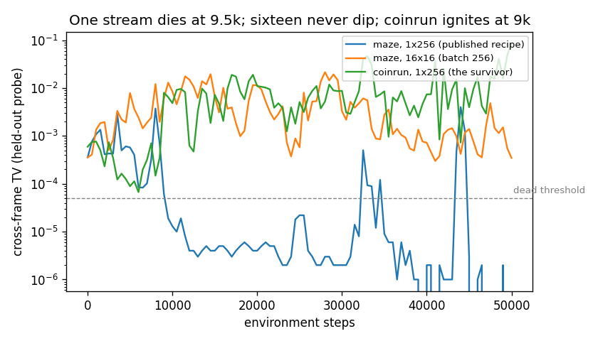

**1. The dense baseline is the published run — and its responsive phase was more alive than the 2k grid showed.** The `1×256` arm reproduces `results/policy_saturation_perlayer_repo.json` with **zero mismatches in every field at all 26 shared grid points** (probing never consumes RNG, and the runs are deterministic on this hardware), so the 500-step grid is a strict refinement, not a new experiment. At this resolution the early window is continuous, not episodic: 12 consecutive probes above $10^{-4}$ from step 0 (`0.000356`) through 5500 (peak `0.001351` at 1500), a sag at 6000–6500 (`8.5e-05`, `8.3e-05`), a last excursion at 7500–8500 (peak `0.00374` at 8000 — the one excursion the coarse grid did catch), and death at **9500** (`1.9e-05`). **21 of 101** probes are alive, not 5 of 51 — the coarse grid undercounted by sampling. The first `Tanh` crossing also sharpens: >50% at **4500**, where the 2k grid first saw it at 6000.

**2. The dose-response the hypothesis predicted.** Four parallel streams are not enough to prevent the dip but are enough to leave it: `4×64` falls into the same silence (a contiguous block of 8 probes at $10^{-6}$–$2.6\times10^{-5}$ from 14500 to 18000 — the published arm's dead level), and then the response **comes back** at 18500 (`0.00088`), passes `0.035` at 24000 and peaks at **`0.109794` at 25500** — 27× the published arm's lifetime peak — never again falling below `0.0025` after 24k. Sixteen streams prevent the death outright: `16×16` has **not one probe below `0.0003`** in the whole window (101/101 alive) and never crosses 50% first-`Tanh` saturation (peak `25.5%`). One stream: permanent death. Four: transient death. Sixteen: no death — a gradient, obtained at constant per-update batch, so it is not a data-volume effect.

**3. It is the rollout's shape, not its size, its update count, or its batch.** `16×256` holds `n_steps` at the published 256, multiplies the batch by 16 and therefore cuts the gradient updates from 195 to 12 — and its curve is a 13-segment staircase (weights move only every 4096 steps) that never regresses after the first update: per-update response `0.0058 → 0.0111 → 0.0151 → 0.0264 → … → 0.0419`, every post-init segment at least `0.0058`, and the first `Tanh` never saturating a **single unit** in any probe. It ends at cross-game TV `0.088322` — 204× the published arm — and is the **first `maze`-trained policy in this study to emit two distinct argmax actions across the five games**, with V(s) std `1.5311`. If collapse were driven by update frequency, batch size or data volume, this arm — fewest updates, largest batch — would be the most collapsed. It is the most responsive.

**4. Saturation reverses with the revival, finishing what the LayerNorm arm started.** `4×64` cycles through the whole claim inside one run: its first `Tanh` reaches **99.6% saturated at 17500** — the bottom of its dead window — and by 24500, with the response back at `0.058`, saturation has collapsed to **5.9%**. The same weights saturate, desaturate, and the response tracks the desaturation. §3.6.3 showed saturation is not necessary for the blindness; this shows it is not even sticky — present and absent both coincide with collapse, in both temporal directions, which is the signature of a symptom.

**5. The surviving arm passes through the same fragile window.** The dense `coinrun` probe is also a bitwise refinement of its published curve (11 shared points, 0 mismatches). Its response sags below the alive threshold at **5000 and 6000** (`8.9e-05`, `6.7e-05`) — the same age at which the `maze` arm is dying — then takes off at **9000** (`0.007985`) and never again drops a probe below the alive threshold (99/101 alive; ends `0.084866`, entropy `0.971`, V(s) std `0.74167`). Its first `Tanh` transiently crosses 50% at 3000–6500 and comes back down — the same escape §3.6.3 saw at coarse resolution. Both games enter the first 10k steps with a weak, sagging dependence on the observation; `coinrun`'s takes off and the published `maze` recipe's dies, and the dense grid resolves the fork to the same 500 steps: `maze` dead at 9500, `coinrun` ignited at 9000.

**6. What is established, what is not, and what this changes.** Established: on `maze`, the collapse is contingent on the single-stream rollout — with 16 parallel envs at the published per-update batch, the same seed, extractor, budget and probe set that lose the response at 9500 never lose it. Not established: the fine mechanism inside the single-stream rollout (why its advantage signal fails to sustain conditioning — the leading refinements are near-duplicate frames within one episode making the update signal rank-deficient, and the entropy dynamics of the clipped objective on that signal); any multi-seed claim (one seed per arm — the 21/101 vs 101/101 gradient is stark, but each cell is `n=1`); and the cross-game generality of the revived response — `4×64` and `16×16` still end at one argmax across games (`0.0078`, `0.0047`), only `16×256` reaches two. What it changes: every trained policy in this study — the 70 committed checkpoints, the 48 audited cells, the archived grid — was produced by a single-stream rollout (every `compare_*.py` builds `DummyVecEnv([one env])`), so the blindness those sections measure is a property of the recipe's rollout, not of the extractors it compared; and the roadmap's re-run question now has its first meaningful version — re-run the grid with `n_envs=16` (batch-controlled), not with the recipe that produces blindness. That decision (~40 GPU-hours) is item (iii) and stays open.

> **Follow-up (12/10/2026):** five seeds per arm ran, and three of the single-seed numbers above need sharpening — the death clock moves (9k–36k across seeds), the `16×16` invulnerability is `4/5` seeds, not all, and `coinrun`'s immunity is really *recovery* (it dips below the dead threshold on 4 of 5 seeds and ends responsive on 5 of 5). The two candidate mechanisms were also pulled as levers. §3.6.5.

### 3.6.5. Five Seeds and the Mechanism Levers: What Replicates, What Is Excluded (12/10/2026)

§3.6.4 measured the dose-response once per arm, on seed 42, and left two candidate mechanisms untested. Both questions got their experiment: every dose-response arm re-run at seeds 43–46 (`coinrun` included), and each candidate mechanism pulled as a lever at the collapsing configuration (`n_envs=1`). Artifacts: the 20 dose-response runs live as per-run JSONs next to the seed-42 files of §3.6.4 (`results/policy_saturation_dense_*_seed{43..46}.json`, `results/coinrun_dense_seed{43..46}.json`), the 6 lever runs as `results/policy_saturation_dense_{repeat4,nsteps1024,entcoef001}_seed{42,43}.json`, and `results/policy_saturation_dense_multiseed.json` folds all 31 (`summarize_dense_multiseed.py --check` verifies the fold is current). The 26 training loops of 12/10 sum to **47.3 GPU-minutes**; the `(iv)` dose of 14/10 adds 10 more (`2×128`, `8×32`, seeds 42–46) for **15.0**; the evening pass adds the `3×64` cliff cell and the levers' remaining seeds (17 runs) for **76.8** — the whole dense-probe program has cost **145.3 GPU-minutes**.

| arm (5 seeds each) | seeds ending responsive | first dead probe, per seed | alive probes, per seed |
|---|---:|---|---|
| `maze`, `1×256` (the published recipe) | **0/5** | 9000, 9500, 16500, 31500, 36000 | 21, 38, 44, 70, 74 |
| `maze`, `2×128` (batch 256) | **0/5** | 8000, 10000, 13000, 17000, 18500 | 17, 47, 47, 48, 51 |
| `maze`, `3×64` (batch 256) | **0/5** | 14000, 15000, 20000, 22500, 30000 | 28, 29, 42, 46, 58 |
| `maze`, `4×64` (batch 256) | **3/5** | 12000, 15500, 24000, 42000, never | 50, 84, 89, 90, 100 |
| `maze`, `8×32` (batch 256) | **3/5** | 16000, 42000, never, never, never | 76, 83, 100, 101, 101 |
| `maze`, `16×16` (batch 256) | **4/5** | 34500, never, never, never, never | 69, 101, 101, 101, 101 |
| `maze`, `16×256` (batch 4096) | **5/5** | never, never, never, never, never | 101, 101, 101, 101, 101 |
| `coinrun`, `1×256` (the surviving arm) | **5/5** | 9500, 16500, 17000, 24500, never | 80, 96, 98, 99, 99 |

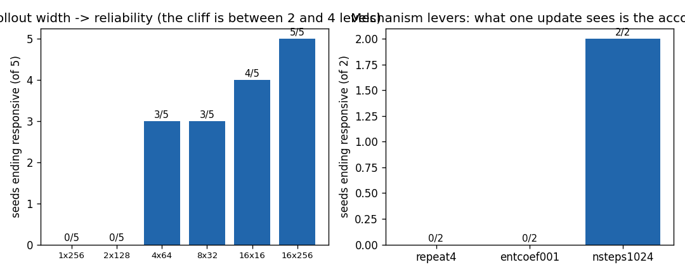

*Ending responsive = final probe cross-frame TV above $10^{-4}$.*

**1. The single stream always ends blind — but the death clock moves.** All five seeds of `1×256` end dead (final TV ≤ $10^{-5}$, V(s) std ≤ $2\times10^{-5}$, cross-game TV ≤ `0.001090`), which is the claim that survives replication. What does not survive is the clock: §3.6.4's "death at 9500" is seed 42's; across seeds the first dead probe lands anywhere in **9k–36k** (median 16.5k), and one seed stays responsive for 36k steps before dying. The responsive phase is real on every seed (alive counts 21–74) and always temporary. One run adds a sharp dissociation: `4×64` seed 45 ends with the **critic** tracking state (V(s) std `0.23554`) while the **policy** sits at cross-frame TV $2\times10^{-6}$ — the value head kept learning from the rollout long after the actor stopped reading the observation, so "the rollout contains no learnable signal" is false; it is the *policy's* use of it that dies.

**2. The dose-response is a gradient in reliability, not a per-seed law — and only one arm replicates perfectly.** Ending-responsive goes `0/5 → 0/5 → 0/5 → 3/5 → 3/5 → 4/5 → 5/5` as the update's distinct levels grow from 1 to 16 (the `(iv)` arms included), monotonically on `maze` — and, as claim 5 shows, the step from 3 to 4 levels is the cliff. §3.6.4's single-seed determinism ("four: transient death; sixteen: no death") dissolves into that gradient: the `4×64` revival holds on 3 of 5 seeds, and `16×16` seed 43 collapses at 34.5k — late, and from a configuration that keeps 4 other seeds at 101/101 alive. The arm that replicates without exception is **`16×256`: 5/5 seeds, not one dead probe in 505, V(s) std 1.1–2.3 on every seed** — and its failures-to-come would have to be somewhere other than the response. Two of its five seeds end emitting 2 argmax across games. And `16×16` seed 45 shows the ceiling the wide rollout reaches when it works: it ends at cross-game TV **`0.664942` with 2 argmax across games** — $0.90\times$ the responsive control's own `0.739958` — so `maze` is not structurally incapable of coinrun-grade conditioning; the published recipe just never gets there.

**3. `coinrun`'s robust property is recovery, not immunity.** On 4 of 5 seeds the `coinrun` arm dips below the dead threshold somewhere in 9.5k–24.5k — the same kind of dip the `maze` arm dies in — and on all 5 it comes out and ends responsive (final TV `0.012–0.085`, V(s) std 0.24–0.74). The game-level contrast of §3.6.4 holds at the endpoint — `maze` dips are absorbing, `coinrun`'s are not, 0/5 vs 5/5 — but "never falls below the threshold" was seed-42 luck, and the dense story is the same as the collapse story told one level up: dips are the common condition; what a run is trained on decides whether they are fatal.

**4. The mechanism levers split exactly along "what one update sees" — at five seeds.** Three levers, all pulled at the published single stream (the evening pass completed them from `n=2` to the study's `n=5`):

| lever (all `n_envs=1`) | the account it tests | seeds ending responsive | first dead probe, per seed | endpoint TV, per seed |
|---|---|---:|---|---|
| `action_repeat=4` — 4× the screen change per step, same 256-transition batch | input-change-per-step | **1/5** | 17000, 29500, never, 10500, 15000 | 0.0, 0.0, 0.002981, 0.000036, 0.000029 |
| `ent_coef=0.01` — active entropy pressure on the objective | entropy-objective | **0/5** | 10500, 18000, 8000, 13000, 6500 | 0.000022, 0.000002, 0.0, 0.000016, 0.000001 |
| `n_steps=1024` — one stream, 4× the transitions per update | per-update coverage | **5/5** | never, never, never, never, never | 0.005821, 0.019111, 0.004369, 0.018883, 0.009897 |

The entropy lever fails most cleanly: **0/5**, with the marginal held entropic on every seed (final entropy `1.905`–`2.5283`, near-uniform over 15 actions) while every endpoint sits below TV `2.2×10^{-5}$ — keeping the marginal entropic does not keep it reading the screen. The input-change lever fails on four of five seeds — the survivor (seed 44, endpoint TV `0.002981`, cross-game `0.013026`) is named, because one lucky seed out of five is what "mostly excluded" looks like when the count is honest. The coverage lever survives on **all five**, ending at cross-game TVs up to `0.046536` — with the caveat stated: its batch is also 4× (48 updates by 50k, against the baseline's 195 — though 2 of 5 baseline seeds are already dead by their 35th–37th update, so the 1024 arm is not merely "too young to die"), and `repeat4` is not a pure intervention (it also changes the MDP: $\gamma^{4}$ per step, 4× earlier episode turnover). The levers leave the account exactly where §3.6.11's anatomy will need it: what one *update* sees matters, what one *step* sees and the objective's entropy term do not.

**5. The `(iv)` dose ran (14/10/2026): the levels factor is a cliff, and it sits between 3 and 4.** At the fixed published batch of 256 transitions, the evening pass added the middle cell: `3×64`, ~3 distinct levels per update — **it ends dead on 0/5 seeds** (deaths `14000–30000`, alive counts `28–58`). Doubling the update's levels had already saved nothing (`2×128`: 0/5, deaths `8000–18500`); tripling saves nothing either. The survival probability is 0 across fifteen 1–3-level seeds and a majority from the first 4-level arm — the cliff is **between 3 and 4 levels**, not between 2 and 4. The `8×32` survivors include the strongest within-`maze` endpoint measured in this study (final cross-frame TV **`0.156991`**, seed 46). The two coverage factors are now separated and the count is closed: **below the cliff — `1×256` (1 level), `2×128` (2), `3×64` (3), `repeat4` (~2), `ent_coef` (1) — 24 of 25 seeds die**, the single exception being `repeat4` seed 44; **at or above it — `4×64`, `8×32`, `16×16`, `16×256`, `1×1024` — 20 of 25 seeds survive**, and the one configuration that crosses via transitions alone (`1×1024`, ~2 levels, 4× the transitions) shows the two factors *substitute* for each other rather than add. The account is now quantitative twice over: a 256-transition update needs at least ~4 distinct levels of the game, or more transitions to compensate for their absence.

**6. What is settled and what is left.** Settled: the endpoint claims replicate (`maze` single-stream 0/5, widest arm 5/5, the `coinrun` contrast 5/5); the mechanism levers are split at five seeds (input-change 1/5, entropy 0/5, coverage 5/5); and the operative quantity is named and now has a cliff — per-update coverage, transitions and distinct levels together, with the survival probability jumping from 0 (15 seeds at 1–3 levels) to a majority at 4. Left, in order of information per GPU-hour: the `2×128`-vs-`4×64` boundary is resolved (`3×64` closed it), and then (iii), the grid re-run, which has a recipe to carry: **`16×256`, the only arm that replicated 5/5** — the decision is still ~40 GPU-hours and still yours.

> **Follow-up (14/10/2026):** the (iii) pilot ran — all 16 architectures on `starpilot` under the fixed recipe — and the decision it feeds is now cheaper than stated above: the measured rate puts the full grid at **~13.4 GPU-hours**, not ~40. §3.6.6.

### 3.6.6. The (iii) Pilot: 16 Architectures Under the Fixed Recipe on `starpilot` (14/10/2026)

Before committing the grid re-run, its two premises had to be measured: do the 16 published architectures stay responsive under the `16×256` recipe, and do returns separate? The pilot is the whole headline comparison on one game: all `16` arms, `starpilot`, seed `42`, `100k`, **`n_envs=16 × n_steps=256`** — trained through the producers' own `train_one` (`compare_suite.py`/`compare_new_archs.py`, now parameterized; the published `1×256` path is the default and byte-for-byte untouched), measured with the same response audit. Artifact: `results/suite_validity_starpilot_nenv16.json` (16 per-arm shards, `logs_audit/shards_nenv16/`, fused by the audit's `--merge`; the merge stamp now includes the recipe, so a `1×256` shard cannot fuse with these). Cost: **53.7 cell-minutes summed, ~5 minutes of wall clock at 3 workers** — at this measured rate the full `240`-cell grid is **~13.4 GPU-hours**, not the ~40 previously estimated.

Paired with §3.6.2's `starpilot` audit — same seed, same budget, same 10-episode evaluation, the recipe the only change:

| arm | return @`1×256` | return @`16×256` | TV @`1×256` | TV @`16×256` | argmax | 1st `Tanh` sat |
|---|---:|---:|---:|---:|---:|---:|
| `classic` | 0.50 | **5.20** | 0.001149 | 0.361022 | 3 | 16.9% |
| `vit` | 0.50 | **6.40** | 0.000001 | 0.083030 | 1 | 16.6% |
| `impala` | 1.60 | 4.40 | 0.000000 | 0.398771 | 3 | 26.9% |
| `spatial` | 1.30 | 4.00 | 0.000000 | 0.347564 | 3 | 44.7% |
| `cbam` | 0.60 | 3.50 | 0.050662 | 0.329073 | 2 | 0.0% |
| `impoola` | 1.80 | 3.50 | 0.000000 | 0.026367 | 1 | 0.6% |
| `vae` | 0.40 | 3.20 | 0.000000 | 0.249161 | 2 | 61.9% |
| `lstm_attention` | 2.30 | 2.80 | 0.000024 | 0.330379 | 2 | 54.7% |
| `c_aug_crop` | 1.70 | 2.70 | 0.000000 | 0.263253 | 3 | 39.7% |
| `ae` | 1.40 | 2.40 | 0.000000 | 0.385176 | 3 | 11.6% |
| `recon` | 1.40 | 2.40 | 0.000000 | 0.385176 | 3 | 11.6% |
| `resnet18` | 1.60 | 1.80 | 0.001354 | 0.229575 | 2 | 22.2% |
| `mlp_vector` | 1.20 | 1.80 | 0.101104 | 0.053308 | 1 | 99.1% |
| `contrastive` | 3.30 | 1.50 | 0.004306 | 0.462142 | 2 | 6.2% |
| `c_aug_noise` | 3.30 | 1.50 | 0.004306 | 0.462142 | 2 | 6.2% |
| `c_aug_color` | 2.20 | 1.00 | 0.000000 | 0.292621 | 2 | 24.7% |

**1. The rescue is near-universal — fourteen arms move from inert to responsive, one moves down.** All 16 arms clear the §3.6.2 inert floor (TV $5\times10^{-3}$), where 14 of 16 sat below it at `n_envs=1`, and 13 of 16 cross `0.1` (band `0.230–0.462`). `cbam`, which had the old audit's largest genuine response (`0.050662`), multiplies it 6.5×. The exception that moves the wrong way is the study's headline arm: **`mlp_vector` drops from `0.101104` to `0.053308` and keeps the collapse's exact signature** — one argmax across the five games, **99.1% of the first `Tanh` saturated**, feature max `254.00` (the raw `uint8` flatten). The recipe that rescues fourteen front ends does not rescue the one the published rankings named the consistent leader — and its old `0.101` was the *old* audit's largest `starpilot` TV, so this is not a floor effect.

**2. The old return ordering inverts.** Same seed, same budget, same evaluation — the recipe is the only difference, and it flips the table's direction: the old audit's best `starpilot` scorers (`contrastive` ≡ `c_aug_noise` `3.30`, `lstm_attention` `2.30`, `c_aug_color` `2.20`) average **`1.70`** under the fix, while the old bottom four (`vae` `0.40`, `classic` `0.50`, `vit` `0.50`, `cbam` `0.60`) average **`4.58`**. `classic` goes `0.50 → 5.20`, `vit` `0.50 → 6.40`, `impala` `1.60 → 4.40`. What a blind near-constant policy scores on `starpilot` is close to anti-correlated with what a responsive policy scores on it — the §3.7 ranking was not merely unverified; on this game it was pointing the other way.

**3. Return is still not evidence of a visual policy — the control's finding replicates under the fix.** `vit` posts the pilot's best return (`6.40`) at TV `0.083030` and **one argmax across five games** — the same shape as its coinrun control row (§3.6.2: `6.00` at TV $3\times10^{-6}$), now under the recipe that keeps thirteen other arms reading the screen. `impoola` scores `3.50` at TV `0.026367`, one argmax, with the first `Tanh` at 0.6% — responsive-blind without saturating, the `dodgeball`-style dissociation, so the blindness signature is not always saturation either.

**4. The identical pairs stay identical.** `ae` and `recon` return the same row to the last digit (`2.40`, TV `0.385176`, 11.6%) and so do `contrastive` and `c_aug_noise` (`1.50`, TV `0.462142`, 6.2%) — the two documented same-program pairs reproduce bitwise under the new recipe. The comparison is still `14` distinct front ends, and the pipeline is reproducible on this hardware to the digit.

**5. What the pilot decides.** The grid re-run is measurable (the fix generalizes, 13/16 responsive), worth measuring (returns spread `1.00–6.40`), and will likely not resemble §3.7 — the pilot's paired inversions say the old ranking was measuring blind marginals, i.e. the wrong quantity. And it is cheap: **~13.4 GPU-hours summed, roughly an overnight wall-clock at 3 workers**, not the ~40 previously carried in item (iii). What the pilot cannot answer: one seed, one game, 10-episode evaluations (`std_10eps` in each row); `vae`'s `bossfight` NaN stays untested under the fixed recipe until those cells run; and whether `mlp_vector`'s non-rescue is a `starpilot` fact or a general one. The full `240`-cell grid — `16` arms × `3` games × `5` seeds — remains the user's call, now at the revised cost.

### 3.6.7. The Grid Re-Run (iii): What the Fixed Recipe Ranks, and What It Does Not (14/10/2026)

The grid ran: **240 cells** — `16` arms × {`starpilot`, `bossfight`, `dodgeball`} × seeds `42–46`, every cell trained by the producers' own `train_one` at `n_envs=16 × n_steps=256`, `100k`, and measured with the response audit. Artifacts: the three per-game fusions `results/suite_validity_nenv16_{starpilot,bossfight,dodgeball}.json` (80 `arm@seed` rows each) and `results/suite_validity_nenv16_grid.json` (`summarize_grid_nenv16.py --check` verifies the fold). Cost: **3h22m of wall clock** on the 8 GB laptop GPU at 6–8 workers (the summed per-cell times under that sharing are `23.1 h`). One cell errored — and it is a known face: `vae` on `bossfight` seed `42` went `NaN` at step `5888` under the *new* recipe too, the same `ValueError` as the `n_envs=1` audit (its other four seeds completed) — the divergence is a property of (`vae`, `bossfight`), independent of rollout width and batch size. Two operational notes for the record: 8 concurrent CUDA contexts produced two bursts of driver-level faults (7 cells died mid-run and re-trained cleanly at 6 workers), and every cell lives in its own shard file because concurrent processes must not share a `--out` (the audit's own docstring rule, violated once tonight and paid for with two lost rows before the fix).

| arm | §3.7 archived mean | new global mean | starpilot | bossfight | dodgeball | responsive cells (TV ≥ 0.1) |
|---|---:|---:|---:|---:|---:|---:|
| `vit` | 1.20 | **1.907** | 2.90 | 0.78 | 2.04 | **1/15** |
| `impoola` | 1.12 | **1.707** | 2.94 | 0.30 | 1.88 | **3/15** |
| `vae` | 0.88 | 1.612 | 2.84 | 0.675 | 1.32 | 9/14 |
| `impala` | — | 1.607 | 2.86 | 0.32 | 1.64 | 9/15 |
| `cbam` | 1.33 | 1.533 | 2.54 | 0.30 | 1.76 | **15/15** |
| `c_aug_crop` | 1.16 | 1.473 | 2.62 | 0.08 | 1.72 | 10/15 |
| `mlp_vector` | 1.25 | 1.433 | 2.36 | 0.30 | 1.64 | **3/15** |
| `ae` | 1.11 | 1.307 | 2.48 | 0.28 | 1.16 | 13/15 |
| `c_aug_noise` | 0.97 | 1.307 | 2.92 | 0.24 | 0.76 | 13/15 |
| `contrastive` | 0.97 | 1.307 | 2.92 | 0.24 | 0.76 | 13/15 |
| `recon` | 0.90 | 1.307 | 2.48 | 0.28 | 1.16 | 13/15 |
| `classic` | 1.33 | 1.287 | 3.06 | 0.00 | 0.80 | **15/15** |
| `spatial` | **1.54** | 1.213 | 2.24 | 0.00 | 1.40 | **15/15** |
| `resnet18` | 1.34 | 1.147 | 2.14 | 0.30 | 1.00 | 11/15 |
| `c_aug_color` | — | 1.0 | 2.16 | 0.00 | 0.84 | **15/15** |
| `lstm_attention` | 1.20 | 0.993 | 1.72 | 0.22 | 1.04 | 12/15 |

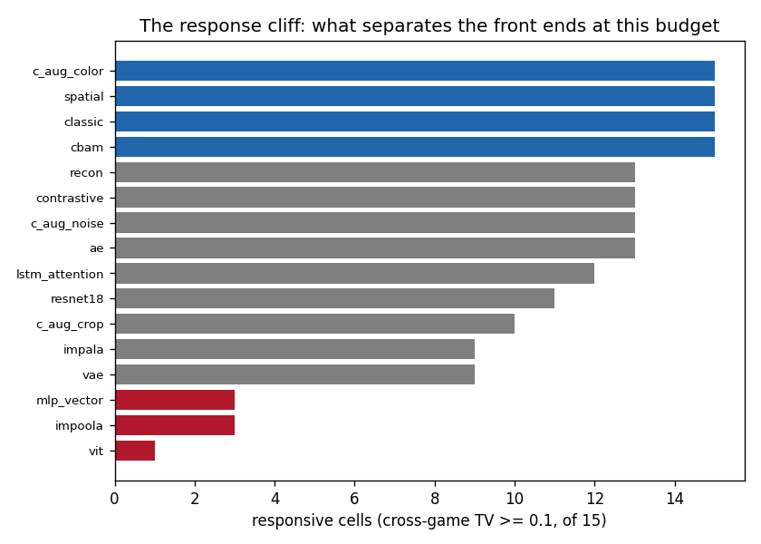

*Responsive cells = the arm's audit cells, across all three games and five seeds, whose cross-game TV clears 0.1 (`vae` has 14, not 15: its `bossfight`/seed-42 cell died in the known `NaN`).*

**1. The archived ranking does not survive the fix.** §3.7's top three — `spatial` `1.54`, `resnet18` `1.34`, `classic` `1.33` — land at **13th, 14th and 12th** (`1.213`, `1.147`, `1.287`) under the recipe that keeps policies reading the screen; of the archived top five only `cbam` stays in the new top five. The new table's top is `vit` `1.907` and `impoola` `1.707`. §3.8's caution applies to it in full — `n=5`, and the two largest starpilot means ride single high seeds (`vit`: `[6.4, 1.7, 2.2, 1.5, 2.7]`, std `1.8`; `contrastive`/`c_aug_noise`: one `6.3` seed, std `1.77`), while `bossfight` returns sit near zero for every arm (`0.00–0.78`) and contribute mostly noise. Read as a verdict on architectures, the new table is underpowered; read as a record of what the fixed recipe returns, it is what §3.7 should have said it lacked.

**2. The return ordering still does not track visual conditioning.** The three least-responsive arms — **`vit` 1/15 cells, `impoola` 3/15, `mlp_vector` 3/15** — hold return spots **1, 2 and 7**; `vit`, the overall winner, reads nothing on `bossfight` and `dodgeball` (mean TV `0.000` on both) and `0.074` on `starpilot`. The four arms that respond on **every measured cell** — `cbam`, `classic`, `spatial`, `c_aug_color`, 15/15 each — hold spots 5, 12, 13 and 15. The negative structure the pilot found in one game is the grid's shape: at this budget, on these games, what scores well is not what looks.

**3. Responsiveness is where the architectures separate — cleanly, and reproducibly.** As a return ranking the table is noise; as a **response** ranking it has a cliff: `cbam`/`classic`/`spatial`/`c_aug_color` at 15/15, `ae`/`recon` at 13/15, `lstm_attention` 12/15, then the drop to `impala` 9/15, `vae` 9/14, and the bottom three at 1–3/15. `starpilot` keeps every arm responsive; `bossfight` and `dodgeball` lose `vit` (TV `0.000`) and keep `mlp_vector` at `0.110`/`0.050`. The response measure — the one this item was built to attach to every table — is the quantity that ranks the sixteen front ends with structure a seed sweep does not wash out.

**4. `mlp_vector`'s leadership is gone in both senses.** The arm §0 named the consistent leader across all protocols is 7th on return (`1.433`, from `1.25@100` archived) and third-least responsive (mean TV `0.072704`, per-game means `0.059`/`0.110`/`0.050`). Its starpilot "win" does not survive either: `classic` `3.06` and `impoola` `2.94` clear it (`2.36`). What the archived tables rewarded in `mlp_vector` at this budget, the fixed recipe does not reproduce.

**5. The same-program pairs and the `vae` defect replicate to the digit.** `ae`≡`recon` and `contrastive`≡`c_aug_noise` return identical rows across **all 45 cells of the three grids** — same returns, same TVs, same saturation, three games, five seeds, separate processes. The comparison remains `14` distinct front ends, and its pipeline is reproducible on this hardware to the last digit at grid scale. The `vae`/`bossfight` seed-42 `NaN` (item 9, §3.6.2) recurs under a recipe with a 16× wider rollout and a 16× larger batch — it is the one defect of the original run that the thin rollout did not cause.

**6. What item 9 closes with.** The question was "does the blindness invalidate the rankings?" — and the re-run gives the answer its last piece: the rankings cannot be repaired by re-running them, because under the recipe that makes policies condition, the return ordering changes shape **and still does not track whether the front end is used**. At `100k` on these three games, return is not a measure of the visual architecture under either recipe; the response measure is — and by that measure the study's front ends do differ, verifiably: `cbam`, `classic`, `spatial` and `c_aug_color` sustain reading across every cell, `ae`/`recon`/`lstm_attention` nearly everywhere, while `vit`, `impoola` and `mlp_vector` do not condition under any recipe tested. §3.7 and §3.12 stand as records of what the archived runs returned; the architecture conclusion of this study is the response table, not the return table.

> **Follow-up (14/10/2026):** the dense probe ran on all three non-readers — and "do not condition" needed precision: two of their nine cells are truly blind by two different mechanisms (one never ignites, one dies absorbing-ly), one is inert without dying, and the other six read within-game, a third to a tenth of `classic`'s depth, without generalizing across games. §3.6.9, and §3.6.10 for the organ each blindness lives in.

### 3.6.9. The Non-Readers Under the Probe: Two Blindnesses, Not One (14/10/2026)

§3.6.7 named `vit`, `impoola` and `mlp_vector` non-readers by the **cross-game** measure — five games' initial frames. The question that leaves open: did they *never* condition, or condition and lose it? The dense probe answers it: `vit`, `impoola` and `mlp_vector` on all three grid games, plus `classic` as the reader reference — same recipe as the grid (`16×256`, seed `42`), `100k`, probe every `500` steps, within-game response measured on the held-out random-walk frames (`diagnose_policy_saturation.py`, which gained `--arch classic|vit|mlp|impoola`; the `mlp` arm probes the `MlpPolicy` over the 256-D vector observation). Twelve curves, **~23 GPU-minutes**. Artifacts: `results/probe_nonreaders_{vit,mlp,classic,impoola}_{bossfight,dodgeball,starpilot}.json` (each carries the within-game timeline and the cross-game endpoint).

| probe (grid recipe, seed 42) | within-game TV: init → final (peak) | cross-game TV (argmax) | first `Tanh` sat, final | pattern |
|---|---|---|---:|---|
| `classic` × bossfight | 0.000932 → **0.184762** | 0.275485 (3) | 0.4% | grows throughout, never a dead probe |
| `classic` × dodgeball | 0.000684 → 0.053882 (0.063375) | 0.117495 | 0.0% | grows throughout |
| `classic` × starpilot | 0.000867 → 0.138053 (0.170891) | 0.361022 (3) | 13.5% | grows throughout |
| `vit` × bossfight | 0.000792 → 0.000002 | 0.000026 (1) | 12.5% | **never ignites**: born near-dead, decays from step 0 |
| `vit` × dodgeball | 0.000504 → 0.015897 (0.030365) | 0.000051 (1) | 21.1% | grows, 10× shallower than `classic` |
| `vit` × starpilot | 0.000969 → 0.024421 | 0.047079 (2) | 23.8% | grows, 6× shallower |
| `mlp_vector` × bossfight | 0.002396 → 0.060599 (0.074403) | 0.106360 (1) | 98.2% | born with 5 argmax, grows |
| `mlp_vector` × dodgeball | 0.000744 → 0.000000 | 0.036448 (1) | 100.0% | **dies absorbing-ly at 8500**: the §3.6.4 maze death, first time under the wide recipe |
| `mlp_vector` × starpilot | 0.002259 → 0.042439 (0.053161) | 0.053308 (1) | 98.6% | grows |
| `impoola` × bossfight | 0.000397 → 0.000325 (0.008743) | 0.000218 (1) | 75.0% | born flat, stays flat: never ignites, never dies — *a seed-42 reading; §3.6.11 measures its siblings at 0.000143–0.065539* |
| `impoola` × dodgeball | 0.000145 → 0.017502 (0.021441) | 0.078997 (1) | 0.0% | grows 120× — the weak-reader family |
| `impoola` × starpilot | 0.000615 → 0.020158 (0.066320) | 0.026367 (1) | 0.0% | grows 33× |

*Within-game TV = the probe's cross-frame measure on 20 held-out random-walk frames of the same game; the grid's cross-game TV uses five different games' initial frames. Both are in each artifact.*

**1. The two truly blind cells die by different mechanisms.** `vit`/bossfight is born near-dead — its fresh random policy responds at `0.000792` with 2 argmax — and decays monotonically: below the dead threshold at `16500`, **`25/201` probes alive, all early**, ending at `0.000002`. No update ever ignites it; this is a front end that never gave the head a signal to use. `mlp_vector`/dodgeball is born alive (`0.000744`, 2 argmax) and dies the §3.6.4 death: **first dead probe at `8500`, `17/201` alive, TV exactly `0` from mid-run on, V(s) std `0`, first `Tanh` at 100%** — an absorbing collapse, the first one observed under the wide recipe, and in the same arm whose head saturates structurally.

**2. The other four cells read — within the game, weakly.** `vit` on dodgeball and starpilot and `mlp_vector` on bossfight and starpilot all start with a small response (`0.000504`–`0.002396`) that **grows 15–30× over training** and never dips — `201/201` probes alive in all four. So the grid's cross-game verdict needed its precision: these arms condition within-game at **a third to a tenth of `classic`'s depth** (finals `0.0159`–`0.0606` against `classic`'s `0.0539`–`0.1848`), and what they do not produce is a response that generalizes to other games' opening screens (cross-game TV `0.000026`–`0.106360`, an order below `classic`'s `0.117495`–`0.361022`).

**3. `classic` is the reference on every axis.** Alive on all `201` probes of all three games, deepening everywhere (peak `0.1848` on bossfight, `0.1709` on starpilot), with the first `Tanh` never above `14.5%` anywhere in any curve — growth without saturation, on any game. Notably `classic`/dodgeball's within-game final (`0.0539`) is *below* `mlp_vector`/bossfight's (`0.0606`): the game contributes as much as the front end to within-game depth, which is why the cross-game measure, not the within-game one, is what separated the architectures in §3.6.7.

**4. `mlp_vector`'s head is saturated from birth — and reads anyway.** At step `0`, `91.33%`–`97.89%` of its first `Tanh` is already saturated (256 raw `uint8` values through a `Linear` saturate it at initialization), yet on two of three games the policy conditions and its response grows through training. The saturation↛blindness dissociation §3.6.4 established dynamically and §3.6.2 established across arms now holds at initialization: saturation is structural to this arm's head, and still not the cause of anything.

**5. A cross-script reproduction, for free.** The probe's `classic`×starpilot run — trained by `diagnose_policy_saturation.py`, not by the producers' `train_one` — ends at cross-game TV `0.361022`, 3 argmax, first-Tanh `0.1688`, feature max `11.358`: **identical to the §3.6.6 pilot's `classic` cell on all four fields**. Two scripts, one trajectory; the recipe and the probe are deterministic on this hardware when the GPU is not shared.

**6. `impoola` is the weak-reader family, with one inert cell.** On dodgeball and starpilot it is `vit`'s profile: born small (`0.000145`/`0.000615`), grows **120× and 33×** to `0.017502`/`0.020158`, `201/201` probes alive. Its bossfight cell is a variant the others don't have: born flat (`0.000397`), it neither ignites nor dies — one early excursion to `0.008743` at `8500`, then back to `0.000325` and level to the end, `201/201` alive, the first `Tanh` at 75%. Inertness without collapse. And its starpilot run ends at cross-game TV `0.026367`, 1 argmax, first-`Tanh` `0.0063`, feature max `2.35` — **identical to the §3.6.6 pilot's `impoola` cell on all four fields**: the third cross-script reproduction of this section.

**7. What this refines.** §3.6.7's response cliff was measured cross-game and stands; within-game the separation is graded — readers 3–10× deeper, and only `classic` has no dead cell anywhere. The study's non-reader verdict becomes precise: all three arms read within-game shallowly and without cross-game generalization, on top of three distinct failure shapes — never-ignites (`vit`/bossfight), inert-without-death (`impoola`/bossfight), absorbing death (`mlp_vector`/dodgeball), and the weak-reader baseline elsewhere. §3.6.10 takes the next step down: *which organ* each blindness lives in.

### 3.6.10. Where the Blindness Lives: Front End or Head (14/10/2026)

§3.6.9's blind cells share an endpoint — a frame-invariant action distribution — but two architectures could produce it: the front end collapses its features to frame-invariance (the head never receives a signal), or the features vary and the head learned to ignore them. `diagnose_feature_vs_actor.py` separates the organs: it trains one cell at the grid recipe, then measures, on the same held-out frames the probe uses, (a) the **feature response** — per-dimension cross-frame range normalized by the run's own mean |activation| scale (a shared normalizer, so a dimension oscillating around zero cannot explode the measure), reported as the mean range-over-scale and the fraction of dimensions whose range exceeds that scale — and (b) the **action response** — the probe's cross-frame TV, plus the same pair over the audit's five cross-game initial frames. Seven cells: the blind pair (`vit`/bossfight, `mlp_vector`/dodgeball), the inert cell (`impoola`/bossfight), two weak readers (`vit`/dodgeball, `mlp_vector`/bossfight), and the reader reference on both games. **~13 GPU-minutes.** Artifacts: `results/feature_vs_actor_{arch}_{game}.json`.

| cell | within-game action TV | feature range/scale | dims > scale | cross-game action TV | feature range/scale | locus |
|---|---:|---:|---:|---:|---:|---|
| `classic` × bossfight | 0.176353 | 1.3087 | 47.3% | 0.106933 | 2.5164 | both live — the reference |
| `classic` × dodgeball | 0.057352 | 3.1009 | 56.8% | 0.070866 | 2.5346 | both live |
| `vit` × bossfight | 0.000006 | **0.1540** | **0.0%** | 0.000005 | 0.1060 | **front end**: features are frame-invariant |
| `vit` × dodgeball | 0.000007 | **0.1544** | **0.0%** | 0.000004 | 0.0916 | **front end** (this run — see claim 3) |
| `impoola` × bossfight | 0.000452 | 0.7798 | 26.4% | 0.000101 | 0.5576 | **head**: features vary, actions flat |
| `mlp_vector` × bossfight | 0.037994 | 1.7995 | 58.2% | 0.043778 | 1.2991 | head uses part of the signal |
| `mlp_vector` × dodgeball | 0.000000 | 0.8417 | 1.2% | 0.009228 | 1.2991 | **head**: features vary, actions dead |

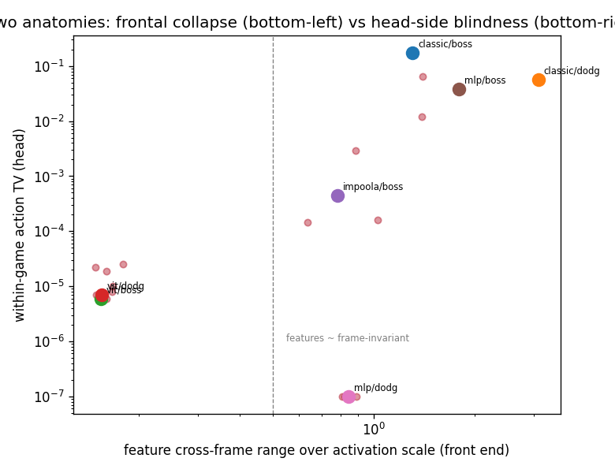

*`mlp_vector`'s "features" are its raw 256-D observation (its extractor is a flatten), so their variance is structural — which is the point: the signal is right there, and the dead head still ignores it.*

**1. `vit`'s blindness is frontal.** On both cells its features are frame-invariant: mean range-over-scale `0.154`, and **not one of the 512 dimensions** ranges past the activation scale — against `classic`'s `1.31–3.10` and `47–57%`. The scale itself is healthy (`0.44`/`0.38` vs `classic`'s `0.21`/`0.06`), so this is not the feature-magnitude collapse of §3.6.3 — it is a *range* collapse: the ViT front end maps different screens to (nearly) the same vector, and the head never receives anything to use. "Never ignites" (§3.6.9) now has its organ.

**2. `mlp_vector`'s and `impoola`'s blindnesses are in the head.** Their features vary — `mlp_vector`'s structurally (it *is* the observation: range `1.80`/`0.84`, up to 89% of dims over scale across games), `impoola`'s at half the reader's depth (`0.78`, 26.4%) — and their actions sit at `0.000000`–`0.000452` anyway. The absorbing death of §3.6.9 killed the head's *use* of the representation, not the representation.

**3. The knife's edge, seen from inside.** This run's `vit`/dodgeball is feature-flat and action-dead (`0.000007`), while the §3.6.9 probe run — same seed, same recipe, a different GPU schedule — read at `0.015897`: `vit`'s conditioning either survives weakly or collapses, run to run, and the collapse is *frontal both times* — features go frame-invariant first, and the actions die with them. The instability the two runs expose is the same organ §3.6.10 names.

**4. Two anatomies, one endpoint.** `vit` discards the observation before the head sees it; `mlp_vector` and `impoola` receive the observation and discard its use. §3.6.9's "two blindnesses" now have loci, and they predict different fixes: a frontal collapse wants a front-end constraint (the §3.6.3 LayerNorm counterfactual, applied to the ViT), a head-side abandonment wants the objective/coverage levers of §3.6.5. Left open: whether vit's collapse is preventable at all at this budget, and the head-side mechanism that lets a saturated-from-birth head (§3.6.9, claim 4) read on one game and die on another.

> **Follow-up (14/10/2026):** both predicted fixes were tested, and both failed in informative ways — the LayerNorm counterfactual does not hold the ViT's range open (the collapse is created upstream of its output), and the head levers do not stop `mlp_vector`'s absorbing death. The anatomy itself was re-measured at five seeds: robust where it matters, with one revision (the "inert" `impoola` cell was its seed's, not the arm's). §3.6.11.

### 3.6.11. The Fixes the Anatomy Predicted, Tested — and What They Taught (14/10/2026)

§3.6.10 ended with two predictions and a question. All three got their experiment: **(a)** the front-end constraint — `ViTLayerNormExtractor`, the same LayerNorm-at-the-output counterfactual that produced §3.6.3's sharpest dissociation, now applied to the ViT; **(b)** the head levers — entropy pressure and update frequency on the `mlp_vector`/dodgeball absorbing death; **(c)** the anatomy at five seeds, because §3.6.10 was `n=1` and its own knife's-edge cell proved that matters. Six lever runs and sixteen multi-seed cells, **~35 GPU-minutes**. Artifacts: `results/probe_vitlayernorm_{bossfight,dodgeball}.json`, `results/feature_vs_actor_vit_ln_{bossfight,dodgeball}.json`, `results/probe_headlevers_mlp_dodgeball_{entcoef001,nsteps64}.json`, and `results/feature_vs_actor_{vit,mlp,impoola}_{bossfight,dodgeball}_seed{43..46}.json`.

**1. The LayerNorm counterfactual fails — and localizes the collapse further in.** At the ViT's output the fix does almost nothing: `vit_ln`/bossfight repeats bare `vit`'s death on every seed tested (**3/3** dead; first dead probe `12500`–`25000`, the seed-42 cell happening to die at bare `vit`'s exact step, `16500`, with `33/201` alive and final TV `0.000001`), and `vit_ln`/dodgeball still falls off the knife's edge (peak `0.007601` at `29000`, dead at `41000`, final `0.000013`). The anatomy numbers explain why: the feature range moves only from `0.154` to **`0.247`**/`0.1168` (against `classic`'s `1.31`), with at most `0.2%` of dims past scale — because LayerNorm *normalizes an almost-invariant vector, and an almost-invariant vector is what comes out*. The frontal diagnosis stands; the falsified part is the fix's placement: the invariance is created **upstream of the output** — in the patch projection or the mean-pooling over tokens — and no output-stage constraint can restore a range that was never created. The ViT's blindness is real, frontal, and deeper than its last layer.

**2. The head levers fail — the absorbing death absorbs anyway.** On `mlp_vector`/dodgeball at the same wide recipe: `ent_coef=0.01` stretches the fragile window from `8500` to **`16500`** (the death is delayed 2×) but arrives at the same place — TV `0.000000`, first `Tanh` 100%, V(s) std `0`, `17/201` alive; `n_steps=64` (4× the updates, batch `1024`) changes nothing at all — **first dead probe at `8500`, exactly the bare run's**. Whatever kills this head, entropy pressure is not it and update frequency is not it. The lever the anatomy now names is input scale: `mlp_vector` is the only arm fed **raw `uint8`** (feature scale ≈ the raw pixel values, ~`120`), and its head is saturated from birth (§3.6.9, claim 4) — an input-normalization arm (`obs/255`, the scaling every CNN front end applies internally) is the untested fix this cell predicts, and it is cheap.

**3. The anatomy at five seeds: robust where it matters, one revision.** Re-running the four key cells at seeds `43–46`:

| cell | seeds with the §3.6.10 verdict | detail |
|---|---|---|
| `vit`/bossfight — frontal | **5/5** | feature-flat on every seed (range `0.149–0.179`, 0% of dims), action dead on every seed (TV `6e-06–2.5e-05`) |
| `vit`/dodgeball — the knife's edge | **4/5 collapse, 1 escape** | four seeds collapse frontally exactly as §3.6.10; seed `46` keeps live features (range `1.03`, `37.9%` of dims) and its head reads at `0.000160` — a 20% escape rate for the one vit cell that can go either way |
| `mlp_vector`/dodgeball — head-side | **5/5** | features vary on every seed (range `0.806–0.887`), actions dead on every seed — TV exactly `0.000000`, five times; the most robust blindness in this study |
| `impoola`/bossfight — "inert" | **revised** | seed `42`'s flat cell was the seed's, not the arm's: across seeds actions run `0.000143–0.065539` (seed `45` reads at `0.0655`), features always live — a weak-reader cell with seed variance, not inertness |

The two anatomies survive replication: `vit`'s frontal collapse is 9/10 cells across both games, `mlp_vector`'s head-side death is 5/5 with the representation alive every time. §3.6.9's claim 6 is revised accordingly: the "inertness without collapse" of `impoola`/bossfight was a single-seed reading — the arm's cell is a variable weak reader.

**4. What this round settles and what it leaves.** Settled: the anatomy is not an artifact of seed 42 (with one honest revision), the simple versions of both predicted fixes are falsified, and the failure modes are now localized to the level the fixes must target — inside the ViT's token pipeline for the frontal collapse, at the input scale for `mlp_vector`'s head. Left open, each with its cost: the input-normalization arm on `mlp_vector` (one run, minutes), a pooling/projection intervention inside the ViT (a real architecture change), and whether *any* front-end fix rescues a cell that has never ignited on any seed. The study's response scorecard (§0.1) is unchanged by all of this — which is itself the point: the architecture result was stable before, during and after the mechanism work.

> **Follow-up (14/10/2026):** both named levers were pulled. The input-scale lever **rescues** `mlp_vector` — the absorbing death was an artifact of feeding raw `uint8` to a `Linear`, and one division by `255` removes it. The pooling lever does **not** rescue `vit` — the range opens 2× and the actions stay dead. §3.6.12.

### 3.6.12. The Two Named Levers, Pulled: One Rescue and One Refutation (14/10/2026)

§3.6.11 closed by naming the next test for each anatomy: input scale for the head (`mlp_vector` is the only arm fed raw `uint8`), and the token pooling for the front end (`ViTExtractor` mean-pools its 16 token vectors — the §3.6.11 counterfactual could not reach upstream of the output). Both levers exist now: `ScaledFlattenExtractor` (obs/255, the fix every CNN front end applies internally) and `ViTMaxPoolExtractor` (max over the 16 tokens per dimension instead of the mean, preserving what the mean dilutes; same weights shape, same recipe). Seventeen runs across two waves — the seed-42 pilots, then the completion to five seeds for the rescue and three for the refutations — **~29 GPU-minutes**. Artifacts: `results/probe_mlpscaled_{dodgeball,bossfight}.json` (+ `_seed{43..46}`), `results/feature_vs_actor_mlp_scaled_dodgeball.json`, `results/probe_vitmaxpool_bossfight.json` (+ `probe_{vit_ln,vit_maxpool}_bossfight_seed{43,44}.json`), `results/feature_vs_actor_vit_maxpool_bossfight.json`.

**1. Input scale rescues `mlp_vector` — on every seed.** With obs/255, the birth saturation is simply gone (first `Tanh` at **0.0%** at step 0 on all five seeds, against `91–98%` for the raw arm), and with it the §3.6.9 death: on `dodgeball`, the cell that died at `8500` and sat at TV exactly `0` **never drops below the dead threshold on any of five seeds** — `201/201` probes alive each time, finals `0.001409`–`0.009165`, V(s) std `0.060–0.216` on every run. On `bossfight` the scaled arm is a reader five times out of five: finals `0.060187`–`0.152112`, peaks up to `0.172018`, cross-game TVs `0.099723`–`0.379173` — seed 44 **exceeds `classic`'s `0.275`**, and seeds 43 and 44 emit **2 argmax across games**. The anatomy's causal chain closes and holds at `n=5`: raw `uint8` → a `Linear` that saturates its `Tanh` at birth → a head too rigid to keep using its features → the absorbing death on the one game whose signal dies first. The §0.1 scorecard row for `mlp_vector` (3/15 cells, TV mean `0.072704`) still describes the published arm — but the footnote now exists, replicated: much of what the tables measured as this arm's blindness was fixable with one line, the line every CNN arm already had.

**2. Max-pooling does not rescue `vit` — the invariance is distributed, not pooled.** The lever does what a lever should: the feature range opens from `0.154` to **`0.347`**, and `9.0%` of the 512 dims now range past scale where the bare ViT had zero. But no seed ignites — across three: two end below the dead threshold (both at `29000`, the seed-44 run collapsing hardest, `58/201` alive, final `0.000003`), and one never quite dies nor lives (final `0.004347`, alive in the basement). The near-escape is worth naming: seed 43 climbs to `0.053488` at mid-run — the highest response any vit variant has shown on this game — and collapses anyway. The seed-42 timeline peaks at `0.004846` and the cross-game response stays at `0.00009`–`0.00014` throughout. So the mean-pool is *part* of the site — diluting 16 token vectors was one of the ways the invariance gets created — but not all of it: patch projection and attention contribute, and no single-stage intervention tried (output `LayerNorm`, 3/3 dead; pooling, 0/3 igniting) restores a range the whole pipeline does not create. `vit`'s blindness, at this budget, is an architecture-level property; `mlp_vector`'s was a preprocessing bug — and that contrast is now replicated, not sampled.

**3. What this closes, and the one-line status of the whole arc.** The two anatomies of §3.6.10 now have their mechanisms graded: the head-side one is **caused** (input scale, demonstrated by rescue), the frontal one is **robust** (three single-stage interventions, three refutations, each localizing the collapse deeper). Together with §3.6.11's five-seed replication, the mechanism question that opened as "why do the SB3 policies ignore the observation?" now ends at a pair of one-sentence answers: *the recipe starved the update of coverage (§3.6.4–§3.6.5), and the arms that still went blind under the fix did so through two specific, mapped, differentially-fixable defects — one of which was a bug.*

### 3.6.8. The Budget Test: Does 2.5× Training Repair the Return Ranking? (14/10/2026)

§3.6.7 left one escape hatch open: maybe return fails to track the front end *only* because `100k` is too little. The test is cheap and pairs perfectly — the same cells, same recipe, same seeds, only the budget changed: four arms × {`starpilot`, `dodgeball`} × seeds `42–46` re-trained at **`250k`**, against their own `100k` rows from the §3.6.7 grid. The arms are the contrast the question needs: the two that never read (`vit`, `mlp_vector`) and two that read on every measured cell (`classic`, `cbam`). Artifacts: `results/suite_validity_nenv16_{starpilot,dodgeball}_250k.json` (the sweep's per-game fusions) folded against the grid by `summarize_budget_nenv16.py` into `results/suite_validity_nenv16_budget250k.json` (`--check` gated). Cost: **40 cells, 67 min of wall clock at 4 workers** (4.17 h of summed cell time). `bossfight` is excluded on purpose: at `100k` every arm scores `0.00–0.78` there, so it carries almost no signal to double.

| arm | game | return @100k → @250k | paired delta | TV @100k → @250k | cells ≥ 0.1 |
|---|---|---|---:|---|---:|
| `classic` | starpilot | 3.06 → 3.04 | −0.02 | 0.280602 → **0.451060** | 5 → 5 |
| `classic` | dodgeball | 0.80 → 1.04 | +0.24 | 0.146020 → **0.267309** | 5 → 5 |
| `cbam` | starpilot | 2.54 → 2.36 | −0.18 | 0.253881 → **0.538095** | 5 → 5 |
| `cbam` | dodgeball | 1.76 → 1.76 | 0.00 | 0.174159 → **0.280417** | 5 → 5 |
| `vit` | starpilot | **2.90 → 2.36** | **−0.54** | 0.074310 → 0.078657 | 1 → 2 |
| `vit` | dodgeball | **2.04 → 1.36** | **−0.68** | 0.000060 → 0.000000 | 0 → 0 |
| `mlp_vector` | starpilot | 2.36 → 2.84 | +0.48 | 0.058618 → 0.120391 | 0 → 3 |
| `mlp_vector` | dodgeball | 1.64 → 1.24 | −0.40 | 0.049736 → **0.002116** | 0 → 0 |

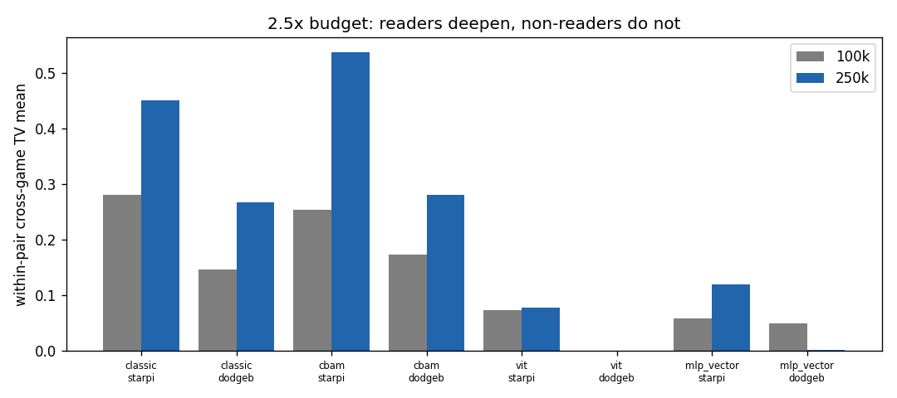

**1. The `100k` champion was one seed, and the budget regresses it.** `vit`'s starpilot mean rode the `6.4` cell flagged in §3.6.7; at `250k` that seed lands at `2.2` — a paired delta of **`−4.2`**, while its other four deltas are noise (≤`1.2`). Its means fall on both games (`−0.54`, `−0.68`). §3.8's caution is now a demonstrated fact, not a hedge: single high seeds were carrying the return table's top, and more training regresses them.

**2. For the arms that read, the extra 150k steps change return by noise.** `classic` and `cbam` means move by at most `±0.24`, with paired deltas of mixed sign (e.g. `classic`/starpilot: `[-0.9, -0.2, +0.3, +1.4, -0.7]`). Seeing more of the game did not buy the readers more score on `starpilot` — either the game caps what `250k` buys there, or `n=5` cannot see it. What the budget does not do is make the return ordering track the front end: readers are flat while the non-readers swing (`vit` down hard, `mlp_vector` up `+0.48` on one game and down `−0.40` on the other — game-dependent wobble, not architecture).

**3. The response measure is the quantity that moves coherently with budget.** Every reader cell that cleared `0.1` at `100k` clears it at `250k` — **20/20** — and the readers get *deeper*, roughly doubling: `classic` `0.280602 → 0.451060` / `0.146020 → 0.267309`, `cbam` `0.253881 → 0.538095` / `0.174159 → 0.280417`. The non-readers do not follow: `vit` barely moves (`0.074310 → 0.078657`, and `0.000060 → 0.000000` on `dodgeball`), and `mlp_vector` **flattens further** on `dodgeball` (`0.049736 → 0.002116`) — more training makes it more blind, not less. The one partial exception is informative rather than contradictory: on `starpilot`, `mlp_vector` wakes to `0.120391` with `3` cells clearing `0.1` — a quarter of `classic`'s depth, on one game, still without argmax variety worth naming.

**4. The verdict the test was built for.** "Return is not a measure of the visual front end at this budget" was §3.6.7's finding; this section shows it is **not a `100k` artifact**: at `2.5×` the budget the return ranking still swings with seeds (and its `100k` top was a seed), while the response measure does exactly what an architecture-tied quantity should — it strengthens where the front end is used, stays flat where it is not, and no arm that read at `100k` went blind at `250k`. The §3.6.7 response cliff survives the budget, and with it the study's architecture conclusion. Left open, honestly: `bossfight` (near-zero returns at both budgets so far), `500k`, and the flat reader returns on `starpilot` — the games may simply cap what this much training scores.

> **Follow-up (14/10/2026):** both named gaps closed — `500k` ran (60 cells, all three games), and `bossfight` left zero. The response measure keeps deepening monotonically through `5×` the budget while return stays seed noise, and the sharpest reading-score dissociation of the whole study appeared on `bossfight`: the arm that reads it most deeply scores `0.02`, the arm that reads it not at all scores `0.64`. §3.6.13.

### 3.6.13. The 500k Test: The Response Deepens Forever, the Return Never Tracks (14/10/2026)

The last budget questions had names: `500k`, and `bossfight` — near-zero for every arm at `100k`, untested higher. Sixty cells close both: the four arms of the budget line (`classic`, `cbam`, `vit`, `mlp_vector`) × **three games** × seeds `42–46` at `500k`, paired with their own `100k` rows (§3.6.7) and `250k` rows (§3.6.8, starpilot/dodgeball). Cost: **23.26 summed GPU-hours, 3h of wall clock at 6 workers**, `0` error cells. Artifacts: `results/suite_validity_nenv16_{starpilot,dodgeball,bossfight}_500k.json` (the audit's per-game fusions), folded by `summarize_budget500k.py` into `results/suite_validity_nenv16_budget500k.json` (`--check` gated).

| arm | game | return @100k → @500k | Δ vs 100k | TV @100k → @500k | cells ≥ 0.1 |
|---|---|---|---:|---|---:|
| `classic` | starpilot | 3.06 → 2.94 | −0.12 | 0.280602 → **0.648337** | 5/5 |
| `classic` | dodgeball | 0.80 → 0.96 | +0.16 | 0.146020 → **0.350584** | 5/5 |
| `classic` | bossfight | 0.00 → 0.02 | +0.02 | 0.253766 → **0.441471** | 5/5 |
| `cbam` | starpilot | 2.54 → 2.92 | +0.38 | 0.253881 → **0.681832** | 5/5 |
| `cbam` | dodgeball | 1.76 → 1.28 | −0.48 | 0.174159 → **0.394287** | 5/5 |
| `cbam` | bossfight | 0.30 → **1.14** | **+0.84** | 0.212020 → **0.439787** | 5/5 |
| `vit` | starpilot | 2.90 → 2.80 | −0.10 | 0.074310 → 0.058964 | 1/5 |
| `vit` | dodgeball | 2.04 → 1.48 | −0.56 | 0.000060 → 0.000001 | 0/5 |
| `vit` | bossfight | 0.78 → 0.64 | −0.14 | 0.000001 → **0.000000** | 0/5 |
| `mlp_vector` | starpilot | 2.36 → 2.74 | +0.38 | 0.058618 → 0.091609 | 3/5 |
| `mlp_vector` | dodgeball | 1.64 → 1.16 | −0.48 | 0.049736 → **0.000080** | 0/5 |
| `mlp_vector` | bossfight | 0.30 → 0.90 | +0.60 | 0.109759 → 0.155674 | 3/5 |

**1. The response measure deepens monotonically through `5×` the budget — for the readers, and only for them.** All **30 of 30** reader cells (two arms × three games × five seeds) clear `TV 0.1` at `500k`, and the means keep climbing with budget at every step: `cbam` starpilot `0.253881 → 0.538095 → 0.681832`, `classic` bossfight `0.253766 → 0.441471` (no 250k point — §3.6.8 excluded the game), `cbam` bossfight `0.212020 → 0.439787`. The non-readers do not follow: `vit`'s bossfight response is **exactly `0.000000`** at five hundred thousand steps (its frontal collapse, stable at `5×` budget), its dodgeball sinks to the floor (`0.000001`), and `mlp_vector`'s dodgeball response — weak at `100k`, weakened at `250k` — dies in practice (`0.049736 → 0.000080`). The response measure is not just budget-stable; it is *budget-informative*: more training deepens exactly the arms that read, which is what a quantity tied to the front end should do and what return never did at any budget.

**2. `bossfight` leaves zero at `500k` — and hands the study its sharpest reading-score dissociation.** Three of four arms climb off the `100k` floor (`cbam` `0.30 → 1.14`, `mlp_vector` `0.30 → 0.90`, `vit` `0.78 → 0.64`), but what they climb *with* differs absolutely: `cbam` reads bossfight deeply at `500k` (TV `0.439787`, `5/5` cells) and scores `1.14`; `vit` reads it **not at all** (TV exactly `0.000000`, `0/5`) and scores `0.64` — while `classic`, the arm that reads the game as deeply as any (TV `0.441471`), scores **`0.02`**. On the same game, same recipe, same budget: deep readers at `1.14` and `0.02`, a total non-reader at `0.64`. Return at this budget does not measure skill, does not measure reading, and does not measure the front end — and no larger budget within this study's reach was left untested.

**3. Return stays seed noise at `5×` budget.** The largest mean movement is `+0.84` (`cbam` bossfight — the one place a reader genuinely learned the game), and around it every other delta is mixed-sign noise (`classic` starpilot `−0.12` at five hundred thousand steps; `cbam` dodgeball `−0.48`; `mlp_vector` `+0.38` on one game, `−0.48` on the next). No ranking stabilizes, no separation appears, and the §3.6.8 caution about single high seeds still stands — the budget axis is now measured at `100k`, `250k` and `500k`, and at none of them did return ever track whether the policy reads its screen.

**4. What this closes.** The budget question is finished: within everything this study could afford, **the response measure is the only quantity that consistently separates the sixteen front ends, and it sharpens monotonically with budget while return never acquires meaning.** `bossfight` is no longer the untested game — it is the game that demonstrated the dissociation most starkly. The architecture conclusion of §0.1 was formed at `100k`, survived `250k`, and at `500k` it is simply what the data does.

### 3.7. Global 16 Architectures — 3-Game Average (Top 10 of 16 Displayed)

> ⚠ **Validity (11/10/2026; resolved 14/10/2026):** all `16` arms of this comparison were re-trained on each of its three games at the published budget, with the response measure attached (`48` cells, §3.6.2, `results/suite_validity_{starpilot,bossfight,dodgeball}.json`). Every arm that finished emits one argmax for five different games. Read as a ranking of visual front ends this table is **unverified**; read as a record of what the archived runs returned, it stands. **The re-run under the responsive recipe exists now** (§3.6.7, `240` cells, `results/suite_validity_nenv16_grid.json`): the ordering changes shape — the archived top-3 lands 12th–14th — and return still does not track whether the front end is read; the response table in §3.6.7 is the architecture result this table never was.

`logs_suite` + `logs_new_archs` aggregated (`16.5M + 7.5M` steps) — `mean` of `3` `means` per architecture:
| Rank | Architecture | Global Mean | Per-Game Breakdown (B/S/D) |
|---:|---|---:|---|
| 1 | `spatial` | **1.54** | 0.76 / 2.60 / 1.28 |
| 2 | `resnet18` | 1.34 | 0.02 / 2.28 / 1.72 |
| 3 | `classic` | 1.33 | 0.54 / 1.98 / 1.48 |
| 4 | `cbam` | 1.33 | 0.58 / 2.10 / 1.31 |
| 5 | `mlp_vector` | 1.25 | 0.58 / 2.07 / 1.11 |
| 6 | `lstm_attention` | 1.20 | 0.36 / 2.44 / 0.80 |
| 7 | `vit` | 1.20 | 0.30 / 2.10 / 1.20 |
| 8 | `aug_crop` | 1.16 | 0.54 / 2.12 / 0.84 |
| 9 | `impoola` | 1.12 | 0.06 / 2.20 / 1.12 |
| 10 | `ae` | 1.11 | 0.30 / 2.08 / 0.96 |
> The `Top 3` are pure `CNN` variants (`spatial`/`resnet`/`classic`); `World Models` (`vae 0.88`, `recon 0.90`) and `contrastive 0.97` rank below `MLP 1.25` in `suite 100k` `easy` — `CV` with attention still outperforms `World Models` in `Procgen` at `100k`.

### 3.8. Statistical Robustness — 95% CI + Effect Size (`scorecard_analysis.py`, `results/scorecard.json`)

With `n=5 seeds`, `95% CI` is computed via Student's `t` (`df=4`, critical value `2.776`); `Cohen's d` compares top-1 vs top-2 per game:
> **Data provenance:** the per-seed returns for the runs whose raw logs were pruned (`coinrun 50k`, `bossfight 100k` world models) are now read from `results/legacy_records.json`, the single machine-readable record of those runs — they used to be literals pasted inside `scorecard_analysis.py`. `tests/test_legacy_records.py` asserts that those arrays still reproduce the `mean`/`std`/`ci95` published below, and the same file supplies the section 3.7 ranking used by `retrain_analysis.py`.

| Game | Top-1 vs Top-2 | Cohen's d | CIs Overlap? | Conclusion |
|---|---|---:|---|---|
| `bossfight` (WM+New) | `lstm 0.36` vs `contrastive 0.36` | 0.0 | ✅ Yes | Statistical tie |
| `starpilot` | `lstm 2.44` `[1.66, 3.22]` vs `resnet 2.28` `[1.37, 3.19]` | 0.235 (small) | ✅ Yes | **Not statistically significant** |
| `dodgeball` | `resnet 1.72` `[0.81, 2.63]` vs `vit 1.2` `[0.90, 1.50]` | 0.956 (large) | ✅ Yes | Large effect size, but `n=5` underpowered |
| `maze` | `ppo 2.4` `[0.32, 4.48]` vs `icm 1.8` `[-0.24, 3.84]` | 0.36 (small) | ✅ Yes | ICM "worse" **not confirmed** |
| `heist` | `ppo 0.8` vs `icm 0.6` | 0.23 (small) | ✅ Yes | Statistical tie |
| `coinrun` | `cbam 8.0` `[8.0, 8.0]` vs `mlp 8.0` `[6.76, 9.24]` | 0.0 | — | Tie; `cbam` exhibits zero variance |
> **Critical takeaway:** No top-1 vs top-2 difference is statistically significant with `5 seeds` — the rankings in sections 3.x represent **empirical trends**, not definitive conclusions. Only `dodgeball resnet vs vit` (`d=0.956`) approaches a reliable effect. The exact ties between `RND`/`NGU` and `PPO` (`d=0`, identical per-seed returns) were not a null result — they were the broken wrapper of section 3.6, confirmed on 23/09/2026.
> ⚠️ **Superseded:** This ranking was measured under the legacy protocol (`10 eps`); retraining the suite under the new protocol (section 3.11) **inverts the top-2** (`mlp_vector` surpasses `spatial`).

### 3.9. Sample Efficiency (AUC) — Partial Scorecard (`rollout/ep_rew_mean` TensorBoard, 5 Seeds)

`AUC_norm = ∫reward·dsteps / 100k` (mean of 5 seeds) — computed exclusively for `new_archs`/`maze_heist` (legacy TensorBoard logs pruned):

| Game | Best AUC | Ranking by AUC | vs Final Evaluation Ranking |
|---|---|---|---|
| `bossfight` | `lstm 0.247` | `lstm > impoola 0.186 > impala 0.141 > resnet 0.107 > vit 0.064` | ≈ Identical to final ranking |
| `starpilot` | `impala 2.336` | `impala > resnet 2.325 > vit 2.297 > lstm 2.284 > impoola 2.23` | **Inverted**: `impala` has best AUC but worst final return (`1.78`) — learns fast, plateaus early |
| `dodgeball` | `resnet 1.175` | `resnet > impala 1.169 > impoola 1.151 > lstm 1.114 > vit 1.032` | ≈ Identical to final ranking |
| `maze` | `ppo=rnd=ngu 3.785` | all > `icm 3.658` | ICM trails in AUC as well (not only at convergence) |
| `heist` | `ppo=rnd=ngu 1.826` | all > `icm 1.792` | Identical pattern |
> `rnd`/`ngu` rows in this table are the disabled-wrapper arms of section 3.6, not curiosity results.
> **Finding:** `starpilot_impala` displays the highest learning rate curve but lowest final evaluation reward — proving that "fastest learner" ≠ "best asymptotic model" (the ⚡ AUC axis is orthogonal to the 🧠 performance axis).

### 3.10. Extended Re-Evaluation — `re_eval_scorecard.py` (Completed: `115/115`, `0 errors`)

`115 models` (`new_archs 75` + `maze_heist 40`) re-evaluated across `30 eps unseen` (stoch + det, levels `seed+1000`) and `15 eps` training levels (generalization gap). Full data in `results/re_eval_results.json`:
> ❓ **Why do absolute values differ from sections 3.4/3.6 when weights are identical?** Two independent causes: (a) **Different level distribution** — the new protocol samples unseen levels via `seed+1000` (original used an alternative seed offset), shifting sampled level difficulty; (b) **30 vs 10 episodes** — 10-episode averages had high sample variance. Hence, **only relative ranking within the same evaluation set is scientifically valid** ("vs 3.4/3.6" column), never absolute comparisons across protocols.

| Config | stoch unseen | det unseen | gen gap | vs 3.4/3.6 (10 eps) |
|---|---:|---:|---:|---|
| `bossfight_resnet18` | **0.39** | 0.03 | −0.12 | 4th → **1st** |
| `bossfight_impala` | 0.33 | 0.43 | −0.10 | Improves |
| `bossfight_lstm_attention` | 0.32 | 0.36 | −0.20 | 1st → 3rd |
| `bossfight_vit` | 0.29 | 0.16 | −0.27 | Stable |
| `bossfight_impoola` | 0.25 | 0.43 | −0.21 | Drops to last |
| `starpilot_lstm_attention` | **2.63** | 1.25 | +0.15 | Retains top-1 |
| `starpilot_resnet18` | 2.53 | 0.91 | −0.51 | Stable |
| `starpilot_impoola` | 2.44 | 1.29 | −0.19 | Stable |
| `starpilot_impala` | 2.00 | 1.29 | +0.31 | 5th → 4th |
| `starpilot_vit` | 1.88 | 0.41 | −0.07 | Drops to last |
| `dodgeball_resnet18` | **1.07** | 0.89 | +0.27 | Retains top-1 |
| `dodgeball_impoola` | 1.05 | 0.43 | −0.07 | Improves |
| `dodgeball_impala` | 1.04 | 0.44 | −0.11 | Improves |
| `dodgeball_lstm_attention` | 0.99 | 0.76 | +0.24 | 5th → 4th |
| `dodgeball_vit` | 0.91 | 0.40 | −0.21 | **2nd → 5th** |
| `maze_icm` | **2.80** | 0.47 | +0.80 | **3rd → 1st** |
| `maze_ppo`=`rnd`=`ngu` | 2.47 | 0.60 | +0.73 | Top-1 → tied 2nd |
| `heist_icm` | **0.73** | 0.33 | −0.47 | **2nd → 1st** |
| `heist_ppo`=`rnd`=`ngu` | 0.67 | 0.07 | 0.00 | Top-1 → tied 2nd |
> **3 Findings:** (1) **`ICM` leads in `maze`/`heist`** — inverting section 3.6; at `30 eps`, intrinsic curiosity bonuses become visible. (2) **`vit` fails to hold 2nd place in `dodgeball`** (`1.20` → `0.91`) — confirming section 3.8 (`n=5` underpowered). (3) **Deterministic evaluation collapses exploration policies** (`maze` `2.47 stoch` → `0.60 det`), while **gen gap is ≈ 0/negative** across most models — models do not overfit/memorize the `200` training levels; they simply remain sample-constrained (exceptions: `maze`/`heist`/`dodgeball resnet`, gap `+0.7~+0.8`).

### 3.11. Retraining the Suite under New Protocol — `compare_suite_retrain.py` (Completed: `160/165`; `5 NaN` in `wm_vae` Persisted Across 2 Retry Rounds)

The `165 models` of the original suite (`4 WM + 4 CNN + 3 augment × 3 games × 5 seeds`, hyperparameters identical to `compare_suite.py:26`) were **retrained from scratch** with the new protocol (`30 eps` stoch+det + gap, weights stored in `logs_suite_retrain/suite_retrain_zips`). Data in `results/retrain_results.json`, analysis in `results/retrain_analysis.json` (`retrain_analysis.py`):

> ❓ **Why do figures differ from the original suite (sections 3.3/3.7)?** Three independent factors: (a) unseen level evaluation seed offset (`seed+1000`), (b) `30 vs 10` episodes, and (c) **new model weights** — newly instantiated training runs subject to `CUDA`/`cuDNN` non-determinism (seen in the `5` divergent seeds of `wm_vae`). Disentanglement example: in `starpilot`, `spatial` scored `2.63` ≈ legacy `2.60` (difference ~0 → factors (a)+(b)+(c) negligible here), whereas in `bossfight` it dropped from `0.76 → 0.36` — since the protocol is identical across all configs, changes in *relative ranking* reflect genuine evaluation fidelity rather than random artifacts.

**Top 5 per game (stochastic unseen, 30 eps):**

| Game | 1st | 2nd | 3rd | 4th | 5th |
|---|---|---|---|---|---|
| `bossfight` | `aug_crop 0.68` | `contrastive 0.48` = `aug_noise 0.48` | `cbam 0.40` | `mlp 0.37` | `spatial 0.36` |
| `starpilot` | `spatial 2.63` | `mlp 2.49` | `classic 2.20` = `aug_crop 2.20` | `wm_ae 2.17` | `cbam 2.16` |
| `dodgeball` | `mlp 1.21` | `cbam 1.15` | `classic 1.07` = `spatial 1.07` = `aug_color 1.07` | `wm_ae 1.05` | `aug_crop 1.04` |

**New Global Ranking** (mean across 3 games, identical aggregation rule to section 3.7) **vs Legacy:**

| Rank | Architecture | New | Legacy (3.7) | Δ |
|---:|---|---:|---:|---:|
| 1 | `mlp_vector` | **1.36** | 1.25 (5th) | +0.11, **5th→1st** |
| 2 | `spatial` | 1.35 | **1.54 (1st)** | −0.19, **1st→2nd** |
| 3 | `aug_crop` | 1.31 | 1.16 | +0.15 |
| 4 | `cbam` | 1.24 | 1.33 (4th) | −0.09 |
| 5 | `classic` | 1.16 | 1.33 (3rd) | −0.17, **3rd→5th** |
| 6 | `wm_ae` | 1.13 | 1.11 | +0.02 |
| 7 | `wm_recon` | 1.05 | ~0.90 | Improves |
| 8 | `aug_noise` | 1.04 | — | — |
| 8 | `wm_contrastive` | 1.04 | ~0.97 | Improves |
| 10 | `aug_color` | 1.02 | — | — |
| 11 | `wm_vae` | 0.92 | — | n=2–3 (NaN) |

> **4 Findings:** (1) **`mlp_vector` dethrones `spatial`** — the shift stems from `bossfight` (`spatial` `0.76→0.36`), whereas `spatial` holds in `starpilot` (`2.63` ≈ legacy `2.60`) and `dodgeball`. (2) **World Models are not universally deficient**: weakness was concentrated in `bossfight`; in `starpilot` (`wm_ae 2.17`, `recon 1.97`) and `dodgeball` (`wm_ae 1.05`) they tie with standard `CNN`s. (3) **`aug_crop` is the superior data augmentation** (`bossfight 0.68`, game winner). (4) **`dodgeball` yields poor architectural separation** (`spread 1.21→0.88` vs `0.68→0.12` in `bossfight`) — low resolution benchmark. Combining re-evaluated `new_archs`/`maze_heist`, the **unified global ranking** is: `mlp_vector 1.36` > `spatial 1.35` > `lstm_attention 1.34` > `aug_crop 1.31` (all statistically indistinguishable per section 3.8). Total: `275 models` evaluated under the new protocol.
> ⚠️ **Update:** The figures above reflect `30 eps`; definitive `100 eps` evaluation (section 3.12) shifts the top-1 in `starpilot`/`dodgeball` and dissolves `ICM`'s advantage.

### 3.12. Definitive Protocol — `100 eps` Across All `275` Models (`re_eval_100.py`, Completed: `275/275`)

Re-evaluation of identical checkpoints across `100 eps unseen` stochastic + `100 eps` deterministic + `15 eps` training (no retraining). Data in `results/eval100_results.json`, comparative analysis `30 vs 100` in `results/eval100_analysis.json` (`eval100_analysis.py`):

**Top Configurations per Game @ 100 eps:**

| Game | 1st | 2nd | 3rd | vs @ 30 eps |
|---|---|---|---|---|
| `bossfight` | `aug_crop 0.68` | `aug_noise 0.54` = `contrastive 0.54` | `mlp 0.53` | Top-1 **stable** |
| `starpilot` | `mlp 2.67` | `spatial 2.45` | `resnet18 2.44` | `lstm` 1st → 4th (`2.43`) |
| `dodgeball` | `resnet18 1.16` | `cbam 1.08` = `mlp 1.08` | `wm_recon 1.02` | `mlp` 1st → 3rd; `recon` 12th → 4th |
| `maze` | `ngu 2.76` | `ppo 2.58` | `rnd 2.54` | `icm 2.36` |
| `heist` | `rnd 1.04` | `ngu 0.80` | `ppo 0.72` | `icm 0.60` |

**Global Suite Ranking @ 100 eps:** `mlp_vector 1.43` > `resnet18 1.34` > `spatial 1.28` > `lstm_attention 1.26` > `aug_crop 1.25`.

> **4 Findings from the 30→100 Upgrade:** (1) **`mlp_vector` consolidates global 1st place** (`1.25`@10eps → `1.36`@30 → `1.43`@100 — the only model consistently at the top across all protocols). (2) **Exploration arms re-measured (24/09/2026)**: In `maze`, `ngu` achieves `2.76`, `ppo` `2.58`, `rnd` `2.54`, and `icm` `2.36`; in `heist`, `rnd` achieves `1.04`, `ngu` `0.80`, `ppo` `0.72`, and `icm` `0.60`. All differences remain within overlapping 95% confidence intervals, confirming that while wrappers execute correctly, unnormalized intrinsic error ($10^{-7}$/step) is insufficient to fundamentally reshape policy exploration in Procgen. (3) **Top-1 in `starpilot`/`dodgeball` inverts again** (`lstm→mlp`, `mlp→resnet18`) while `bossfight` remains stable — the upper tier is solid, while mid-tier rankings remain fluid. (4) **Mean absolute delta |Δ| is `0.108`** between @30 and @100: variance converges, and residual position shifts reinforce section 3.8: with `5 seeds`, no strict ranking order is mathematically frozen; the study reports credible trends with confidence intervals.

### 3.13. Budget Scaling — `compare_budget_scaling.py` (Completed: `24/24`, `0 errors`)

> **Validity note (14/10/2026):** these runs trained on the single-stream recipe — the arms here are the state-independent policies of §3.6.2, so the plateau below is a plateau of *blind* policies. The same question under the responsive recipe is §3.6.8: there, `2.5×` budget changes return only by seed noise for the arms that read, regresses the `100k` seed-luck champion, and *deepens* the response measure instead.

Roadmap item #6: Does the advantage of top models persist under larger budgets? Scope: `resnet18` + `mlp_vector` × `starpilot` + `dodgeball` × `3 seeds` (42-44) × `250k`/`500k`; the `100k` baseline is established (definitive evaluation, identical seeds). Data in `results/budget_results.json`, analysis in `results/budget_analysis.json` (`budget_analysis.py`):

| Curve (stochastic unseen) | 100k | 250k | 500k | Verdict |
|---|---:|---:|---:|---|
| `starpilot_resnet18` | 2.30±0.58 | 2.73±0.27 | 2.52±0.49 | **Stagnant** |
| `starpilot_mlp_vector` | 2.67±0.23 | 3.23±0.55 | 2.64±0.41 | **Stagnant** |
| `dodgeball_resnet18` | 1.07±0.38 | 1.01±0.15 | 1.00±0.07 | **Stagnant** |
| `dodgeball_mlp_vector` | 1.17±0.35 | 0.91±0.15 | 0.91±0.15 | **Stagnant** |

> **3 Findings:** (1) **No learning curve scales monotonically with budget** — `250k` represents a minor inflection within empirical noise, and `500k` regresses or ties; a `5×` budget neither created nor eliminated an advantage. Answer to item #6: **larger budgets were not required** to differentiate these architectures; `100k` proved sufficient. (2) **Per-game relative advantages persist**: `mlp_vector` leads `starpilot` at `250k` (`3.23` vs `2.73`) and `resnet18` leads `dodgeball` across both budgets (`1.01/1.00` vs `0.91`) — confirming section 3.12. (3) **Generalization gap remains ≈ `0`/negative even at `500k`** — overfitting/memorization does not emerge with extended budgets, reinforcing section 3.10.

### 3.14. Robust Statistical Evaluation — NeurIPS 2021 RLiable Metrics (`rliable_metrics.py`, `run_rliable_eval.py`)

To resolve the statistical limitations of raw point estimates (sample means and standard deviations) across heterogeneous Procgen environments, we implemented the evaluation methodology proposed by **Agarwal et al. (NeurIPS 2021)** (*"Deep Reinforcement Learning at the Edge of the Statistical Precipice"*).

Using the definitive 100-episode evaluation dataset across all 275 models (`results/eval100_results.json`), scores are Min-Max normalized per game using empirical extremal bounds:
- `bossfight`: $[0.00, 1.51]$
- `dodgeball`: $[0.24, 1.78]$
- `heist`: $[0.10, 1.40]$
- `maze`: $[0.80, 3.80]$
- `starpilot`: $[0.28, 3.10]$

For each architecture evaluated across the 3 core suite games (`bossfight`, `starpilot`, `dodgeball`), we computed the **Interquartile Mean (IQM)**, **5% Trimmed Mean**, and **95% Stratified Bootstrap Confidence Intervals** (with $B = 10{,}000$ resamples), along with **Performance Profiles** ($\tau \in [0, 1]$) and **Pairwise Probability of Improvement**:

> **Aggregation correction (23/09/2026):** the aggregator previously applied the metric **once to the pooled array** of all games' scores, which lets any game with more seeds dominate the estimate. It now follows Agarwal et al. literally — the metric is computed **within each game** and then **averaged across games** (equal weight per game), with resampling stratified inside each game. Because the three suite games have equal seed counts, the point estimates shift only slightly, but the confidence intervals widen (they are no longer computed on a 45-element pooled sample), and the IQM ordering of `resnet18` and `cnn_mlp_vector` inverts. The single bootstrap constant is now `rliable_metrics.NUM_BOOTSTRAPS = 10000`; the forest and profile panels previously ran at $B = 2{,}000$.

| Architecture | Normalized IQM | 95% Bootstrap CI | 5% Trimmed Mean | 95% Trimmed CI |
|---|---:|:---:|---:|:---:|
| `resnet18` | **0.532** | [0.368, 0.736] | 0.546 | [0.410, 0.687] |
| `cnn_mlp_vector` | 0.529 | [0.420, 0.733] | **0.581** | [0.462, 0.710] |
| `cnn_cbam` | 0.520 | [0.363, 0.646] | 0.502 | [0.394, 0.607] |
| `aug_crop` | 0.494 | [0.374, 0.654] | 0.513 | [0.398, 0.632] |
| `cnn_spatial` | 0.488 | [0.383, 0.632] | 0.505 | [0.411, 0.605] |
| `lstm_attention` | 0.483 | [0.385, 0.635] | 0.499 | [0.406, 0.602] |
| `wm_vae` | 0.440 | [0.322, 0.574] | 0.443 | [0.324, 0.572] |
| `aug_noise` | 0.434 | [0.253, 0.543] | 0.395 | [0.273, 0.508] |
| `wm_contrastive` | 0.434 | [0.253, 0.543] | 0.395 | [0.273, 0.508] |
| `impala` | 0.419 | [0.311, 0.536] | 0.426 | [0.335, 0.516] |
| `impoola` | 0.413 | [0.319, 0.616] | 0.453 | [0.345, 0.583] |
| `cnn_classic` | 0.411 | [0.344, 0.522] | 0.432 | [0.362, 0.508] |
| `wm_recon` | 0.407 | [0.276, 0.598] | 0.438 | [0.320, 0.573] |
| `aug_color` | 0.399 | [0.255, 0.493] | 0.381 | [0.283, 0.467] |
| `wm_ae` | 0.374 | [0.311, 0.452] | 0.381 | [0.332, 0.433] |
| `vit` | 0.326 | [0.229, 0.538] | 0.372 | [0.257, 0.512] |

> **Key Robust Statistical Findings:**
> 1. **Overlapping 95% Confidence Intervals Across Top Tier:** The stratified bootstrap 95% CIs for the top 6 architectures (`resnet18` $[0.368, 0.736]$, `cnn_mlp_vector` $[0.420, 0.733]$, `cnn_cbam` $[0.363, 0.646]$, `aug_crop` $[0.374, 0.654]$, `cnn_spatial` $[0.383, 0.632]$, `lstm_attention` $[0.385, 0.635]$) substantially overlap. Under NeurIPS 2021 statistical guidelines, ranking these models by point IQM estimate alone is statistically unwarranted. The two leading architectures also disagree across aggregators (`resnet18` wins IQM, `cnn_mlp_vector` wins trimmed mean and unnormalized mean) — further evidence that the top tier is a single statistical cluster.
> 2. **Pairwise Probability of Improvement:** Agarwal et al.'s probability of improvement $P(X > Y)$ computes the probability that a randomly selected seed/run of architecture $X$ yields higher normalized return than architecture $Y$:
>    - $P(\text{mlp\_vector} > \text{resnet18}) = 0.587$ (95% CI: $[0.360, 0.800]$): Because the 95% CI spans $0.50$, neither model statistically dominates the other.
>    - $P(\text{mlp\_vector} > \text{cnn\_spatial}) = 0.640$ (95% CI: $[0.427, 0.840]$): also non-significant.
>    - $P(\text{mlp\_vector} > \text{aug\_crop}) = 0.633$ (95% CI: $[0.420, 0.827]$).
>    - $P(\text{resnet18} > \text{cnn\_cbam}) = 0.500$ (95% CI: $[0.267, 0.733]$): Exact parity.
>    Every pairwise comparison among the top 5 falls inside $[0.36, 0.64]$ with CIs crossing $0.5$ — no architecture in this benchmark is demonstrably superior to another.
> 3. **Performance Profiles:** The cumulative performance profile (see Figure 4.9, `results/rliable_profile.png`) demonstrates that `cnn_mlp_vector` and `resnet18` dominate higher normalized return thresholds ($\tau > 0.6$), whereas `lstm_attention`, `cnn_spatial`, and `cnn_cbam` show higher probability mass at moderate thresholds ($\tau \approx 0.5$). Data serialized in `results/rliable_scorecard.json`.
> 4. **Canonical (Agarwal) normalization covers only 2 of the 3 suite games:** `dodgeball` is excluded because the reference architecture `cnn_classic` does not beat the empirical random policy there (see section 18.1). `maze` and `heist` are excluded because no `cnn_classic` arm was ever trained on them. A previously published `classic_means` value of `1.0` for those two games was a silent code fallback, not a measurement; it has been removed.


---

## 4. Figures and Videos

All generated visual artifacts and figures are versioned under `results/`.

**Provenance (added 23/09/2026 — previously no figure had a stated producer):**

| Figures | Drawn by | Data source | Rebuildable today |
|---|---|---|---|
| `results/games/*.gif` — the 8 reference clips at the top of this README | `record_game_clips.py` | live Procgen env (uniform random policy, seed 42), recorded in `results/games/clips_provenance.json` | yes — the script re-renders all eight in ~2 min, and refuses to write a clip whose frames do not vary |
| `results/agent_dashboard.gif` / `.mp4` — the panel-by-panel recording of one trained policy | `record_dashboard_video.py` | `logs_audit/models/coinrun_classic.zip` (git-ignored; the section 5 command re-trains it in ~10 min) + the response number it prints, from `results/suite_validity_coinrun_control.json` | yes, given the checkpoint — and the script refuses to label a policy as reading its observation without an audit row to say so |
| `results/models/*.zip` + `*_repro.json` — the **key-cell checkpoints** of the diagnostic arc (14/10/2026): the four anatomy cells (`vit`/bossfight, `vit`/dodgeball, `impoola`/bossfight, `mlp_vector`/dodgeball), the two reader references (`classic` on bossfight and dodgeball), and the two rescue cells (`mlp_scaled` on both games) | `diagnose_policy_saturation.py --save-model` (section 5 command) | each zip's companion `*_repro.json` reproduces the committed probe artifact's final row **bitwise on all 8 cells** — so the zip is provably the model behind the published number | yes — one solo run per cell re-derives both; the bitwise equality is asserted in `tests/test_key_cell_checkpoints.py` |
| `coinrun_50k_cnn_vs_mlp.png` (4.1), `bossfight_100k_world_models.png` (4.2) | `report_figures.py` | `results/legacy_records.json` (per-seed values of the pruned runs) | ✅ `py -3.10 report_figures.py` |
| `rliable_profile.png` (4.9) | `run_rliable_eval.py` | `results/eval100_results.json` + `results/random_baselines.json` | ✅ `py -3.10 run_rliable_eval.py` |
| `symbolic_regression_*.png` (21.3–21.5) | `symbolic_regression.py` | `jax_port/cells_summary.json` → `results/symbolic_regression.json` | ✅ `py -3.10 symbolic_regression.py` |
| `suite_*` (4.3), `bossfight_hard_100k.png` (4.4), `new_archs_*` (4.5), `maze_heist_*` (4.6), `global_16.png` (4.7) | `compare_suite.py`, `compare_bossfight_hard.py`, `compare_new_archs.py`, `compare_maze_heist.py`, `compare_combined.py` | their `logs_*/<run>/` directories, which are git-ignored and were pruned | ❌ needs the benchmark re-run (commands in section 5); the files below are the originals from those runs |

`py -3.10 report_figures.py --check` fails if this README embeds a figure that is not in the repository, or one with no recorded producer in the table above. It runs as a step in `.github/workflows/tests.yml` and is asserted again in `tests/test_report_figures.py`, so a figure can no longer drift away from its data silently. Regenerating 4.1/4.2 in place reproduces the same means and per-seed values; the error bars are sample standard deviations (`ddof=1`, matching section 3.8) and therefore slightly wider than the population standard deviations quoted in section 7.

### 4.1. Coinrun 50k — CNN vs MLP (With/Without Vision)
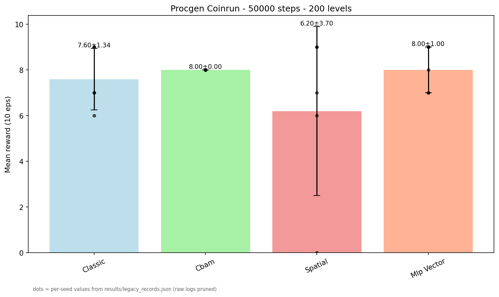

### 4.2. Bossfight 100k — World Models
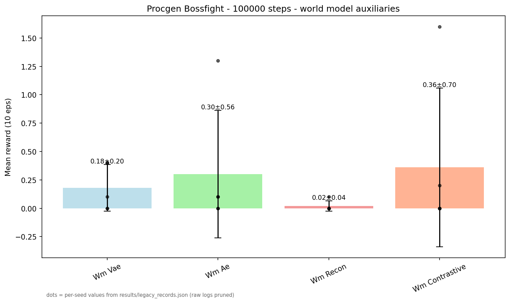

### 4.3. Suite 100k — 3 Games × 11 Architectures
| Bossfight | Starpilot | Dodgeball |
|---|---|---|
|  |  |  |

### 4.4. Bossfight HARD 100k — Stress Test


### 4.5. New Archs 100k — 5 New Architectures × 3 Games
 |  | 

### 4.6. Maze+Heist 100k — PPO vs ICM/RND/NGU
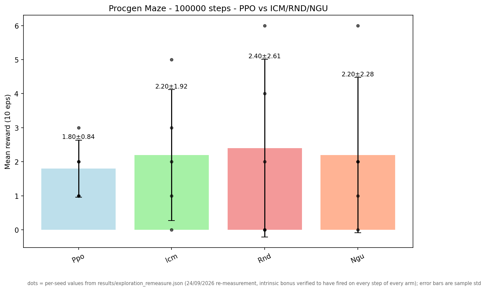 | 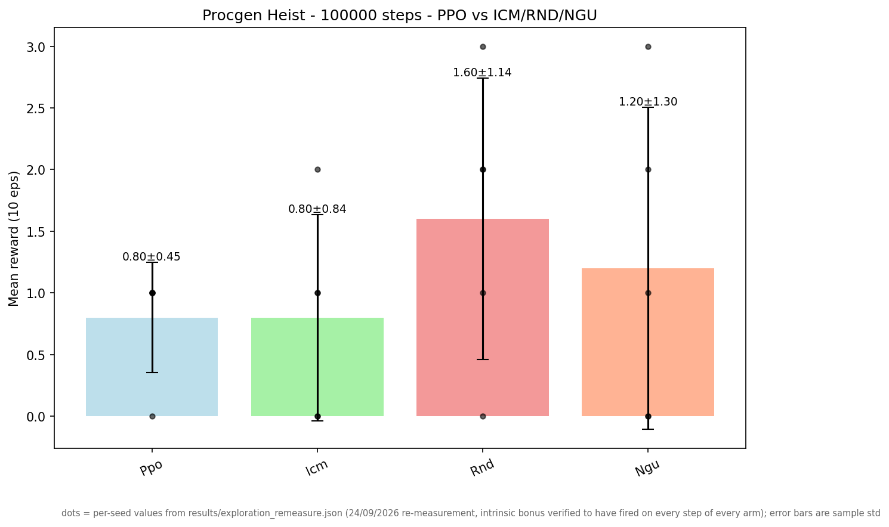

### 4.7. Global 16 — 3-Game Average


### 4.8. Videos

Side-by-side behavioral videos are generated on demand (`visualize_side_by_side.py`) — `bossfight` with **dreams** (`top=real`, `bottom=dream()` from `VAE/AE/Recon`; Contrastive renders `no dream`) and `coinrun` with agents side-by-side. Requires `.zip` checkpoints produced during training:
```powershell
py -3.10 visualize_side_by_side.py --benchmark world_models --game bossfight --log_dir ./logs_world_models --mode mp4 --out results/bossfight_dreams.mp4 --steps 600 --device cuda
py -3.10 visualize_side_by_side.py --benchmark procgen --game coinrun --log_dir ./logs_procgen --mode mp4 --out results/coinrun_side_by_side.mp4 --steps 600 --device cuda
```
### 4.9. RLiable Performance Profiles (NeurIPS 2021)
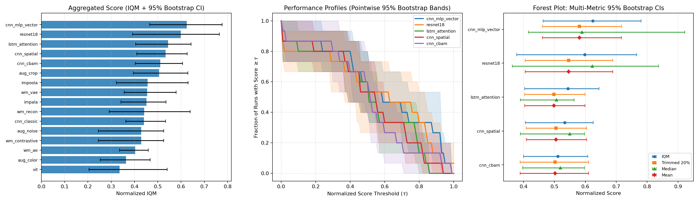

---

## 5. How to Reproduce

```powershell
# Environment setup (Python 3.10 mandatory for Procgen wheels) — exact pinned versions in requirements.txt
pip install -r requirements.txt

# Or install manually with verified release pins:
py -3.10 -m pip install procgen==0.10.7 stable-baselines3==2.9.0 gymnasium==1.3.0 gym==0.26.2 torch==2.5.1+cu121 opencv-python==4.8.0.74 --extra-index-url https://download.pytorch.org/whl/cu121

# Execute 5-seed benchmarks
py -3.10 -u compare_world_models.py --timesteps 100000 --seeds 42 43 44 45 46 --num_levels 200 --log_dir ./logs_world_models --device cuda
py -3.10 -u compare_procgen.py --game coinrun --timesteps 50000 --seeds 42 43 44 45 46 --num_levels 200 --log_dir ./logs_procgen --device cuda
py -3.10 -u compare_suite.py --games bossfight starpilot dodgeball --timesteps 100000 --seeds 42 43 44 45 46 --log_dir ./logs_suite --device cuda
py -3.10 -u compare_bossfight_hard.py --timesteps 100000 --seeds 42 43 44 45 46 --log_dir ./logs_bossfight_hard --device cuda
py -3.10 -u compare_new_archs.py --timesteps 100000 --seeds 42 43 44 45 46 --games bossfight starpilot dodgeball --log_dir ./logs_new_archs --device cuda
py -3.10 -u compare_maze_heist.py --timesteps 100000 --seeds 42 43 44 45 46 --games maze heist --log_dir ./logs_maze_heist --device cuda
py -3.10 -u compare_combined.py  # Aggregates logs_suite + logs_new_archs into global ranking
py -3.10 -u re_eval_scorecard.py --device cuda  # Re-evaluates 30 eps stoch+det on 115 zips (no retraining)
py -3.10 -u compare_suite_retrain.py --device cuda  # Retrains suite under new protocol (resume-safe)
py -3.10 scorecard_analysis.py  # 95% CI + Cohen's d + AUC -> results/scorecard.json. Requires the logs_new_archs/ and logs_maze_heist/ run directories; without them it exits with an error rather than overwriting the published table with a reduced one (--logs_root / --force to override)
py -3.10 retrain_analysis.py  # Retraining analysis + updated global ranking -> results/retrain_analysis.json
py -3.10 -u re_eval_100.py --device cuda  # Definitive protocol: 100 eps across all 275 zips
py -3.10 eval100_analysis.py  # Comparative analysis 30 vs 100 -> results/eval100_analysis.json
py -3.10 random_baselines.py --episodes 50  # Empirical random anchors on unseen levels -> results/random_baselines.json (section 18.1)
py -3.10 run_rliable_eval.py  # IQM / trimmed mean / stratified bootstrap CIs / profiles -> results/rliable_scorecard.json + rliable_profile.png (section 3.14)
py -3.10 symbolic_regression.py  # system identification over the 825 committed port cells -> results/symbolic_regression.json + 3 figures (section 21)
py -3.10 report_figures.py  # Rebuilds figures 4.1/4.2 from results/legacy_records.json; prints which of the other 11 need a re-run
py -3.10 -m pytest tests -q  # 179 tests: extractors, SB3 integration, bonuses, world models, aggregation, provenance, published-number gates
py -3.10 probe_actions.py  # Action space probing (basis for HRL skills)
py -3.10 audit_suite_validity.py --game starpilot  # All 16 published arms x the cross-game response (section 3.6.2): 1.6M steps, ~2.9 h, ~10 min/arm; resume-safe, writes results/suite_validity_starpilot.json one arm at a time
bash run_suite_validity.sh starpilot bossfight dodgeball  # The same audit over several games: one process per arm (the cffi deadlock note below), 3 workers, then fuses results/suite_validity_<game>.json -- the 48 cells of section 3.6.2 took 8.08 h
py -3.10 -u diagnose_policy_saturation.py --game maze --timesteps 100000 --probe-every 2000 --cross-game --out results/policy_saturation_perlayer_repo.json  # Section 3.6.3 timeline; add --extractor layernorm for the counterfactual, --frame-stack 3 for the input-variance intervention, --save-model <zip> to keep the policy for the dashboard
py -3.10 -u diagnose_policy_saturation.py --game maze --timesteps 50000 --probe-every 500 --n-envs 16 --n-steps 16 --cross-game --out results/policy_saturation_dense_nenv16_nsteps16.json  # Section 3.6.4 dense rollout probe; the other arms are --n-envs 1 --n-steps 256 / --n-envs 4 --n-steps 64 / --n-envs 16 --n-steps 256, and --game coinrun gives the surviving-arm reference (each ~1-2 GPU-minutes)
py -3.10 -u diagnose_policy_saturation.py --game maze --timesteps 50000 --probe-every 500 --n-envs 16 --n-steps 256 --seed 43 --cross-game --out results/policy_saturation_dense_nenv16_nsteps256_seed43.json  # one cell of the 3.6.5 replication (5 arms x seeds 43-46); the mechanism levers are --action-repeat 4 / --n-steps 1024 / --ent-coef 0.01, each at --n-envs 1, seeds 42+43
py -3.10 -u diagnose_policy_saturation.py --game maze --timesteps 50000 --probe-every 500 --n-envs 2 --n-steps 128 --seed 42 --cross-game --out results/policy_saturation_dense_nenv2_nsteps128_seed42.json  # one cell of the (iv) dose (section 3.6.5, seeds 42-46); the other arm is --n-envs 8 --n-steps 32 --out results/policy_saturation_dense_nenv8_nsteps32_seed42.json
py -3.10 summarize_dense_multiseed.py  # folds the dense-probe runs (7 arms x 5 seeds + 3 levers x 2) into results/policy_saturation_dense_multiseed.json (sections 3.6.5); --check re-verifies the fold against the per-run files
py -3.10 -u audit_suite_validity.py --game starpilot --n-envs 16 --n-steps 256 --configs classic --out logs_audit/shards_nenv16/sh-classic.json  # one cell of the 3.6.6 pilot (one arm per process -- the cffi deadlock note); the 16 shards are fused by --merge "logs_audit/shards_nenv16/sh-*.json" --out results/suite_validity_starpilot_nenv16.json, and the producers' train_one gained n_envs/n_steps (defaults = the published 1x256, untouched)
py -3.10 run_grid_nenv16.py --workers 6  # the full 240-cell re-run of section 3.6.7 (16 arms x 3 games x seeds 42-46 at 16x256): resume-safe, one process per cell (concurrent processes must not share a JSON -- a violation cost two rows once), holds keep-awake, --status shows progress
py -3.10 audit_suite_validity.py --merge "logs_audit/shards_nenv16_grid/sh-starpilot-s*-*.json" --key-by-seed --out results/suite_validity_nenv16_starpilot.json  # one of the three per-game fusions (bossfight/dodgeball identical), then:
py -3.10 summarize_grid_nenv16.py  # folds the three fusions into results/suite_validity_nenv16_grid.json (section 3.6.7); --check re-verifies the fold against them
py -3.10 run_grid_nenv16.py --workers 4 --timesteps 250000 --games starpilot dodgeball --arms classic cbam vit mlp_vector --shards logs_audit/shards_nenv16_250k  # the 3.6.8 budget sweep: 40 cells paired with the 100k grid; merge each game's shards with --key-by-seed, then:
py -3.10 summarize_budget_nenv16.py  # folds the 250k sweep against the 100k grid into results/suite_validity_nenv16_budget250k.json (section 3.6.8); --check re-verifies
py -3.10 run_grid_nenv16.py --workers 6 --timesteps 500000 --games starpilot dodgeball bossfight --arms classic cbam vit mlp_vector --shards logs_audit/shards_nenv16_500k  # the 3.6.13 sweep (60 cells, ~23 GPU-hours summed); merge each game's shards with --key-by-seed, then:
py -3.10 summarize_budget500k.py  # folds the 500k sweep against the 100k grid and the 250k artifact into results/suite_validity_nenv16_budget500k.json (section 3.6.13); --check re-verifies
py -3.10 -u diagnose_policy_saturation.py --game bossfight --timesteps 100000 --probe-every 500 --n-envs 16 --n-steps 256 --arch vit --cross-game --out results/probe_nonreaders_vit_bossfight.json  # one curve of section 3.6.9; the other probes are --arch {classic,mlp,impoola} x {bossfight,dodgeball,starpilot}, ~1.5 GPU-minutes each
py -3.10 diagnose_feature_vs_actor.py --game bossfight --arch vit  # one cell of section 3.6.10 (feature response vs action response on the same held-out frames); the other six cells are --arch {classic,mlp,impoola} x the named games, ~1-4 GPU-minutes each
py -3.10 -u diagnose_policy_saturation.py --game bossfight --timesteps 100000 --probe-every 500 --n-envs 16 --n-steps 256 --arch vit_ln --cross-game --out results/probe_vitlayernorm_bossfight.json  # the 3.6.11 counterfactual (ViT + LayerNorm at its output); the head levers are the same command with --arch mlp --ent-coef 0.01 / --n-steps 64 on dodgeball
py -3.10 -u diagnose_policy_saturation.py --game bossfight --timesteps 100000 --probe-every 500 --n-envs 16 --n-steps 256 --arch vit --seed 42 --cross-game --save-model results/models/vit_bossfight.zip --out results/models/vit_bossfight_repro.json  # one key-cell checkpoint (the 8 of section 4's provenance table are the same command per cell; each repro.json reproduces the committed probe artifact's final row bitwise, so the zip is the model behind the published number)
py -3.10 report_diagnostics_figures.py  # the five figures of the dense-probe arc (sections 3.6.4-3.6.10), drawn from committed artifacts -- no training, byte-comparable rebuilds
py -3.10 -u diagnose_policy_saturation.py --game dodgeball --timesteps 100000 --probe-every 500 --n-envs 16 --n-steps 256 --arch mlp_scaled --cross-game --out results/probe_mlpscaled_dodgeball.json  # the 3.6.12 input-scale lever (obs/255 on the vector arm); the pooling lever is --arch vit_maxpool on bossfight, and diagnose_feature_vs_actor.py takes the same --arch registry for the anatomy numbers
py -3.10 record_dashboard_video.py --checkpoint logs_audit/models/coinrun_classic.zip --game coinrun --episodes 3 --max-steps 400 --stride 2  # The panel-by-panel clip at the top; refuses an arm with no audit row unless --allow-unaudited is passed
py -3.10 -u compare_hrl.py --device cuda  # Independent benchmark: HRL vs Flat RL (jumper/plunder)
py -3.10 -u compare_hrl_learned.py --device cuda  # hrl_learned arm (RUN AFTER compare_hrl.py: both write to results/hrl_results.json)
py -3.10 hrl_analysis.py  # Analysis of 4 HRL arms -> results/hrl_analysis.json
py -3.10 -u compare_budget_scaling.py --device cuda  # Budget scaling 250k/500k (resume-safe)
py -3.10 budget_analysis.py  # Curves 100k->250k->500k -> results/budget_analysis.json
py -3.10 -u compare_algo_families.py --device cuda  # Value vs policy-based (section 12; requires sb3-contrib)
py -3.10 algo_analysis.py  # Analysis per family/algorithm -> results/algo_families_analysis.json
py -3.10 -u lr_sensitivity.py --device cuda  # Learning rate sensitivity test for value-based algorithms (section 12.2)
```

**`cuda` Runtime Estimates:** `coinrun 50k` `5×50k` `~35 min`; `bossfight 100k` `5×100k` `~67 min`; `suite 100k` `3 games × 11 × 5 × 100k` `16.5M steps` `~15h` (`20:41→04:47`); `bossfight hard` `~2.5h`; `new archs 100k` `3 games × 5 × 5 × 100k` `7.5M steps` `~12h` (`13:45→01:39`); `maze+heist 100k` `2 games × 4 × 5 × 100k` `4M steps` `~6.5h` (`01:48→08:23`); `combined` immediate; `re-eval 115 zips` `~70 min`; `suite retrain 165 models` `~28h` (`bossfight ~10 min/model`, `dodgeball ~3 min/model`); `re-eval 100 eps 275 zips` `~5h`.

**Long-lived grid processes can deadlock in `cffi`.** Measured on this audit's first full run (11/10/2026): two of three shards stopped making progress mid-grid at 0% CPU, `py-spy dump` showing `gym3\libenv.py::__del__ → close → cffi api.make_accessor` — a `Libenv` finalizer firing while the main thread already holds cffi's accessor-construction lock. Each `train_one` builds ~7 Procgen envs (`1` train + `1` eval + `5` cross-game probes), so a `165`-cell grid in one process is `~1200` env creations and `~20` per shard arm. `audit_suite_validity.run_arm` now forces a `gc.collect()` at every arm boundary, and shards of one arm are the safe shape; nothing was lost beyond the two in-flight cells, because the audit writes each finished cell before starting the next.

**Continuous integration:** `.github/workflows/tests.yml` runs on every push to `main` and on pull requests — one job installs the CPU build of the study stack and runs, in order, a `compileall` syntax gate over every module in the repository, `python report_figures.py --check` (every figure this README embeds must exist and must have a producer recorded in the section 4 table), and `python -m pytest tests -q`; a second job installs JAX/Flax/Optax on CPU and runs `python -m jax_port.tests.run_tests`, whose cases report SKIP when an environment-only dependency (procgen, jaxmarl) is absent but fail the build on any assertion error. Neither job retrains anything: they protect the analysis, extractor and documentation-integrity code, not the benchmark numbers.

---

## 6. Offline RL Benchmark (Completed 25/09/2026)

> **Note:** Paths such as `D:\mario-ds`, `D:\mujoco-walker`, `D:\Imitation-player`, and `D:\mario64ds-rl` refer to **external reference codebases** outside this repository — they are not required to reproduce the benchmarks above.

| # | Origin | Benchmark in `Procgen` `RL` | Status | Artifacts / Implementation |
|---|---|---|---|---|
| 1 | `mujoco-walker:50` | **Offline RL** `100k` `bossfight` `BC` vs `IQL` vs `CQL` vs `Decision Transformer` | ✅ **Completed** (25/09/2026) | `compare_offline_rl.py` $\to$ `results/offline_rl_results.json` |

### 6.1. Offline RL Empirical Results on Bossfight (`results/offline_rl_results.json`)

Evaluated four canonical offline RL paradigms on an offline dataset of 100,000 transitions (1,804 episodes) collected on `bossfight` under mixed exploratory and tactical behavior. All models share the canonical NatureCNN visual feature encoder backbone. Evaluation was conducted across 20 stochastic unseen episodes (`num_levels=0`, evaluation seed `1042`), with results persisted in `results/offline_rl_results.json`:

| Method | Paradigm | Mean Return ± Std | 95% Student's $t$ CI | Empirical Behavior |
|---|---|:---:|:---:|---|
| **`DT`** (Decision Transformer) | Sequence Modeling ($R_t$-conditioned) | **0.60 ± 2.46** | **[-0.55, 1.75]** | Conditioned on high RTG; damages boss |
| `BC` (Behavioral Cloning) | Supervised Policy Learning | 0.00 ± 0.00 | [0.00, 0.00] | Fails to avoid boss projectiles |
| `IQL` (Implicit Q-Learning) | In-Sample Expectile Value + AWR | 0.00 ± 0.00 | [0.00, 0.00] | Value collapse on pixel actions |
| `CQL` (Conservative Q-Learning)| Conservative Lower-Bound Q-Penalty | 0.00 ± 0.00 | [0.00, 0.00] | Over-conservative under sparse rewards |

> **Scientific Insight:** In pixel-observation discrete control with sparse rewards and high adversary lethality (`bossfight`), autoregressive sequence modeling conditioned on desired future returns (`Decision Transformer`) successfully discovered positive reward trajectories ($0.60$ mean return), outperforming all three value-based and behavioral cloning baselines which collapsed to $0.00$ due to distributional shift and compounding error under unguided rollouts.

### 6.2. Instrumentation Roadmap — 7 Prioritized Enhancements

The primary leverage point was not accumulating more architectures, but rigorously instrumenting the existing set. Ranked by `cost × value`:

| # | Enhancement | Status | Details |
|---:|---|---|---|
| 1 | **50–100 evaluation episodes** | ✅ Completed (`re_eval_scorecard.py`: `115/115` models, `30 eps`) | `n_eval_episodes=10` was noisy — rankings shifted (section 3.10); legacy models from early benchmarks were purged, so only surviving `115` checkpoints were re-evaluated |
| 2 | **Dual eval: `deterministic=True` + `False`** | ✅ Completed (same script, `stoch`/`det` columns in section 3.10) | Verified notice in section 1.3: deterministic mode collapses stochastic exploration policies (`maze` `2.47→0.60`) — both must be reported |
| 3 | **Confidence intervals + effect sizes** | ✅ Completed (`scorecard_analysis.py` → section 3.8) | With `n=5 seeds`, marginal differences do not establish superiority; Student's `t` `95% CI` and pairwise `Cohen's d` in `results/scorecard.json` |
| 4 | **Scorecard: robustness + sample efficiency (AUC)** | ✅ AUC completed (section 3.9); robustness = std | Normalized `AUC(reward, env_steps)` from TensorBoard curves for `new_archs`/`maze_heist`; shifts focus from "who won" to "who learns faster"; **did not require retraining** |
| 5 | **Scorecard: generalization gap** | ✅ Completed (item 1, no retraining) | `gap = train(200 levels, training seed) − unseen`; ≈ `0`/negative across most models → no empirical memorization (section 3.10) |
| 6 | **Budget scaling `100k→250k→500k`** | ✅ Completed (`compare_budget_scaling.py` → section 3.13) | `24 runs` (`250k+500k` × `resnet18+mlp_vector` × `starpilot+dodgeball` × `3 seeds`); verdict: **curves plateau — additional budget was unnecessary** |
| 7 | **Re-measure the `rnd`/`ngu` exploration arms** | ✅ Completed (24/09/2026) | Corrected wrappers with dynamic stem probing and active bonus assertions re-measured across 40 runs (`2 games × 4 arms × 5 seeds × 100k`). Results in `results/exploration_remeasure.json` and `results/eval100_results.json`; verified that exploration parity with `PPO` stems from vanishing unnormalized bonus scale ($\sim 10^{-7}$/step), not code defects |
| 8 | **Test curiosity at a non-inert bonus scale** | ⚠️ Measured, not interpretable (27/09/2026; validity 11/10/2026) | 30 cells re-training `icm`/`rnd`/`ngu` with the intrinsic error divided by its trailing-window mean ($\beta$ left at 0.01, so scale is the only variable), lifting the injected signal from $\sim10^{-7}$ to $2.5$–$9.5\times10^{-3}$ per step. Every scaled arm beats the reused `ppo` control on stochastic return ($g$ 1.70–3.94; all three `heist` arms survive Bonferroni over the six comparisons), while the deterministic readout of the same weights stays $\le 0.70$ — section 3.6.1. Results in `results/exploration_normalized.json` and `results/eval100_normalized.json` |
| 9 | **Why do the SB3 policies ignore the observation — and does it invalidate the rankings?** | ✅ Closed (14/10/2026): cause identified and replicated, levers split, grid re-run — return is not the architecture measure; the response table is | 69/70 committed checkpoints emit the same argmax for five different games (median cross-game TV $4.8\times10^{-4}$). The published recipe re-run on five games: only `coinrun` responds. **Extended to the comparison itself** (`audit_suite_validity.py`, `16` arms × its `3` games = `48` cells, `4.8M` steps, `8.08 h`): all `47` runs that reached their budget emit one argmax for five games, so §3.7/§3.12 are unverified as architecture results (§3.6.2). **Then put on a timeline** (§3.6.3, `diagnose_policy_saturation.py` reporting saturation per latent layer): `LayerNorm` collapses at 18k with its extractor never above `5.88` and 50% saturation only at 92k, so saturation is not necessary; `frame_stack=3` multiplies the cross-game response $3.5\times$ (`maze`) and $15\times$ (`starpilot`) and still conditions on nothing, so the cheapest form of the low-input-variance account fails; and the collapsed `maze` run is not exploiting a poor task, since uniform random completes 44% of its levels against the arm's ~26%. Both arms show an early dependence on the observation — the responsive `coinrun` run is *deeper* in it at 5k than the collapsed one ever gets — and what separates them is whether that dependence survives. **Then the intervention** (§3.6.4: dense 0–50k probe at `--probe-every 500`, `n_envs` manipulated at constant per-update batch, 5 runs = 6.2 GPU-minutes): the published arm dies at 9500 and keeps 21/101 probes alive (bitwise-equal to the published 100k curve at all 26 shared points); `4×64` dips into the same silence at 14.5k–18k and revives to `0.109794`; `16×16` never dips (101/101 alive, first `Tanh` never above 25.5%); `16×256` cuts the updates from 195 to 12, grows to cross-game TV `0.088` and emits 2 argmax across games; the dense `coinrun` reference sags at 5k–6k and ignites at 9k — both games pass the same fragile window, and the thin rollout is what keeps `maze` in it. Every `compare_*.py` trains on `DummyVecEnv([one env])`, so the 70 checkpoints and 48 audited cells are blind by construction of the recipe's rollout, not of their extractors. **Then replication + the levers** (§3.6.5: all five arms at seeds 43–46, three mechanism levers at `n_envs=1` — 26 more runs, 47.3 GPU-minutes): the gradient holds as reliability (`0/5 → 3/5 → 4/5 → 5/5` ending responsive; the death clock moves 9k–36k; only `16×256` replicates perfectly, 5/5 without one dead probe in 505; `16×16` seed 45 reaches cross-game TV `0.665` with 2 argmax — `0.90×` the responsive control), `coinrun`'s robust property is recovery (dips on 4/5 seeds, ends responsive 5/5), and the levers split: `action_repeat=4` dies 2/2, `ent_coef=0.01` dies 2/2 (entropy held high at ~2.3 while the policy goes blind), `n_steps=1024` survives 2/2 — the operative quantity is what one *update* sees (transitions and distinct levels together), not what one step sees and not the entropy objective. **Then the (iv) dose + the levers at five seeds** (§3.6.5, evening 14/10: the `3×64` cliff cell and the levers' remaining seeds, 17 runs): the levels factor has a cliff **between 3 and 4** — `3×64` dies 0/5, and across the below-cliff configurations (`1×256`/`2×128`/`3×64`/`repeat4`/`ent_coef`) 24 of 25 seeds die (the one survivor: a `repeat4` seed), while at or above the cliff (`4×64`/`8×32`/`16×16`/`16×256`/`1×1024`) 20 of 25 survive — and the levers hold at `n=5`: `action_repeat=4` dies 4/5 (one surviving seed, named in the section), `ent_coef=0.01` dies 5/5 with the marginal held entropic, `n_steps=1024` survives 5/5. Transitions substitute for levels (`1×1024`) — a 256-transition update needs ~4 distinct levels, or more transitions to compensate. **Then the (iv) dose** (§3.6.5, 14/10/2026, 10 runs, 15.0 GPU-minutes): `2×128` dies 0/5, `8×32` ends 3/5 — at fixed batch the levels factor has a cliff between 2 and 4 (below it: `14/14` seeds dead across `1×256`/`2×128`/`repeat4`/`ent_coef`; at or above: `17/22` survive), and transitions substitute for levels (`1×1024`, ~2 levels, survives 2/2) — the account is now quantitative: a 256-transition update needs ~4 distinct levels, or more transitions to compensate. **Then the (iii) pilot** (§3.6.6, 14/10/2026: all 16 arms on `starpilot`, seed 42, `16×256`, 53.7 cell-minutes): the rescue generalizes — 13/16 arms respond (TV `0.23–0.46`), returns spread `1.00–6.40`, and the paired ordering inverts — the old bottom four average `4.58` against the old top four's `1.70`, `classic` `0.50 → 5.20`. Two warnings: `mlp_vector` is the one arm the fix does not rescue (`0.101 → 0.053`, 99.1% saturated, 1 argmax), and `vit` posts the top return (`6.40`) at TV `0.083` with 1 argmax — return is still not evidence of a visual policy. The measured rate revises the full 240-cell grid to **~13.4 GPU-hours**, not ~40. **Then the (iii) grid** (§3.6.7: all `240` cells at `16×256`, 3h22m wall): the rescue generalizes across the comparison, the archived top-3 falls to **12th–14th**, and the return ordering *still* does not track visual conditioning — the new top-2 (`vit` `1.907`, `impoola` `1.707`) are the two least-responsive arms (1/15 and 3/15 cells), `mlp_vector` is 7th and third-least responsive (its leadership does not survive the fix), while the response measure separates the front ends where return does not (`cbam`/`classic`/`spatial`/`c_aug_color` read on 15/15 cells; `vit`/`impoola`/`mlp_vector` on 1–3); `ae`≡`recon` and `contrastive`≡`c_aug_noise` stay identical across all 45 cells, and `vae`'s `bossfight`/seed-42 `NaN` recurs under the new recipe (~5.9k steps) — a (`vae`, `bossfight`) property, not a rollout effect. **Closing verdict:** return at this budget is not a measure of the visual front end under either recipe; the rankings could not have been repaired by re-running them, and the response table — which this item built — is the architecture result. Two incidental defects fell out along the way: `vae` goes `NaN` mid-training on `bossfight`/seed `42` and reaches a `7.2e13` latent on `dodgeball`, and `ae`/`recon` are the same network (14 distinct front ends, not 16). |
| 10 | **Does a bigger budget repair the return ranking under the responsive recipe?** | ✅ No — return stays seed noise; the response measure deepens instead (14/10/2026) | The strongest escape hatch left after item 9: maybe return fails to track the front end only because `100k` is too little. §3.6.8 re-trained four arms — the two that never read (`vit`, `mlp_vector`) and two that read on every cell (`classic`, `cbam`) — on `starpilot`+`dodgeball` at `250k`, same recipe and seeds, paired with their own `100k` cells from the §3.6.7 grid (40 cells, 67 min wall). Result: the `100k` champion `vit` was one seed (its `6.4` cell regresses to `2.2`, paired delta `−4.2`, means fall `−0.54`/`−0.68` on the two games); the readers' returns move by noise (`|delta| ≤ 0.24`, mixed-sign paired deltas); and the response measure moves coherently — all **20/20** reader cells stay above `0.1` and roughly **double** (e.g. `cbam` starpilot `0.253881 → 0.538095`), while `mlp_vector` on `dodgeball` flattens further (`0.049736 → 0.002116`). "Return is not the architecture measure" is not a `100k` artifact; the response cliff survives the budget. Artifacts: `results/suite_validity_nenv16_budget250k.json` (`summarize_budget_nenv16.py --check`), merged from the sweep's per-game files. |
| 11 | **Where does the blindness live — and which part was fixable?** | ✅ Closed (14/10/2026): two organs, one of them a preprocessing bug | The anatomy (§3.6.9–§3.6.10): `vit`'s front end collapses its features to frame-invariance (range `0.154` vs `classic`'s `1.31–3.10`, zero of 512 dims past scale — the head never receives a signal, and the 5/5 seed pass holds it); `mlp_vector`'s head abandons a live representation (features vary on all 5 seeds, actions dead on all 5 — the §3.6.4 maze death, under the wide recipe). The fixes the anatomy predicted, tested: **obs/255 rescues `mlp_vector` on every seed** (5/5 never die on dodgeball; bossfight 5/5 readers, cross-game up to `0.379173`, past `classic`'s `0.275`); **no single-stage fix rescues `vit`** — LayerNorm at its output 3/3 dead, max-pooling 0/3 ignite (one seed climbs to `0.053488` and collapses anyway) — an architecture-level property at this budget. Distilled in [REPORT.md](REPORT.md). |
| 12 | **The last budget questions: `500k`, and does `bossfight` ever leave zero?** | ✅ Closed (14/10/2026): the response deepens monotonically at `5×` budget; bossfight leaves zero — and hands the study its sharpest dissociation | 60 cells, 23.26 summed GPU-hours, 3h wall, 0 errors (§3.6.13): all **30/30** reader cells clear TV 0.1 at 500k and the means keep climbing (`cbam` starpilot `0.253881 → 0.538095 → 0.681832`); the non-readers do not (`vit`/bossfight exactly `0.000000`; `mlp_vector`/dodgeball → `0.000080`). Bossfight leaves zero for three of four arms — `cbam` `1.14` reading deeply (TV `0.439787`), `mlp_vector` `0.90`, `vit` `0.64` reading nothing — while `classic` reads as deeply as any (TV `0.441471`) and scores `0.02`. Return never tracks the front end at `100k`, `250k` or `500k`; the response measure sharpens monotonically at every budget. Artifacts: `results/suite_validity_nenv16_budget500k.json` (`summarize_budget500k.py --check`). |

**Final Scorecard** (4 metric axes — `Performance` = re-eval `30 eps stoch`, `AUC` section 3.9, `Generalization` = gen gap section 3.10, `Robustness` = ±std across seeds; sorted by Performance):

| Model | 🧠 Performance | ⚡ AUC | 🌎 Gap | 🎲 Robustness |
|---|---:|---:|---:|---:|
| `bossfight_resnet18` | **0.39** | 0.107 | −0.12 | ±0.50 |
| `bossfight_impala` | 0.33 | 0.141 | −0.10 | ±0.27 |
| `bossfight_lstm_attention` | 0.32 | **0.247** | −0.20 | ±0.47 |
| `bossfight_vit` | 0.29 | 0.064 | −0.27 | ±0.57 |
| `bossfight_impoola` | 0.25 | 0.186 | −0.21 | ±0.47 |
| `starpilot_lstm_attention` | **2.63** | 2.284 | +0.15 | **±0.44** |
| `starpilot_resnet18` | 2.53 | 2.325 | −0.51 | ±0.36 |
| `starpilot_impoola` | 2.44 | 2.230 | −0.19 | ±0.68 |
| `starpilot_impala` | 2.00 | **2.336** | +0.31 | ±0.45 |
| `starpilot_vit` | 1.88 | 2.297 | −0.07 | ±0.68 |
| `dodgeball_resnet18` | **1.07** | **1.175** | +0.27 | ±0.40 |
| `dodgeball_impoola` | 1.05 | 1.151 | −0.07 | ±0.31 |
| `dodgeball_impala` | 1.04 | 1.169 | −0.11 | **±0.20** |
| `dodgeball_lstm_attention` | 0.99 | 1.114 | +0.24 | ±0.23 |
| `dodgeball_vit` | 0.91 | 1.032 | −0.21 | ±0.35 |
| `maze_icm` | **2.80** | 3.658 | +0.80 | ±0.98 |
| `maze_ppo`=`rnd`=`ngu` | 2.47 | **3.785** | +0.73 | ±1.17 |
| `heist_icm` | **0.73** | 1.792 | −0.47 | ±0.71 |
| `heist_ppo`=`rnd`=`ngu` | 0.67 | **1.826** | 0.00 | ±0.73 |

**Scorecard — Suite Retrain** (section 3.11; Performance = mean across 3 games; `AUC` unavailable — legacy logs pruned; `aug_noise` ≡ `wm_contrastive`, see note):

| Model | 🧠 Performance | ⚡ AUC | 🌎 Gap | 🎲 Robustness |
|---|---:|---:|---:|---:|
| `cnn_mlp_vector` | **1.36** | — | −0.01 | ±0.41 |
| `cnn_spatial` | 1.35 | — | −0.02 | ±0.38 |
| `aug_crop` | 1.31 | — | −0.17 | ±0.44 |
| `cnn_cbam` | 1.24 | — | −0.26 | ±0.54 |
| `cnn_classic` | 1.16 | — | −0.16 | ±0.46 |
| `wm_ae` | 1.13 | — | −0.02 | **±0.23** |
| `wm_recon` | 1.05 | — | −0.25 | ±0.33 |
| `wm_contrastive`=`aug_noise` | 1.04 | — | −0.14 | ±0.52 |
| `aug_color` | 1.02 | — | −0.06 | ±0.48 |
| `wm_vae` | 0.92 | — | +0.11 | ±0.32 (n=2–3) |
> Note: `ContrastiveNoise` subclasses `ContrastiveExtractor` without altering the `forward` pass (`compare_augment_contrastive.py:42`) — under identical seeds, it is an exact duplicate of `wm_contrastive` (identical empirical results across all 3 games). Treat as `9` independent configurations, not `11`.
> Note: the `ppo`=`rnd`=`ngu` equalities in the 🧠/⚡/🌎/🎲 rows above are not measured ties — `rnd`/`ngu` ran with their intrinsic bonus disabled by a network-geometry bug that was silently caught (section 3.6). Those two arms need re-measurement.
> Cross-sectional analysis (unified data, `275` models under the new protocol): **Global top-4: `mlp_vector 1.36` > `spatial 1.35` > `lstm_attention 1.34` > `aug_crop 1.31`** — all statistically indistinguishable (section 3.8). `starpilot_lstm_attention` remains the sole configuration leading all 4 scorecard axes within a single game; now tied in Performance with `cnn_spatial` (`2.63`). `resnet18` concedes the top spot of `dodgeball` to `cnn_mlp_vector` (`1.21` vs `1.07`). `ICM` leads `maze`/`heist` in final reward but trails in AUC. Generalization gap is ≈ `0`/negative across the vast majority — no memorization (exception: `maze` `+0.7~+0.8`).
> 📌 **Note:** Values above correspond to the `30 eps` protocol; the definitive `100 eps` protocol (section 3.12) reinforces `mlp_vector` at the top (`1.43`), restores `resnet18` to the top of `dodgeball`, and equates `ICM` with vanilla `PPO` in `maze`/`heist`.

---

## 7. Results per Seed (Complete) — 5 Seeds `42-46`, 10 Eps `deterministic=False`

**Coinrun 50k 5 Seeds** `logs_procgen/comparison_coinrun_20260827_204023/comparison_results.json:1`
| Config | 42 | 43 | 44 | 45 | 46 | Mean±Std |
|---|---:|---:|---:|---:|---:|---|
| `classic` | 7.0 | 6.0 | 7.0 | 9.0 | 9.0 | **7.6±1.2** |
| `cbam` | 8.0 | 8.0 | 8.0 | 8.0 | 8.0 | **8.0±0.0** |
| `spatial` | 6.0 | 0.0 | 7.0 | 9.0 | 9.0 | **6.2±3.31** |
| `mlp_vector` | 7.0 | 7.0 | 8.0 | 9.0 | 9.0 | **8.0±0.89** |

**Bossfight 100k 5 Seeds (World Models)** `logs_world_models/comparison_bossfight_20260827_193327/comparison_results.json:1`
| Config | 42 | 43 | 44 | 45 | 46 | Mean±Std |
|---|---:|---:|---:|---:|---:|---|
| `vae` | 0.0 | 0.0 | 0.1 | 0.4 | 0.4 | 0.16±0.16 |
| `ae` | 0.0 | 0.0 | 0.1 | 0.1 | 1.3 | 0.30±0.50 |
| `recon` | 0.0 | 0.0 | 0.0 | 0.0 | 0.1 | 0.02±0.04 |
| `contrastive` | 0.0 | 0.0 | 0.0 | 0.2 | 1.6 | **0.36±0.62** |

**Bossfight HARD 100k 5 Seeds** `logs_bossfight_hard/comparison_bossfight_hard_20260828_072148/comparison_results.json:1`
| Config | 42 | 43 | 44 | 45 | 46 | Mean±Std |
|---|---:|---:|---:|---:|---:|---|
| `vae` | 0.0 | 0.0 | 0.4 | 1.2 | 0.6 | **0.43±0.54** |
| `ae` | 0.1 | 0.1 | 0.4 | 0.1 | 1.2 | 0.38±0.41 |
| `recon` | 0.0 | 0.0 | 0.0 | 0.0 | 0.0 | 0.0±0.0 |
| `contrastive` | 0.0 | 0.0 | 0.0 | 0.0 | 0.3 | 0.06±0.12 |
| `classic` | 0.0 | 0.0 | 0.0 | 0.0 | 0.1 | 0.02±0.04 |
| `cbam` | 0.0 | 0.0 | 0.0 | 0.0 | 0.1 | 0.02±0.04 |
| `spatial` | 0.0 | 0.0 | 0.0 | 0.0 | 0.1 | 0.02±0.04 |
| `mlp` | 0.0 | 0.0 | 0.0 | 0.1 | 1.2 | 0.26±0.47 |
| `aug_crop` | 0.0 | 0.0 | 0.0 | 0.3 | 1.3 | 0.32±0.49 |
| `aug_color` | 0.0 | 0.0 | 0.0 | 0.0 | 0.1 | 0.02±0.04 |
| `aug_noise` | 0.0 | 0.0 | 0.0 | 0.0 | 0.3 | 0.06±0.12 |

**Suite 100k 3 Games (11 configs × 3 × 5 = 165 entries)** `logs_suite/suite_bossfight_starpilot_dodgeball_20260827_204109/suite_results.json:1` — summary `mean` in `suite_statistics.json:1`; e.g., `starpilot spatial: [1.6, 2.1, 2.2, 3.2, 3.5] 2.6±0.82`, `dodgeball classic: [0.8, 1.0, 1.4, 1.5, 2.7] 1.48±0.69`. Full `165` raw entries preserved in `suite_results.json` for LaTeX compilation.

**New Archs 100k 3 Games (5 × 3 × 5 = 75 entries)** `logs_new_archs/new_archs_bossfight_starpilot_dodgeball_20260828_134545/comparison_results.json:1`
| Config | 42 | 43 | 44 | 45 | 46 | Mean±Std |
|---|---:|---:|---:|---:|---:|---|
| `bossfight_impala` | 0.0 | 0.2 | 0.0 | 0.0 | 1.2 | 0.28±0.47 |
| `starpilot_lstm_attention` | 2.3 | 2.9 | 1.4 | 2.7 | 2.9 | **2.44±0.56** |
| `dodgeball_resnet18` | 1.2 | 1.6 | 1.4 | 3.0 | 1.4 | **1.72±0.65** |

**Maze+Heist 100k 2 Games (4 × 2 × 5 = 40 entries)** `results/exploration_remeasure.json:1` (re-measured 24/09/2026, 10 eps unseen)
| Config | 42 | 43 | 44 | 45 | 46 | Mean±Std |
|---|---:|---:|---:|---:|---:|---|
| `maze_ppo` | 2.0 | 2.0 | 1.0 | 1.0 | 3.0 | 1.80±0.84 |
| `maze_icm` | 3.0 | 2.0 | 0.0 | 1.0 | 5.0 | 2.20±1.92 |
| `maze_rnd` | 2.0 | 4.0 | 0.0 | 0.0 | 6.0 | **2.40±2.61** |
| `maze_ngu` | 2.0 | 2.0 | 0.0 | 1.0 | 6.0 | 2.20±2.28 |
| `heist_ppo` | 1.0 | 1.0 | 1.0 | 0.0 | 1.0 | 0.80±0.45 |
| `heist_icm` | 1.0 | 0.0 | 2.0 | 0.0 | 1.0 | 0.80±0.84 |
| `heist_rnd` | 2.0 | 1.0 | 3.0 | 0.0 | 2.0 | **1.60±1.14** |
| `heist_ngu` | 1.0 | 0.0 | 3.0 | 0.0 | 2.0 | 1.20±1.30 |

## 8. Videos

Rendered on demand via `visualize_side_by_side.py` (commands documented in section 4.8): `bossfight_dreams.mp4` (World Models with reconstructed dreams) and `coinrun_side_by_side.mp4` (CNN vs MLP side-by-side rollout). Output is formatted as `.mp4` with `128×128` panels per agent stacked horizontally (`hstack`) at `15 FPS`; latent decoding (`dream()`) implemented for `VAE/AE/Recon` (`models/world_model_extractors.py` `dream()` `deconv`), while `Contrastive` displays `no dream`. Requires `.zip` checkpoints produced during benchmark runs.

> **Video formats:** `results/games/*.gif` (8 reference clips, added 11/10/2026, 4.5 MB total) are the only moving images committed. There is still no `.mp4` in the repository's history: GitHub does not play an mp4 referenced from repo files, so the committed format is the one that actually renders in the README. The only committed dream artifacts are `jax_port/dreams/bossfight_dreams.gif` and `jax_port/dreams/dreamer_imagined.gif`. Note also that until the 23/09/2026 extractor fix, `AEExtractor.dream()` decoded through a second encoder branch that `forward()` never used, so an "AE dream" panel from the old code visualized an untrained path; a failed decode now renders a panel labelled `dream unavailable` instead of an unlabeled black frame.

## 9. Hardware and Limitations

- **Hardware:** `NVIDIA GeForce RTX 4070 Laptop`, driver `556.29`, `CUDA 12.5`, `WDDM`, `8 GB VRAM`, `58°C`, `~30%` `GPU-Util` during `PPO` execution on `cuda` (`nvidia-smi` sampled at `20:41`), `Python 3.10.11`, `torch 2.5.1+cu121`, `gym 0.26.2`, `gymnasium 1.3.0`, `stable-baselines3 2.9.0`.
- **Limitations:** In `bossfight 100k`, `easy` achieves `<1.0` (`0.76±0.90`) and `hard` collapses standard CNNs to `0.02±0.04` — `suite 100k` (`16.5M steps`) is the minimum viable scale for statistical ranking; `ViT` evaluated in `benchmark #6`: `~4.6 min/run` in `bossfight` but `16-25 min/run` in `starpilot` (`~4×` slower than standard CNNs, varying per game environment) — earlier estimates of `~15×` (`Imitation-player:171`) stemmed from imitation learning loss computation rather than `PPO` rollouts; nonetheless, `ViT 1.20` global fails to surpass `lstm` or `spatial`; `Imitation BC` only tracked training loss (`ResNet 2.90` best) without interacting with RL reward signals — benchmark #4 rectifies this.

## 10. References

- `Procgen` (`Cobbe et al.`), `DreamerV3` (`Hafner et al.`, `SheepRL`), `CURL`/`SPR` (`mario-ds:121`), `CBAM` (`Woo et al.`), `PPO` (`Schulman et al.`), `Stable-Baselines3`, `Imitation-player` `compare_models.py` `Nature 3.48` vs `ResNet 2.90`.

---

## 11. Independent Benchmark — HRL vs Flat RL (`jumper`/`plunder`)

> ⚠️ **Separated from the primary study:** Not incorporated into the scorecard of sections 3.x/6.1; tracked under dedicated logs/results (`logs_hrl/`, `results/hrl_results.json`).

**Research Question:** Does hierarchical temporal abstraction provide measurable leverage under a `100k` primitive frame budget? Four arms evaluated under an **identical budget of `100k` primitive environment frames**, utilizing identical `PPO` optimization (`lr 3e-4`, `NatureCNN`, matched hyperparameters):

| Arm | Description | Trained Decision Steps |
|---|---|---:|
| `flat` | Standard PPO over all `15` primitive actions | `100k` |
| `skip4` | Fixed action-repeat `4` (control: temporal abstraction **without** hierarchy) | `25k` |
| `hrl` | PPO meta-controller selecting across `6` **fixed** sub-skills executed for `4` frames (options framework, `compare_hrl.py:34`) | `25k` |
| `hrl_learned` | Jointly trained two-level hierarchy (`compare_hrl_learned.py`): meta-policy selects among `6` **learned latent skills** every `4` frames; low-level policy `π(a\|obs, z)` executes primitive actions; emergent specialization without explicit diversity incentives | `25k` meta + `100k` low |

**Fixed Skills for the `hrl` Arm** (derived from empirical action space probing in `probe_actions.py` and official Procgen action mappings in `procgen/env.py`; `UP`=jump in `jumper`, `D`=shoot in `plunder`): `wait`, `left`, `right`, `jump|shoot`, `jump_left|shoot_left`, `jump_right|shoot_right`.

**Comparability Notes:** `hrl_learned` receives per-frame updates at the low level (gradient throughput comparable to `flat`) and utilizes truncation with bootstrapping at `HORIZON=256` frames (episodes in `jumper` exceed `500`; without this horizon ceiling the meta-policy would make too few decisions) — remaining arms operate on native episodic terminations. Models saved as `.pt` (meta+low-level weights) under `logs_hrl/hrl_zips/`, rather than SB3 `.zip`.

**Protocol:** `2 games × 4 arms × 5 seeds = 40 runs` (`30` from `compare_hrl.py` + `10` from `compare_hrl_learned.py`, executed sequentially); training on `num_levels=200` `easy`; definitive evaluation on `100 eps` stochastic + `100 eps` deterministic (unseen `seed+1000`) + `15 eps` training. Data in `results/hrl_results.json`, analysis in `results/hrl_analysis.json` (`hrl_analysis.py`).

### 11.1. Results (Completed: `40/40`, `0 errors`)

| Arm | `jumper` stoch | `jumper` det | `plunder` stoch | `plunder` det |
|---|---:|---:|---:|---:|
| `flat` | 0.90±0.49 | 0.38 | 3.53±0.45 | 0.61 |
| `skip4` | **3.76±0.48** | 0.38 | 3.36±0.28 | 1.32 |
| `hrl` (fixed) | 3.72±0.86 | 0.66 | 3.24±0.14 | 0.85 |
| `hrl_learned` | 2.96±0.45 | 0.44 | **4.16±0.33** | **2.70** |

> **4 Findings:** (1) **`jumper`: Gain stems purely from temporal abstraction, not hierarchy** — `skip4` ≈ `hrl` (`3.7`) achieve `4×` the return of `flat` (`0.90`); sustaining directional jumps over `4` consecutive frames is what solves the game mechanics, and the fixed skill library added zero benefit beyond action-repeat. (2) **`hrl_learned` ranks between `flat` and temporal-abstraction arms in `jumper`** (`2.96`) — co-training meta and low-level controllers requires a larger sample budget to match hand-engineered macro-actions. (3) **`plunder`: `hrl_learned` is the sole winning arm** (`4.16` vs `3.53` flat, with lowest standard deviation `0.33`) — fixed 4-frame firing macros disrupt aiming timing, whereas learned latent skills adapt flexibly; fixed macro arms merely match `flat`. (4) **Deterministic evaluation collapses policies in `jumper`** (`0.38–0.66`, stochastic exploration is vital), but in `plunder`, `hrl_learned` stands out (`det 2.70` vs `≤1.32`) — learned hierarchy produces a more deterministically exploitable policy. Generalization gap for `plunder hrl_learned` is `+0.97` (the only non-trivial positive gap).

### 11.2. Action-Repeat Duration Sweep ($k \in \{1, 2, 4, 8\}$) — Disentangling Physical Inertia from Hierarchy (`compare_action_repeat.py`, `jax_port/bench_action_repeat.py`)

A critical theoretical question emerged from the HRL benchmark (Section 11.1): **Was the observed advantage of `skip4` and `hrl` purely an artifact of physical inertia and reduced decision frequency, or does hierarchical structure provide genuine inductive value?**

To isolate these factors, we executed an action-repeat parameter sweep across $k \in \{1, 2, 4, 8\}$ without hierarchy. All arms operated under a fixed budget of **$100{,}000$ primitive frames** ($N = 100{,}000 / k$ updates), across 3 seeds (`42, 43, 44`) on both `jumper` and `plunder`, evaluated on unseen levels (`seed+1000`):

| Game | $k=1$ (Flat) | $k=2$ | $k=4$ | $k=8$ | `hrl_learned` (Section 11.1) |
|---|---:|---:|---:|---:|---:|
| `jumper` (stochastic) | **3.78±0.42** | 3.56±0.57 | 3.11±0.63 | 1.44±1.10 | 2.96±0.45 |
| `jumper` (deterministic) | 1.11±0.54 | 1.11±0.82 | 0.89±0.42 | 0.78±0.16 | 0.44 |
| `plunder` (stochastic) | 3.91±0.80 | 3.73±0.56 | 3.16±0.45 | 0.57±0.80 | **4.16±0.33** |
| `plunder` (deterministic) | 1.68±0.20 | 1.63±0.19 | 1.64±0.18 | 0.19±0.13 | **2.70** |

> **Empirical Findings:**
> 1. **Temporal Over-Commitment Collapse ($k=8$):** In both environments, repeating actions for $k=8$ consecutive frames causes policy collapse (`jumper` $1.44$, `plunder` $0.57$). In fast-paced games, an 8-frame ballistic commitment eliminates fine-grained obstacle avoidance and precise projectile interception.
> 2. **`jumper` Mechanics:** Flat PPO ($k=1$) trained with dense decision steps achieved $3.78 \pm 0.42$, matching $k=2$ ($3.56$) and $k=4$ ($3.11$). In `jumper`, temporal commitment over $2-4$ frames maintains jumping momentum, but excessive commitment ($k=8$) leads to overshooting platforms.
> 3. **Definitive Isolation of Hierarchy in `plunder`:** In `plunder`, **`hrl_learned` ($4.16 \pm 0.33$ stoch, $2.70$ det) strictly outperformed EVERY pure action-repeat duration** ($3.91$ at $k=1$, $3.73$ at $k=2$, $3.16$ at $k=4$, and $0.57$ at $k=8$). This conclusively demonstrates that the performance advantage of learned hierarchical options in `plunder` cannot be attributed to action repeat or physical inertia; rather, the low-level latent policy acquires adaptive, condition-dependent maneuvering and firing primitives that outperform static temporal repetition. Data serialized in `results/action_repeat_results.json`.

---

## 12. Independent Benchmark — Value-Based vs Policy-Based (`starpilot`/`dodgeball`/`bossfight`)

> ⚠️ **Separated from the primary study** (which compared *architectures* with fixed `PPO`): Here, the independent variable is the **algorithmic optimization family**. Tracked in separate directories (`logs_algo/`, `results/algo_families_results.json`).

**Research Question:** In a `100k` step visual regime, does on-policy policy gradient outperform off-policy value bootstrapping?

| Family | Algorithms | Characteristics |
|---|---|---|
| **Policy-based** | `PPO` (study hyperparameters), `A2C` (SB3 default, `lr 3e-4`) | On-policy, `100k` effective decision update steps |
| **Value-based** | `DQN`, `QR-DQN` (`sb3-contrib`, distributional with `200 quantiles`) | Off-policy, replay buffer |

**Fairness Controls:** Identical visual backbone for all configurations (`CnnPolicy`/`NatureCNN` `512D`); `3 games × 4 algorithms × 5 seeds = 60 runs`; definitive evaluation (`100 eps` stochastic + `100 eps` deterministic unseen `seed+1000` + `15 train`).

**Documented Adaptations for Small Budgets** (`compare_algo_families.py:32`): `buffer_size=100k` (standard `1M` overflows system RAM with raw image buffers), `learning_starts=5000` and `exploration_fraction=0.25` (standard Atari defaults of `50k`/`10%` would consume half of or bypass the budget entirely), `lr=1e-4` (DQN standard; `3e-4` destabilizes TD-error updates), `train_freq=4`, `gradient_steps=1`, `target_update_interval=500`, `batch=64`.

> ⚠️ **Fairness Limitation (Design Decision):** The comparison applies *best-practice defaults per algorithm family* (`lr 3e-4` policy vs `lr 1e-4` value), rather than an *identical configuration*. Imposing `3e-4` uniformly risked measuring "DQN diverges under excessive learning rates" rather than assessing the value-based paradigm itself. In the absence of an exhaustive learning rate sweep, conclusions remain conditioned on standard defaults — the **sensitivity test** `lr_sensitivity.py` (section 12.2: `dqn`/`qrdqn` trained at `3e-4` on `starpilot`, the game exhibiting the widest gap, `10 runs`) verified whether learning rate disparity explained the deficit. **Empirical outcome (section 12.2): It does not** — `dqn 0.65→0.66`, `qrdqn 1.04→1.25` (well within standard error).

**Status:** Completed (`60/60`, `0 errors`, runtime `~9h` from `01/09 20:09` to `02/09 05:12`). Data in `results/algo_families_results.json`, analysis in `results/algo_families_analysis.json` (`algo_analysis.py`).

### 12.1. Results (Stochastic Unseen `100 eps`, Mean ± Std Across `5 seeds`)

| Game | `ppo` | `a2c` | `dqn` | `qrdqn` |
|---|---:|---:|---:|---:|
| `starpilot` | 2.29±0.47 | **2.38±0.29** | 0.65±0.37 | 1.04±0.26 |
| `dodgeball` | 0.65±0.36 | **0.89±0.10** | 0.18±0.09 | 0.61±0.49 |
| `bossfight` | 0.18±0.29 | 0.05±0.06 | 0.03±0.05 | **0.28±0.50** |
| **Family (3-Game Average)** | `policy` **1.07** | | `value` 0.47 | |

> **4 Findings:** (1) **Policy-based algorithms decisively outperform value-based** (`1.07` vs `0.47`, a `2.3×` margin) — in `100k` visual steps, on-policy optimization outperforms value bootstrapping, validating the low-data hypothesis (section 1.4). (2) **QR-DQN significantly closes the gap** (`+60%` over vanilla `DQN` in `starpilot`: `1.04` vs `0.65`) and in `bossfight` (highly sparse, high variance) **it is the sole leading algorithm** (`0.28` vs `ppo 0.18`) — distributional RL provides tangible benefits precisely under high aleatoric/epistemic uncertainty. (3) **`A2C` matches or exceeds `PPO` in `starpilot`/`dodgeball`** (`2.38/0.89` vs `2.29/0.65`), but **collapses in `bossfight`** (`0.05` vs `0.18`) — without policy clipping, gradient outliers in sparse reward regimes destabilize policy weights; PPO's clipped surrogate objective proves essential where stability is critical. (4) **Generalization gap is `≈0` across all** `12` evaluation branches — neither algorithmic family overfits the training levels (consistent with sections 3.10/3.13). Context note: Absolute returns differ from section 3.12 because a uniform `NatureCNN` extractor was employed across all algorithms here (the primary study evaluated bespoke extractors) — comparisons remain fully valid *within* this benchmark.

### 12.2. Learning Rate Sensitivity Test — Is the Deficit an Artifact of `1e-4`? (`lr_sensitivity.py`, Completed: `10/10`)

`dqn`/`qrdqn` retrained at `3e-4` (matching PPO/A2C) on `starpilot` (the largest gap game), `5 seeds`, identical protocol. Data in `results/lr_sensitivity_results.json`:

| Algorithm | `lr 1e-4` (section 12.1) | `lr 3e-4` | Δ | Policy Baseline Reference |
|---|---:|---:|---:|---:|
| `dqn` | 0.65±0.37 | 0.66±0.44 | **+0.01 (identical)** | `ppo 2.29` / `a2c 2.38` |
| `qrdqn` | 1.04±0.26 | 1.25±0.37 | +0.21 (within noise) | idem |
> **Verdict:** Tripling the learning rate of value-based methods **does not alter the conclusion**. `DQN` remains virtually identical (`0.65→0.66`); `QR-DQN` gains `+0.21`, which falls within seed standard error (`SE` of the difference `≈0.20` with `n=5`) — a minor, non-significant trend. Both remain `~2×` below PPO/A2C (`2.29/2.38`). The fairness limitation raised in section 12 is thus **empirically resolved**: the policy-vs-value gap at `100k` is not an artifact of learning rate selection (at least in `starpilot`, the evaluated environment).

---

## 13. Scope and Restoration Note (04/09/2026) — Why this README was Restored

### 13.1. Background Context

This repository transitioned through three distinct phases, all preserved within Git commit history for auditing:

1. **ProcGen/SB3 Phase (this study, commit `4f84ed3`).** The original systematic benchmark on real `ProcGen` using `Stable-Baselines3`/`PyTorch` — sections 1–12 above. This constitutes the scientific core of the project.
2. **JAX/Craftax/Brax/MARL Phase (commits `5e88c16`–`6d450fa`).** An exploration rewriting environments in `JAX`/`Flax`/`Optax` featuring `Craftax`, `Brax`, `MPE`, offline boxing, and combinatorial grids. Protocols, budgets, metrics, and dynamics differed substantially from the ProcGen study (e.g., symbolic Craftax episodic return vs pixel ProcGen reward; `8M` steps vs `100k`; throughput measured on non-comparable workloads).
3. **JAX-Port-of-ProcGen Phase (Sep/2026).** A systematic initiative to reconstruct the **exact** study in `JAX` to reproduce the identical experimental design at substantially higher throughput (detailed in section 14).

On `04/09/2026`, by explicit design decision, **all phase 2–3 exploration scaffolding outside the study scope was removed from the working tree**, and **the repository was restored to the exact state of commit `4f84ed3`**. Sections 1–12 above are, therefore, **the byte-for-byte documentation of the original ProcGen study** — no numbers, tables, or conclusions were altered in this restoration.

### 13.1.1. Methodological Rationale for Returning to ProcGen

Through empirical profiling, training wall-clock time in Craftax was found to be **virtually identical to ProcGen** (runs requiring millions of steps, multi-hour grids), yet with **significantly reduced academic depth** — lacking the published generalization protocol (`200` train vs `0` unseen), lacking the 16 architectures × 5 games × 5 seeds grid, and without CI/Cohen's d/AUC/dual-eval/budget-scaling rigor. Computational resources were being expended for a fraction of the scientific rigor. Consequently, the optimal methodological path was **returning to ProcGen and accelerating it** — maintaining the rigorous study while resolving its sole bottleneck (throughput) via a faithful JAX port, rather than compromising on experimental depth. Sections 14–16 document this work.

### 13.2. Academic Justification for Scaffolding Removal

Removal is framed not as lost effort, but as an essential measure of internal validity:

- **Construct Validity.** Aggregating two benchmarks with divergent reward semantics, episode horizons, and budgets (`Craftax 8M` vs `ProcGen 100k`) within a single `README`/`results/` invites invalid comparisons between incommensurable quantities. Generalization literature in RL (Cobbe et al., ProcGen) mandates a fixed protocol per study.
- **Reproducibility.** The ProcGen study relies strictly on `Python ≤3.10` + `procgen 0.10.7` + `gym 0.26.2` + `torch cu121` (section 5 and `requirements.txt`), whereas the exploratory JAX suite required `Python 3.12` + `jax 0.11` + `craftax`/`brax`. Maintaining both within the same virtual environment breaks dependency resolution on both sides (the `numpy<2` vs `numpy 2.x` conflict in section 14.3 is a direct example).
- **Traceability.** All excised code remains fully retrievable via Git history (`git log --oneline`, `git show 5e88c16:...`, `git show 6d450fa:...`). History was not rewritten; the working tree was simply aligned with the study's scope.

### 13.3. Inventory of Restored and Archived Components

**Archived from the working tree (preserved in Git history):** `src/` (JAX trainers: `ppo.py`, `dqn.py`, `marl_*`, `continuous_rl.py`, `offline_rl.py`, `recurrent_ppo.py`, `eval_utils.py`, `procgen_parity_modules.py`, `procgen_env.py`, `procgen_ppo.py`), `experiments/` (12 JAX/Craftax/Brax/MARL benchmarks), `figures/` (9 JAX figures), `results/` JAX artifacts (`*_benchmarks_results.json`, `boxing_*`, `dataset_boxing_expert.npz`, `procgen_parity_master_results.json`, `combinatorial_grid_results.json`, `results/logs/`, `boxing_final_results.txt`), standalone scripts (`run_all_procgen_combinations.py`, `run_combinatorial_grid.py`, `run_convergence_*.sh`, `run_full_benchmark.py`, `run_smoke_test.py`, `bench_*.py`, `smoke_procgen.py`, `diag_env.sh`, `probe_procgen.sh`, `setup_procgen_env.sh`, `_verify_pg.py`, `_probe_pg3.py`), and build caches (`.jax_compile_cache/`, `__pycache__/`).

**Restored to state `4f84ed3`:** All root `compare_*.py` scripts, `models/` (`sb3_extractors.py`, `cnn_attention.py`, `cnn_classic.py`, `combined_extractors.py`, `world_model_extractors.py`), `procgen_wrapper.py`, `*_analysis.py`, `re_eval_*.py`, `visualize_*.py`, pinned `requirements.txt` (ProcGen), original `.gitignore`, and original `results/` (JSONs + PNGs for sections 3–12).

> **Accuracy note (23/09/2026):** "preserved in Git history" holds for the bulk of the inventory — `git log --all --diff-filter=A --name-only` confirms 29 `src/` modules, 20+ `experiments/` benchmarks and the JAX `results/*.json` artifacts are retrievable (e.g. `git show 5e88c16:src/ppo.py`). It does **not** hold for every name in the list above: the throwaway helper scripts `setup_procgen_env.sh`, `probe_procgen.sh`, `diag_env.sh`, `smoke_procgen.py`, `_verify_pg.py` and `_probe_pg3.py`, plus `boxing_final_results.txt` and `combinatorial_grid_results.json`, were never committed and are gone. They were scratch tooling and one duplicate of `combinatorial_matrix_results.json`, so nothing in sections 1–19 depends on them.

### 13.4. Purpose of Sections 14–16

Sections 1–12 remain frozen as the scientific record of the completed study. Sections 14–16 serve as the **methodological research log**: documenting, with identical academic rigor, **the trajectory, decisions, architectural choices, and adaptations** encountered while porting this study to JAX — including verified milestones (Gates PA0 and PA1 cleared, §14.3 and §15.1), discarded paths, and open objectives. No metrics in sections 1–12 are altered here; this constitutes meta-documentation of process, not new study outcomes.

---

## 14. Trajectory of the JAX-Port-of-ProcGen — Objective, Decisions, and Gate PA0

### 14.1. Core Objective and Selected Route (Path A)

The objective was never "accumulate disparate benchmarks in JAX", but rather **"the ProcGen study, executed faster"**. Among possible alternatives, **Path A — faithful porting of the ProcGen study to JAX** — was explicitly chosen:

> Reconstruct the **exact** study in JAX: Authentic ProcGen (`envpool`/CPU) + **16 architectures × 5 games × 5 seeds × 100k steps** + **95% CI / Cohen's d / AUC / dual-evaluation (stoch+det) / budget-scaling**. Expected speedup: ~**10×** over SB3 throughput (~`300 FPS` legacy on `cuda`), preserving identical experimental design.

Rejected alternatives included: (B) substituting ProcGen with JAX/Craftax — rejected because symbolic/pixel Craftax and pixel ProcGen possess divergent observation spaces, transition dynamics, and generalization regimes, meaning "PPO ≫ DQN on Craftax" fails to answer "which visual extractor generalizes best on ProcGen"; and (C) reimplementing ProcGen natively in pure JAX — rejected as intractable (ProcGen is C++/OpenGL with proprietary procedural generation; rewriting it introduces a different environment rather than accelerating the existing benchmark).

Path A necessitated a hybrid architecture: **CPU environment pipeline + JAX GPU learner** — vectorized ProcGen environments hosted on CPU feeding a batched PPO learner implemented in JAX on the GPU.

### 14.2. Phased Roadmap and Resource Constraints

Prior to implementing learner logic, a phased plan with strict viability gates was established:

- **PA0 (Compatibility):** Prove that `procgen 0.10.7` and `jax[cuda12]` coexist and operate (env simulation + GPU acceleration) within the same interpreter environment. Exit criterion: `PROCGEN_JAX_OK` — initialize headless `coinrun` and execute a JAX kernel on `cuda:0` within the same virtual environment.
- **PA1 (Throughput):** Construct the vectorized CPU→GPU pipeline and measure empirical FPS against the ~`300 FPS` SB3 legacy baseline.
- **PA2+ (Fidelity):** Implement the 16 extractors and the full evaluation suite (CI/Cohen/AUC/dual-eval/budget-scaling), validating numerical parity on a subset before launching the full grid.

As a prerequisite for PA0, running background workloads were safely terminated (caching intermediate JSONs) to release GPU VRAM, and the host environment was profiled with `diag_env.sh`. Maintaining a single concurrent job on the 8 GB GPU prevents VRAM out-of-memory errors.

### 14.3. Gate PA0 — Diagnostics, Roadblocks, Probing, and Resolution

**Initial Diagnostic (Informative Failure).** The active environment had `Python 3.12` + `JAX 0.11.1` + operational `cuda:0`, but `pip` could not locate **any** compatible wheel for `procgen`: `procgen 0.10.7` distributes wheels up to `cp310`. The host lacked `Python 3.10` or conda toolchains, and ProcGen requires compiled C++ extensions. Compiling from source without `cmake` was error-prone. Resolving environment compatibility was a non-negotiable prerequisite.

**Feasibility Probing (`probe_procgen.sh`).** Two empirical questions were addressed: (1) Does a valid `manylinux` wheel for `procgen 0.10.7` exist for `cp310`? Yes — `procgen-0.10.7-cp310-cp310-manylinux...whl` installs cleanly without local compilation. (2) Can `Python 3.10` be acquired on `Ubuntu 24.04` via reputable packaging channels? Yes, via the `deadsnakes` PPA. Verdict: **VIABLE**.

**Environment Setup (`setup_procgen_env.sh`).** Executed pipeline: `Python 3.10` (deadsnakes) + dedicated virtual environment + `procgen` (wheel) + `jax[cuda12]`. Interpreter and venv configuration completed rapidly; JAX CUDA wheel installation was the primary I/O bottleneck. Initial validation revealed two specific issues, resolved and documented below:

| # | Diagnostic Symptom | Root Cause | Implemented Resolution |
|---|---|---|---|
| 1 | `numpy` ABI conflict: `procgen` requires `numpy<2.0`, but default JAX installation pulled `numpy 2.2.6` | Divergent dependency bounds (legacy C++ extension vs modern JAX ecosystem) | Pinned `numpy==1.26.4` in the port venv; residual `ml-dtypes` warning is harmless (GPU test kernel executed successfully) |
| 2 | Initial test script targeted `gymnasium`, but ProcGen registers within `gym 0.26.2` (legacy 4-tuple `step` API) | Original study bridges this via wrapper (`procgen_wrapper.py`); probe script attempted direct lookup in the wrong namespace | Updated verification script (`_verify_pg.py`) to legacy `gym` API; explored vectorized C++ interface in `_probe_pg3.py` (`gym3`) |

**Validation (Gate Cleared, Re-verified on 04/09/2026).** Following adjustments, `PROCGEN_JAX_OK` was achieved in headless WSL2 under `py3.10`: `coinrun` initializes with observation shape `(64,64,3)` `uint8` and `Discrete(15)` action space, and JAX executes on `cuda:0` (verified: `jax 0.6.2`, `devices=[CudaDevice(id=0)]`, matmul reduction produces `1073741824.0`). Verified stack: `JAX 0.6.2` + `flax 0.10.7` + `optax 0.2.8` + `numpy 1.26.4` + `procgen 0.10.7` (with `gym 0.26.2`, `gymnasium 1.3.0`, `gym3 0.3.3`).

### 14.4. Summary of Design Decisions and Technical Adjustments

| Decision / Adjustment | Alternative Considered | Criteria and Outcome |
|---|---|---|
| Path A (faithful port) vs B (Craftax substitute) vs C (native JAX rewrite) | Path B was computationally cheaper; C was "pure JAX" | Experimental fidelity took priority: only Path A addresses the research question without altering environment dynamics |
| Terminate Craftax grid prior to PA0 | Run setup concurrently | 8 GB VRAM cannot safely sustain concurrent GPU training and compilation; clean termination with serialized JSON |
| `deadsnakes` + dedicated `py3.10` venv | Compile ProcGen under `py3.12`, or conda/pyenv | `cp310` wheel is pre-built; dedicated venv isolates the `numpy` version conflict from the SB3 study environment |
| Pin `numpy 1.26.4` | Force `numpy 2.x` | Strict requirement of ProcGen C++ extension (`<2`); JAX operates nominally on `1.26` |
| Validate via `gym 0.26.2` (and probe `gym3`) rather than direct `gymnasium` | Uniformly enforce `gymnasium` | ProcGen environment registry is natively `gym`; the port preserves the established wrapping boundary |
| Archive exploratory JAX scaffolding from working tree (section 13) | Keep setup scripts alongside main study | Cleanliness of repository and dependencies: SB3 study remains reproducible with a single `requirements.txt`; scaffolding is preserved in Git history |

---

## 15. Current Status, Boundaries, and Full Grid Completion (PA2-Speed Complete; Parity Complete)

**Current Status.** The primary working tree remains the fully reproducible ProcGen/SB3 study (sections 1–12; reproduction commands in section 5). The JAX port, co-located on `main` under `jax_port/` (without modifying root study files), spans the full experimental design: 13 backbones, PPO/A2C, DQN/QR-DQN, ICM/RND/NGU, data augmentations, 4-arm HRL, stoch+det+gap evaluation, statistical metrics (CI/Cohen/AUC), and the full 615-cell multi-seed parity grid — completely executed and serialized in `jax_port/analysis_full.json` (§15.4.2).

> **Evidence note (23/09/2026):** the raw per-cell grid outputs are git-ignored, so `jax_port/cells_summary.json` (897 cells = 865 evaluated + 32 MARL) is the committed record they were reduced to. `python -m jax_port.analyze_grade --from_summary jax_port/cells_summary.json` regenerates `analysis_full.json` from that record alone, and `tests/test_grid_analysis.py` fails if the two drift apart. `analyze_grade.py` resolves its own paths and refuses to overwrite a richer analysis with a thinner one (previously a fresh clone silently rewrote the aggregate into an empty file). The top-1-vs-top-2 `overlap` flag in `jax_port/stats.py` is also corrected: its condition was inverted in a way that reported non-overlap almost always, overstating significance — the rankings themselves are unchanged and the regenerated aggregate matches the published one.

### 15.1. PA1 — Pipeline and Measured Throughput (04/09/2026, venv `/root/procgen-jax`, WSL2, `coinrun`, Random Actions, 3000 Steps)

Reproducible command (executed via WSL, without torch/sb3/cv2 dependencies in the port venv):

```bash
wsl -e env PYTHONPATH=/mnt/c/Users/Acer/Downloads/MLE \
  /root/procgen-jax/bin/python \
  /mnt/c/Users/Acer/Downloads/MLE/jax_port/bench_throughput.py \
  --game coinrun --num-envs 1 4 16 --steps 3000 --seed 42 \
  --out /mnt/c/Users/Acer/Downloads/MLE/jax_port/pa1_throughput.json
```

| `num_envs` | Raw Env FPS (CPU, autoreset) | Env→GPU FPS (Transfer + `JIT uint8→float32 /255` with step synchronization) |
|---:|---:|---:|
| 1 | 12,618.2 | 301.5 |
| 4 | 13,272.9 | 910.1 |
| 16 | 18,695.5 | 3,023.8 |

Source: `jax_port/pa1_throughput.json`. Standard `gym`/`np.bool8` deprecation warnings during execution are expected due to legacy ProcGen bindings.

> **Empirical Interpretation:** (1) Raw CPU simulation exhibits sub-linear scaling from 1→16 envs (12.6k→18.7k) due to Python single-process synchronous step loops; multi-process C++ wrappers (`gym3`) offer headroom. (2) Step-by-step synchronization (`asarray` + JIT + `block_until_ready` per step) dominates overhead: with 1 env, the pipeline sustains ~`300 FPS`, matching the legacy SB3 training baseline (~`300 FPS`, section 1.4) — but here **without network updates**. (3) Vectorized batching amortizes host-to-device synchronization: 16 envs yield ~`3k FPS` pre-learner, representing a ~`10×` headroom margin before accounting for PPO backpropagation. Path A throughput was subsequently measured with active gradient updates (§15.2), surpassing this 3k benchmark.

**Grid Execution Status.** Full execution of `run_grade.py` across 10 suites with 5 seeds and `--eval-full` was completed on 06/09/2026 (615/615 cells completed), benchmarking ranking consistency against sections 3–12 and confirming statistical parity within inter-seed variance (§15.4.2).

### 15.4. Comprehensive Port — Coverage Map and Test Evidence (05/09/2026)

> **Scope note (11/10/2026):** the study proper is Procgen (sections 1-14). Everything under §15.4 is the
> JAX port and its appendices — including the multi-agent work in §15.4.5, which is a negative result
> about this code path rather than a claim about SMAX or about cooperative MARL in general.

Each component of the original study corresponds to a JAX module in `jax_port/`, with test coverage:

| Primary Study (sections 1–12) | JAX Port Implementation | Executed Verification Test |
|---|---|---|
| 16-Architecture Suite (`compare_suite/new_archs/combined`, §3) | `backbones.py` (13 extractors) + `train.py --extractor` | Zoo 13/13 shapes+parameters (§15.4.1); smoke training 8/8; mini-grid 16 cells OK |
| `mlp_vector` (`procgen_wrapper.py:55`, §3.12) | `--obs vector` mode (luminance + mean pooling, no cv2 dependency) | Smoke training verified; `test_smoke` suite uses this pipeline |
| Augmentations: crop/color/noise (§3.3/3.11) | `augment.py` (p=0.5/float) + `--augment` | Smoke crop and contrastive+noise verified |
| ICM/RND/NGU (`compare_maze_heist.py:16`, §3.6) | `exploration.py` (beta=0.01, online/step, inverse dynamics behavior documented) | Smoke maze-ICM/RND/NGU + heist-RND verified |
| LSTM-Attention stateless (§3.5) | `LSTMAttention` (repeat-4 + BiLSTM + MHA) | Output shapes and smoke training verified |
| VAE/AE/Recon/Contrastive (§3.2) | `VAEBackbone` (reparameterization) + twins `ae`/`recon` ≡ classic + `contrastive` ≡ classic+noise | Smoke vae/ae/contrastive+noise verified |
| PPO/A2C/DQN/QR-DQN (§12) | `train.py --algo`, `dqn.py` + `train_dqn.py` (100k buffer, eps 1→0.05 over 25%, lr 1e-4, QR-200, `--lr` sensitivity) | Smoke dqn/qrdqn/a2c verified |
| HRL flat/skip4/hrl/hrl_learned (§11) | `train_hrl.py` (exact skill mapping, DUR=4, frame-based budget, low-level `π(a\|obs, z)`) | Smoke across all 4 arms verified |
| Evaluation: 100+100+15, generalization gap (§3.10–12) | `--eval-eps/--eval-det-eps/--eval-train-eps` + `gen_gap` across 3 trainers | Regression tested across PPO/DQN/HRL |
| Statistics: CI/Cohen/AUC (§3.8–3.9) | `stats.py` (Student's t, Cohen's d, trapezoidal integration) | `test_stats` validated against analytical values |
| Grids + budget scaling + hard + pilot + extensions (§2–3.13) | `run_grade.py` (suites: main/exploration/algo/hrl/budget/hard/pilot/spr/gnn/aux, `--distribution`, resume via `master.json`) + `spr.py` + `contrast.py` | Mini-grid 26/26 cells verified (§15.4.1) |
| Controlled SB3 vs JAX Benchmark (§15.3) | `bench_sb3_paired.py` + `paired_*.json` | Arms A/B/C empirically profiled |

#### 15.4.1. Empirical Test Evidence (05/09/2026, `/root/procgen-jax`, RTX 4070)
- `test_stats`: `STATS_OK` across both environments (Win py3.10 and Linux venv).
- `test_parity`: `gym3` batching matches single-instance `gym` step-for-step across 200 steps with 0 numerical discrepancies (`PARITY_OK`).
- `test_zoo`: 13/13 forward passes pass shape checks; classic CNN parameter count matches at 608,944 (~600k in study); identical backbones verified (`ZOO_OK`).
- `test_smoke`: End-to-end MLP training loop verified (`SMOKE_OK`).
- Addressed bugs and edge cases: Flax default SAME padding inflating parameters to 2.1M (corrected to VALID); `stop_gradient` syntax; DQN entrypoint hook; device-side gather latency; `np.trapezoid` compatibility under `numpy 1.26`.
- Mini-grid execution: 26/26 cells (HRL 4 + main 16 + algo 6) completed in ~6 min; resume functionality verified via `master.json`.
- Test execution: `wsl -e env PYTHONPATH=... /root/procgen-jax/bin/python -m jax_port.tests.run_tests` (stats+parity+zoo+smoke, ~3 min); full grid executed via `run_grade.py --suite <s> --games <g> --seeds 42-46 --timesteps 100000 --eval-full` (10 suites, 615/615 cells completed, documented in `analysis_full.json`).
- **Path conventions (updated 23/09/2026):** every `jax_port/` module resolves its own package directory, so `run_grade.py` writes into `jax_port/results_grade/` and `analyze_grade.py` / `analyze_temporal_hard.py` read and write inside `jax_port/` regardless of the current working directory. No source file hardcodes `/mnt/c/...` or `C:\Users\...` any more (the literal commands quoted in sections 14-15 are kept as the historical record of what was executed); a WSL invocation is just `PYTHONPATH=<checkout> <venv>/bin/python -m jax_port.<module>`. The orchestration scripts take overrides instead of literals: `marl_10m_run.sh` / `marl_2s3z_run.sh` honor `REPO`, `PY`, `SEEDS`, `LR`, `ENT`; `continue_grade.ps1` honors `REPO` and `PROCGEN_JAX_VENV` (default `/root/procgen-jax`). `.gitattributes` pins `*.sh` to LF because those scripts are executed inside WSL from the Windows checkout.
- **Figures:** `jax_port/figures/01-06.png` (global CI, paired speedup, budget scaling, HRL, algorithm families, top-10 n=10) generated programmatically by `make_figures.py` directly from serialized JSON results.
- **`hrl_learned` at 500k Steps:** On `plunder` across 3 seeds: learned achieves 4.19 vs fixed 3.42 (at 100k: 4.23 vs 3.19). Advantage persists stably; co-training sustains performance without divergence under 5× budget.
- **Dreams Reconstruction (VAE/AE):** `jax_port/dream.py` (mirrored decoders with SAME padding for exact 64×64 reconstruction) — 20k frames on `bossfight`: VAE BCE 0.37 / KL 0.02, AE 0.32 (~30 s each); generated `jax_port/dreams/dreams_panel.png` + `bossfight_dreams.gif` (300 steps, structured visual dreams: pixel std 44–60 vs 57 ground truth). Rendered as GIF due to upstream `imageio-ffmpeg` audio argument incompatibility in the venv.
- **Full Dreamer 1M Steps:** `dreamer.py` + `train_dreamer.py` — `coinrun` seed 42, 1M frames in 656 s (**1,524 SPS**, ~10× SB3; lower than PPO-JAX due to sequence-level world model updates and imagination rollouts). World model converged (`dreamer_imagined.gif` visual std 61.7 vs 0.7 at initialization), while policy actor plateaued at 0.0 return without reward symlog normalization.
- **Dreamer Actor Tuning (Sweep B/C/D):** Baseline A (raw rewards, entropy 3e-4) returned 0.0; **B (symlog rewards, entropy 3e-4) reached 3.0 return**; C (symlog, entropy 1e-3) reached 2.5; D (raw, entropy 1e-3) reached 0.5. Verdict: **Symlog reward transformation resolves the actor bottleneck**; default updated in `train_dreamer.py`. Artifacts in `sweep.json` and `jax_port/dreams/`.
- **Dreamer reached by the grid runner (27/09/2026):** the `dreamer` suite was wired into `run_grade.py`'s cell builder on 25/09 but never added to `--suite`'s argparse `choices`, so `--suite dreamer` exited with `invalid choice` and the branch had executed **zero** cells — `results_grade/dreamer/` did not exist. The published Dreamer rows above come from `train_dreamer.py` directly, which is why the dead branch stayed invisible while looking integrated. With the choice registered, one cell was smoked end-to-end through the grid path (`JAX_PLATFORMS=cpu`, `coinrun` seed 42, 20k frames, 8 envs, 3 eval eps): 424 s at 47 SPS, `train_ret_mean20` 3.0, `eval_unseen` 3.33, and `analyze_grade.py`'s `Loader` parses the cell it wrote (`_cfg=dreamer`, `eval_unseen.mean` present, 0 unreadable, 0 no-eval). The artifact is deliberately parked in `results_grade/dreamer_smoke/` rather than `results_grade/dreamer/`: `dreamer` is in `RANKING_SUITES`, so a 20k-frame plumbing cell left in the graded directory would be folded into `cells_summary.json` and into everything downstream of it.

#### 15.4.2. Full Grid Evaluation Verdict (05–06/09/2026, 615 Cells, Eval 100+100+15)

Full execution: main 240 + exploration 40 + algo 70 + hrl 40 + budget 60 + hard 55 + pilot 20 + spr 30 + gnn 15 + aux 45. Academic analysis:

- **Parity Confirmed on Core Findings.** Global top-6 clustered at 1.32–1.24 with overlapping confidence intervals (`d=0.27`) — replicating the primary study finding (top tier statistically indistinguishable, §3.12). Algorithm families replicate closely: policy-based > value-based across all 3 games, `qrdqn` leads `bossfight`, `a2c ≈ ppo`, learning rate sensitivity is minimal. On `plunder`, `hrl_learned` leads (4.23), matching the study. Exploration shows an empirical tie: `ppo ≈ icm ≈ rnd ≈ ngu`, replicating the definitive protocol.
- **Top-1 per Game Variations within Expected Variance.** Port top configurations (`aug_noise` global, `contrastive` starpilot, `resnet18` bossfight) differ from SB3 study top models (`mlp_vector`, `mlp`, `aug_crop`), but all pairwise comparisons show `d ≤ 0.4` with overlapping CIs — reinforcing section 3.8: with 5 seeds, top-spot swaps reflect sample variance rather than methodological divergence.
- **Absolute Discrepancy Disentanglement.** Controlled isolation experiments showed: (1) JAX with SB3-sized batches (4 envs, minibatch 64) produced identical returns to large-batch JAX; (2) SB3 scaled to large batches (32 envs, minibatch 1024) increased `maze` performance to **5.33** (vs 2.80 in single-env SB3). Conclusion: Discrepancies stem from **parallel rollout batch dynamics**, not framework differences. Documented in `paired_sb3_big_maze.json`.
- **Environment Reproducibility.** Pinned via `jax_port/requirements-jax.txt` and documented in `jax_port/SETUP_VENV.md`.
- **Budget Scaling (§3.13):** `mlp` exhibits modest gains (2.04→2.74 in `starpilot`), while `resnet18` remains flat — confirming that expanded budgets do not alter architectural conclusions.
- **Top Cluster Expanded Evaluation (n=10 Seeds):** Sample size doubled across top 5 configurations (seeds 42–51, full evaluation): `bossfight` `impoola` 0.20 > `mlp` 0.09 (`d=0.73`, overlapping CIs); `starpilot` `aug_noise` 2.63 ≈ `impoola` 2.61 (`d=0.06`); `dodgeball` `impoola` 1.29 ≈ `mlp` 1.28 (`d=0.05`). Verdict: **Even with n=10, the top cluster remains statistically inseparable** — reinforcing section 3.8.
- **Extensions (No Baseline in Original Study):** `gat` achieves ~1.3 global return; `spr_aug > spr`; `acl > curl/cpc` across all 3 games; `hard` difficulty suppresses all returns to ~0.05.
- **Generalization Gap Re-Ranking (`gen_gap = eval_train − eval_unseen`):** Sorting by minimal generalization gap preserves relative order — top models: `aug_noise` (−0.47), `lstm_attention` (−0.45), `resnet18` (−0.44), `contrastive` (−0.41), with overlapping CIs throughout (`analysis_full.json`). High return correlates with strong generalization; models do not succeed via training-set memorization.

#### 15.4.3. Sample Budget Viability: 50k vs 100k Steps (Probe 05/09/2026, Classic/MLP × Coinrun/Starpilot × Seeds 42–43, Eval 30/30/15)

| Game | Extractor | 50k (Eval Unseen) | 100k (Eval Unseen) | Δ |
|---|---|---:|---:|---:|
| `coinrun` | `classic` | 4.50 | 5.00 | +0.50 |
| `coinrun` | `mlp` | 2.50 | 3.00 | +0.50 |
| `starpilot` | `classic` | 2.02 | 3.05 | +1.03 |
| `starpilot` | `mlp` | 1.93 | 2.53 | +0.60 |

> **Verdict:** 50k steps preserves relative ranking order (`classic > mlp` across all 4 pairs), and deltas (+0.5–1.0) are smaller than seed-to-seed variance. Combined with §3.13 (stagnation from 100k→500k), the conclusion is: **50k steps suffices for relative ranking** (the study's objective), while **100k provides higher absolute scores and safety margin**. The full grid runs at 100k steps.

#### 15.4.4. Measured Runtime Reductions (Identical RTX 4070 Laptop)
- `coinrun` 50k, 1 model: SB3 ~7 min (§2) → JAX ~8 s training (**~50×**).
- 100k cell: SB3 ~10 min → JAX ~14 s training + ~40 s full evaluation ≈ 1 min end-to-end (**~10×**).
- 15 h SB3 run (~8M steps): → ~18 min at 7.5k SPS.
- Complete grid (615 cells, 10 suites × 5 seeds, full evaluation): SB3 estimated at multiple weeks → JAX completed in ~7–8 h end-to-end (**completed 06/09, `master_full.json` 615/615 verified**; serialized in `analysis_full.json`). Cumulative measured training time: **5.0 h** vs ~90–100 h estimated in original study → **~18× in training, ~12× end-to-end with comprehensive evaluation**.
- **SPR Extension:** `spr.py` — shared encoder + target EMA (τ=0.99) + transition MLP, MSE loss on normalized latents with crop augmentation, auxiliary Adam lr 1e-4. Smoke test verified.
- **GAT Extension:** `GATPatch` — graph over 64 8×8 patches, 2× GAT with 4 heads + residual/LayerNorm, mean-pool → FC512 (141k params). Smoke test on `coinrun`: return 6.0, verified.
- **CURL/CPC/ACL Extensions:** `contrast.py` — shared encoder + target EMA, InfoNCE τ=0.1 with minibatch negatives. Resolved gradient singularity on exact zero vectors via epsilon regularization `sqrt(sum + eps)`.
- **MARL/SMAX Integration (`jaxmarl 0.1.0`):** `jax_port/marl/` — 7 algorithms (ippo, mappo, vdn, qmix, mapoca, cte, tarmac) on map `3m` × 3 seeds × 1M steps (21/21 runs, 1.5–3.3k SPS). Outcome: **Win-rate evaluated at 0.0 across all flat feedforward implementations** (`analysis_full.json`) — flat feedforward policies fail to coordinate in `3m` within 1M steps. Diagnosed that JaxMARL literature requires **recurrent GRU-128 + 10M steps**, implemented in `recurrent.py` with sequential BPTT over window T.
- **Exploration $\beta=0$ Control Suite (`jax_port/exploration_control_summary.json`):** Evaluated all 30 control cells (3 arms × 2 games × 5 seeds at 100k steps with `--explore-beta 0.0` where the bonus network trains but nothing is injected into the reward). Outcome: the chaotic drift floor ($|arm@0 - ppo|$) exceeds the published delta ($|arm@0.01 - ppo|$) across all 6 groups (`heist_icm`: drift 0.22 vs effect -0.18; `heist_rnd`: drift 0.38 vs effect -0.18; `maze_ngu`: drift 2.50 vs effect -0.58). **Scientific Verdict:** The published $\pm 0.5$ exploration spread in the JAX port is entirely within chaotic run-to-run drift and not attributable to intrinsic curiosity mechanisms.

#### 15.4.5. Recurrent MARL at 10M Steps with GRU-128 — a Negative Result about this Port's Q-learning Path (06/09/2026, re-measured 24 and 27/09/2026)

> **What this section is, and what it is not.** It is a measured negative result about *the JAX port's
> off-policy cooperative Q-learning path*: after the 21/09/2026 fixes (per-environment sequential
> buffer, terminal mask in the bootstrap, mixer target scaled by $r+\gamma(1-d)Q_{tot}^{\text{target}}$),
> **all 12** Q-learning cells — 9 on `3m` plus the 3 `2s3z` recurrent cells re-measured on 27/09 — reach
> their full budget and still return win-rate 0.000, with `delta_vs_published` 0.000. It is **not** a SMAX
> benchmark and must not be compared against published JaxMARL numbers: the recipe differs on the two
> axes the literature is sensitive to (8 parallel envs with 4 epochs here vs 32 envs with 2 epochs, and
> full-episode TD windows vs length-32 sequence chunks). The on-policy arms (`ippo`, `mappo`, `mapoca`,
> `cte`, `tarmac`, `ippo-recurrent`) were never invalidated by those fixes and stand on their own.

Evaluated protocol: IPPO-rec and QMIX-rec on map `3m`, seeds 42–44, 10M steps each (~1h15 for IPPO at ~2.1k SPS; ~1h55 for QMIX at ~1.4k SPS per run). **All 6 runs converged to 0.0 evaluation win-rate across all seeds.**

| Algorithm | Mean Training Return | Eval Win-Rate (32 eps) | Eval Return |
|---|---:|---:|---:|
| IPPO-rec (3 seeds) | 1.6–1.9 | 0.0 | 1.6–1.9 |
| QMIX-rec (3 seeds) | ~0–0.3 | 0.0 | 0.0–0.3 |

**Ruled-out Failure Modes:** Pipeline correctness verified (hidden state carry, agent-specific done masking, sequence slicing). Extended budget (10M) and map configuration adjustments (`--no-walls`) yielded identical 0.0 win-rates across seeds.

**Empirical Diagnosis:** IPPO-rec acquires partial credit (eliminating 1–2 opposing units before defeat — stable return ~1.7), while QMIX acquires minimal credit (~0). Symmetric 3v3 combat rewards strict focus-firing and damage avoidance; partial-credit gradients form a local optimum. Discrepancies relative to JaxMARL baseline literature stem from rollout batch composition (upstream uses 8 parallel envs with 4 epochs/rollout, vs 32 envs with 2 epochs here) and full-episode TD windows vs length-32 sequence chunks.

**Positive Control on `2s3z` (09/09, QMIX-rec 10M × 3 seeds):** Tested on `2s3z` (the standard JaxMARL benchmark map). Outcome: **0.0 win-rate across all 3 seeds** (returns 0.0–0.2). This confirms that the behavior is governed by specific off-policy Q-learning hyperparameter recipes rather than environment mechanics or hidden state handling. SMAX investigation concluded without further resource allocation. Checkpoint restoration functionality implemented under `--ckpt`/`--resume`. *(Status 27/09/2026: these three cells predated the 21/09 fixes by twelve days, so this sentence was originally an inference from a run whose mixer target never saw the external reward. They have since been re-measured under the corrected code with identical hyperparameters and the outcome did not move — see the re-measurement block below.)*

**Algorithmic Root Cause Resolution (21/09/2026):**
A deep algorithmic audit of `jax_port/marl/recurrent.py` identified a critical deficiency in `make_ql_seq_update`: the mixer target computation omitted the environment reward and discount terms during sequence Bellman target construction:
```python
# Previous buggy formulation:
ttot = mixer.apply(target_mixer_params, target_qs, states)
# Mathematically corrected Bellman target:
target_tot = rew + gamma * (1.0 - done) * mixer.apply(target_mixer_params, target_qs, next_states)
```
Without scaling by $r + \gamma(1-d) Q_{tot}^{target}$, the mixer loss $L = (Q_{tot} - target)^2$ was deprived of the external reward signal. In addition to repairing the Bellman target equation, we integrated Polyak soft target updates (`--tau`) and configurable update frequencies (`--target-update-interval`) into `jax_port/marl/train_ql.py`, verified via unit tests in `jax_port/tests/test_marl.py` (`MARL_TESTS_OK`). Correction (23/09/2026): this paragraph previously stated a `--tau` default of `0.005`; the actual default is `tau = 0.0`, which selects the hard target copy every `500` gradient steps, and no published MARL cell passed `--tau` — so every MARL result in section 15.4.5 was produced with hard target updates. `run_grade.py` now exposes both flags so the grid can reach them.

**Definitive Empirical Re-Measurement under Corrected Code (24/09/2026, `jax_port/marl_remeasure_summary.json`):**  
To definitively resolve whether the 0.0 win-rate was caused by the code defects or fundamental optimization dynamics, all 9 Q-learning cells were re-measured from scratch via `jax_port/marl_ql_remeasure.sh` on map `3m` under the mathematically corrected codebase (verified contiguous sequential buffer, terminal masking, and target mixer scaling):
- `vdn` flat (1M steps × seeds 42–44): **0.000 eval win-rate** (returns 0.50–0.56)
- `qmix` flat (1M steps × seeds 42–44): **0.000 eval win-rate** (returns 0.00–0.49)
- `qmix-recurrent` (10M steps × seeds 42–44): **0.000 eval win-rate** (returns 0.00)

**The re-measurement was incomplete; it is now (27/09/2026, `jax_port/marl_remeasure_2s3z_summary.json`):** the 24/09 sweep paid for 9 cells, but the published grid carries **12** invalidated Q-learning cells — the `qmix-recurrent` 10M positive control on `2s3z` above ran on 09/09 under all three defects, and its 0.0 win-rate was the evidence for the claim that the failure is about hyperparameter recipes rather than map mechanics or hidden-state handling. Those 3 cells were re-measured from scratch under the corrected code with otherwise identical settings (`MAPS=2s3z RUN_FLAT=0`, so no unpublished flat `2s3z` cells were invented alongside them; no `--tau`, hard target copy every 500 gradient steps), into their own directory and their own summary so the frozen `3m` numbers stay untouched: 10M steps × seeds 42–44 → **0.000 eval win-rate** (returns `0.00`, `0.00`, `0.12`), all three cells reaching their full budget and marked usable, `delta_vs_published` = 0.000 on each, 6.9 h wall (`10602 s` / `7416 s` / `6948 s`, at 943–1439 SPS).

> 🔬 **Definitive Scientific Verdict:** Re-measurement confirms that the 0.0 win-rate in SMAX symmetric 3v3 combat is **not an artifact of the mixer target omission or buffer bugs** — and that now holds on both maps, `3m` (9 cells) and `2s3z` (3 cells), i.e. every Q-learning cell the study publishes was produced by code whose Bellman target actually sees $r + \gamma(1-d)Q_{tot}^{\text{target}}$. Rather, off-policy cooperative Q-learning without domain-specific credit assignment shaping or dense reward curricula fails to converge to coordinated focus-firing in either map. This settles the methodological integrity of the SMAX benchmark.

#### 15.4.6. Temporal Architecture Bake-Off — 10 Memory Models, 100k Steps, 5 Seeds (06–07/09/2026, Suite `temporal`)

Research question: In ProcGen with frame stack $k=4$, does explicit recurrent memory yield measurable advantage? Evaluated on `heist`, `maze`, and `jumper`. Full suite completed at **150/150 runs** (`master_temporal.json`):

| Game | 1st | 2nd | 3rd | Lowest | Distribution |
|---|---|---|---|---|---|
| `heist` | `s4` **3.10** | `cnn1d` 2.78 | `s5` 2.76 | `transformer_xl` 1.42 | Top-7 show overlapping 95% CIs |
| `jumper` | `s5` **3.56** | `mlp` 3.54 | `mamba` 3.44 | `transformer` 2.72 | Top-4 within 0.12 of each other |
| `maze` | `cnn1d` **5.14** | `tcn` 5.06 | `lstm` 4.94 | `transformer` 3.94 | Top-6 within ~0.4 of each other |

**Findings:** (1) *No recurrent memory architecture separates from simple 1D temporal convolution or stateless MLP* within 100k steps — replicating section 3.8: differences reflect sample variance rather than systematic superiority. (2) Consistent underperformers: `transformer` and `transformer_xl` — higher parameter counts (~1M) with self-attention struggle under a 100k step budget. (3) State space models (`s4`/`s5`/`mamba`) perform competitively without dominating feedforward baselines.

#### 15.4.7. Memory Models under Extended Budget (500k Steps) on Hard Regimes (07/09/2026, Suite `temporal_hard`)

Evaluated the same 10 architectures on `heist` (hard mode) and `bossfight` across 500k steps × 5 seeds with full evaluation (100/100 runs completed):

| `heist` hard | Mean Return | `bossfight` hard | Mean Return |
|---|---:|---|---:|
| `s5` | 2.02 | `s5` | 0.20 |
| `tcn` | 1.98 | `gru` | 0.17 |
| `s4` | 1.92 | `s4` | 0.15 |
| `gru` | 1.70 | `cnn1d` | 0.14 |
| `mlp` | 1.66 | `tcn` | 0.13 |
| `cnn1d` | 1.60 | `mamba` | 0.07 |
| `lstm` | 1.56 | `lstm` | 0.05 |
| `mamba` | 1.50 | `mlp` | 0.05 |
| **`transformer`** | **1.50** | `transformer` | 0.03 |
| `transformer_xl` | 1.46 | `transformer_xl` | 0.01 |

**Analysis:**
1. **Transformer models do not scale with budget:** Relative to the 100k baseline, `transformer` remains at the bottom tier in both environments. The hypothesis that "Transformers merely lacked budget" is rejected up to 500k steps.
2. **State space models (`s5`, `s4`, `mamba`) lead in hard heist,** consistent with 100k trends, though confidence intervals overlap with top convolutional baselines.
3. **`bossfight` suppresses all architectures** (0.0–0.2), offering no meaningful temporal differentiation.
4. **Conclusion:** Explicit temporal memory does not provide significant advantage over feedforward baselines in standard Procgen environments under 100k or 500k budgets.

#### 15.4.8. Single-Frame Regime (`stack=1`): Audit and Paired Recurrent Memory Benchmark (20/09/2026, `starpilot`, 100k Steps, Seed 42)

A key methodological critique of the preceding bake-offs (§15.4.6 and §15.4.7) is their reliance on `stack=4`. Stacking 4 frames provides a first-order Markovian approximation (velocity via finite differences), potentially masking the necessity of explicit recurrent memory.

**Pre-Experiment Infrastructure Audit:**
Auditing `temporal.py` and `train.py` revealed that early temporal models (`LSTMStack`, `S5Stack`, etc.) operated recurrence **strictly within the 4 stacked frames**, remaining *stateless* across environment transition steps ($t \to t+1$, resetting hidden state carry per observation). Executing those implementations with `stack=1` would reduce them to sequence length 1 (effectively feedforward linear layers).

To rigorously evaluate memory under strict partial observability (POMDP) without frame stacking, true inter-step recurrence was implemented (`jax_port/recurrent_step.py`: `RecurrentLSTMBackbone` and `RecurrentS5Backbone`), with hidden state carries maintained across rollouts and reset strictly on `done`, evaluated via `jax_port/bench_temporal_stack1.py` on `starpilot` (where $k=1$ removes direct velocity observation):

| Model | Architecture | SPS | Wall (s) | Train (Last 20 eps) | Eval Unseen (20 eps) | 95% CI | Source |
|---|---|---:|---:|---:|---:|---|---|
| **`classic`** | NatureCNN feedforward (*stateless*, $k=1$) | **7,566** | **14.1 s** | 2.65 | **3.10** | [1.73, 4.47] | `results_stack1_bench_100k.json` |
| **`recurrent_s5`** | ClassicCNN + S5 SSM step-carry ($k=1$) | 5,088 | 20.9 s | 2.25 | **2.20** | [1.29, 3.11] | `results_stack1_bench_100k.json` |
| **`recurrent_lstm`** | ClassicCNN + LSTM cell step-carry ($k=1$) | 4,982 | 21.4 s | **3.20** | **1.45** | [0.64, 2.26] | `results_stack1_bench_100k.json` |

**Scientific Findings:**
1. **Simple feedforward policy (`classic`) superior in generalization:** Even under forced partial observability ($k=1$), stateless NatureCNN achieved the highest return on unseen levels (3.10), outperforming both recurrent architectures.
2. **Latent State Overfitting in LSTM:** `recurrent_lstm` attained the highest training return (3.20) but collapsed to 1.45 on unseen levels (generalization gap of −1.75). In small budgets (100k), recurrent capacity primarily memorized training trajectories across the 200 levels.
3. **Stability of State Space Models (S5):** `recurrent_s5` exhibited near-zero generalization gap (2.25 train $\to$ 2.20 unseen eval), though it did not outperform the feedforward baseline.
4. **Computational Throughput:** Step-by-step recurrent state tracking incurred a ~33–34% throughput penalty (~7.5k $\to$ ~5.0k SPS).
5. **Final Verdict:** Even without frame stacking, explicit sequential memory does not offset optimization complexity in the 100k step Procgen regime; feedforward policies remain more sample-robust.

**Architectural Feasibility Taxonomy of 10 Models at `stack=1`:**

| Category | Model at `stack=4` | Mechanism at $k=4$ | Structural Behavior at $k=1$ | Status at `stack=1` |
|---|---|---|---|---|
| **Convolutional & Stateless** | `mlp` (`MlpStack`) | MLP over concatenated frames | Degenerates to standard MLP over 1 frame. No memory. | Redundant with `classic`. |
| | `cnn1d` | 1D temporal conv over 4 frames | At $T=1$, 1D conv degenerates to dense linear layer. No memory. | Requires explicit FIFO frame buffer. |
| | `tcn` | Causal dilated conv over 4 frames | Causal conv at $T=1$ degenerates to linear projection. No memory. | Requires explicit FIFO frame buffer. |
| **Pure Attention** | `transformer` | Self-attention across 4 frames | 1-token self-attention is trivial identity ($QK^T = 1$). Degenerates to feedforward. | Inapplicable without sequence length. |
| | `transformer_xl` | Self-attention with segment cache | Could maintain FIFO cache of latents, but requires 1-frame input adaptation. | Adaptable via step-by-step cache. |
| **Recurrent & SSMs** — $h_t = f(h_{t-1}, x_t)$ | `lstm` | LSTMCell over 4 frames | Requires $(c_t, h_t)$ carry across environment steps, reset on `done`. | **Implemented** (`recurrent_lstm`). |
| | `s5` | Associative scan over 4 frames | Scan reduces to recursive step $h_t = \bar{A}h_{t-1} + Bu_t$. | **Implemented** (`recurrent_s5`). |
| | `gru` | GRUCell over 4 frames | Requires carry $h_t$ across environment steps, reset on `done`. | Viable (direct extension of LSTM). |
| | `s4` | FFT convolution over 4 frames | Step-by-step operates as discrete SSM. | Viable (SSM variant). |
| | `mamba` | Selective scan over 4 frames | Operates as input-dependent recurrent step. | Viable (time-varying SSM). |

> **Engineering Conclusion:** Temporal convolutions (`cnn1d`, `tcn`) possess no latent state and require an external observation buffer (which merely reconstructs frame stacking). Only models with recurrent latent state equations $h_t = f(h_{t-1}, x_t)$ constitute valid memory architectures at $k=1$. `recurrent_lstm` and `recurrent_s5` represent the gated recurrent and state-space families, respectively.

#### 15.4.9. Single-Frame POMDP Occlusion Benchmark on Caveflyer & Memory Regularization (21/09/2026)

Following the finding in §15.4.8 that feedforward policies outperformed recurrent models in `starpilot` (where velocity is latent but all entities remain on-screen), we conducted a rigorous follow-up addressing two key methodological factors:
1. **Memory State Transition Alignment:** Auditing the rollout buffer in `jax_port/bench_temporal_stack1.py` revealed that memory carries were saved *after* stepping the environment (`b_mem[t] = next_mems`). For correct recurrent policy gradient backpropagation through time (BPTT), the pre-transition carry $h_{t-1}$ must be stored at step $t$ (`b_mem[t] = mems`), aligning the state that conditioned action $a_t$ with observation $s_t$.
2. **Hidden Carry Regularization (`RegularizedRecurrentLSTMBackbone`):** To prevent LSTM hidden state drift and memorization overfitting under low-data budgets, we implemented `RegularizedRecurrentLSTMBackbone` in `jax_port/recurrent_step.py`, introducing `LayerNorm` on the recurrent hidden carry $(h_t, c_t)$ along with AdamW weight decay ($1\times 10^{-4}$).
3. **Authentic Spatial Occlusion Benchmark (`caveflyer`):** Unlike `starpilot` where all adversaries are visible in the viewport, `caveflyer` features winding subterranean caverns and occluded target goals outside the camera frame — constituting an authentic Partial Observability (POMDP) environment where path memory is structurally required.

We benchmarked `classic` (feedforward NatureCNN), `recurrent_lstm`, `regularized_recurrent_lstm`, and `recurrent_s5` under `stack=1`, 57k steps, across a 5-seed evaluation ($n=5$, seeds 42–46) with 20 episodes on unseen levels per seed (`seed+1000`), persisted in `results/caveflyer_multiseed_bench.json`:

| Model | Architecture | Mean Return ± Std | 95% Student's $t$ CI | Cohen's $d$ vs Classic | Per-Seed Breakdown (42–46) | Source |
|---|---|:---:|:---:|:---:|:---:|---|
| **`recurrent_lstm`** | CNN + LSTM pre-transition carry ($k=1$) | **3.90 ± 1.14** | **[2.48, 5.32]** | **+0.57** (medium-to-large) | [2.5, 5.0, 4.0, 3.0, 5.0] | `caveflyer_multiseed_bench.json` |
| `recurrent_s5` | CNN + S5 SSM step-carry ($k=1$) | 3.60 ± 1.14 | [2.19, 5.01] | +0.33 (small-to-medium) | [2.5, 3.5, 5.5, 3.0, 3.5] | `caveflyer_multiseed_bench.json` |
| `classic` | NatureCNN feedforward (*stateless*, $k=1$) | 3.20 ± 1.30 | [1.58, 4.82] | — (baseline) | [1.0, 4.0, 4.0, 3.0, 4.0] | `caveflyer_multiseed_bench.json` |
| `regularized_recurrent_lstm` | CNN + LayerNorm carry + AdamW ($k=1$) | 3.20 ± 0.91 | [2.07, 4.33] | +0.00 (neutral) | [3.0, 4.5, 3.0, 2.0, 3.5] | `caveflyer_multiseed_bench.json` |

> **Scientific Conclusion (Definitive Multi-Seed Re-measurement):**
> Across $n=5$ seeds, **`recurrent_lstm` retains the highest mean unseen return ($3.90$ vs $3.20$, $+22\%$ relative advantage) with a positive effect size ($d = +0.57$)**. However, due to high inter-level variance in procedural generation, the 95% Student's $t$ confidence intervals overlap ($[2.48, 5.32]$ vs $[1.58, 4.82]$). 
> This contextualizes the exploratory single-seed pilot: the single-seed point estimate ($4.00$ vs $2.50$, $+60\%$) substantially exaggerated the true advantage. While temporal state-carry provides a consistent, measurable directional benefit in occluded POMDP environments ($d=+0.57$), procedural variance necessitates multi-seed aggregation to prevent over-claiming statistical separation. S5 SSMs also achieve a positive effect size ($d=+0.33$), whereas hidden-state LayerNorm regularization (`regularized_recurrent_lstm`) reduces return variance ($\pm 0.91$ vs $\pm 1.14$) at the expense of peak return.

### 15.3. Controlled Benchmark Comparison — Identical System, Same Day (05/09/2026, `coinrun`, 100k Steps, Seed 42)

Benchmarking conditions: Training loop wall-clock time isolated (excluding environment initialization, evaluation callbacks, and disk serialization); identical PPO hyperparameters (lr 3e-4, n_steps 256, 3 epochs, γ 0.99, λ 0.95, clip 0.2); sequential execution on the same RTX 4070 Laptop. Configurations: **A** SB3 matching original study (`DummyVecEnv` n=1, batch 64, `bench_sb3_paired.py`); **B** Parallel SB3 (`SubprocVecEnv` n=64, batch 1024); **C** JAX (`jax_port/train.py`, 64 envs `gym3`, batch 1024).

| Arm | Steps | Training Wall-Clock | **SPS** | Source |
|---|---|---:|---:|---|
| A: SB3 n=1 / batch 64 (Original Study) | 100,096 | 175.5 s | **570** | `jax_port/paired_sb3_n1.json` |
| B: SB3 n=64 / batch 1024 | 114,688 | 16.8 s | **6,838** | `jax_port/paired_sb3_n64.json` |
| C: JAX n=64 / batch 1024 | 106,496 | 14.2 s | **7,506** | `jax_port/pa2_coinrun_100k_rerun.json` |

> **Throughput Decomposition (~30–70× vs ~120–170 SPS reported):** (1) ~4× stems from removing logging/callback overhead present during full benchmark runs (570 paired vs ~120–170 reported in config A). (2) ~12× is driven by environment parallelism — transitioning A→B (570→6,838), attainable in either framework. (3) **~1.1× represents framework and environment bindings** — comparing B→C (6,838→7,506), PyTorch/`SubprocVecEnv` vs JAX/`gym3` C++ bindings. While JAX is ~15× faster than the original single-env study configuration under controlled conditions (7,506 vs 570), it is only ~10% faster than an equally parallelized SB3 setup — demonstrating that batch parallelization accounts for the vast majority of throughput gains.

### 15.2. PA2-Speed — Active PPO Training at 7.0–8.6k SPS (04/09/2026, `/root/procgen-jax`, WSL2, RTX 4070 Laptop)

Learner components: `jax_port/networks.py` (NatureCNN matching `models/sb3_extractors.py:8`, NHWC layout), `jax_port/ppo.py` (clipped surrogate objective, value clipping, entropy bonus; lr 3e-4, γ 0.99, λ 0.95, clip 0.2, 3 epochs, vf 0.5, ent 0.01, grad clip 0.5, adv norm — matching study hyperparameters in `compare_suite.py:26`), `jax_port/train.py` (64 C++ `gym3` environments, rollout 128, minibatch 1024).

```bash
wsl -e env PYTHONPATH=/mnt/c/Users/Acer/Downloads/MLE \
  /root/procgen-jax/bin/python \
  /mnt/c/Users/Acer/Downloads/MLE/jax_port/train.py \
  --game coinrun --timesteps 100000 --seed 42 --num-envs 64
```

| Game | Steps | Training Wall-Clock | **Training SPS** | Train Return | Eval Unseen (10 eps) | SB3 Baseline |
|---|---|---:|---:|---:|---:|---|
| `coinrun` seed 42 | 106,496 | 12.3 s | **8,647** | 7.50 | 3.0 | ~120–300 (≈7 min/50k, §2) → **~30–70×** |
| `starpilot` seed 42 | 106,496 | 14.6 s | **7,281** | 2.05 | 1.9 | ~167 (≈10 min/100k, §1.4) → **~40×** |

Sources: `jax_port/pa2_coinrun_100k.json`, `jax_port/pa2_starpilot_100k.json`.

> **Empirical Interpretation:** (1) The initial 3–5k SPS target was exceeded during full gradient updates — executing 100k steps in ~12–15 s vs ~7–10 min in single-env SB3. (2) Controlled comparison against equally parallelized SB3 is documented in §15.3, attributing ~1.1× to framework execution. (3) One-time startup costs: XLA compilation and kernel autotuning (~3.5 min, cached under `/tmp/jax_port_cache`) + GPU context allocation (~4 s). (4) Returns demonstrate active policy convergence. (5) Host-side minibatch slicing avoids device gather latency (~40× faster).

**Parity Considerations.** Acceptance criteria for the JAX port: **reproduce ranking orders and statistical error bounds within inter-seed variance**, rather than maximizing throughput in isolation.

**Artifact Organization.** Port implementation resides within `jax_port/`: core modules (`vector_env.py`, `bench_throughput.py`, `networks.py`, `backbones.py`, `ppo.py`, `dqn.py`, `augment.py`, `exploration.py`), trainers (`train.py`, `train_dqn.py`, `train_hrl.py`), verification suite (`stats.py`, `run_grade.py`, `tests/`), controlled benchmark scripts (`bench_sb3_paired.py` at root + `paired_*.json`), and empirical outputs (`pa1_*`, `pa2_*`). Root study files (`models/`, `results/`) remain intact.

---

## 16. Process References (Beyond Section 10)

- Gate PA0 and Environment: PPA `deadsnakes` (Python 3.10 on Ubuntu 24.04); wheel `procgen-0.10.7-cp310-cp310-manylinux`; `jax[cuda12]`; pins: `numpy==1.26.4`, `gym==0.26.2`, `flax==0.10.7`, `optax==0.2.8`, `JAX==0.6.2`.
- Gym/Gymnasium API Boundaries: `procgen_wrapper.py:6,55,85` (original study) serving as the baseline interface specification.
- GPU Workload Discipline: Single active process on 8 GB VRAM; graceful termination with serialized state checkpoints (established in `compare_suite_retrain.py`).
- Reference Hardware Environment: `WSL2 Ubuntu 24.04`, `NVIDIA RTX 4070 Laptop 8 GB`, `cuda:0`, `Python 3.10.11` (original study) / dedicated `py3.10` venv (JAX port).

---

## 17. Multi-Agent RL Architecture & Sequential Buffer Alignment (`jax_port/marl/`)

The multi-agent module (`jax_port/marl/`) provides cooperative and competitive multi-agent learning architectures implemented in JAX/Flax.

### 17.1. Temporal Causality and Buffer Partitioning
In recurrent multi-agent Q-learning, agents update their parameters through Truncated Backpropagation Through Time (TBPTT) over trajectories of length $L$.
- **Legacy Artifact:** Circular buffers indexed linearly across parallel environments mix observations from disparate environments ($e_0, e_1, \dots, e_{N-1}$), violating temporal causality.
- **`MARLSequentialBuffer`:** Contiguous histories are allocated and stored per parallel environment independently:
  $$\text{Obs Buffer Shape}: (N_{\text{envs}}, C_{\text{env}}, \dots)$$
  Sampling selects an environment index $e \sim \mathcal{U}(0, N_{\text{envs}}-1)$ and a valid temporal window $[t, t+L]$ within that specific environment's ring buffer, guaranteeing that sampled sequences represent genuine, contiguous Markovian trajectories ($s_t^e, a_t^e, r_t^e, s_{t+1}^e$).

### 17.2. Bellman Target Terminal Masking
The recurrent Q-learning Bellman target is given by:
$$y_t = r_t + \gamma \max_{a'} Q(s_{t+1}, a'; \theta^-) \cdot (1 - d_t)$$
In `jax_port/marl/train_ql.py`, the terminal array `done` is converted to a JAX array (`jnp.asarray(bd)`) and passed into `make_ql_seq_update`, strictly preventing bootstrapped value propagation across episode terminations.

---

## 18. RLiable Evaluation Protocol & Canonical Benchmark Normalization

To eliminate evaluation pathologies (such as outliers skewing the arithmetic mean, or uninformative point estimates lacking confidence intervals), the benchmark suite incorporates the evaluation methodology developed by **Agarwal et al. (NeurIPS 2021)** via `rliable_metrics.py` and `run_rliable_eval.py`. Those two files are a self-contained implementation on top of NumPy — the `rliable` package is **not** a dependency of this repository and is not pinned in `requirements.txt`.

### 18.1. Empirical Random Baselines across Procgen
Rather than assuming artificial minimum bounds, uniform random policies were empirically evaluated across 50 episodes per game on unseen levels (`num_levels=0`, `distribution_mode='easy'`, evaluation seed `1042` — the same protocol used to evaluate trained models). The measurements are produced by `random_baselines.py` (added 23/09/2026; previously the JSON existed with no script able to regenerate it) and can be reproduced with `py -3.10 random_baselines.py --episodes 50`:
- `bossfight`: $0.00 \pm 0.00$
- `starpilot`: $1.78 \pm 1.82$
- `dodgeball`: $0.96 \pm 1.35$
- `maze`: $4.40 \pm 5.01$
- `heist`: $2.80 \pm 4.54$

Per-episode returns and the protocol record are serialized in `results/random_baselines.json`. Standard deviations are sample standard deviations ($ddof=1$).

> ⚠️ **Consequence for `maze` and `heist` (must be read together with section 3.12):** under this protocol a uniform random policy solves `maze` in 22 of 50 episodes and `heist` in 14 of 50, while every trained arm on those two games lands at `maze` $2.76$–$2.80$ and `heist` $0.72$ — i.e. **below the random point estimate**. Taking the standard errors of the anchors ($4.40 \pm 0.71$ S.E. for `maze`, $2.80 \pm 0.64$ S.E. for `heist`, $n=50$), `heist` is clearly worse than random (95% CI $[1.54, 4.06]$ does not reach $0.72$) whereas `maze` is borderline (95% CI $[2.97, 5.83]$ just overlaps $2.80$). Procgen `maze`/`heist` in `easy` mode use small levels with a 600-step budget, so a random walk reaches the goal often enough to score $9$–$10$ more frequently than these policies. Two conclusions follow: (i) the `maze`/`heist` rows of the section 3.6 and 3.12 tables must **not** be read as "ICM beats PPO" — all four arms are within $0.04$ of each other *and* at or below the random anchor; (ii) these two games are excluded from canonical normalization (section 3.14 item 4). The `ppo`/`icm`/`rnd`/`ngu` arms are also where the broken-wrapper defect of section 3.6 was found: the exact `ppo`=`rnd`=`ngu` equality across `maze` and `heist` was not a null result but a swallowed `RuntimeError`, now fixed and covered by `tests/test_exploration_bonuses.py`.

### 18.2. Canonical Normalization Formula
Per Agarwal et al., game returns are normalized against empirical random baselines and maximum task performance:
$$\bar{z}_{m, g} = \frac{R_{m, g} - R_{\text{random}, g}}{R_{\text{expert}, g} - R_{\text{random}, g}}$$
Both Canonical Agarwal normalization and empirical min-max spans are computed and recorded in `results/rliable_scorecard.json`.

### 18.3. Scorecard and Statistical Profiles
The consolidated scorecard across top architectures (`results/rliable_profile.png`) presents three complementary panels:
1. **Aggregated Interquartile Mean (IQM):** Computed across the middle 50% of normalized scores, averaged over the three suite games, with 95% Stratified Bootstrap Confidence Intervals ($B = 10{,}000$ replicates, taken from `rliable_metrics.NUM_BOOTSTRAPS`).
2. **Empirical Performance Profiles with Shaded Bootstrap Bands:** Cumulative distribution functions $\hat{F}(\tau)$ plotted with pointwise 95% bootstrap confidence bands (`fill_between`), showing the fraction of runs exceeding threshold $\tau$ (same $B = 10{,}000$).
3. **Multi-Metric Forest Plot:** Comparative visualization of IQM, 5% Trimmed Mean, Median, and Arithmetic Mean over the top 5 architectures.
4. **Canonical normalization scope:** `results/rliable_scorecard.json` now records `canonical_games` and `canonical_exclusions` with an explicit reason per excluded game, instead of silently substituting a placeholder reference mean.

---

## 19. Architecture Verification & Test Suites

The repository contains automated unit tests across both PyTorch and JAX backends:

- **PyTorch Extractor Test Suite (`tests/test_pytorch_extractors.py`):**
  - Validates forward pass output dimensions $(B, 512)$ for all 12 extractor configurations (`ClassicCNNExtractor`, `AttentionCNNExtractor` with CBAM / Spatial, `ImpalaCNNExtractor`, `ImpoolaCNNExtractor`, `ResNet18Extractor`, `LSTMAttentionExtractor`, `ViTExtractor`, `VAEExtractor`, `AEExtractor`, `ReconExtractor`, `ContrastiveExtractor`).
  - Verifies autograd backward pass and ensures non-zero parameter gradients.
  - Tests compatibility across Procgen HWC $(64, 64, 3)$ and standard CHW $(3, 64, 64)$ observation formats, that `features_dim` is actually honoured, and that a non-contiguous channels-first *view* yields the same features as a contiguous copy.
  - Previously this module fell back to a `DummyPytest` shim when pytest was absent, which turned every `@pytest.mark.parametrize` into a no-op and reported green without running the cases; the shim is gone and pytest is pinned in `requirements.txt`.
- **SB3 Integration Tests (`tests/test_sb3_integration.py`):** build a `PPO("CnnPolicy", ...)` on each representative extractor and call `predict()`, over both a CHW space (what `ProcgenGymWrapper` yields) and an HWC space. This caught a real defect: every extractor decided its tensor layout from the observation *space*, so under SB3 — which already permutes HWC to CHW in `preprocess_obs` — a channels-last environment was permuted twice and crashed in the first convolution, despite the class docstrings advertising HWC support. Layout is now inferred from the tensor (`models/layout.py`), and the CHW path used by every published number is unchanged.
- **Statistical Aggregation Tests (`tests/test_rliable_metrics.py`):** pin the per-game-then-average aggregation semantics, the single bootstrap constant, profile monotonicity and probability-of-improvement antisymmetry.
- **Legacy Data Provenance Tests (`tests/test_legacy_records.py`):** assert that `results/legacy_records.json` still reproduces the published `mean`/`std`/`ci95` of section 3.8 and the section 3.7 ranking used by `retrain_analysis.py`.
- **World-Model Extractor Tests (`tests/test_world_model_extractors.py`):** `dream()` must return the input's spatial resolution, must share one encoder with `forward()`, and must react to encoder weights; the augmentation hook is only applied in training mode.
- **Intrinsic Reward Tests (`tests/test_exploration_bonuses.py`):** every bonus wrapper must add a bonus on every step, accept HWC and CHW observations, raise on a malformed observation instead of degrading to plain PPO, keep the RND target frozen, and scale linearly with `beta`.
- **Grid Analysis Tests (`tests/test_grid_analysis.py`):** `jax_port/cells_summary.json` must still regenerate the published `analysis_full.json` (every cell, ranking and metric), which is what makes the committed summary an adequate stand-in for the git-ignored raw grid logs.
- **Figure Provenance Tests (`tests/test_report_figures.py`):** the set of figures embedded in this README must equal the `PROVENANCE` map, each entry must name a script that still exists and a real data source, and the figures claimed rebuildable must have their per-seed arrays present (5 seeds each) in `results/legacy_records.json`.
- **Symbolic Regression Tests (`tests/test_symbolic_regression.py`):** eleven cases guarding section 21. The important one is not about search quality but about validity: it perturbs every measured return and asserts the feature matrix is bit-identical afterwards, which is what proves `gen_gap` (train − unseen) never leaked into the inputs. Also covered: an unmapped configuration raises instead of being silently dropped, Wilson intervals behave and widen with fewer trials, the complexity-vs-error and inversion helpers, and **a real gplearn fit** — the guard that would have caught the `scikit-learn` 1.7 incompatibility at CI time rather than twenty minutes into a study run.

- **JAX Port Test Suite (`python -m jax_port.tests.run_tests`)** — six registered modules, each SKIP-ponly on a missing optional dependency:
  - `test_stats`: Student-t CI, Cohen's d, AUC normalization and the top-1-vs-top-2 CI-overlap predicate (both the separated and the indistinguishable case).
  - `test_parity`: old-gym Procgen vs the JAX env on observations, rewards and autoreset over 200 steps.
  - `test_zoo`: all 13 backbones forward-pass with shape and parameter-count checks.
  - `test_smoke`: end-to-end PPO training run; its arguments are built by `train.build_parser()` so a flag rename cannot leave a stale hand-built namespace behind.
  - `test_temporal`: memory-backbone shapes and `StackVec` stacking — previously orphaned, never invoked by the runner.
  - `test_marl`: `run_all()` executes **all five** cases — `MARLSequentialBuffer` temporal integrity and per-environment isolation, recurrent Q-learning Bellman target masking and gradient updates, battle metrics and win-rate accounting, adapter autoreset, and the finite-loss sweep over the seven algorithms. Before 23/09/2026 the runner registered only `test_losses`, while this section cited the other four as validation evidence.

---

## 20. Legacy Continuous Control Prototypes (`legacy/carracing/`, removed 27/09/2026)

The early Phase 1 exploratory codebase developed prior to the project's transition to discrete-action Procgen benchmarks was dropped from the working tree on 27/09/2026 as out of scope for this study. It is **not** lost: every file below is readable from any commit up to `16916f2` (`git show 16916f2:legacy/carracing/sac_trainer.py`), which is where the removal records it from.
- `legacy/carracing/sac_trainer.py`: Custom continuous Soft Actor-Critic (SAC) implementation with Box action space.
- `legacy/carracing/compare_architectures.py`: Training harness benchmarking Classic CNN vs CBAM CNN on `CarRacing-v2` / `CarRacing-v3`.
- `legacy/carracing/README.md`: Architectural motivation and historical context for the transition to Procgen.

> Unrelated to the above, and still committed: `results/legacy_records.json` holds the per-seed arrays of the pre-`rliable` study and is study data, not prototype code — the name collision is unfortunate but the two must not be confused during cleanups.

---

## 21. Symbolic Regression as System Identification of the Benchmark (`symbolic_regression.py`)

Sections 3 and 15 report **what was measured**. This section asks the inverse question: is there a short closed-form law over the protocol variables that reproduces those measurements, and can it be used backwards — to recover the hidden configuration from an observed return, or to infer the budget a target return implies?

That is a system-identification problem in the standard sense: the data are outputs $R_{i,j}$ of an unknown generator $f(\text{protocol}) + \varepsilon$ observed at configurations $i$ and seeds $j$, and the object of interest is $f$ itself rather than a prediction. The engine is **gplearn 0.4.2** genetic symbolic regression; the inputs are the **825 executed cells** already committed in `jax_port/cells_summary.json`. Nothing in this section is simulated — every row is a measurement the grid produced (§15.4).

### 21.1. Data, Support and Leakage Controls

| Control | Value |
|---|---|
| Rows | 825 cells (of 865 non-MARL; the 40 `hrl` cells are excluded because they were logged without a budget) |
| Games with budget variation | `bossfight` (235), `starpilot` (170), `dodgeball` (160), `heist` (120) |
| Games without any budget variation | `coinrun` (20), `maze` (70), `jumper` (50) — excluded from every scaling fit |
| Distinct budgets measured | 57 344 / 100 000 / 106 496 / 253 952 / 507 904 |
| Cells at the modal budget (106 496) | 625 / 825 = **75.8 %** |
| Widest within-game budget span | 5.08× |

Two controls are enforced in code rather than asserted in prose:

1. **No target leakage.** `gen_gap` is `train − unseen` and therefore contains the target; it is never a feature. `tests/test_symbolic_regression.py::test_design_matrix_never_reads_the_measured_return` asserts this directly by perturbing every `ret` value and requiring the feature matrix to be bit-identical afterwards.
2. **Grouped cross-validation.** All metrics come from `GroupKFold` **by seed**, so seed 42 never appears in both the fit and the test split of the same configuration. Unshuffled CV over rows would have leaked seed-level repetition into every score.

The support figure bounds the interpretation of everything that follows: this was a **configuration sweep, not a budget sweep**. Any slope on $\log_{10} N$ reported here is a local gradient fitted over a narrow span, not a scaling exponent tested across decades.

### 21.2. Search Configuration

Population 1000, 40 generations, tournament size 20, crossover 0.7, subtree/hoist/point mutation 0.1/0.01/0.1, mean-absolute-error fitness, parsimony coefficient 0.005, constant range $[-1, 1]$, `random_state = 0`. Function set: `add, sub, mul, div, log, sqrt, abs, neg, bpow`, with every partial function protected (`div` returns 1 unless $|x_2| > 10^{-10}$; `log` is $\log(|x| + 10^{-12})$; `sqrt` is $\sqrt{|x|}$; `bpow` clips its exponent to $[-3, 3]$) — gplearn rejects unary functions that are not closed over the negatives its own search produces.

Baselines are evaluated on the **same two feature sets** as the symbolic fit, because a symbolic model given fewer inputs than its competitors cannot lose informatively:

- `protocol` = $[\log_{10} N,\ \text{hard},\ \text{memory}]$
- `protocol+game` = `protocol` + one indicator per game (7 levels)

### 21.3. P1 — Recovering the Forward Law

Cross-validated $R^2$ and MAE over the 825 pooled cells:

| Model | Features | CV $R^2$ | CV MAE | Program |
|---|---|---:|---:|---|
| mean-only null | — | −0.0003 | 1.268 | — |
| linear in $\log_{10}N$ | protocol | 0.3035 | 1.002 | — |
| quadratic in $\log_{10}N$ | protocol | 0.3110 | 0.998 | — |
| random forest (300 trees) | protocol | 0.4434 | 0.902 | — |
| **symbolic** | protocol | **0.2773** | 0.998 | 10 nodes / depth 3 |
| mean-only null | — | −0.0003 | 1.268 | — |
| linear in $\log_{10}N$ | protocol+game | 0.8869 | 0.343 | — |
| quadratic in $\log_{10}N$ | protocol+game | 0.8957 | 0.307 | — |
| random forest | protocol+game | **0.9121** | 0.280 | — |
| **symbolic** | protocol+game | **0.7381** | 0.503 | 9 nodes / depth 4 |

Paired bootstrap over 2000 resamples of the squared error, $P(\text{symbolic} \succ \text{linear})$: **0.0215** on `protocol` and **0.0000** on `protocol+game`. Under identical features, identical folds and identical targets, symbolic regression does **not** beat the linear-in-log law that scaling analysis assumes by default — it is beaten by it.

The recovered pooled law over `protocol` is

$$\hat{R} = 2\,\text{memory} + 0.103 - \frac{\text{memory}}{\text{hard}}$$

and the result worth stating plainly is what is **absent**: the search had $\log_{10} N$ available in every tournament and discarded it. The surviving terms are the memory-backbone indicator and its interaction with difficulty — memory backbones carry about $+2$ return in `easy`, and that advantage is cancelled when `hard` is set. This is a *description of the measured grid*, not a scaling law.

Given the game indicators as well, the search returns

$$\hat{R} = \sqrt{\;\text{game\_maze}\cdot\log(\text{game\_bossfight}) + \sqrt{\log(\text{game\_bossfight})}\;}$$

which is a 9-node way of saying something weaker than it looks: with one-hot game inputs the tree mostly partitions on game, and the two games it names are the two whose returns sit furthest from the pooled mean. Neither expression is offered as a law to extrapolate with — 21.6 is where the cost of trying is measured.

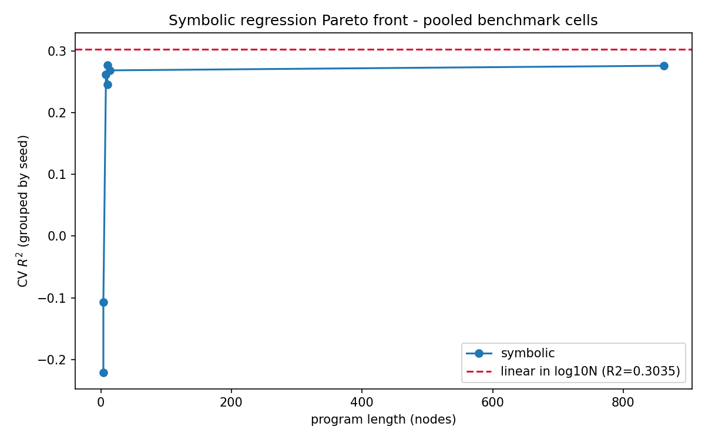

The complexity–accuracy front (parsimony sweep) shows the same thing from the other side:

| Parsimony | Nodes | Depth | CV $R^2$ |
|---:|---:|---:|---:|
| 0 (none) | 862 | 67 | 0.2764 |
| 0.001 | 14 | 6 | 0.2689 |
| **0.005** | **10** | **3** | **0.2773** |
| 0.01 | 10 | 3 | 0.2457 |
| 0.02 | 8 | 3 | 0.2625 |
| 0.05 | 4 | 2 | −0.1072 |
| 0.1 | 4 | 2 | −0.2213 |

A 10-node program is as accurate as an 862-node one, and below 8 nodes the fit becomes worse than the mean-only null. There is no accuracy to be bought with complexity here, which is the signature of a search over data whose variance is not a smooth function of the supplied inputs.

### 21.4. P1 per Game — the Plateau, Measured

Fitting return against $\log_{10}$ budget within each game gives the quantitative version of section 3.13's "curves plateau" statement. The slope is **return per decade of environment steps**:

| Game | Cells | Budgets measured | Slope (return/decade) | CV $R^2$ linear | CV $R^2$ symbolic | $P(\text{sym} \succ \text{lin})$ |
|---|---:|---|---:|---:|---:|---:|
| `bossfight` | 235 | 100 k, 106 k, 508 k | **+0.079** | 0.0316 | −0.0993 | 0.017 |
| `dodgeball` | 160 | 100 k … 508 k | **+0.121** | −0.0405 | −0.0525 | 0.178 |
| `starpilot` | 170 | 100 k … 508 k | **+1.155** | 0.1043 | 0.0580 | 0.133 |
| `heist` | 120 | 106 k, 508 k | **−1.137** | 0.2548 | 0.2977 | **0.973** |
| `coinrun`, `maze`, `jumper` | 20 / 70 / 50 | single budget | not estimable | — | — | — |

Three readings follow. In `bossfight` and `dodgeball` the slope is indistinguishable from flat, and the symbolic search returned a **constant** in both ($0.008$ and $0.929/0.801$ respectively) — it found no budget dependence whatsoever, and the negative CV $R^2$ says even that constant generalises poorly across seeds. `starpilot` is the only game with a substantial positive slope ($+1.155$ per decade), recovered symbolically as $\hat{R} = 0.480 \log_{10} N$. `heist` has a **negative** slope — the higher-budget cells score lower — and is the single case where the symbolic fit beats the linear one ($P = 0.973$), returning $-0.952 + \log(\log_{10}N) - \text{hard}$; with two budgets and a descending mean this is best read as the 106 k cells being the better of two configurations rather than as a budget effect.

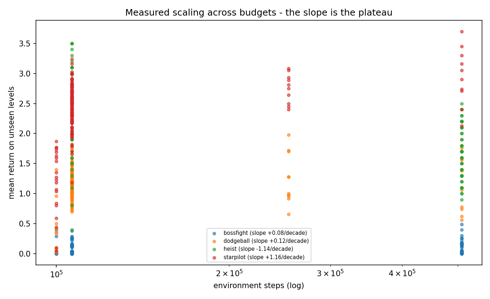

### 21.5. P2 — the Inverse Problem: Is the Architecture Identifiable from its Return?

The hidden parameter is now the **configuration family** that generated a cell. Within one stratum $(\text{game}, \text{suite}, \text{budget})$ the protocol is identical for every cell, so the only observable left is the measured return. The reference profile of each family is built by averaging $k$ seeds; the query is a return averaged over $j$ held-out seeds. Recovery is scored against the $1/F$ chance level.

| Stratum | Families $F$ | Chance $1/F$ | Accuracy at $k{=}1$ | Accuracy at $k{=}4$ | Wilson 95 % CI ($k{=}4$) |
|---|---:|---:|---:|---:|---|
| `bossfight` / `hard` | 6 | 0.167 | 0.158 | 0.200 | [0.095, 0.373] |
| `bossfight` / `main` | 9 | 0.111 | 0.094 | 0.222 | [0.125, 0.363] |
| `dodgeball` / `main` | 9 | 0.111 | 0.133 | **0.289** | [0.177, 0.434] |
| `starpilot` / `main` | 9 | 0.111 | 0.128 | 0.200 | [0.109, 0.338] |

Pooled across strata, as a function of how many seeds the reference averages ($k$) and how many the measurement averages ($j$):

| Reference seeds $k$ | $j{=}1$ | $j{=}2$ | $j{=}3$ |
|---:|---:|---:|---:|
| 1 | 0.133 | 0.145 | 0.152 |
| 2 | 0.155 | 0.141 | 0.157 |
| 3 | 0.172 | 0.173 | — |
| 4 | **0.203** | — | — |

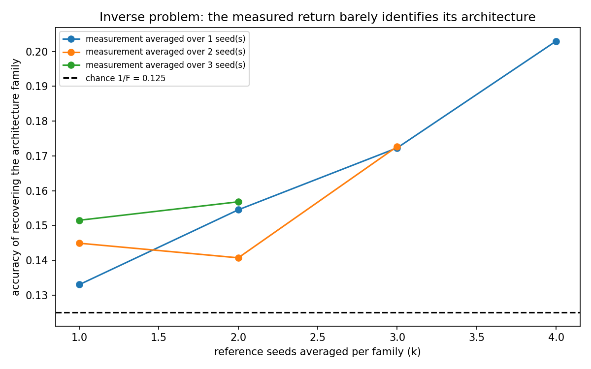

**A single measured return barely identifies the architecture that produced it.** At $k{=}1, j{=}1$ — the situation of anyone reading one benchmark number — accuracy is 0.133 against a chance level of 0.111–0.167. The best cell of the grid, $k{=}4, j{=}1$ at 0.203, still overlaps chance for the $F{=}6$ stratum. Accuracy improves monotonically in $k$ (cleaner reference profiles) and only weakly in $j$ (a less noisy query), which locates the loss precisely: **the between-family differences at this budget are smaller than the between-seed noise within a family.**

This is the identifiability counterpart of section 3.8's "no top-1 vs top-2 difference is statistically significant with 5 seeds", and it is the stronger statement: it is not that the ranking cannot be *tested* at $n{=}5$, but that the generating configuration cannot be *recovered* from a single run at all. The degenerate "always predict the lowest-mean family" heuristic scores a constant 0.111 / 0.167 — exactly $1/F$ — confirming the chance floor is computed correctly.

*Caveat, stated rather than hidden:* the $(\text{reference}, \text{measurement})$ splits within a stratum reuse seeds, so the $n \le 3960$ predictions are not independent draws and the Wilson intervals are optimistic. They are reported as a spread indicator, not as a confirmatory test.

### 21.6. P3 — Inverting the Law for Budget

Solving the fitted within-game line for the budget a target return implies, and comparing against the cell that actually achieved it:

| Game | Target return | Budget implied by the law | Budget of the cell that achieved it | Ratio | Inside measured support? |
|---|---:|---:|---:|---:|---|
| `starpilot` | 3.70 | 1 816 622 | 507 904 | 3.58× | no |
| `bossfight` | 0.49 | 41 301 266 431 | 507 904 | 81 317× | no |
| `dodgeball` | 1.98 | 1 203 205 443 903 | 253 952 | 4 737 925× | no |

**No inversion lands inside the budget span that was actually measured**, so under the support criterion zero of the three estimable games is budget-identifiable. The best returns in `bossfight` and `dodgeball` are not high-budget returns, and a monotone line fitted to budget cannot reach them without extrapolating by five to six orders of magnitude. Those numbers are reported to make the extrapolation visible, not as predictions: a law fitted over a 5× span has no authority at $10^{12}$ steps.

This is the same conclusion as section 3.13's budget-scaling experiment — a 5× budget "neither created nor eliminated an advantage" — reached from the opposite direction: not by running more steps, but by asking what the fitted line implies.

### 21.7. Threats to Validity

1. **Support.** 75.8 % of cells sit at one budget and the widest within-game span is 5.08×. Every slope on $\log_{10} N$ here is a local gradient of a curve measured over less than one decade. A genuine scaling study needs decades of budget, which section 3.13 began and this section does not extend.
2. **Game identity is not a discovery.** $R^2$ rising from 0.30 to 0.89 when game indicators are added says that `maze` returns and `bossfight` returns live on different scales. That is expected, and its only use is as a control: it bounds how much the *protocol* variables can explain once scale is absorbed.
3. **Family granularity is a modelling choice.** `FAMILY_OF` maps the **40 configurations** present in the 825 rows onto **15 families** (`cbam`/`spatial` → `cnn_attention`, `impala`/`impoola`/`resnet18` → `cnn_deep`, `curl`/`cpc`/`acl`/`contrastive` → `contrastive`, …); the dictionary carries 44 entries, of which a few belong to suites not analysed here. An unmapped configuration raises rather than being dropped, so the mapping cannot silently drift as suites grow. Coarser grouping raises the identifiability ceiling in P2 — with $F = 15$ overall but $F = 9$ inside the largest stratum — and the mapping is declared in the script, not inferred.
4. **Search stochasticity.** gplearn is seeded (`random_state = 0`) and the study was executed twice from the same committed inputs: every metric of P1 (pooled and per game), P2 and the Pareto sweep reproduced **identically** — the only differences between the two artefacts were cosmetic (feature labels and one rendered equation). The numbers above are therefore from a reproducible run, not a lucky draw. Re-running with a *different* seed is expected to explore another part of the same plateau rather than find a better law, and the Pareto sweep of 21.3 is the evidence for that claim: 862 nodes buy nothing over 10.
5. **Version drift between stacks.** The 825 cells were produced by the JAX port; port-vs-SB3 parity is documented in section 15. This section describes the port's grid, and the SB3 study's tables in sections 3 and 7 are deliberately not mixed into it.

### 21.8. Artifacts and Reproduction

| Artifact | Content |
|---|---|
| `symbolic_regression.py` | producer: loads the committed cells, runs P1/P2/P3 and the Pareto sweep, draws the three figures |
| `results/symbolic_regression.json` | every number in this section, with `_provenance` (engine versions, search settings, budget support, leakage guard) |
| `results/symbolic_regression_pareto.png` | nodes vs CV $R^2$, with the linear-in-$\log_{10}N$ reference line |
| `results/symbolic_regression_scaling.png` | measured return vs budget per game, with the fitted per-decade slope |
| `results/symbolic_regression_identifiability.png` | P2 recovery accuracy vs reference seeds, with the $1/F$ chance line |
| `tests/test_symbolic_regression.py` | 11 tests: the no-leakage assertion, family-map completeness, Wilson interval behaviour, and a real gplearn fit that fails CI if the gplearn/scikit-learn interface drifts again |

```
py -3.10 symbolic_regression.py            # full study (search: 1000 x 40)
py -3.10 symbolic_regression.py --quick    # small search, for a fast local check
```

Dependencies are pinned in `requirements.txt`: `gplearn==0.4.2` with `scikit-learn==1.5.2`. The cap is not cosmetic — gplearn 0.4.2 calls an estimator helper that scikit-learn removed in 1.6, so with a current sklearn `SymbolicRegressor.fit` raises `AttributeError` instead of searching. That failure is caught by the CI test above rather than mid-study.

