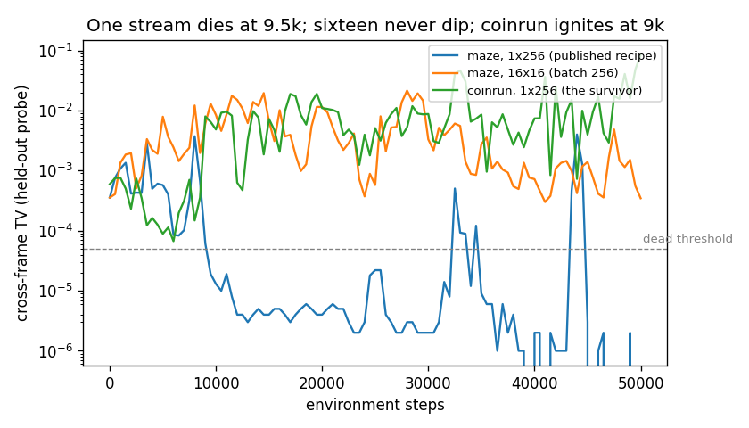
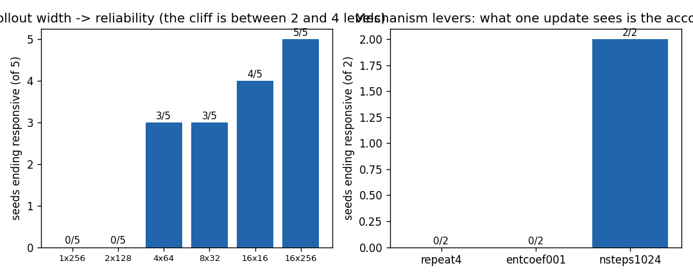
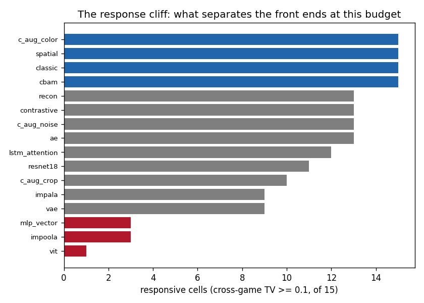
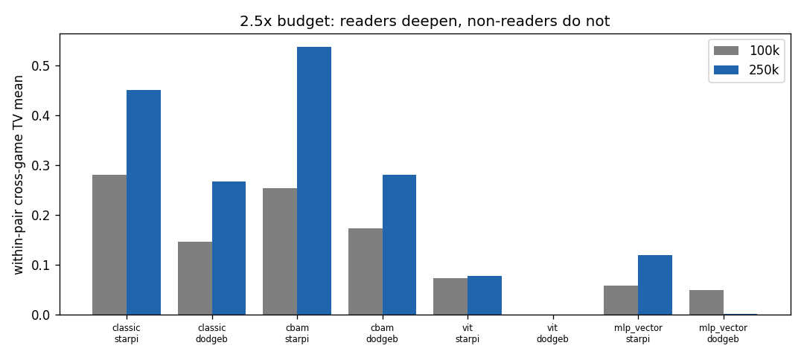
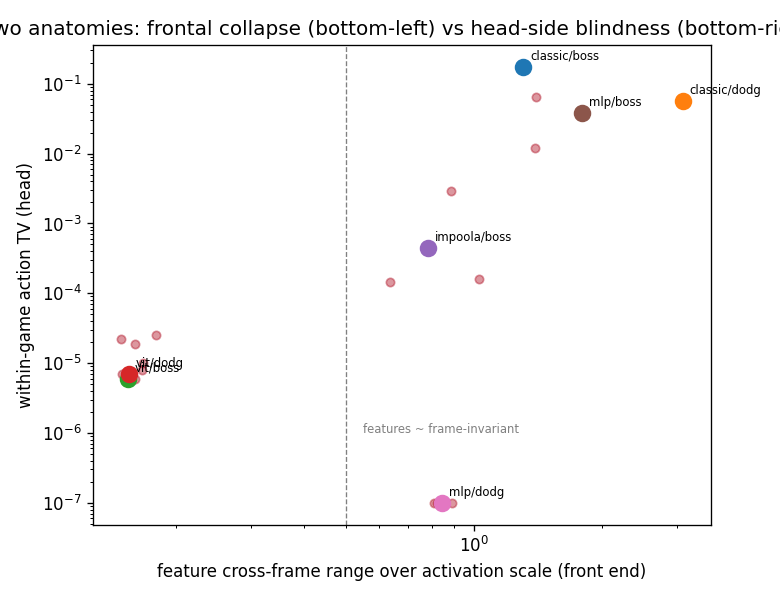
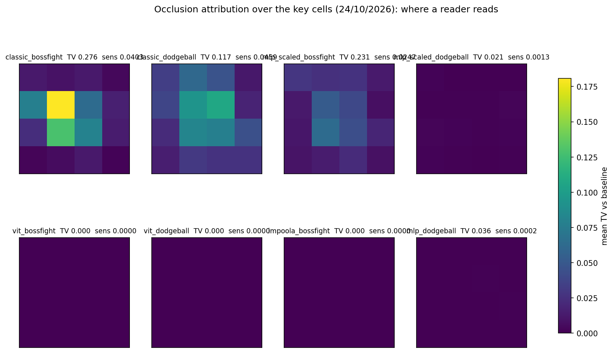

# The Diagnostic Arc — Exploration Arms and the Collapse of Observation-Conditioning

> Part of the study's documentation — start at the [README](../README.md). Sections 3.6–3.6.13: the exploration benchmark, the discovery that the trained policies ignore their observation, its cause (the single-stream rollout), the grid re-run, the anatomy of the non-readers and the budget tests. The ten-minute narrative of this page is [REPORT.md](../REPORT.md). Section numbers are the README's original ones, so every `§x.y` reference in the code, tests and other pages still names the same section.

### 3.6. Maze+Heist 100k — PPO vs ICM vs RND vs NGU (Exploration)
`results/exploration_remeasure.json` (re-measured 24/09/2026, 40 models across seeds 42-46)
| Game | `ppo` | `icm` | `rnd` | `ngu` |
|---|---:|---:|---:|---:|
| `maze` (10 eps) | 1.80±0.84 | 2.20±1.92 | **2.40±2.61** | 2.20±2.28 |
| `heist` (10 eps) | 0.80±0.45 | 0.80±0.84 | **1.60±1.14** | 1.20±1.30 |
| `maze` (100 eps) | 2.58 | 2.36 | 2.54 | **2.76** |
| `heist` (100 eps) | 0.72 | 0.60 | **1.04** | 0.80 |

> ✅ **Re-measured Arms (24/09/2026):** The previous `rnd` and `ngu` arms ran with broken linear projections (`nn.Linear(1024, 512)` instead of `2304`) that raised exceptions silently swallowed by `except Exception: pass`, producing identical clones of vanilla PPO. The re-measurement with verified dynamic stem sizing in `models/bonuses.py` recorded active intrinsic reward computation on 100% of steps (100,096/100,096 steps across all runs).
> **Scientific Finding on Bonus Scaling:** In SB3, the raw feature MSE produces an intrinsic reward of $\sim 10^{-5}$, which under default $\beta=0.01$ amounts to an effective bonus of $\sim 1.05 \times 10^{-7}$ per step against the $0/1$ sparse extrinsic reward. Consequently, while `rnd` achieves a modest advantage on `heist` (`1.04` vs `0.72`), exploration bonuses without running variance normalization (Burda et al., 2018) fail to significantly break away from PPO. Note that the uniform random baseline scores `4.40±5.01` on `maze` and `2.80±4.54` on `heist` under 50 episodes (section 18.1), confirming that 100k steps is insufficient for any policy to master deep maze navigation or 3-key heist puzzles.
> **Follow-up (27/09/2026):** this null is a statement about scale, and it is reversible — section 3.6.1 re-trains the same three arms with the bonus rescaled to $O(\beta)$ and every arm then beats this control on stochastic return.

### 3.6.1. Scaled-Bonus Arms (27/09/2026) — the Null Was the Scale; the Reversal Is Not a Curiosity Result
`results/exploration_normalized.json` — 30 new cells (`2 games × 3 bonus arms × 5 seeds × 100k`), trained with `compare_maze_heist.py --normalize` and summarized by `summarize_exploration_normalized.py`.

**What changed, precisely.** The published arms add `beta × raw prediction MSE` to every step, which measures $\sim 10^{-7}$. The scaled arms add `beta × (MSE / trailing-window mean of that MSE)` — divisive reward normalization, chosen because it stays positive, monotone in novelty, and $O(1)$ whatever level the predictor converges to. Two other forms were measured and rejected: dividing by the running *std* alone still injected `5.3e-5` (`ngu`) and `1.1e-4` (`icm`) per step on a live smoke (the error is heavy-tailed, so the std is set by rare spikes and the typical ratio stays far below 1), and the textbook demeaned z-score floored at 0 is *degenerate* for a bonus that decays by design — as the predictor learns, every new error sits below its own running mean, so the injected bonus clipped to `0.0` on all 400 steps of a probe, for all three arms. `beta=0.01`, the optimizer, the env protocol and the seeds are untouched, so the scale is the only variable. `ppo` has no bonus to rescale: its rows are reused from the frozen 24/09 grid and the reuse is declared in `_provenance.control` (both protocols; the 100-ep row carries `reused_from`).

Measured injected magnitude, per cell and stable across seeds to ±2%: `icm` 9.49–9.52e-3, `rnd` 5.92e-3 (`maze`) / 7.84e-3 (`heist`), `ngu` 2.49e-3 / 3.76e-3 per step — four to five orders of magnitude above the published arms — with the per-step max pinned at `beta × clip = 5.0e-2`, i.e. the clip binds and is part of the arm, not an accident.

100 stochastic episodes on unseen levels, $n=5$, Student-t 95% CI, Welch $p$ and Hedges $g$ against the reused control:

| Arm | `maze` mean | 95% CI | $p$ | $g$ | `heist` mean | 95% CI | $p$ | $g$ |
|---|---:|---|---:|---:|---:|---|---:|---:|
| `ppo` (control, reused) | 2.58 | [1.49, 3.67] | — | — | 0.72 | [0.29, 1.15] | — | — |
| `icm` | 4.18 | [3.75, 4.61] | 0.0118 | 2.17 | **3.04** | [2.21, 3.87] | 0.00046 | 3.94 |
| `rnd` | **5.04** | [4.19, 5.89] | 0.0014 | 2.83 | **3.52** | [2.32, 4.72] | 0.0017 | 3.49 |
| `ngu` | 4.18 | [3.16, 5.20] | 0.0179 | 1.70 | **2.84** | [1.79, 3.89] | 0.0029 | 2.97 |

> **Reading (corrected 11/10/2026 — see §3.6.2).** The numbers below were measured and stand as measurements; the interpretation originally written here does not. Every scaled arm beats the control on `heist` and survive a Bonferroni correction over the six comparisons ($\alpha=0.05$ → $p_{adj}\le 0.0174$), and on `maze` only `rnd` does ($p_{adj}=0.0081$; `icm` 0.071, `ngu` 0.107, and `ngu`'s interval overlaps the control's). Effect sizes are large ($g$ 1.70–3.94) with $n=5$. **But these policies do not condition on the observation** (§3.6.2: 69/70 checkpoints pick the same action for five different Procgen games), so what the bonus demonstrably changed is a near-constant action marginal — not curiosity-driven perception. This table is evidence that a live intrinsic reward shifts the marginal; it is not evidence about exploration.
> **Caveat that mattered more than the win, and still holds.** Under deterministic execution the same checkpoints return `maze` 0.00 (`icm`) / 0.70 (`rnd`) / 0.46 (`ngu`) and `heist` 0.14 / 0.26 / 0.20 — the same near-zero band the unnormalized arms and the control occupied (control: 0.22 / 0.08). `gen_gap` (train-level minus unseen-level) is positive for every arm (+0.35 to +1.42).

> **Follow-up (24/10/2026) — the question re-asked under the responsive recipe, and roadmap item 8 closes.** §3.6.2's correction left the table above without an interpretation: every policy behind it was state-independent, so what the scaled bonus moved could not be curiosity about the screen. The same three arms and a **fresh** `ppo` control have now been re-trained at the recipe that keeps policies responsive (`compare_maze_heist.py --normalize --n-envs 16`, the `16×256` grid recipe of §3.6.7), `5` seeds, `100` stochastic episodes on unseen levels, with `response_guard.py` attached to every cell: `40` cells, `0` errors, `39.76` GPU-hours summed (bonus injection verified at `2.5–9.5×10⁻³` per step, the same O(β) scale as above). Artifacts: `results/exploration_nenv16.json` (`summarize_exploration_nenv16.py`), run dirs `logs_maze_heist_norm16/`.

| arm | maze mean | 95% CI | p vs control | g | responsive | heist mean | 95% CI | p vs control | g | responsive |
|---|---:|---|---:|---:|---:|---:|---|---:|---:|---:|
| `ppo` (fresh control) | 4.20 | [3.76, 4.64] | — | — | 1/5 | 2.06 | [1.30, 2.82] | — | — | **4/5** |
| `icm` | 4.28 | [3.38, 5.18] | 0.83 | 0.13 | 2/5 | 2.46 | [1.56, 3.36] | 0.37 | 0.54 | 2/5 |
| `rnd` | 4.50 | [3.97, 5.03] | 0.26 | 0.69 | 1/5 | 2.70 | [2.13, 3.27] | 0.10 | 1.07 | 2/5 |
| `ngu` | 4.40 | [3.94, 4.86] | 0.41 | 0.50 | 2/5 | 2.82 | [2.37, 3.27] | 0.051 | 1.37 | 0/5 |

**1. The recipe lift is bigger than any bonus effect.** The fresh control at `16` envs scores `maze 4.20` and `heist 2.06` against the published `1`-env control's `2.58`/`0.72` — a `+1.62`/`+1.34` lift from coverage alone, larger than every curiosity delta in this table and larger than the effect the §3.6.1 table attributed to the bonus. Against the `1`-env scaled arms themselves, the maze arms land where they were (`4.18–5.04` → `4.28–4.50`) and the heist arms land below where they were (`2.84–3.52` → `2.46–2.82`): part of the §3.6.1 heist win was the bonus acting on a starved recipe, and the responsive recipe absorbs it.

**2. No comparison survives correction.** On `maze` all three deltas are noise (`p` `0.26–0.83`). On `heist` the deltas are directional and sizable — `ngu +0.76`, `g 1.37`, `p 0.051`, the strongest single cell of the table — but six comparisons were run; nothing survives a Bonferroni-corrected `α = 0.0083`, and `ngu` sits exactly at the uncorrected boundary.

**3. The response column gives the interpretation the 1-env table never had — and it inverts the heist story.** The heist control is the arm that READS: `4/5` seeds responsive, cross-game TV mean `0.226`, while every bonus arm reads less (`icm`/`rnd` `2/5`, `ngu` `0/5`, TVs `0.070–0.099`) — the opposite ordering of their returns. On `maze` all arms sit at the threshold's edge (TVs `0.071–0.102`, `1–2/5` cells), the §3.6.10 within-game-reader band: alive within-run (§3.6.4's dense probes) without clearing the cross-game bar. So the residual heist advantage is a reward-shaping effect that does **not** come with deeper reading — the arms that read most on heist are the control's. **Item 8's answer: the scaled-bonus curiosity effect does not survive the recipe fix as a visual-curiosity effect; what remains on heist is a directional shaping effect orthogonal to observation-conditioning.**

### 3.6.2. Validity of these arms: the policies barely condition on the observation (11/10/2026)

While building a dashboard-style recording of one of these agents, the first thing worth showing — *what it thinks, frame by frame* — turned out to be constant. That turned a side task into a validity check, and the check fails.

**The test.** Every SB3 maze/heist checkpoint in the tree (70: the 40 of the 24/09 re-measurement and the 30 of §3.6.1, minus shared names) is fed the initial frame of **five different Procgen games** — `maze`, `heist`, `bossfight`, `starpilot`, `dodgeball` — and the action distributions are compared.

| measure | result |
|---|---|
| same argmax action for all five games | **69 / 70 checkpoints** |
| total-variation distance between the five distributions | median `4.83e-4`, min `1.1e-5`, max `0.1159`; only 5/70 above `1e-2` |
| actor's first `Tanh` units saturated ($\|x\|>0.999$) | mean `80.9%` on level-initial frames, `97.2%` on mid-episode frames |
| same measures at **initialization** (untrained, 3 seeds) | `0.0%` saturated, extractor feature max `≈1.8` |
| extractor feature max after training | mean `17.8` (≈10× the initial scale) |

Artifacts: `results/checkpoint_cross_game_response.json`, `results/checkpoint_state_dependence.json`, produced by `diagnose_policy_saturation.py` (curve files `results/policy_saturation_curve_repo100k.json` / `_layernorm100k.json`).

**What was ruled out.** The obvious story is that the un-normalized `ClassicCNNExtractor` output (mean 2.0, max 31 on trained checkpoints) saturates the `Tanh` latent of SB3's `MlpExtractor`, freezing the actor on a constant vector. It is true that this happens — the 100k run reproduces it step by step: `feat_max` 1.8 → 11.1 by 10k → 31.1 by 100k, saturation 0% → 46% → 50% of the latent units. It is **not** the cause: re-training 100k with the same CNN followed by a `LayerNorm` holds the features at `max ≈ 4.5` and saturation at `36%`, and the policy still collapses (cross-game TV `1e-5`, one argmax, entropy down to 0.6 nats). Clamping the scale removes the symptom's magnitude, not the collapse.

**What is not claimed.** No mechanism is established here, and the fix is not known. Two things are consistent with the data and are left as open questions rather than conclusions: the within-episode input barely changes (300 steps of a random walk in `maze` produce 19 distinct frames, mean per-pixel change `0.071/255`), so an input-independent policy is close to optimal for what the rollout contains; and whatever the reason, a PPO run that ends with a near-uniform marginal over 15 actions is not a visual policy, so no arm in §3.6/§3.6.1 is evidence about curiosity.

**Scope: it is not only the exploration arms.** Because the published main-suite checkpoints are not in the tree, the recipe was re-run from scratch — `compare_suite.py`'s exact PPO hyperparameters (`lr 3e-4`, `n_steps 256`, `batch 64`, `n_epochs 3`, `ClassicCNNExtractor(features_dim=512)`), `easy`, 200 training levels, 100k steps, seed 42 — once per game, and cross-checked against five different games at the end (`diagnose_policy_saturation.py --cross-game`, artifacts `results/scope_probe_*.json`):

| game trained | max cross-game TV | 1st `Tanh` saturated | extractor feature max |
|---|---:|---:|---:|
| `coinrun` | **0.740** | 0.0% | 1.5 |
| `dodgeball` | 0.000001 | 90.0% | 20.2 |
| `maze` | 0.000221 | 95.3% | 31.1 |
| `starpilot` | 0.001149 | 100.0% | 110.8 |
| `bossfight` | 0.000000 | 100.0% | 94.9 |

All three main-suite games collapse; `coinrun` does not. Across these five runs the response separates cleanly from the feature scale — the one run whose extractor output stayed at `max 1.5` is the one that reads its input, and the four at `max 20-111` saturate 90-100% of the actor's first `Tanh` and emit one argmax for five different games. That is an association, not yet a mechanism: the `LayerNorm` counterfactual above reduced the saturation (36% averaged over both latent layers) without restoring any response, so scale alone does not explain it either.

**All sixteen arms, at the published budget (11/10/2026).** That was one extractor. `audit_suite_validity.py` re-trains every arm of the headline comparison on `starpilot` and attaches the response measure to each: the training call is imported from the producers (`compare_suite.train_one`, `compare_new_archs.train_one`) rather than copied, so the hyperparameters are the published ones by construction (`lr 3e-4`, `n_steps 256`, `batch 64`, `n_epochs 3`, `features_dim 512`, `easy`, `200` levels, `100k` steps, seed `42`), scored on `10 eps` at unseen levels (`seed+1000`) — the protocol of §3.3, one seed instead of five. `16` cells, `1.6M` steps, `2.87 h` of summed cell time (three workers, so the wall clock was ~`1.6 h`). Artifact: `results/suite_validity_starpilot.json`, ordered by response:

| arm | family | max cross-game TV | return (10 eps) | 1st `Tanh` saturated | feature max |
|---|---|---:|---:|---:|---:|
| `mlp_vector` | `procgen_cnn` | 0.101104 | 1.20 | 100.0% | 254.00 |
| `cbam` | `procgen_cnn` | 0.050662 | 0.60 | 98.4% | 150.25 |
| `c_aug_noise` | `augment` | 0.004306 | 3.30 | 99.1% | 247.39 |
| `contrastive` | `world_model` | 0.004306 | 3.30 | 99.1% | 247.39 |
| `resnet18` | `new_arch` | 0.001354 | 1.60 | 88.8% | 14.82 |
| `classic` | `procgen_cnn` | 0.001149 | 0.50 | 100.0% | 261.35 |
| `lstm_attention` | `new_arch` | 0.000024 | 2.30 | 98.4% | 47.88 |
| `vit` | `new_arch` | 0.000001 | 0.50 | 18.8% | 3.69 |
| `ae` | `world_model` | 0.000000 | 1.40 | 100.0% | 174.74 |
| `c_aug_color` | `augment` | 0.000000 | 2.20 | 100.0% | 162.86 |
| `c_aug_crop` | `augment` | 0.000000 | 1.70 | 100.0% | 404.13 |
| `impala` | `new_arch` | 0.000000 | 1.60 | 100.0% | 1553.56 |
| `impoola` | `new_arch` | 0.000000 | 1.80 | 100.0% | 209.15 |
| `recon` | `world_model` | 0.000000 | 1.40 | 100.0% | 174.74 |
| `spatial` | `procgen_cnn` | 0.000000 | 1.30 | 100.0% | 405.06 |
| `vae` | `world_model` | 0.000000 | 0.40 | 100.0% | 233.98 |

**All 16 emit one argmax for the five games** (`distinct_argmax_across_games = 1`), `14/16` have cross-game TV below $5\times10^{-3}$, and `12/16` hold ≥99% of the actor's first `Tanh`. The largest response in the whole comparison is `0.101` — `mlp_vector`, the arm §0 and §3.12 name the consistent leader — which is still an order of magnitude below the `0.740` of the responding `coinrun` run above. Feature scale is once again not the mechanism: the smallest latent in the study (`vit`, `3.69`, only `18.8%` saturated) and the largest (`impala`, `1553.56`) are both inert (`1e-6` and `0`), so ordering the arms by `feat_max` does not order them by response. `mlp_vector`'s `254.00` is the raw `uint8` observation, not a latent activation (its extractor is a flatten), so it belongs in neither of those comparisons.

**The measurement has a positive control.** A test that reports zero for everything is indistinguishable from a broken test, so the same audit ran on `coinrun` — the one game where the recipe is known to respond (`results/suite_validity_coinrun_control.json`):

| arm (coinrun) | max cross-game TV | return (10 eps) | 1st `Tanh` saturated | feature max |
|---|---:|---:|---:|---:|
| `classic` | 0.739958 | 6.00 | 0.0% | 1.33 |
| `mlp_vector` | 0.021878 | 7.00 | 100.0% | 254.00 |
| `vit` | 0.000003 | 6.00 | 23.4% | 4.21 |

`classic` reproduces the `0.740` of the scope table to four decimals, so the detector fires on a policy that reads its input and the sixteen zeros are not an artifact of the test. The control also narrows the scope claim: within one game and one recipe the response still splits by architecture (`classic` `0.740` vs `vit` `3e-6`), so collapse is a property of the (game × architecture) pair, not a uniform failure of the recipe — and `vit` scoring `6.00` while emitting TV $3\times10^{-6}$ is a direct demonstration that return is not evidence of a visual policy.

**The comparison's other two games, same recipe (11/10/2026).** `results/suite_validity_bossfight.json`, `results/suite_validity_dodgeball.json` — the same `16` arms on `bossfight` and `dodgeball`, so the audit now covers every cell of the headline comparison's own scope: `48` cells, `4.8M` steps, `8.08 h` of summed cell time at ~`10 min`/arm over three workers. The hours are the cells' own `seconds` added together and count only cells that finished — the `bossfight`/`vae` cell that died mid-run contributes its error, not its time.

| game | arms measured | TV below $5\times10^{-3}$ | ≥99% of 1st `Tanh` saturated | largest TV | GPU h |
|---|---:|---:|---:|---|---:|
| `starpilot` | 16/16 | 14/16 | 12/16 | `0.101104` (`mlp_vector`) | 2.87 |
| `bossfight` | 15/16 | 11/15 | 11/15 | `0.287505` (`c_aug_noise` ≡ `contrastive`) | 2.62 |
| `dodgeball` | 16/16 | 15/16 | 5/16 | `0.017479` (`mlp_vector`) | 2.59 |

**All 47 measured arms emit one argmax for five different games**, on every game the ranking is computed from. The strongest response anywhere in the comparison's own games is `0.287505` — still a half of the `coinrun` positive control, and that arm still picks a single action for all five games. Saturation is now dissociated from collapse rather than merely unexplained: on `dodgeball` `15/16` arms are inert while only `5/16` reach ≥99% saturated first `Tanh`, so a policy can keep its latent entirely inside the `Tanh`'s linear region and still not use the observation.

**A second, separate defect: the `vae` arm diverges to `NaN` on `bossfight`.** At seed `42` the run stopped with `ValueError: Expected parameter logits (Tensor of shape (1, 15)) ... found invalid values: tensor([[nan, nan, ...]])`, and the artifact records `39680` of `100000` steps logged before it died — so the action logits went `NaN` **during training** and the cell never reached its budget (§6 item 9). The audit writes it as an error instead of scoring it `0.00`, and three independent runs of that cell produced the same message at the same step. It is not a property of the extractor: the same arm at seeds `43` and `44` completes `100000` steps and measures normally (`0.000013` and `0.037041` cross-game TV, feature max `65.04` and `40.47`; `results/suite_validity_bossfight_vae_seeds.json`). Nor is it one bad draw: `dodgeball` at seed `42` trains to completion but drives its own extractor features to `72202032513024.0` (`7.2e13`, against `233.98` for the same arm on `starpilot`). So `vae`'s row in §3.3/§5.2 rests on an arm that today either dies mid-run or reaches a $10^{13}$ latent, depending on the game.

**Two pairs of the sixteen are the same program.** `contrastive`/`c_aug_noise` is the documented case (§5.2 note). `ae`/`recon` is a second one: as `models/world_model_extractors.py` stands, `ReconExtractor` and `AEExtractor` build the same modules in the same order and differ only by an attribute name (`fc` → `fc_enc`) — verified by rebuilding both under one seed: identical parameter count (`1201923`), bitwise-equal weights, bitwise-equal `forward` output. Each pair was trained in a separate process and returned rows identical to the last digit (`1.40` / `0.000000` / `174.74` and `3.30` / `0.004306` / `247.39`), which also says the pipeline is reproducible on this hardware. The headline comparison is therefore `14` distinct visual front ends, not `16`; in the archived grid these two arms report `1.13` vs `1.05`, so those archived numbers did not come from the file now in the tree.

> **Follow-up (24/10/2026): the pair facts are now a gate, and both slots have genuinely distinct opt-in variants.** `tests/test_distinct_arms.py` rebuilds both pairs under one seed and asserts the bitwise equality above, so the `14`-front-end count can no longer drift silently. The registry also carries the two slots as distinct programs, available by name to a future grid without touching any published arm: `recon_bottleneck` (`models/world_model_extractors.py`) gives `recon` the narrower path its docstring always claimed — encode → `128-D` bottleneck → `512` — and `c_aug_noise_drop` (`compare_augment_contrastive.py:ContrastivePixelDrop`) replaces the inherited `0.01` jitter with pixel dropout (`p=0.1`), a corruption the base arm cannot express. With `mlp_scaled` (§3.6.12) the registry now exposes `17` distinct front ends; the default audit and every merged artifact still cover exactly the published sixteen.

**What this does and does not say about §3.7 and §3.12.** It is a measurement of the recipe, re-run today, not a measurement of the archived numbers — those weights no longer exist. What it establishes is that the recipe used for the 16-architecture comparison produces state-independent policies on all three of its games: the audit now covers `48` of the comparison's own cells (`16` arms `×` `bossfight`/`starpilot`/`dodgeball`), and every one of the `47` that reached its budget emits a single argmax for five different games. The rankings there are therefore **unverified**, not confirmed: a comparison of policies that do not read the observation cannot attribute a difference to the visual architecture. What the audit does *not* do is restore the archived table — it does not re-run the `5`-seed grid, and it says nothing about why the policies collapse (§6 item 9).

### 3.6.3. When the Collapse Happens, and What Is Now Excluded (11/10/2026)

§3.6.2 excluded feature scale by comparing endpoints. Three runs put the same question on a **timeline**, at the published recipe (`100k`, seed `42`, probe every `2000` steps — `5000` for `coinrun` — on 20 frames drawn from 4 different levels, so the probe is not one episode's near-identical frames):

| run | extractor output > 10 at | 1st latent `Tanh` > 50% at | cross-frame TV < $5\times10^{-5}$ at | final cross-game TV | final V(s) std |
|---|---|---|---|---:|---:|
| `maze`, published extractor | 10k | 6k | 10k | 0.000221 | 0.00000 |
| `maze`, `LayerNorm` counterfactual | never (peak `5.88`) | 92k | 18k | 0.000031 | 0.00003 |
| `maze`, `frame_stack=3` | 12k | 10k | 16k | 0.000774 | 0.00000 |
| `starpilot`, `frame_stack=3` | 4k | 8k | 42k | 0.017082 | 0.42411 |
| `coinrun`, published extractor (the responsive reference) | 5k, then back down | 5k, then back down | never | 0.739958 | 0.16838 |

Artifacts: `results/policy_saturation_perlayer_repo.json`, `results/policy_saturation_perlayer_layernorm.json`, `results/frame_stack_maze.json`, `results/frame_stack_starpilot.json`, `results/coinrun_responsive_curve.json` (`diagnose_policy_saturation.py`, which now reports saturation **per latent layer** — `tanh_saturated_by_layer` — because one average over both layers hides a layer that saturates early behind one that never does).

**1. Saturation is not necessary for the blindness, and the timeline says so better than the endpoint did.** In the published arm saturation does precede collapse (`Tanh` > 50% at 6k, response gone at 10k) — the ordering the scale hypothesis needs. But the `LayerNorm` arm never lets its extractor output exceed `5.88`, crosses 50% saturation only at **92k**, and loses the response at **18k**: the collapse happens 74,000 steps before the mechanism that was supposed to cause it, and at a feature scale the published arm passes at 10k. A clamped scale does not delay the collapse; it only removes the symptom that was being read as the cause.

**2. Both runs start with a signal; only one keeps it.** In the published `maze` arm, **5 of the 51 probes** show cross-frame TV above $10^{-4}$ — steps 0, 2k, 4k, 8k and 44k, with $0.00036$, $0.00041$, $0.00050$, $0.00374$ (2 distinct argmax actions across the probe frames) and $0.00400$ (V(s) std $0.12017$). From 44k on, every remaining probe is at most $2\times10^{-6}$ and 25 of the 28 are exactly zero; its final V(s) std is `0.00000`. `coinrun` is *deeper* than that at step 5000 (TV `0.00009`, `60.9%` of the first `Tanh` saturated, V(s) std `0.0030`) and then grows through the same window: `0.00485` at 10k, `0.01100` at 20k, `0.26280` by 65k. So the difference is not that the collapsed run never had a dependence on the observation — it had two, and both stayed under $4\times10^{-3}$ — but that the responsive run's excursions grow by two orders of magnitude instead of dying out. That puts the interesting event anywhere in the first ~50k steps and says the next probe must be dense there (`--probe-every 500`), not another extractor.

**3. Giving the policy visible motion does not restore conditioning.** `frame_stack=3` puts the last three frames inside a single observation, which is the cheapest version of the low-input-variance account: if the complaint is that consecutive Procgen frames barely differ, the fix is to show the difference. It multiplies the cross-game response — `maze` `0.000221 → 0.000774` ($3.5\times$), `starpilot` `0.001149 → 0.017082` ($15\times$, and its V(s) std of `0.424` shows the critic is now tracking state) — and still leaves both emitting **one argmax for five different games**, two orders of magnitude below the `coinrun` reference. The probe caveat is stated plainly: the cross-game frames are episode starts, where the stack is three copies of one frame, so this measures whether *training* with motion produced a conditional policy. It did not.

**4. The blind policy is not a near-optimal answer to a poor task.** On `maze` the reward is `0` or `+10` (level completed), which makes the mean directly readable as a completion rate: uniform random completes **44%** of unseen levels (`22/50` episodes, mean `4.40` — `results/random_baselines.json`), while the trained, state-independent arms complete about **26%** (mean `2.58` over 5 seeds × `100 eps`, `results/exploration_remeasure.json`). The intervals overlap, so this is directional rather than significant — but "the rollout contains nothing worth conditioning on, so a constant policy is a good answer" needs the constant policy to be *good*, and on `maze` it is worse than flipping coins.

**5. What the surviving candidates are, stated as of tonight.** Scale and saturation are excluded (1), the input-variance account in its cheapest form is excluded (3), and "no pressure" is weakened (4). What is left and untested is the early window itself: whether the policy leaves the responsive phase because the advantage signal in a single-env `DummyVecEnv` rollout at `n_steps=256` is too thin to sustain a conditional policy (which predicts that a wider rollout or more parallel envs would keep it), or because the entropy of the marginal it converges to is a local optimum of the clipped objective. The next measurement is therefore a 0–20k probe at `--probe-every 500` with `n_envs` as the manipulated variable — not another extractor.

> **Follow-up (12/10/2026):** that measurement ran — 0–50k, four `maze` arms, `n_envs` manipulated at constant per-update batch — and the thin-rollout account passed its intervention. §3.6.4.

### 3.6.4. The Intervention Passes: a Single-Stream Rollout Is What Kills the Responsive Phase (12/10/2026)

§3.6.3 left one candidate standing and named the experiment that would decide it. That experiment ran: the same recipe and probe set as §3.6.3, but sampled every **500 steps over 0–50k**, with `n_envs` as the manipulated variable. Four `maze` arms — the published `1×256`; a `4×64` and a `16×16` that **hold the per-update batch at the published 256** while multiplying the number of parallel trajectories (each env on its own level stream, construction seed `+ rank`, so 16 envs are not 16 copies of one trajectory); and a `16×256` that raises the batch 16× — plus the same dense probe on `coinrun`, the arm that survives the thin rollout. Artifacts: `results/policy_saturation_dense_nenv1_nsteps256.json`, `results/policy_saturation_dense_nenv4_nsteps64.json`, `results/policy_saturation_dense_nenv16_nsteps16.json`, `results/policy_saturation_dense_nenv16_nsteps256.json`, `results/coinrun_dense_curve.json` (`diagnose_policy_saturation.py`, now with `--n-envs`/`--n-steps`; probes fire on the **environment-step** grid, not the vec-env step count, so every arm measures the same steps). The five training loops sum to **6.2 GPU-minutes** (`training_seconds` in each provenance) — the cheapest decisive experiment of the whole item.

| run | 1st `Tanh` > 50% at | cross-frame TV < $5\times10^{-5}$ at | alive probes (TV > $10^{-4}$, of 101) | final cross-game TV | argmax across games | final V(s) std |
|---|---|---|---:|---:|---:|---:|
| `maze`, `1×256` (the published recipe) | 4500 | 9500 | 21 | 0.000432 | 1 | 0.00000 |
| `maze`, `4×64` (batch 256) | 8500 | 12000, back at 18.5k | 89 | 0.007842 | 1 | 0.09962 |
| `maze`, `16×16` (batch 256) | never (peak 25.5%) | never (min 0.0003) | 101 | 0.004706 | 1 | 0.19275 |
| `maze`, `16×256` (batch 4096) | never (0.0%) | never | 101 | 0.088322 | 2 | 1.53110 |
| `coinrun`, `1×256` (the surviving arm, dense) | 3000–6500, then back down | never (min $6.7\times10^{-5}$) | 99 | 0.410747 | 1 | 0.74167 |

**1. The dense baseline is the published run — and its responsive phase was more alive than the 2k grid showed.** The `1×256` arm reproduces `results/policy_saturation_perlayer_repo.json` with **zero mismatches in every field at all 26 shared grid points** (probing never consumes RNG, and the runs are deterministic on this hardware), so the 500-step grid is a strict refinement, not a new experiment. At this resolution the early window is continuous, not episodic: 12 consecutive probes above $10^{-4}$ from step 0 (`0.000356`) through 5500 (peak `0.001351` at 1500), a sag at 6000–6500 (`8.5e-05`, `8.3e-05`), a last excursion at 7500–8500 (peak `0.00374` at 8000 — the one excursion the coarse grid did catch), and death at **9500** (`1.9e-05`). **21 of 101** probes are alive, not 5 of 51 — the coarse grid undercounted by sampling. The first `Tanh` crossing also sharpens: >50% at **4500**, where the 2k grid first saw it at 6000.

**2. The dose-response the hypothesis predicted.** Four parallel streams are not enough to prevent the dip but are enough to leave it: `4×64` falls into the same silence (a contiguous block of 8 probes at $10^{-6}$–$2.6\times10^{-5}$ from 14500 to 18000 — the published arm's dead level), and then the response **comes back** at 18500 (`0.00088`), passes `0.035` at 24000 and peaks at **`0.109794` at 25500** — 27× the published arm's lifetime peak — never again falling below `0.0025` after 24k. Sixteen streams prevent the death outright: `16×16` has **not one probe below `0.0003`** in the whole window (101/101 alive) and never crosses 50% first-`Tanh` saturation (peak `25.5%`). One stream: permanent death. Four: transient death. Sixteen: no death — a gradient, obtained at constant per-update batch, so it is not a data-volume effect.

**3. It is the rollout's shape, not its size, its update count, or its batch.** `16×256` holds `n_steps` at the published 256, multiplies the batch by 16 and therefore cuts the gradient updates from 195 to 12 — and its curve is a 13-segment staircase (weights move only every 4096 steps) that never regresses after the first update: per-update response `0.0058 → 0.0111 → 0.0151 → 0.0264 → … → 0.0419`, every post-init segment at least `0.0058`, and the first `Tanh` never saturating a **single unit** in any probe. It ends at cross-game TV `0.088322` — 204× the published arm — and is the **first `maze`-trained policy in this study to emit two distinct argmax actions across the five games**, with V(s) std `1.5311`. If collapse were driven by update frequency, batch size or data volume, this arm — fewest updates, largest batch — would be the most collapsed. It is the most responsive.

**4. Saturation reverses with the revival, finishing what the LayerNorm arm started.** `4×64` cycles through the whole claim inside one run: its first `Tanh` reaches **99.6% saturated at 17500** — the bottom of its dead window — and by 24500, with the response back at `0.058`, saturation has collapsed to **5.9%**. The same weights saturate, desaturate, and the response tracks the desaturation. §3.6.3 showed saturation is not necessary for the blindness; this shows it is not even sticky — present and absent both coincide with collapse, in both temporal directions, which is the signature of a symptom.

**5. The surviving arm passes through the same fragile window.** The dense `coinrun` probe is also a bitwise refinement of its published curve (11 shared points, 0 mismatches). Its response sags below the alive threshold at **5000 and 6000** (`8.9e-05`, `6.7e-05`) — the same age at which the `maze` arm is dying — then takes off at **9000** (`0.007985`) and never again drops a probe below the alive threshold (99/101 alive; ends `0.084866`, entropy `0.971`, V(s) std `0.74167`). Its first `Tanh` transiently crosses 50% at 3000–6500 and comes back down — the same escape §3.6.3 saw at coarse resolution. Both games enter the first 10k steps with a weak, sagging dependence on the observation; `coinrun`'s takes off and the published `maze` recipe's dies, and the dense grid resolves the fork to the same 500 steps: `maze` dead at 9500, `coinrun` ignited at 9000.

**6. What is established, what is not, and what this changes.** Established: on `maze`, the collapse is contingent on the single-stream rollout — with 16 parallel envs at the published per-update batch, the same seed, extractor, budget and probe set that lose the response at 9500 never lose it. Not established: the fine mechanism inside the single-stream rollout (why its advantage signal fails to sustain conditioning — the leading refinements are near-duplicate frames within one episode making the update signal rank-deficient, and the entropy dynamics of the clipped objective on that signal); any multi-seed claim (one seed per arm — the 21/101 vs 101/101 gradient is stark, but each cell is `n=1`); and the cross-game generality of the revived response — `4×64` and `16×16` still end at one argmax across games (`0.0078`, `0.0047`), only `16×256` reaches two. What it changes: every trained policy in this study — the 70 committed checkpoints, the 48 audited cells, the archived grid — was produced by a single-stream rollout (until 30/10/2026 every `compare_*.py` built `DummyVecEnv([one env])`; they now default to `16×256`, §5), so the blindness those sections measure is a property of the recipe's rollout, not of the extractors it compared; and the roadmap's re-run question now has its first meaningful version — re-run the grid with `n_envs=16` (batch-controlled), not with the recipe that produces blindness. That decision (~40 GPU-hours) is item (iii) and stays open.

> **Follow-up (12/10/2026):** five seeds per arm ran, and three of the single-seed numbers above need sharpening — the death clock moves (9k–36k across seeds), the `16×16` invulnerability is `4/5` seeds, not all, and `coinrun`'s immunity is really *recovery* (it dips below the dead threshold on 4 of 5 seeds and ends responsive on 5 of 5). The two candidate mechanisms were also pulled as levers. §3.6.5.

### 3.6.5. Five Seeds and the Mechanism Levers: What Replicates, What Is Excluded (12/10/2026)

§3.6.4 measured the dose-response once per arm, on seed 42, and left two candidate mechanisms untested. Both questions got their experiment: every dose-response arm re-run at seeds 43–46 (`coinrun` included), and each candidate mechanism pulled as a lever at the collapsing configuration (`n_envs=1`). Artifacts: the 20 dose-response runs live as per-run JSONs next to the seed-42 files of §3.6.4 (`results/policy_saturation_dense_*_seed{43..46}.json`, `results/coinrun_dense_seed{43..46}.json`), the 6 lever runs as `results/policy_saturation_dense_{repeat4,nsteps1024,entcoef001}_seed{42,43}.json`, and `results/policy_saturation_dense_multiseed.json` folds all 31 (`summarize_dense_multiseed.py --check` verifies the fold is current). The 26 training loops of 12/10 sum to **47.3 GPU-minutes**; the `(iv)` dose of 14/10 adds 10 more (`2×128`, `8×32`, seeds 42–46) for **15.0**; the evening pass adds the `3×64` cliff cell and the levers' remaining seeds (17 runs) for **76.8** — the whole dense-probe program has cost **145.3 GPU-minutes**.

| arm (5 seeds each) | seeds ending responsive | first dead probe, per seed | alive probes, per seed |
|---|---:|---|---|
| `maze`, `1×256` (the published recipe) | **0/5** | 9000, 9500, 16500, 31500, 36000 | 21, 38, 44, 70, 74 |
| `maze`, `2×128` (batch 256) | **0/5** | 8000, 10000, 13000, 17000, 18500 | 17, 47, 47, 48, 51 |
| `maze`, `3×64` (batch 256) | **0/5** | 14000, 15000, 20000, 22500, 30000 | 28, 29, 42, 46, 58 |
| `maze`, `4×64` (batch 256) | **3/5** | 12000, 15500, 24000, 42000, never | 50, 84, 89, 90, 100 |
| `maze`, `8×32` (batch 256) | **3/5** | 16000, 42000, never, never, never | 76, 83, 100, 101, 101 |
| `maze`, `16×16` (batch 256) | **4/5** | 34500, never, never, never, never | 69, 101, 101, 101, 101 |
| `maze`, `16×256` (batch 4096) | **5/5** | never, never, never, never, never | 101, 101, 101, 101, 101 |
| `coinrun`, `1×256` (the surviving arm) | **5/5** | 9500, 16500, 17000, 24500, never | 80, 96, 98, 99, 99 |

*Ending responsive = final probe cross-frame TV above $10^{-4}$.*

**1. The single stream always ends blind — but the death clock moves.** All five seeds of `1×256` end dead (final TV ≤ $10^{-5}$, V(s) std ≤ $2\times10^{-5}$, cross-game TV ≤ `0.001090`), which is the claim that survives replication. What does not survive is the clock: §3.6.4's "death at 9500" is seed 42's; across seeds the first dead probe lands anywhere in **9k–36k** (median 16.5k), and one seed stays responsive for 36k steps before dying. The responsive phase is real on every seed (alive counts 21–74) and always temporary. One run adds a sharp dissociation: `4×64` seed 45 ends with the **critic** tracking state (V(s) std `0.23554`) while the **policy** sits at cross-frame TV $2\times10^{-6}$ — the value head kept learning from the rollout long after the actor stopped reading the observation, so "the rollout contains no learnable signal" is false; it is the *policy's* use of it that dies.

**2. The dose-response is a gradient in reliability, not a per-seed law — and only one arm replicates perfectly.** Ending-responsive goes `0/5 → 0/5 → 0/5 → 3/5 → 3/5 → 4/5 → 5/5` as the update's distinct levels grow from 1 to 16 (the `(iv)` arms included), monotonically on `maze` — and, as claim 5 shows, the step from 3 to 4 levels is the cliff. §3.6.4's single-seed determinism ("four: transient death; sixteen: no death") dissolves into that gradient: the `4×64` revival holds on 3 of 5 seeds, and `16×16` seed 43 collapses at 34.5k — late, and from a configuration that keeps 4 other seeds at 101/101 alive. The arm that replicates without exception is **`16×256`: 5/5 seeds, not one dead probe in 505, V(s) std 1.1–2.3 on every seed** — and its failures-to-come would have to be somewhere other than the response. Two of its five seeds end emitting 2 argmax across games. And `16×16` seed 45 shows the ceiling the wide rollout reaches when it works: it ends at cross-game TV **`0.664942` with 2 argmax across games** — $0.90\times$ the responsive control's own `0.739958` — so `maze` is not structurally incapable of coinrun-grade conditioning; the published recipe just never gets there.

**3. `coinrun`'s robust property is recovery, not immunity.** On 4 of 5 seeds the `coinrun` arm dips below the dead threshold somewhere in 9.5k–24.5k — the same kind of dip the `maze` arm dies in — and on all 5 it comes out and ends responsive (final TV `0.012–0.085`, V(s) std 0.24–0.74). The game-level contrast of §3.6.4 holds at the endpoint — `maze` dips are absorbing, `coinrun`'s are not, 0/5 vs 5/5 — but "never falls below the threshold" was seed-42 luck, and the dense story is the same as the collapse story told one level up: dips are the common condition; what a run is trained on decides whether they are fatal.

**4. The mechanism levers split exactly along "what one update sees" — at five seeds.** Three levers, all pulled at the published single stream (the evening pass completed them from `n=2` to the study's `n=5`):

| lever (all `n_envs=1`) | the account it tests | seeds ending responsive | first dead probe, per seed | endpoint TV, per seed |
|---|---|---:|---|---|
| `action_repeat=4` — 4× the screen change per step, same 256-transition batch | input-change-per-step | **1/5** | 17000, 29500, never, 10500, 15000 | 0.0, 0.0, 0.002981, 0.000036, 0.000029 |
| `ent_coef=0.01` — active entropy pressure on the objective | entropy-objective | **0/5** | 10500, 18000, 8000, 13000, 6500 | 0.000022, 0.000002, 0.0, 0.000016, 0.000001 |
| `n_steps=1024` — one stream, 4× the transitions per update | per-update coverage | **5/5** | never, never, never, never, never | 0.005821, 0.019111, 0.004369, 0.018883, 0.009897 |

The entropy lever fails most cleanly: **0/5**, with the marginal held entropic on every seed (final entropy `1.905`–`2.5283`, near-uniform over 15 actions) while every endpoint sits below TV `2.2×10^{-5}$ — keeping the marginal entropic does not keep it reading the screen. The input-change lever fails on four of five seeds — the survivor (seed 44, endpoint TV `0.002981`, cross-game `0.013026`) is named, because one lucky seed out of five is what "mostly excluded" looks like when the count is honest. The coverage lever survives on **all five**, ending at cross-game TVs up to `0.046536` — with the caveat stated: its batch is also 4× (48 updates by 50k, against the baseline's 195 — though 2 of 5 baseline seeds are already dead by their 35th–37th update, so the 1024 arm is not merely "too young to die"), and `repeat4` is not a pure intervention (it also changes the MDP: $\gamma^{4}$ per step, 4× earlier episode turnover). The levers leave the account exactly where §3.6.11's anatomy will need it: what one *update* sees matters, what one *step* sees and the objective's entropy term do not.

**5. The `(iv)` dose ran (14/10/2026): the levels factor is a cliff, and it sits between 3 and 4.** At the fixed published batch of 256 transitions, the evening pass added the middle cell: `3×64`, ~3 distinct levels per update — **it ends dead on 0/5 seeds** (deaths `14000–30000`, alive counts `28–58`). Doubling the update's levels had already saved nothing (`2×128`: 0/5, deaths `8000–18500`); tripling saves nothing either. The survival probability is 0 across fifteen 1–3-level seeds and a majority from the first 4-level arm — the cliff is **between 3 and 4 levels**, not between 2 and 4. The `8×32` survivors include the strongest within-`maze` endpoint measured in this study (final cross-frame TV **`0.156991`**, seed 46). The two coverage factors are now separated and the count is closed: **below the cliff — `1×256` (1 level), `2×128` (2), `3×64` (3), `repeat4` (~2), `ent_coef` (1) — 24 of 25 seeds die**, the single exception being `repeat4` seed 44; **at or above it — `4×64`, `8×32`, `16×16`, `16×256`, `1×1024` — 20 of 25 seeds survive**, and the one configuration that crosses via transitions alone (`1×1024`, ~2 levels, 4× the transitions) shows the two factors *substitute* for each other rather than add. The account is now quantitative twice over: a 256-transition update needs at least ~4 distinct levels of the game, or more transitions to compensate for their absence.

**6. What is settled and what is left.** Settled: the endpoint claims replicate (`maze` single-stream 0/5, widest arm 5/5, the `coinrun` contrast 5/5); the mechanism levers are split at five seeds (input-change 1/5, entropy 0/5, coverage 5/5); and the operative quantity is named and now has a cliff — per-update coverage, transitions and distinct levels together, with the survival probability jumping from 0 (15 seeds at 1–3 levels) to a majority at 4. Left, in order of information per GPU-hour: the `2×128`-vs-`4×64` boundary is resolved (`3×64` closed it), and then (iii), the grid re-run, which has a recipe to carry: **`16×256`, the only arm that replicated 5/5** — the decision is still ~40 GPU-hours and still yours.

> **Follow-up (14/10/2026):** the (iii) pilot ran — all 16 architectures on `starpilot` under the fixed recipe — and the decision it feeds is now cheaper than stated above: the measured rate puts the full grid at **~13.4 GPU-hours**, not ~40. §3.6.6.

### 3.6.6. The (iii) Pilot: 16 Architectures Under the Fixed Recipe on `starpilot` (14/10/2026)

Before committing the grid re-run, its two premises had to be measured: do the 16 published architectures stay responsive under the `16×256` recipe, and do returns separate? The pilot is the whole headline comparison on one game: all `16` arms, `starpilot`, seed `42`, `100k`, **`n_envs=16 × n_steps=256`** — trained through the producers' own `train_one` (`compare_suite.py`/`compare_new_archs.py`, now parameterized; the published `1×256` path is the default and byte-for-byte untouched), measured with the same response audit. Artifact: `results/suite_validity_starpilot_nenv16.json` (16 per-arm shards, `logs_audit/shards_nenv16/`, fused by the audit's `--merge`; the merge stamp now includes the recipe, so a `1×256` shard cannot fuse with these). Cost: **53.7 cell-minutes summed, ~5 minutes of wall clock at 3 workers** — at this measured rate the full `240`-cell grid is **~13.4 GPU-hours**, not the ~40 previously estimated.

Paired with §3.6.2's `starpilot` audit — same seed, same budget, same 10-episode evaluation, the recipe the only change:

| arm | return @`1×256` | return @`16×256` | TV @`1×256` | TV @`16×256` | argmax | 1st `Tanh` sat |
|---|---:|---:|---:|---:|---:|---:|
| `classic` | 0.50 | **5.20** | 0.001149 | 0.361022 | 3 | 16.9% |
| `vit` | 0.50 | **6.40** | 0.000001 | 0.083030 | 1 | 16.6% |
| `impala` | 1.60 | 4.40 | 0.000000 | 0.398771 | 3 | 26.9% |
| `spatial` | 1.30 | 4.00 | 0.000000 | 0.347564 | 3 | 44.7% |
| `cbam` | 0.60 | 3.50 | 0.050662 | 0.329073 | 2 | 0.0% |
| `impoola` | 1.80 | 3.50 | 0.000000 | 0.026367 | 1 | 0.6% |
| `vae` | 0.40 | 3.20 | 0.000000 | 0.249161 | 2 | 61.9% |
| `lstm_attention` | 2.30 | 2.80 | 0.000024 | 0.330379 | 2 | 54.7% |
| `c_aug_crop` | 1.70 | 2.70 | 0.000000 | 0.263253 | 3 | 39.7% |
| `ae` | 1.40 | 2.40 | 0.000000 | 0.385176 | 3 | 11.6% |
| `recon` | 1.40 | 2.40 | 0.000000 | 0.385176 | 3 | 11.6% |
| `resnet18` | 1.60 | 1.80 | 0.001354 | 0.229575 | 2 | 22.2% |
| `mlp_vector` | 1.20 | 1.80 | 0.101104 | 0.053308 | 1 | 99.1% |
| `contrastive` | 3.30 | 1.50 | 0.004306 | 0.462142 | 2 | 6.2% |
| `c_aug_noise` | 3.30 | 1.50 | 0.004306 | 0.462142 | 2 | 6.2% |
| `c_aug_color` | 2.20 | 1.00 | 0.000000 | 0.292621 | 2 | 24.7% |

**1. The rescue is near-universal — fourteen arms move from inert to responsive, one moves down.** All 16 arms clear the §3.6.2 inert floor (TV $5\times10^{-3}$), where 14 of 16 sat below it at `n_envs=1`, and 13 of 16 cross `0.1` (band `0.230–0.462`). `cbam`, which had the old audit's largest genuine response (`0.050662`), multiplies it 6.5×. The exception that moves the wrong way is the study's headline arm: **`mlp_vector` drops from `0.101104` to `0.053308` and keeps the collapse's exact signature** — one argmax across the five games, **99.1% of the first `Tanh` saturated**, feature max `254.00` (the raw `uint8` flatten). The recipe that rescues fourteen front ends does not rescue the one the published rankings named the consistent leader — and its old `0.101` was the *old* audit's largest `starpilot` TV, so this is not a floor effect.

**2. The old return ordering inverts.** Same seed, same budget, same evaluation — the recipe is the only difference, and it flips the table's direction: the old audit's best `starpilot` scorers (`contrastive` ≡ `c_aug_noise` `3.30`, `lstm_attention` `2.30`, `c_aug_color` `2.20`) average **`1.70`** under the fix, while the old bottom four (`vae` `0.40`, `classic` `0.50`, `vit` `0.50`, `cbam` `0.60`) average **`4.58`**. `classic` goes `0.50 → 5.20`, `vit` `0.50 → 6.40`, `impala` `1.60 → 4.40`. What a blind near-constant policy scores on `starpilot` is close to anti-correlated with what a responsive policy scores on it — the §3.7 ranking was not merely unverified; on this game it was pointing the other way.

**3. Return is still not evidence of a visual policy — the control's finding replicates under the fix.** `vit` posts the pilot's best return (`6.40`) at TV `0.083030` and **one argmax across five games** — the same shape as its coinrun control row (§3.6.2: `6.00` at TV $3\times10^{-6}$), now under the recipe that keeps thirteen other arms reading the screen. `impoola` scores `3.50` at TV `0.026367`, one argmax, with the first `Tanh` at 0.6% — responsive-blind without saturating, the `dodgeball`-style dissociation, so the blindness signature is not always saturation either.

**4. The identical pairs stay identical.** `ae` and `recon` return the same row to the last digit (`2.40`, TV `0.385176`, 11.6%) and so do `contrastive` and `c_aug_noise` (`1.50`, TV `0.462142`, 6.2%) — the two documented same-program pairs reproduce bitwise under the new recipe. The comparison is still `14` distinct front ends, and the pipeline is reproducible on this hardware to the digit.

**5. What the pilot decides.** The grid re-run is measurable (the fix generalizes, 13/16 responsive), worth measuring (returns spread `1.00–6.40`), and will likely not resemble §3.7 — the pilot's paired inversions say the old ranking was measuring blind marginals, i.e. the wrong quantity. And it is cheap: **~13.4 GPU-hours summed, roughly an overnight wall-clock at 3 workers**, not the ~40 previously carried in item (iii). What the pilot cannot answer: one seed, one game, 10-episode evaluations (`std_10eps` in each row); `vae`'s `bossfight` NaN stays untested under the fixed recipe until those cells run; and whether `mlp_vector`'s non-rescue is a `starpilot` fact or a general one. The full `240`-cell grid — `16` arms × `3` games × `5` seeds — remains the user's call, now at the revised cost.

### 3.6.7. The Grid Re-Run (iii): What the Fixed Recipe Ranks, and What It Does Not (14/10/2026)

The grid ran: **240 cells** — `16` arms × {`starpilot`, `bossfight`, `dodgeball`} × seeds `42–46`, every cell trained by the producers' own `train_one` at `n_envs=16 × n_steps=256`, `100k`, and measured with the response audit. Artifacts: the three per-game fusions `results/suite_validity_nenv16_{starpilot,bossfight,dodgeball}.json` (80 `arm@seed` rows each) and `results/suite_validity_nenv16_grid.json` (`summarize_grid_nenv16.py --check` verifies the fold). Cost: **3h22m of wall clock** on the 8 GB laptop GPU at 6–8 workers (the summed per-cell times under that sharing are `23.1 h`). One cell errored — and it is a known face: `vae` on `bossfight` seed `42` went `NaN` at step `5888` under the *new* recipe too, the same `ValueError` as the `n_envs=1` audit (its other four seeds completed) — the divergence is a property of (`vae`, `bossfight`), independent of rollout width and batch size. Two operational notes for the record: 8 concurrent CUDA contexts produced two bursts of driver-level faults (7 cells died mid-run and re-trained cleanly at 6 workers), and every cell lives in its own shard file because concurrent processes must not share a `--out` (the audit's own docstring rule, violated once tonight and paid for with two lost rows before the fix).

| arm | §3.7 archived mean | new global mean | starpilot | bossfight | dodgeball | responsive cells (TV ≥ 0.1) |
|---|---:|---:|---:|---:|---:|---:|
| `vit` | 1.20 | **1.907** | 2.90 | 0.78 | 2.04 | **1/15** |
| `impoola` | 1.12 | **1.707** | 2.94 | 0.30 | 1.88 | **3/15** |
| `vae` | 0.88 | 1.612 | 2.84 | 0.675 | 1.32 | 9/14 |
| `impala` | — | 1.607 | 2.86 | 0.32 | 1.64 | 9/15 |
| `cbam` | 1.33 | 1.533 | 2.54 | 0.30 | 1.76 | **15/15** |
| `c_aug_crop` | 1.16 | 1.473 | 2.62 | 0.08 | 1.72 | 10/15 |
| `mlp_vector` | 1.25 | 1.433 | 2.36 | 0.30 | 1.64 | **3/15** |
| `ae` | 1.11 | 1.307 | 2.48 | 0.28 | 1.16 | 13/15 |
| `c_aug_noise` | 0.97 | 1.307 | 2.92 | 0.24 | 0.76 | 13/15 |
| `contrastive` | 0.97 | 1.307 | 2.92 | 0.24 | 0.76 | 13/15 |
| `recon` | 0.90 | 1.307 | 2.48 | 0.28 | 1.16 | 13/15 |
| `classic` | 1.33 | 1.287 | 3.06 | 0.00 | 0.80 | **15/15** |
| `spatial` | **1.54** | 1.213 | 2.24 | 0.00 | 1.40 | **15/15** |
| `resnet18` | 1.34 | 1.147 | 2.14 | 0.30 | 1.00 | 11/15 |
| `c_aug_color` | — | 1.0 | 2.16 | 0.00 | 0.84 | **15/15** |
| `lstm_attention` | 1.20 | 0.993 | 1.72 | 0.22 | 1.04 | 12/15 |

*Responsive cells = the arm's audit cells, across all three games and five seeds, whose cross-game TV clears 0.1 (`vae` has 14, not 15: its `bossfight`/seed-42 cell died in the known `NaN`).*

**1. The archived ranking does not survive the fix.** §3.7's top three — `spatial` `1.54`, `resnet18` `1.34`, `classic` `1.33` — land at **13th, 14th and 12th** (`1.213`, `1.147`, `1.287`) under the recipe that keeps policies reading the screen; of the archived top five only `cbam` stays in the new top five. The new table's top is `vit` `1.907` and `impoola` `1.707`. §3.8's caution applies to it in full — `n=5`, and the two largest starpilot means ride single high seeds (`vit`: `[6.4, 1.7, 2.2, 1.5, 2.7]`, std `1.8`; `contrastive`/`c_aug_noise`: one `6.3` seed, std `1.77`), while `bossfight` returns sit near zero for every arm (`0.00–0.78`) and contribute mostly noise. Read as a verdict on architectures, the new table is underpowered; read as a record of what the fixed recipe returns, it is what §3.7 should have said it lacked.

**2. The return ordering still does not track visual conditioning.** The three least-responsive arms — **`vit` 1/15 cells, `impoola` 3/15, `mlp_vector` 3/15** — hold return spots **1, 2 and 7**; `vit`, the overall winner, reads nothing on `bossfight` and `dodgeball` (mean TV `0.000` on both) and `0.074` on `starpilot`. The four arms that respond on **every measured cell** — `cbam`, `classic`, `spatial`, `c_aug_color`, 15/15 each — hold spots 5, 12, 13 and 15. The negative structure the pilot found in one game is the grid's shape: at this budget, on these games, what scores well is not what looks.

**3. Responsiveness is where the architectures separate — cleanly, and reproducibly.** As a return ranking the table is noise; as a **response** ranking it has a cliff: `cbam`/`classic`/`spatial`/`c_aug_color` at 15/15, `ae`/`recon` at 13/15, `lstm_attention` 12/15, then the drop to `impala` 9/15, `vae` 9/14, and the bottom three at 1–3/15. `starpilot` keeps every arm responsive; `bossfight` and `dodgeball` lose `vit` (TV `0.000`) and keep `mlp_vector` at `0.110`/`0.050`. The response measure — the one this item was built to attach to every table — is the quantity that ranks the sixteen front ends with structure a seed sweep does not wash out.

**4. `mlp_vector`'s leadership is gone in both senses.** The arm §0 named the consistent leader across all protocols is 7th on return (`1.433`, from `1.25@100` archived) and third-least responsive (mean TV `0.072704`, per-game means `0.059`/`0.110`/`0.050`). Its starpilot "win" does not survive either: `classic` `3.06` and `impoola` `2.94` clear it (`2.36`). What the archived tables rewarded in `mlp_vector` at this budget, the fixed recipe does not reproduce.

**5. The same-program pairs and the `vae` defect replicate to the digit.** `ae`≡`recon` and `contrastive`≡`c_aug_noise` return identical rows across **all 45 cells of the three grids** — same returns, same TVs, same saturation, three games, five seeds, separate processes. The comparison remains `14` distinct front ends, and its pipeline is reproducible on this hardware to the last digit at grid scale. The `vae`/`bossfight` seed-42 `NaN` (item 9, §3.6.2) recurs under a recipe with a 16× wider rollout and a 16× larger batch — it is the one defect of the original run that the thin rollout did not cause.

**6. What item 9 closes with.** The question was "does the blindness invalidate the rankings?" — and the re-run gives the answer its last piece: the rankings cannot be repaired by re-running them, because under the recipe that makes policies condition, the return ordering changes shape **and still does not track whether the front end is used**. At `100k` on these three games, return is not a measure of the visual architecture under either recipe; the response measure is — and by that measure the study's front ends do differ, verifiably: `cbam`, `classic`, `spatial` and `c_aug_color` sustain reading across every cell, `ae`/`recon`/`lstm_attention` nearly everywhere, while `vit`, `impoola` and `mlp_vector` do not condition under any recipe tested. §3.7 and §3.12 stand as records of what the archived runs returned; the architecture conclusion of this study is the response table, not the return table.

> **Follow-up (14/10/2026):** the dense probe ran on all three non-readers — and "do not condition" needed precision: two of their nine cells are truly blind by two different mechanisms (one never ignites, one dies absorbing-ly), one is inert without dying, and the other six read within-game, a third to a tenth of `classic`'s depth, without generalizing across games. §3.6.9, and §3.6.10 for the organ each blindness lives in.

### 3.6.8. The Budget Test: Does 2.5× Training Repair the Return Ranking? (14/10/2026)

§3.6.7 left one escape hatch open: maybe return fails to track the front end *only* because `100k` is too little. The test is cheap and pairs perfectly — the same cells, same recipe, same seeds, only the budget changed: four arms × {`starpilot`, `dodgeball`} × seeds `42–46` re-trained at **`250k`**, against their own `100k` rows from the §3.6.7 grid. The arms are the contrast the question needs: the two that never read (`vit`, `mlp_vector`) and two that read on every measured cell (`classic`, `cbam`). Artifacts: `results/suite_validity_nenv16_{starpilot,dodgeball}_250k.json` (the sweep's per-game fusions) folded against the grid by `summarize_budget_nenv16.py` into `results/suite_validity_nenv16_budget250k.json` (`--check` gated). Cost: **40 cells, 67 min of wall clock at 4 workers** (4.17 h of summed cell time). `bossfight` is excluded on purpose: at `100k` every arm scores `0.00–0.78` there, so it carries almost no signal to double.

| arm | game | return @100k → @250k | paired delta | TV @100k → @250k | cells ≥ 0.1 |
|---|---|---|---:|---|---:|
| `classic` | starpilot | 3.06 → 3.04 | −0.02 | 0.280602 → **0.451060** | 5 → 5 |
| `classic` | dodgeball | 0.80 → 1.04 | +0.24 | 0.146020 → **0.267309** | 5 → 5 |
| `cbam` | starpilot | 2.54 → 2.36 | −0.18 | 0.253881 → **0.538095** | 5 → 5 |
| `cbam` | dodgeball | 1.76 → 1.76 | 0.00 | 0.174159 → **0.280417** | 5 → 5 |
| `vit` | starpilot | **2.90 → 2.36** | **−0.54** | 0.074310 → 0.078657 | 1 → 2 |
| `vit` | dodgeball | **2.04 → 1.36** | **−0.68** | 0.000060 → 0.000000 | 0 → 0 |
| `mlp_vector` | starpilot | 2.36 → 2.84 | +0.48 | 0.058618 → 0.120391 | 0 → 3 |
| `mlp_vector` | dodgeball | 1.64 → 1.24 | −0.40 | 0.049736 → **0.002116** | 0 → 0 |

**1. The `100k` champion was one seed, and the budget regresses it.** `vit`'s starpilot mean rode the `6.4` cell flagged in §3.6.7; at `250k` that seed lands at `2.2` — a paired delta of **`−4.2`**, while its other four deltas are noise (≤`1.2`). Its means fall on both games (`−0.54`, `−0.68`). §3.8's caution is now a demonstrated fact, not a hedge: single high seeds were carrying the return table's top, and more training regresses them.

**2. For the arms that read, the extra 150k steps change return by noise.** `classic` and `cbam` means move by at most `±0.24`, with paired deltas of mixed sign (e.g. `classic`/starpilot: `[-0.9, -0.2, +0.3, +1.4, -0.7]`). Seeing more of the game did not buy the readers more score on `starpilot` — either the game caps what `250k` buys there, or `n=5` cannot see it. What the budget does not do is make the return ordering track the front end: readers are flat while the non-readers swing (`vit` down hard, `mlp_vector` up `+0.48` on one game and down `−0.40` on the other — game-dependent wobble, not architecture).

**3. The response measure is the quantity that moves coherently with budget.** Every reader cell that cleared `0.1` at `100k` clears it at `250k` — **20/20** — and the readers get *deeper*, roughly doubling: `classic` `0.280602 → 0.451060` / `0.146020 → 0.267309`, `cbam` `0.253881 → 0.538095` / `0.174159 → 0.280417`. The non-readers do not follow: `vit` barely moves (`0.074310 → 0.078657`, and `0.000060 → 0.000000` on `dodgeball`), and `mlp_vector` **flattens further** on `dodgeball` (`0.049736 → 0.002116`) — more training makes it more blind, not less. The one partial exception is informative rather than contradictory: on `starpilot`, `mlp_vector` wakes to `0.120391` with `3` cells clearing `0.1` — a quarter of `classic`'s depth, on one game, still without argmax variety worth naming.

**4. The verdict the test was built for.** "Return is not a measure of the visual front end at this budget" was §3.6.7's finding; this section shows it is **not a `100k` artifact**: at `2.5×` the budget the return ranking still swings with seeds (and its `100k` top was a seed), while the response measure does exactly what an architecture-tied quantity should — it strengthens where the front end is used, stays flat where it is not, and no arm that read at `100k` went blind at `250k`. The §3.6.7 response cliff survives the budget, and with it the study's architecture conclusion. Left open, honestly: `bossfight` (near-zero returns at both budgets so far), `500k`, and the flat reader returns on `starpilot` — the games may simply cap what this much training scores.

> **Follow-up (14/10/2026):** both named gaps closed — `500k` ran (60 cells, all three games), and `bossfight` left zero. The response measure keeps deepening monotonically through `5×` the budget while return stays seed noise, and the sharpest reading-score dissociation of the whole study appeared on `bossfight`: the arm that reads it most deeply scores `0.02`, the arm that reads it not at all scores `0.64`. §3.6.13.

### 3.6.9. The Non-Readers Under the Probe: Two Blindnesses, Not One (14/10/2026)

§3.6.7 named `vit`, `impoola` and `mlp_vector` non-readers by the **cross-game** measure — five games' initial frames. The question that leaves open: did they *never* condition, or condition and lose it? The dense probe answers it: `vit`, `impoola` and `mlp_vector` on all three grid games, plus `classic` as the reader reference — same recipe as the grid (`16×256`, seed `42`), `100k`, probe every `500` steps, within-game response measured on the held-out random-walk frames (`diagnose_policy_saturation.py`, which gained `--arch classic|vit|mlp|impoola`; the `mlp` arm probes the `MlpPolicy` over the 256-D vector observation). Twelve curves, **~23 GPU-minutes**. Artifacts: `results/probe_nonreaders_{vit,mlp,classic,impoola}_{bossfight,dodgeball,starpilot}.json` (each carries the within-game timeline and the cross-game endpoint).

| probe (grid recipe, seed 42) | within-game TV: init → final (peak) | cross-game TV (argmax) | first `Tanh` sat, final | pattern |
|---|---|---|---:|---|
| `classic` × bossfight | 0.000932 → **0.184762** | 0.275485 (3) | 0.4% | grows throughout, never a dead probe |
| `classic` × dodgeball | 0.000684 → 0.053882 (0.063375) | 0.117495 | 0.0% | grows throughout |
| `classic` × starpilot | 0.000867 → 0.138053 (0.170891) | 0.361022 (3) | 13.5% | grows throughout |
| `vit` × bossfight | 0.000792 → 0.000002 | 0.000026 (1) | 12.5% | **never ignites**: born near-dead, decays from step 0 |
| `vit` × dodgeball | 0.000504 → 0.015897 (0.030365) | 0.000051 (1) | 21.1% | grows, 10× shallower than `classic` |
| `vit` × starpilot | 0.000969 → 0.024421 | 0.047079 (2) | 23.8% | grows, 6× shallower |
| `mlp_vector` × bossfight | 0.002396 → 0.060599 (0.074403) | 0.106360 (1) | 98.2% | born with 5 argmax, grows |
| `mlp_vector` × dodgeball | 0.000744 → 0.000000 | 0.036448 (1) | 100.0% | **dies absorbing-ly at 8500**: the §3.6.4 maze death, first time under the wide recipe |
| `mlp_vector` × starpilot | 0.002259 → 0.042439 (0.053161) | 0.053308 (1) | 98.6% | grows |
| `impoola` × bossfight | 0.000397 → 0.000325 (0.008743) | 0.000218 (1) | 75.0% | born flat, stays flat: never ignites, never dies — *a seed-42 reading; §3.6.11 measures its siblings at 0.000143–0.065539* |
| `impoola` × dodgeball | 0.000145 → 0.017502 (0.021441) | 0.078997 (1) | 0.0% | grows 120× — the weak-reader family |
| `impoola` × starpilot | 0.000615 → 0.020158 (0.066320) | 0.026367 (1) | 0.0% | grows 33× |

*Within-game TV = the probe's cross-frame measure on 20 held-out random-walk frames of the same game; the grid's cross-game TV uses five different games' initial frames. Both are in each artifact.*

**1. The two truly blind cells die by different mechanisms.** `vit`/bossfight is born near-dead — its fresh random policy responds at `0.000792` with 2 argmax — and decays monotonically: below the dead threshold at `16500`, **`25/201` probes alive, all early**, ending at `0.000002`. No update ever ignites it; this is a front end that never gave the head a signal to use. `mlp_vector`/dodgeball is born alive (`0.000744`, 2 argmax) and dies the §3.6.4 death: **first dead probe at `8500`, `17/201` alive, TV exactly `0` from mid-run on, V(s) std `0`, first `Tanh` at 100%** — an absorbing collapse, the first one observed under the wide recipe, and in the same arm whose head saturates structurally.

**2. The other four cells read — within the game, weakly.** `vit` on dodgeball and starpilot and `mlp_vector` on bossfight and starpilot all start with a small response (`0.000504`–`0.002396`) that **grows 15–30× over training** and never dips — `201/201` probes alive in all four. So the grid's cross-game verdict needed its precision: these arms condition within-game at **a third to a tenth of `classic`'s depth** (finals `0.0159`–`0.0606` against `classic`'s `0.0539`–`0.1848`), and what they do not produce is a response that generalizes to other games' opening screens (cross-game TV `0.000026`–`0.106360`, an order below `classic`'s `0.117495`–`0.361022`).

**3. `classic` is the reference on every axis.** Alive on all `201` probes of all three games, deepening everywhere (peak `0.1848` on bossfight, `0.1709` on starpilot), with the first `Tanh` never above `14.5%` anywhere in any curve — growth without saturation, on any game. Notably `classic`/dodgeball's within-game final (`0.0539`) is *below* `mlp_vector`/bossfight's (`0.0606`): the game contributes as much as the front end to within-game depth, which is why the cross-game measure, not the within-game one, is what separated the architectures in §3.6.7.

**4. `mlp_vector`'s head is saturated from birth — and reads anyway.** At step `0`, `91.33%`–`97.89%` of its first `Tanh` is already saturated (256 raw `uint8` values through a `Linear` saturate it at initialization), yet on two of three games the policy conditions and its response grows through training. The saturation↛blindness dissociation §3.6.4 established dynamically and §3.6.2 established across arms now holds at initialization: saturation is structural to this arm's head, and still not the cause of anything.

**5. A cross-script reproduction, for free.** The probe's `classic`×starpilot run — trained by `diagnose_policy_saturation.py`, not by the producers' `train_one` — ends at cross-game TV `0.361022`, 3 argmax, first-Tanh `0.1688`, feature max `11.358`: **identical to the §3.6.6 pilot's `classic` cell on all four fields**. Two scripts, one trajectory; the recipe and the probe are deterministic on this hardware when the GPU is not shared.

**6. `impoola` is the weak-reader family, with one inert cell.** On dodgeball and starpilot it is `vit`'s profile: born small (`0.000145`/`0.000615`), grows **120× and 33×** to `0.017502`/`0.020158`, `201/201` probes alive. Its bossfight cell is a variant the others don't have: born flat (`0.000397`), it neither ignites nor dies — one early excursion to `0.008743` at `8500`, then back to `0.000325` and level to the end, `201/201` alive, the first `Tanh` at 75%. Inertness without collapse. And its starpilot run ends at cross-game TV `0.026367`, 1 argmax, first-`Tanh` `0.0063`, feature max `2.35` — **identical to the §3.6.6 pilot's `impoola` cell on all four fields**: the third cross-script reproduction of this section.

**7. What this refines.** §3.6.7's response cliff was measured cross-game and stands; within-game the separation is graded — readers 3–10× deeper, and only `classic` has no dead cell anywhere. The study's non-reader verdict becomes precise: all three arms read within-game shallowly and without cross-game generalization, on top of three distinct failure shapes — never-ignites (`vit`/bossfight), inert-without-death (`impoola`/bossfight), absorbing death (`mlp_vector`/dodgeball), and the weak-reader baseline elsewhere. §3.6.10 takes the next step down: *which organ* each blindness lives in.

### 3.6.10. Where the Blindness Lives: Front End or Head (14/10/2026)

§3.6.9's blind cells share an endpoint — a frame-invariant action distribution — but two architectures could produce it: the front end collapses its features to frame-invariance (the head never receives a signal), or the features vary and the head learned to ignore them. `diagnose_feature_vs_actor.py` separates the organs: it trains one cell at the grid recipe, then measures, on the same held-out frames the probe uses, (a) the **feature response** — per-dimension cross-frame range normalized by the run's own mean |activation| scale (a shared normalizer, so a dimension oscillating around zero cannot explode the measure), reported as the mean range-over-scale and the fraction of dimensions whose range exceeds that scale — and (b) the **action response** — the probe's cross-frame TV, plus the same pair over the audit's five cross-game initial frames. Seven cells: the blind pair (`vit`/bossfight, `mlp_vector`/dodgeball), the inert cell (`impoola`/bossfight), two weak readers (`vit`/dodgeball, `mlp_vector`/bossfight), and the reader reference on both games. **~13 GPU-minutes.** Artifacts: `results/feature_vs_actor_{arch}_{game}.json`.

| cell | within-game action TV | feature range/scale | dims > scale | cross-game action TV | feature range/scale | locus |
|---|---:|---:|---:|---:|---:|---|
| `classic` × bossfight | 0.176353 | 1.3087 | 47.3% | 0.106933 | 2.5164 | both live — the reference |
| `classic` × dodgeball | 0.057352 | 3.1009 | 56.8% | 0.070866 | 2.5346 | both live |
| `vit` × bossfight | 0.000006 | **0.1540** | **0.0%** | 0.000005 | 0.1060 | **front end**: features are frame-invariant |
| `vit` × dodgeball | 0.000007 | **0.1544** | **0.0%** | 0.000004 | 0.0916 | **front end** (this run — see claim 3) |
| `impoola` × bossfight | 0.000452 | 0.7798 | 26.4% | 0.000101 | 0.5576 | **head**: features vary, actions flat |
| `mlp_vector` × bossfight | 0.037994 | 1.7995 | 58.2% | 0.043778 | 1.2991 | head uses part of the signal |
| `mlp_vector` × dodgeball | 0.000000 | 0.8417 | 1.2% | 0.009228 | 1.2991 | **head**: features vary, actions dead |

*`mlp_vector`'s "features" are its raw 256-D observation (its extractor is a flatten), so their variance is structural — which is the point: the signal is right there, and the dead head still ignores it.*

**1. `vit`'s blindness is frontal.** On both cells its features are frame-invariant: mean range-over-scale `0.154`, and **not one of the 512 dimensions** ranges past the activation scale — against `classic`'s `1.31–3.10` and `47–57%`. The scale itself is healthy (`0.44`/`0.38` vs `classic`'s `0.21`/`0.06`), so this is not the feature-magnitude collapse of §3.6.3 — it is a *range* collapse: the ViT front end maps different screens to (nearly) the same vector, and the head never receives anything to use. "Never ignites" (§3.6.9) now has its organ.

**2. `mlp_vector`'s and `impoola`'s blindnesses are in the head.** Their features vary — `mlp_vector`'s structurally (it *is* the observation: range `1.80`/`0.84`, up to 89% of dims over scale across games), `impoola`'s at half the reader's depth (`0.78`, 26.4%) — and their actions sit at `0.000000`–`0.000452` anyway. The absorbing death of §3.6.9 killed the head's *use* of the representation, not the representation.

**3. The knife's edge, seen from inside.** This run's `vit`/dodgeball is feature-flat and action-dead (`0.000007`), while the §3.6.9 probe run — same seed, same recipe, a different GPU schedule — read at `0.015897`: `vit`'s conditioning either survives weakly or collapses, run to run, and the collapse is *frontal both times* — features go frame-invariant first, and the actions die with them. The instability the two runs expose is the same organ §3.6.10 names.

**4. Two anatomies, one endpoint.** `vit` discards the observation before the head sees it; `mlp_vector` and `impoola` receive the observation and discard its use. §3.6.9's "two blindnesses" now have loci, and they predict different fixes: a frontal collapse wants a front-end constraint (the §3.6.3 LayerNorm counterfactual, applied to the ViT), a head-side abandonment wants the objective/coverage levers of §3.6.5. Left open: whether vit's collapse is preventable at all at this budget, and the head-side mechanism that lets a saturated-from-birth head (§3.6.9, claim 4) read on one game and die on another.

> **Follow-up (14/10/2026):** both predicted fixes were tested, and both failed in informative ways — the LayerNorm counterfactual does not hold the ViT's range open (the collapse is created upstream of its output), and the head levers do not stop `mlp_vector`'s absorbing death. The anatomy itself was re-measured at five seeds: robust where it matters, with one revision (the "inert" `impoola` cell was its seed's, not the arm's). §3.6.11.

### 3.6.11. The Fixes the Anatomy Predicted, Tested — and What They Taught (14/10/2026)

§3.6.10 ended with two predictions and a question. All three got their experiment: **(a)** the front-end constraint — `ViTLayerNormExtractor`, the same LayerNorm-at-the-output counterfactual that produced §3.6.3's sharpest dissociation, now applied to the ViT; **(b)** the head levers — entropy pressure and update frequency on the `mlp_vector`/dodgeball absorbing death; **(c)** the anatomy at five seeds, because §3.6.10 was `n=1` and its own knife's-edge cell proved that matters. Six lever runs and sixteen multi-seed cells, **~35 GPU-minutes**. Artifacts: `results/probe_vitlayernorm_{bossfight,dodgeball}.json`, `results/feature_vs_actor_vit_ln_{bossfight,dodgeball}.json`, `results/probe_headlevers_mlp_dodgeball_{entcoef001,nsteps64}.json`, and `results/feature_vs_actor_{vit,mlp,impoola}_{bossfight,dodgeball}_seed{43..46}.json`.

**1. The LayerNorm counterfactual fails — and localizes the collapse further in.** At the ViT's output the fix does almost nothing: `vit_ln`/bossfight repeats bare `vit`'s death on every seed tested (**3/3** dead; first dead probe `12500`–`25000`, the seed-42 cell happening to die at bare `vit`'s exact step, `16500`, with `33/201` alive and final TV `0.000001`), and `vit_ln`/dodgeball still falls off the knife's edge (peak `0.007601` at `29000`, dead at `41000`, final `0.000013`). The anatomy numbers explain why: the feature range moves only from `0.154` to **`0.247`**/`0.1168` (against `classic`'s `1.31`), with at most `0.2%` of dims past scale — because LayerNorm *normalizes an almost-invariant vector, and an almost-invariant vector is what comes out*. The frontal diagnosis stands; the falsified part is the fix's placement: the invariance is created **upstream of the output** — in the patch projection or the mean-pooling over tokens — and no output-stage constraint can restore a range that was never created. The ViT's blindness is real, frontal, and deeper than its last layer.

**2. The head levers fail — the absorbing death absorbs anyway.** On `mlp_vector`/dodgeball at the same wide recipe: `ent_coef=0.01` stretches the fragile window from `8500` to **`16500`** (the death is delayed 2×) but arrives at the same place — TV `0.000000`, first `Tanh` 100%, V(s) std `0`, `17/201` alive; `n_steps=64` (4× the updates, batch `1024`) changes nothing at all — **first dead probe at `8500`, exactly the bare run's**. Whatever kills this head, entropy pressure is not it and update frequency is not it. The lever the anatomy now names is input scale: `mlp_vector` is the only arm fed **raw `uint8`** (feature scale ≈ the raw pixel values, ~`120`), and its head is saturated from birth (§3.6.9, claim 4) — an input-normalization arm (`obs/255`, the scaling every CNN front end applies internally) is the untested fix this cell predicts, and it is cheap.

**3. The anatomy at five seeds: robust where it matters, one revision.** Re-running the four key cells at seeds `43–46`:

| cell | seeds with the §3.6.10 verdict | detail |
|---|---|---|
| `vit`/bossfight — frontal | **5/5** | feature-flat on every seed (range `0.149–0.179`, 0% of dims), action dead on every seed (TV `6e-06–2.5e-05`) |
| `vit`/dodgeball — the knife's edge | **4/5 collapse, 1 escape** | four seeds collapse frontally exactly as §3.6.10; seed `46` keeps live features (range `1.03`, `37.9%` of dims) and its head reads at `0.000160` — a 20% escape rate for the one vit cell that can go either way |
| `mlp_vector`/dodgeball — head-side | **5/5** | features vary on every seed (range `0.806–0.887`), actions dead on every seed — TV exactly `0.000000`, five times; the most robust blindness in this study |
| `impoola`/bossfight — "inert" | **revised** | seed `42`'s flat cell was the seed's, not the arm's: across seeds actions run `0.000143–0.065539` (seed `45` reads at `0.0655`), features always live — a weak-reader cell with seed variance, not inertness |

The two anatomies survive replication: `vit`'s frontal collapse is 9/10 cells across both games, `mlp_vector`'s head-side death is 5/5 with the representation alive every time. §3.6.9's claim 6 is revised accordingly: the "inertness without collapse" of `impoola`/bossfight was a single-seed reading — the arm's cell is a variable weak reader.

**4. What this round settles and what it leaves.** Settled: the anatomy is not an artifact of seed 42 (with one honest revision), the simple versions of both predicted fixes are falsified, and the failure modes are now localized to the level the fixes must target — inside the ViT's token pipeline for the frontal collapse, at the input scale for `mlp_vector`'s head. Left open, each with its cost: the input-normalization arm on `mlp_vector` (one run, minutes), a pooling/projection intervention inside the ViT (a real architecture change), and whether *any* front-end fix rescues a cell that has never ignited on any seed. The study's response scorecard (§0.1) is unchanged by all of this — which is itself the point: the architecture result was stable before, during and after the mechanism work.

> **Follow-up (14/10/2026):** both named levers were pulled. The input-scale lever **rescues** `mlp_vector` — the absorbing death was an artifact of feeding raw `uint8` to a `Linear`, and one division by `255` removes it. The pooling lever does **not** rescue `vit` — the range opens 2× and the actions stay dead. §3.6.12.

### 3.6.12. The Two Named Levers, Pulled: One Rescue and One Refutation (14/10/2026)

§3.6.11 closed by naming the next test for each anatomy: input scale for the head (`mlp_vector` is the only arm fed raw `uint8`), and the token pooling for the front end (`ViTExtractor` mean-pools its 16 token vectors — the §3.6.11 counterfactual could not reach upstream of the output). Both levers exist now: `ScaledFlattenExtractor` (obs/255, the fix every CNN front end applies internally) and `ViTMaxPoolExtractor` (max over the 16 tokens per dimension instead of the mean, preserving what the mean dilutes; same weights shape, same recipe). Seventeen runs across two waves — the seed-42 pilots, then the completion to five seeds for the rescue and three for the refutations — **~29 GPU-minutes**. Artifacts: `results/probe_mlpscaled_{dodgeball,bossfight}.json` (+ `_seed{43..46}`), `results/feature_vs_actor_mlp_scaled_dodgeball.json`, `results/probe_vitmaxpool_bossfight.json` (+ `probe_{vit_ln,vit_maxpool}_bossfight_seed{43,44}.json`), `results/feature_vs_actor_vit_maxpool_bossfight.json`.

**1. Input scale rescues `mlp_vector` — on every seed.** With obs/255, the birth saturation is simply gone (first `Tanh` at **0.0%** at step 0 on all five seeds, against `91–98%` for the raw arm), and with it the §3.6.9 death: on `dodgeball`, the cell that died at `8500` and sat at TV exactly `0` **never drops below the dead threshold on any of five seeds** — `201/201` probes alive each time, finals `0.001409`–`0.009165`, V(s) std `0.060–0.216` on every run. On `bossfight` the scaled arm is a reader five times out of five: finals `0.060187`–`0.152112`, peaks up to `0.172018`, cross-game TVs `0.099723`–`0.379173` — seed 44 **exceeds `classic`'s `0.275`**, and seeds 43 and 44 emit **2 argmax across games**. The anatomy's causal chain closes and holds at `n=5`: raw `uint8` → a `Linear` that saturates its `Tanh` at birth → a head too rigid to keep using its features → the absorbing death on the one game whose signal dies first. The §0.1 scorecard row for `mlp_vector` (3/15 cells, TV mean `0.072704`) still describes the published arm — but the footnote now exists, replicated: much of what the tables measured as this arm's blindness was fixable with one line, the line every CNN arm already had.

**2. Max-pooling does not rescue `vit` — the invariance is distributed, not pooled.** The lever does what a lever should: the feature range opens from `0.154` to **`0.347`**, and `9.0%` of the 512 dims now range past scale where the bare ViT had zero. But no seed ignites — across three: two end below the dead threshold (both at `29000`, the seed-44 run collapsing hardest, `58/201` alive, final `0.000003`), and one never quite dies nor lives (final `0.004347`, alive in the basement). The near-escape is worth naming: seed 43 climbs to `0.053488` at mid-run — the highest response any vit variant has shown on this game — and collapses anyway. The seed-42 timeline peaks at `0.004846` and the cross-game response stays at `0.00009`–`0.00014` throughout. So the mean-pool is *part* of the site — diluting 16 token vectors was one of the ways the invariance gets created — but not all of it: patch projection and attention contribute, and no single-stage intervention tried (output `LayerNorm`, 3/3 dead; pooling, 0/3 igniting) restores a range the whole pipeline does not create. `vit`'s blindness, at this budget, is an architecture-level property; `mlp_vector`'s was a preprocessing bug — and that contrast is now replicated, not sampled.

**3. What this closes, and the one-line status of the whole arc.** The two anatomies of §3.6.10 now have their mechanisms graded: the head-side one is **caused** (input scale, demonstrated by rescue), the frontal one is **robust** (three single-stage interventions, three refutations, each localizing the collapse deeper). Together with §3.6.11's five-seed replication, the mechanism question that opened as "why do the SB3 policies ignore the observation?" now ends at a pair of one-sentence answers: *the recipe starved the update of coverage (§3.6.4–§3.6.5), and the arms that still went blind under the fix did so through two specific, mapped, differentially-fixable defects — one of which was a bug.*

> **Follow-up (24/10/2026): the rescue is now a first-class pipeline arm, and the grid confirms it at the audit's own protocol.** The obs/255 fix lived only in the probe script's registry; it is now in the shared wrapper (`ProcgenVectorWrapper(scale=True)`, with the raw path kept as the factory default so every published cell stays reproducible) and the audit exposes it as an opt-in `mlp_scaled` arm. Re-run as the full grid — 3 games × 5 seeds at the `16×256` recipe, `15` cells, `0.39` GPU-hours, `0` errors — the scaled arm reads on **`7/15` cells against the raw arm's `3/15`** (TV mean `0.135081` vs `0.072704`), born unsaturated everywhere (first `Tanh` `2–28%`); `bossfight` `4/5` responsive (TVs `0.094–0.281`), `starpilot` `3/5` (`0.064–0.424`, seed 46 at `0.424` — past `classic`'s own `0.275`), and the caveat the probes could not see: `dodgeball` `0/5` (TVs `0.007–0.025`) — the scaled arm is a *within-game* reader there, the §3.6.10 pattern, not a non-reader. Returns move inside noise (`starpilot 2.72` vs raw `2.36`, `bossfight 0.50` vs `0.30`, `dodgeball 1.72` vs `1.64`). Artifacts: `results/suite_validity_nenv16_mlp_scaled.json` (+ the three per-game fusions), folded by `summarize_mlpscaled_grid.py` from `logs_audit/shards_mlpscaled/` (`--check` gated).

> **Where a reader reads (24/10/2026): occlusion attribution over the eight key cells.** `diagnose_occlusion.py` slides a zeroed `16×16` patch over the `64×64` frame (a `4×4` grid of sites; the vector arm occludes the matching `4×4` blocks of its `16×16` downsample) on `12` held-out random-walk frames per cell and measures how much each site moves the action distribution. The eight committed key-cell checkpoints of §4 separate on three rungs: the readers are structured — `classic`/bossfight mean site TV `0.040` with a `0.181` max site, `classic`/dodgeball `0.046`, `mlp_scaled`/bossfight `0.025`; the blind cells are flat at `0.00001–0.0002` — `vit` on both games, `impoola`/bossfight, and the raw `mlp_vector` cell; and the within-game caveat gets its number: `mlp_scaled`/dodgeball sits **two orders of magnitude above the flat `vit`/`impoola` cells** (`0.00126` against `0.00001–0.00002`), still `8×` above the least-flat blind cell (the raw `mlp_vector` cell at `0.00016`), and `20–35×` below the readers — it reads its screen, locally, without generalizing across games, which is §3.6.10's category made quantitative. Data: `results/occlusion_summary.json` (`diagnose_occlusion.py --check` re-measures the committed checkpoints).

### 3.6.13. The 500k Test: The Response Deepens Forever, the Return Never Tracks (14/10/2026)

The last budget questions had names: `500k`, and `bossfight` — near-zero for every arm at `100k`, untested higher. Sixty cells close both: the four arms of the budget line (`classic`, `cbam`, `vit`, `mlp_vector`) × **three games** × seeds `42–46` at `500k`, paired with their own `100k` rows (§3.6.7) and `250k` rows (§3.6.8, starpilot/dodgeball). Cost: **23.26 summed GPU-hours, 3h of wall clock at 6 workers**, `0` error cells. Artifacts: `results/suite_validity_nenv16_{starpilot,dodgeball,bossfight}_500k.json` (the audit's per-game fusions), folded by `summarize_budget500k.py` into `results/suite_validity_nenv16_budget500k.json` (`--check` gated).

| arm | game | return @100k → @500k | Δ vs 100k | TV @100k → @500k | cells ≥ 0.1 |
|---|---|---|---:|---|---:|
| `classic` | starpilot | 3.06 → 2.94 | −0.12 | 0.280602 → **0.648337** | 5/5 |
| `classic` | dodgeball | 0.80 → 0.96 | +0.16 | 0.146020 → **0.350584** | 5/5 |
| `classic` | bossfight | 0.00 → 0.02 | +0.02 | 0.253766 → **0.441471** | 5/5 |
| `cbam` | starpilot | 2.54 → 2.92 | +0.38 | 0.253881 → **0.681832** | 5/5 |
| `cbam` | dodgeball | 1.76 → 1.28 | −0.48 | 0.174159 → **0.394287** | 5/5 |
| `cbam` | bossfight | 0.30 → **1.14** | **+0.84** | 0.212020 → **0.439787** | 5/5 |
| `vit` | starpilot | 2.90 → 2.80 | −0.10 | 0.074310 → 0.058964 | 1/5 |
| `vit` | dodgeball | 2.04 → 1.48 | −0.56 | 0.000060 → 0.000001 | 0/5 |
| `vit` | bossfight | 0.78 → 0.64 | −0.14 | 0.000001 → **0.000000** | 0/5 |
| `mlp_vector` | starpilot | 2.36 → 2.74 | +0.38 | 0.058618 → 0.091609 | 3/5 |
| `mlp_vector` | dodgeball | 1.64 → 1.16 | −0.48 | 0.049736 → **0.000080** | 0/5 |
| `mlp_vector` | bossfight | 0.30 → 0.90 | +0.60 | 0.109759 → 0.155674 | 3/5 |

**1. The response measure deepens monotonically through `5×` the budget — for the readers, and only for them.** All **30 of 30** reader cells (two arms × three games × five seeds) clear `TV 0.1` at `500k`, and the means keep climbing with budget at every step: `cbam` starpilot `0.253881 → 0.538095 → 0.681832`, `classic` bossfight `0.253766 → 0.441471` (no 250k point — §3.6.8 excluded the game), `cbam` bossfight `0.212020 → 0.439787`. The non-readers do not follow: `vit`'s bossfight response is **exactly `0.000000`** at five hundred thousand steps (its frontal collapse, stable at `5×` budget), its dodgeball sinks to the floor (`0.000001`), and `mlp_vector`'s dodgeball response — weak at `100k`, weakened at `250k` — dies in practice (`0.049736 → 0.000080`). The response measure is not just budget-stable; it is *budget-informative*: more training deepens exactly the arms that read, which is what a quantity tied to the front end should do and what return never did at any budget.

**2. `bossfight` leaves zero at `500k` — and hands the study its sharpest reading-score dissociation.** Three of four arms climb off the `100k` floor (`cbam` `0.30 → 1.14`, `mlp_vector` `0.30 → 0.90`, `vit` `0.78 → 0.64`), but what they climb *with* differs absolutely: `cbam` reads bossfight deeply at `500k` (TV `0.439787`, `5/5` cells) and scores `1.14`; `vit` reads it **not at all** (TV exactly `0.000000`, `0/5`) and scores `0.64` — while `classic`, the arm that reads the game as deeply as any (TV `0.441471`), scores **`0.02`**. On the same game, same recipe, same budget: deep readers at `1.14` and `0.02`, a total non-reader at `0.64`. Return at this budget does not measure skill, does not measure reading, and does not measure the front end — and no larger budget within this study's reach was left untested.

**3. Return stays seed noise at `5×` budget.** The largest mean movement is `+0.84` (`cbam` bossfight — the one place a reader genuinely learned the game), and around it every other delta is mixed-sign noise (`classic` starpilot `−0.12` at five hundred thousand steps; `cbam` dodgeball `−0.48`; `mlp_vector` `+0.38` on one game, `−0.48` on the next). No ranking stabilizes, no separation appears, and the §3.6.8 caution about single high seeds still stands — the budget axis is now measured at `100k`, `250k` and `500k`, and at none of them did return ever track whether the policy reads its screen.

**4. What this closes.** The budget question is finished: within everything this study could afford, **the response measure is the only quantity that consistently separates the sixteen front ends, and it sharpens monotonically with budget while return never acquires meaning.** `bossfight` is no longer the untested game — it is the game that demonstrated the dissociation most starkly. The architecture conclusion of §0.1 was formed at `100k`, survived `250k`, and at `500k` it is simply what the data does.
