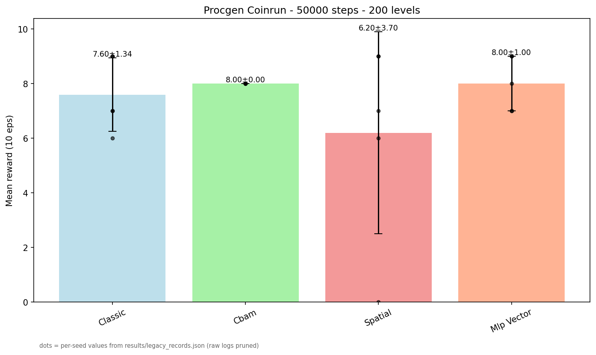
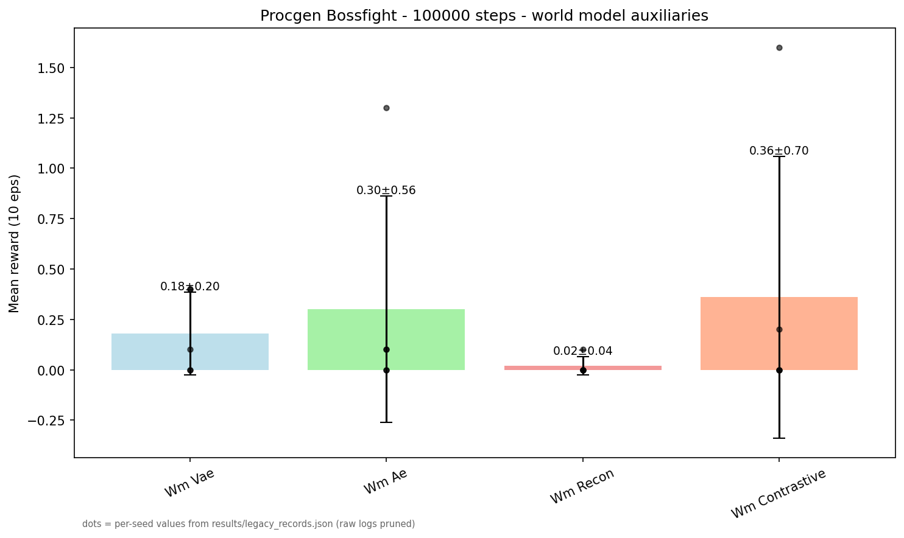
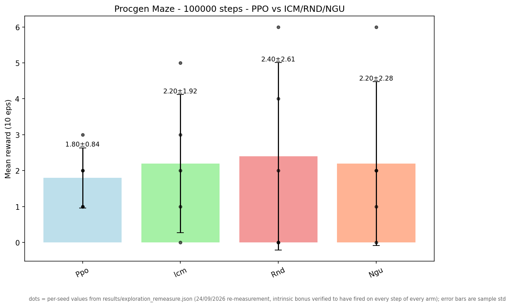
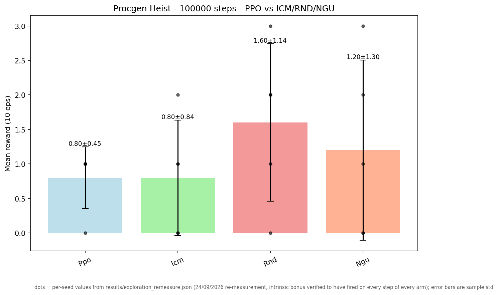
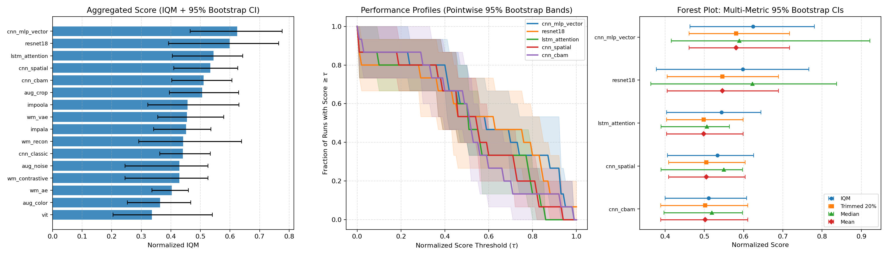

# Figures and Videos

> Part of the study's documentation — start at the [README](../README.md). Sections 4 and 8. Section numbers are the README's original ones, so every `§x.y` reference in the code, tests and other pages still names the same section.

## 4. Figures and Videos

All generated visual artifacts and figures are versioned under `results/`.

**Provenance (added 23/09/2026 — previously no figure had a stated producer):**

| Figures | Drawn by | Data source | Rebuildable today |
|---|---|---|---|
| `results/games/*.gif` — the 8 reference clips at the top of this README | `record_game_clips.py` | live Procgen env (uniform random policy, seed 42), recorded in `results/games/clips_provenance.json` | yes — the script re-renders all eight in ~2 min, and refuses to write a clip whose frames do not vary |
| `results/agent_dashboard.gif` / `.mp4` — the panel-by-panel recording of one trained policy | `record_dashboard_video.py` | `logs_audit/models/coinrun_classic.zip` (git-ignored; the section 5 command re-trains it in ~10 min) + the response number it prints, from `results/suite_validity_coinrun_control.json` | yes, given the checkpoint — and the script refuses to label a policy as reading its observation without an audit row to say so |
| `results/models/*.zip` + `*_repro.json` — the **key-cell checkpoints** of the diagnostic arc (14/10/2026): the four anatomy cells (`vit`/bossfight, `vit`/dodgeball, `impoola`/bossfight, `mlp_vector`/dodgeball), the two reader references (`classic` on bossfight and dodgeball), and the two rescue cells (`mlp_scaled` on both games) | `diagnose_policy_saturation.py --save-model` (section 5 command) | each zip's companion `*_repro.json` reproduces the committed probe artifact's final row **bitwise on all 8 cells** — so the zip is provably the model behind the published number | yes — one solo run per cell re-derives both; the bitwise equality is asserted in `tests/test_key_cell_checkpoints.py` |
| `coinrun_50k_cnn_vs_mlp.png` (4.1), `bossfight_100k_world_models.png` (4.2) | `report_figures.py` | `results/legacy_records.json` (per-seed values of the pruned runs) | ✅ `py -3.10 report_figures.py` |
| `rliable_profile.png` (4.9) | `run_rliable_eval.py` | `results/eval100_results.json` + `results/random_baselines.json` | ✅ `py -3.10 run_rliable_eval.py` |
| `symbolic_regression_*.png` (21.3–21.5) | `symbolic_regression.py` | `jax_port/cells_summary.json` → `results/symbolic_regression.json` | ✅ `py -3.10 symbolic_regression.py` |
| `suite_*` (4.3), `bossfight_hard_100k.png` (4.4), `new_archs_*` (4.5), `maze_heist_*` (4.6), `global_16.png` (4.7) | `compare_suite.py`, `compare_bossfight_hard.py`, `compare_new_archs.py`, `compare_maze_heist.py`, `compare_combined.py` | their `logs_*/<run>/` directories, which are git-ignored and were pruned | ❌ needs the benchmark re-run (commands in section 5); the files below are the originals from those runs — and their rankings are the state-independent policies of §3.6.2, so they stand as the archived record, not as architecture results |

`py -3.10 report_figures.py --check` fails if this README embeds a figure that is not in the repository, or one with no recorded producer in the table above. It runs as a step in `.github/workflows/tests.yml` and is asserted again in `tests/test_report_figures.py`, so a figure can no longer drift away from its data silently. Regenerating 4.1/4.2 in place reproduces the same means and per-seed values; the error bars are sample standard deviations (`ddof=1`, matching section 3.8) and therefore slightly wider than the population standard deviations quoted in section 7.

### 4.1. Coinrun 50k — CNN vs MLP (With/Without Vision)


### 4.2. Bossfight 100k — World Models


### 4.3. Suite 100k — 3 Games × 11 Architectures

> ⚠️ **Archived ranking (§3.6.2–3.6.5):** these runs trained under the single-stream `1×256` recipe, and the audit measured every re-run of that recipe as producing state-independent policies — the bars are the historical record, not an architecture result.
| Bossfight | Starpilot | Dodgeball |
|---|---|---|
|  |  |  |

### 4.4. Bossfight HARD 100k — Stress Test

> ⚠️ **Archived ranking (§3.6.2–3.6.5):** these runs trained under the single-stream `1×256` recipe, and the audit measured every re-run of that recipe as producing state-independent policies — the bars are the historical record, not an architecture result.


### 4.5. New Archs 100k — 5 New Architectures × 3 Games

> ⚠️ **Archived ranking (§3.6.2–3.6.5):** these runs trained under the single-stream `1×256` recipe, and the audit measured every re-run of that recipe as producing state-independent policies — the bars are the historical record, not an architecture result.
 |  | 

### 4.6. Maze+Heist 100k — PPO vs ICM/RND/NGU

> ⚠️ **Archived ranking (§3.6.2–3.6.5):** these runs trained under the single-stream `1×256` recipe, and the audit measured every re-run of that recipe as producing state-independent policies — the bars are the historical record, not an architecture result.
 | 

### 4.7. Global 16 — 3-Game Average

> ⚠️ **Archived ranking (§3.6.2–3.6.5):** these runs trained under the single-stream `1×256` recipe, and the audit measured every re-run of that recipe as producing state-independent policies — the bars are the historical record, not an architecture result.


### 4.8. Videos

Side-by-side behavioral videos are generated on demand (`visualize_side_by_side.py`) — `bossfight` with **dreams** (`top=real`, `bottom=dream()` from `VAE/AE/Recon`; Contrastive renders `no dream`) and `coinrun` with agents side-by-side. Requires `.zip` checkpoints produced during training:
```powershell
py -3.10 visualize_side_by_side.py --benchmark world_models --game bossfight --log_dir ./logs_world_models --mode mp4 --out results/bossfight_dreams.mp4 --steps 600 --device cuda
py -3.10 visualize_side_by_side.py --benchmark procgen --game coinrun --log_dir ./logs_procgen --mode mp4 --out results/coinrun_side_by_side.mp4 --steps 600 --device cuda
```
### 4.9. RLiable Performance Profiles (NeurIPS 2021)


## 8. Videos

Rendered on demand via `visualize_side_by_side.py` (commands documented in section 4.8): `bossfight_dreams.mp4` (World Models with reconstructed dreams) and `coinrun_side_by_side.mp4` (CNN vs MLP side-by-side rollout). Output is formatted as `.mp4` with `128×128` panels per agent stacked horizontally (`hstack`) at `15 FPS`; latent decoding (`dream()`) implemented for `VAE/AE/Recon` (`models/world_model_extractors.py` `dream()` `deconv`), while `Contrastive` displays `no dream`. Requires `.zip` checkpoints produced during benchmark runs.

> **Video formats:** `results/games/*.gif` (8 reference clips, added 11/10/2026, 4.5 MB total) are the only moving images committed. There is still no `.mp4` in the repository's history: GitHub does not play an mp4 referenced from repo files, so the committed format is the one that actually renders in the README. The only committed dream artifacts are `jax_port/dreams/bossfight_dreams.gif` and `jax_port/dreams/dreamer_imagined.gif`. Note also that until the 23/09/2026 extractor fix, `AEExtractor.dream()` decoded through a second encoder branch that `forward()` never used, so an "AE dream" panel from the old code visualized an untrained path; a failed decode now renders a panel labelled `dream unavailable` instead of an unlabeled black frame.
