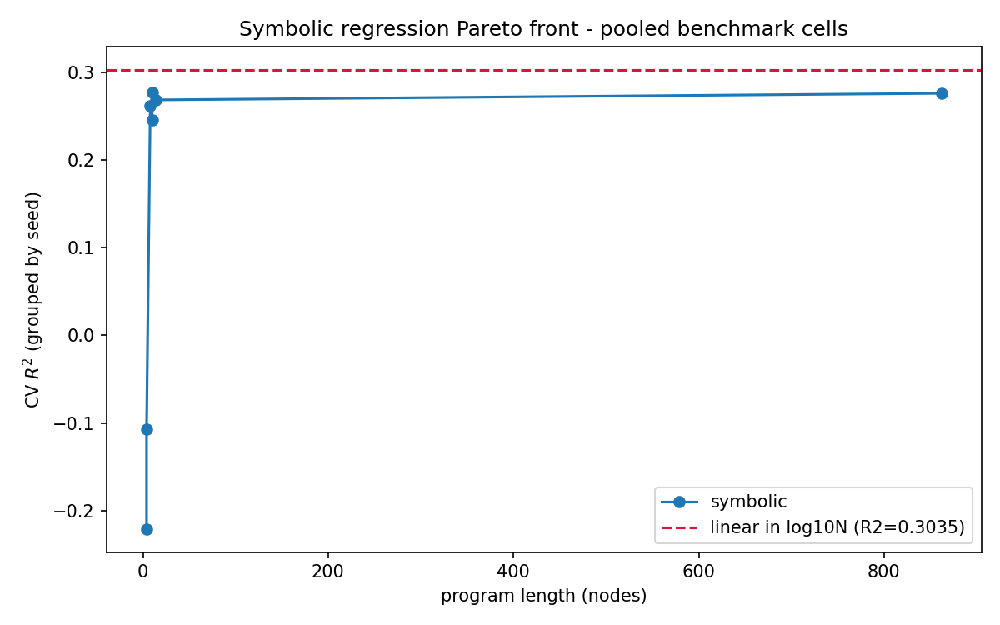
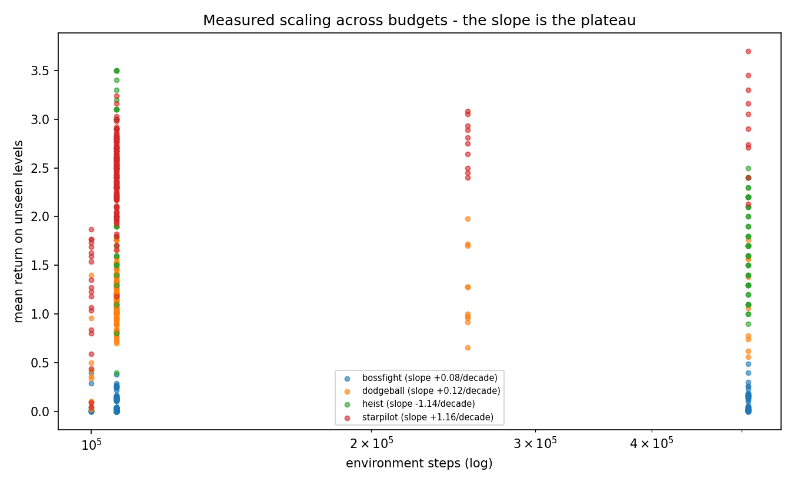
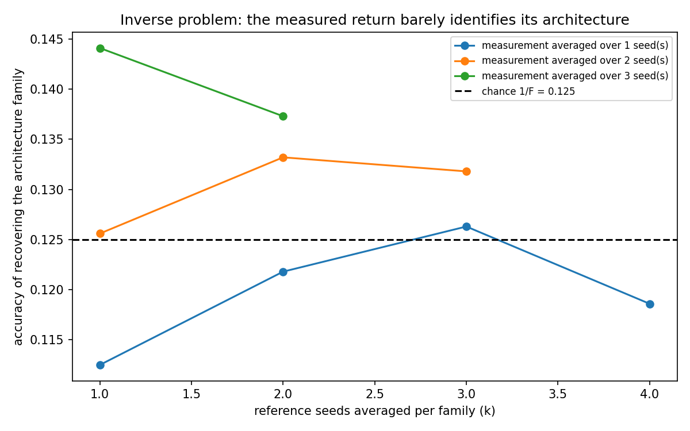

# Symbolic Regression as System Identification of the Benchmark

> Part of the study's documentation — start at the [README](../README.md). Section 21. Section numbers are the README's original ones, so every `§x.y` reference in the code, tests and other pages still names the same section.

## 21. Symbolic Regression as System Identification of the Benchmark (`symbolic_regression.py`)

Sections 3 and 15 report **what was measured**. This section asks the inverse question: is there a short closed-form law over the protocol variables that reproduces those measurements, and can it be used backwards — to recover the hidden configuration from an observed return, or to infer the budget a target return implies?

That is a system-identification problem in the standard sense: the data are outputs $R_{i,j}$ of an unknown generator $f(\text{protocol}) + \varepsilon$ observed at configurations $i$ and seeds $j$, and the object of interest is $f$ itself rather than a prediction. The engine is **gplearn 0.4.2** genetic symbolic regression; the inputs are the **825 executed cells** already committed in `jax_port/cells_summary.json`. Nothing in this section is simulated — every row is a measurement the grid produced (§15.4).

### 21.1. Data, Support and Leakage Controls

| Control | Value |
|---|---|
| Rows | 825 cells (of 865 non-MARL; the 40 `hrl` cells are excluded because they were logged without a budget) |
| Games with budget variation | `bossfight` (235), `starpilot` (170), `dodgeball` (160), `heist` (120) |
| Games without any budget variation | `coinrun` (20), `maze` (70), `jumper` (50) — excluded from every scaling fit |
| Distinct budgets measured | 57 344 / 100 000 / 106 496 / 253 952 / 507 904 |
| Cells at the modal budget (106 496) | 625 / 825 = **75.8 %** |
| Widest within-game budget span | 5.08× |

Two controls are enforced in code rather than asserted in prose:

1. **No target leakage.** `gen_gap` is `train − unseen` and therefore contains the target; it is never a feature. `tests/test_symbolic_regression.py::test_design_matrix_never_reads_the_measured_return` asserts this directly by perturbing every `ret` value and requiring the feature matrix to be bit-identical afterwards.
2. **Grouped cross-validation.** All metrics come from `GroupKFold` **by seed**, so seed 42 never appears in both the fit and the test split of the same configuration. Unshuffled CV over rows would have leaked seed-level repetition into every score.

The support figure bounds the interpretation of everything that follows: this was a **configuration sweep, not a budget sweep**. Any slope on $\log_{10} N$ reported here is a local gradient fitted over a narrow span, not a scaling exponent tested across decades.

### 21.2. Search Configuration

Population 1000, 40 generations, tournament size 20, crossover 0.7, subtree/hoist/point mutation 0.1/0.01/0.1, mean-absolute-error fitness, parsimony coefficient 0.005, constant range $[-1, 1]$, `random_state = 0`. Function set: `add, sub, mul, div, log, sqrt, abs, neg, bpow`, with every partial function protected (`div` returns 1 unless $|x_2| > 10^{-10}$; `log` is $\log(|x| + 10^{-12})$; `sqrt` is $\sqrt{|x|}$; `bpow` clips its exponent to $[-3, 3]$) — gplearn rejects unary functions that are not closed over the negatives its own search produces.

Baselines are evaluated on the **same two feature sets** as the symbolic fit, because a symbolic model given fewer inputs than its competitors cannot lose informatively:

- `protocol` = $[\log_{10} N,\ \text{hard},\ \text{memory}]$
- `protocol+game` = `protocol` + one indicator per game (7 levels)

### 21.3. P1 — Recovering the Forward Law

Cross-validated $R^2$ and MAE over the 825 pooled cells:

| Model | Features | CV $R^2$ | CV MAE | Program |
|---|---|---:|---:|---|
| mean-only null | — | −0.0003 | 1.268 | — |
| linear in $\log_{10}N$ | protocol | 0.3035 | 1.002 | — |
| quadratic in $\log_{10}N$ | protocol | 0.3110 | 0.998 | — |
| random forest (300 trees) | protocol | 0.4434 | 0.902 | — |
| **symbolic** | protocol | **0.2773** | 0.998 | 10 nodes / depth 3 |
| mean-only null | — | −0.0003 | 1.268 | — |
| linear in $\log_{10}N$ | protocol+game | 0.8869 | 0.343 | — |
| quadratic in $\log_{10}N$ | protocol+game | 0.8957 | 0.307 | — |
| random forest | protocol+game | **0.9121** | 0.280 | — |
| **symbolic** | protocol+game | **0.7381** | 0.503 | 9 nodes / depth 4 |

Paired bootstrap over 2000 resamples of the squared error, $P(\text{symbolic} \succ \text{linear})$: **0.0215** on `protocol` and **0.0000** on `protocol+game`. Under identical features, identical folds and identical targets, symbolic regression does **not** beat the linear-in-log law that scaling analysis assumes by default — it is beaten by it.

The recovered pooled law over `protocol` is

$$\hat{R} = 2\,\text{memory} + 0.103 - \frac{\text{memory}}{\text{hard}}$$

and the result worth stating plainly is what is **absent**: the search had $\log_{10} N$ available in every tournament and discarded it. The surviving terms are the memory-backbone indicator and its interaction with difficulty — memory backbones carry about $+2$ return in `easy`, and that advantage is cancelled when `hard` is set. This is a *description of the measured grid*, not a scaling law.

Given the game indicators as well, the search returns

$$\hat{R} = \sqrt{\;\text{game\_maze}\cdot\log(\text{game\_bossfight}) + \sqrt{\log(\text{game\_bossfight})}\;}$$

which is a 9-node way of saying something weaker than it looks: with one-hot game inputs the tree mostly partitions on game, and the two games it names are the two whose returns sit furthest from the pooled mean. Neither expression is offered as a law to extrapolate with — 21.6 is where the cost of trying is measured.



The complexity–accuracy front (parsimony sweep) shows the same thing from the other side:

| Parsimony | Nodes | Depth | CV $R^2$ |
|---:|---:|---:|---:|
| 0 (none) | 862 | 67 | 0.2764 |
| 0.001 | 14 | 6 | 0.2689 |
| **0.005** | **10** | **3** | **0.2773** |
| 0.01 | 10 | 3 | 0.2457 |
| 0.02 | 8 | 3 | 0.2625 |
| 0.05 | 4 | 2 | −0.1072 |
| 0.1 | 4 | 2 | −0.2213 |

A 10-node program is as accurate as an 862-node one, and below 8 nodes the fit becomes worse than the mean-only null. There is no accuracy to be bought with complexity here, which is the signature of a search over data whose variance is not a smooth function of the supplied inputs.

### 21.4. P1 per Game — the Plateau, Measured

Fitting return against $\log_{10}$ budget within each game gives the quantitative version of section 3.13's "curves plateau" statement. The slope is **return per decade of environment steps**:

| Game | Cells | Budgets measured | Slope (return/decade) | CV $R^2$ linear | CV $R^2$ symbolic | $P(\text{sym} \succ \text{lin})$ |
|---|---:|---|---:|---:|---:|---:|
| `bossfight` | 235 | 100 k, 106 k, 508 k | **+0.079** | 0.0316 | −0.0993 | 0.017 |
| `dodgeball` | 160 | 100 k … 508 k | **+0.121** | −0.0405 | −0.0525 | 0.178 |
| `starpilot` | 170 | 100 k … 508 k | **+1.155** | 0.1043 | 0.0580 | 0.133 |
| `heist` | 120 | 106 k, 508 k | **−1.137** | 0.2548 | 0.2977 | **0.973** |
| `coinrun`, `maze`, `jumper` | 20 / 70 / 50 | single budget | not estimable | — | — | — |

Three readings follow. In `bossfight` and `dodgeball` the slope is indistinguishable from flat, and the symbolic search returned a **constant** in both ($0.008$ and $0.929/0.801$ respectively) — it found no budget dependence whatsoever, and the negative CV $R^2$ says even that constant generalises poorly across seeds. `starpilot` is the only game with a substantial positive slope ($+1.155$ per decade), recovered symbolically as $\hat{R} = 0.480 \log_{10} N$. `heist` has a **negative** slope — the higher-budget cells score lower — and is the single case where the symbolic fit beats the linear one ($P = 0.973$), returning $-0.952 + \log(\log_{10}N) - \text{hard}$; with two budgets and a descending mean this is best read as the 106 k cells being the better of two configurations rather than as a budget effect.



### 21.5. P2 — the Inverse Problem: Is the Architecture Identifiable from its Return?

The hidden parameter is now the **configuration family** that generated a cell. Within one stratum $(\text{game}, \text{suite}, \text{budget})$ the protocol is identical for every cell, so the only observable left is the measured return. The reference profile of each family is built by averaging $k$ seeds; the query is a return averaged over $j$ held-out seeds. Recovery is scored against the $1/F$ chance level.

| Stratum | Families $F$ | Chance $1/F$ | Accuracy at $k{=}1$ | Accuracy at $k{=}4$ | Wilson 95 % CI ($k{=}4$) |
|---|---:|---:|---:|---:|---|
| `bossfight` / `hard` | 6 | 0.167 | 0.158 | 0.200 | [0.095, 0.373] |
| `bossfight` / `main` | 9 | 0.111 | 0.094 | 0.222 | [0.125, 0.363] |
| `dodgeball` / `main` | 9 | 0.111 | 0.133 | **0.289** | [0.177, 0.434] |
| `starpilot` / `main` | 9 | 0.111 | 0.128 | 0.200 | [0.109, 0.338] |

Pooled across strata, as a function of how many seeds the reference averages ($k$) and how many the measurement averages ($j$):

| Reference seeds $k$ | $j{=}1$ | $j{=}2$ | $j{=}3$ |
|---:|---:|---:|---:|
| 1 | 0.133 | 0.145 | 0.152 |
| 2 | 0.155 | 0.141 | 0.157 |
| 3 | 0.172 | 0.173 | — |
| 4 | **0.203** | — | — |



**A single measured return barely identifies the architecture that produced it.** At $k{=}1, j{=}1$ — the situation of anyone reading one benchmark number — accuracy is 0.133 against a chance level of 0.111–0.167. The best cell of the grid, $k{=}4, j{=}1$ at 0.203, still overlaps chance for the $F{=}6$ stratum. Accuracy improves monotonically in $k$ (cleaner reference profiles) and only weakly in $j$ (a less noisy query), which locates the loss precisely: **the between-family differences at this budget are smaller than the between-seed noise within a family.**

This is the identifiability counterpart of section 3.8's "no top-1 vs top-2 difference is statistically significant with 5 seeds", and it is the stronger statement: it is not that the ranking cannot be *tested* at $n{=}5$, but that the generating configuration cannot be *recovered* from a single run at all. The degenerate "always predict the lowest-mean family" heuristic scores a constant 0.111 / 0.167 — exactly $1/F$ — confirming the chance floor is computed correctly.

*Caveat, stated rather than hidden:* the $(\text{reference}, \text{measurement})$ splits within a stratum reuse seeds, so the $n \le 3960$ predictions are not independent draws and the Wilson intervals are optimistic. They are reported as a spread indicator, not as a confirmatory test.

### 21.6. P3 — Inverting the Law for Budget

Solving the fitted within-game line for the budget a target return implies, and comparing against the cell that actually achieved it:

| Game | Target return | Budget implied by the law | Budget of the cell that achieved it | Ratio | Inside measured support? |
|---|---:|---:|---:|---:|---|
| `starpilot` | 3.70 | 1 816 622 | 507 904 | 3.58× | no |
| `bossfight` | 0.49 | 41 301 266 431 | 507 904 | 81 317× | no |
| `dodgeball` | 1.98 | 1 203 205 443 903 | 253 952 | 4 737 925× | no |

**No inversion lands inside the budget span that was actually measured**, so under the support criterion zero of the three estimable games is budget-identifiable. The best returns in `bossfight` and `dodgeball` are not high-budget returns, and a monotone line fitted to budget cannot reach them without extrapolating by five to six orders of magnitude. Those numbers are reported to make the extrapolation visible, not as predictions: a law fitted over a 5× span has no authority at $10^{12}$ steps.

This is the same conclusion as section 3.13's budget-scaling experiment — a 5× budget "neither created nor eliminated an advantage" — reached from the opposite direction: not by running more steps, but by asking what the fitted line implies.

### 21.7. Threats to Validity

1. **Support.** 75.8 % of cells sit at one budget and the widest within-game span is 5.08×. Every slope on $\log_{10} N$ here is a local gradient of a curve measured over less than one decade. A genuine scaling study needs decades of budget, which section 3.13 began and this section does not extend.
2. **Game identity is not a discovery.** $R^2$ rising from 0.30 to 0.89 when game indicators are added says that `maze` returns and `bossfight` returns live on different scales. That is expected, and its only use is as a control: it bounds how much the *protocol* variables can explain once scale is absorbed.
3. **Family granularity is a modelling choice.** `FAMILY_OF` maps the **40 configurations** present in the 825 rows onto **15 families** (`cbam`/`spatial` → `cnn_attention`, `impala`/`impoola`/`resnet18` → `cnn_deep`, `curl`/`cpc`/`acl`/`contrastive` → `contrastive`, …); the dictionary carries 44 entries, of which a few belong to suites not analysed here. An unmapped configuration raises rather than being dropped, so the mapping cannot silently drift as suites grow. Coarser grouping raises the identifiability ceiling in P2 — with $F = 15$ overall but $F = 9$ inside the largest stratum — and the mapping is declared in the script, not inferred.
4. **Search stochasticity.** gplearn is seeded (`random_state = 0`) and the study was executed twice from the same committed inputs: every metric of P1 (pooled and per game), P2 and the Pareto sweep reproduced **identically** — the only differences between the two artefacts were cosmetic (feature labels and one rendered equation). The numbers above are therefore from a reproducible run, not a lucky draw. Re-running with a *different* seed is expected to explore another part of the same plateau rather than find a better law, and the Pareto sweep of 21.3 is the evidence for that claim: 862 nodes buy nothing over 10.
5. **Version drift between stacks.** The 825 cells were produced by the JAX port; port-vs-SB3 parity is documented in section 15. This section describes the port's grid, and the SB3 study's tables in sections 3 and 7 are deliberately not mixed into it.

### 21.8. Artifacts and Reproduction

| Artifact | Content |
|---|---|
| `symbolic_regression.py` | producer: loads the committed cells, runs P1/P2/P3 and the Pareto sweep, draws the three figures |
| `results/symbolic_regression.json` | every number in this section, with `_provenance` (engine versions, search settings, budget support, leakage guard) |
| `results/symbolic_regression_pareto.png` | nodes vs CV $R^2$, with the linear-in-$\log_{10}N$ reference line |
| `results/symbolic_regression_scaling.png` | measured return vs budget per game, with the fitted per-decade slope |
| `results/symbolic_regression_identifiability.png` | P2 recovery accuracy vs reference seeds, with the $1/F$ chance line |
| `tests/test_symbolic_regression.py` | 11 tests: the no-leakage assertion, family-map completeness, Wilson interval behaviour, and a real gplearn fit that fails CI if the gplearn/scikit-learn interface drifts again |

```
py -3.10 symbolic_regression.py            # full study (search: 1000 x 40)
py -3.10 symbolic_regression.py --quick    # small search, for a fast local check
```

Dependencies are pinned in `requirements.txt`: `gplearn==0.4.2` with `scikit-learn==1.5.2`. The cap is not cosmetic — gplearn 0.4.2 calls an estimator helper that scikit-learn removed in 1.6, so with a current sklearn `SymbolicRegressor.fit` raises `AttributeError` instead of searching. That failure is caught by the CI test above rather than mid-study.
